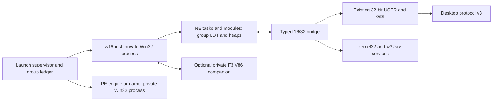

# F5 Win16 subsystem contract

Date: 2026-10-14. Directive: [f5-19 contract](../directives/f5-19-win16-subsystem-contract.md).
Status: proposed contract for lead review and the required independent Codex
cross-review; **no permission to start f5-19 runtime code is implied**.
This milestone changes documents only. No NE execution, original installer
completion, QEMU result, hardware result or measured memory budget is claimed.

## 1. Authority and scope

The owner reaffirmed complete Win16 support inside F5 on 2026-10-14 in
[the Win32 contract's evening decisions](win32-personality-contract.md#decisions-of-2026-10-14-owner-evening-after-the-cross-review-and-the-research).
This contract implements that direction and cross-review M06. **Full Win16
means a real protected-mode NE execution environment with KERNEL, USER and
GDI services, heaps, cooperative tasks and callbacks.** Its initial acceptance
surface is established by original period installers and authored programs;
it is not a claim that every Windows 3.x application already works.

Once reviewed, the requirements below are mandatory in F5. MUST/SHOULD/MAY
have the meaning used by [the Win32 contract](win32-personality-contract.md).
Explicit CiukiOS policies below are design choices, not descriptions of
Microsoft internals or measured capacities.

This amendment supersedes N3/W24's blanket NE refusal, N10's exclusion of
the thunks needed here, and the earlier research note's proposal to defer
full Win16 until after installer replacement. Earlier text remains historical.
PE32 continues to execute as ordinary Win32 processes. DOS programs retain
the F3 personality. An NE file is not the DOS stub preceding a PE header.

In scope: Windows-targeted i386-compatible 16-bit NE EXEs/DLLs, ordinal and
named imports, NE resources, self-loading Windows modules, original Win16
installer launchers/engines and their Win32 children. Windows 3.1 and Windows
95/98 user API behavior is the reference where applicable. Neither OS/2 NE
execution, Win32s as a hosted OS, a binary Microsoft KRNL386/USER/GDI, VxDs,
binary device drivers nor direct hardware access is required or permitted.
The Win32 contract's driver, copy-protection, MSI and networking boundaries
remain applicable. Legitimate unsupported requests need named failures.

Recognized-installer substitution and host extraction MAY assist diagnosis,
but MUST NOT replace either the Worms or IS3 original execution gate. The
original entry point, NE helpers and actual selected engine must execute.
There is no silent fallback to a downloaded replacement SETUP.EXE.

## 2. Research record and resulting decisions — 2026-10-14

Primary documents were researched before this contract was written. Mirrored
Microsoft manuals/articles below retain Microsoft authorship; Wine sources
are upstream implementation evidence, not Windows conformance authority.
Wine **10.0** is a fixed, accessible source reference for this research, not
the shipping Wine pin: f5-14A owns that pin and the dependency/license audit.
No claim is made to have read an inaccessible scan or a proprietary IS3 manual.

| Source, location consulted | Established behavior and CiukiOS decision |
| --- | --- |
| Microsoft, [Windows 3.1 SDK Programmer's Reference, Volume 4: Resources](https://www.bitsavers.org/pdf/microsoft/windows_3.1/Windows_3.1_Programmers_Reference_Volume_4_Resources_1992.pdf), chapters 6–7; [SDK Getting Started](https://bitsavers.computerhistory.org/pdf/microsoft/windows_3.1/Microsoft_Windows_3.1_SDK_1992/PC28914-0492_Windows_3.1_SDK_Getting_Started_199204.pdf), manual descriptions | Period authority for executable/resource formats and the API reference volumes. The scan was indexed but its full text could not be fetched in this session. Reconcile exact 3.1 fields against a readable copy in 19a; the following accessible Microsoft appendix and Wine code provide the independently inspected format baseline. |
| Microsoft Press, [MS-DOS Encyclopedia, Appendix K: Segmented (New) EXE File Header Format](https://www.pcjs.org/documents/books/mspl13/msdos/encyclopedia/appendix-k/) | Documents NE tables, alignment, segment lengths, imports/exports and fixups. Use explicit field decoding and test the distinction between file-relative and header-relative offsets; do not cast disk data to host structs. This earlier format description does not settle every 3.1/9x extension. |
| Microsoft, [Windows 3.1 DDK Installation and Update Guide](https://www.bitsavers.org/pdf/microsoft/windows_3.1/Microsoft_Windows_3.1_SDK_1992/PC29131-0392_Windows_3.1_Device_Driver_Kit_Installation_Mar92.pdf), introduction; [Windows DDK Virtual Device Adaptation Guide](https://www.pcjs.org/documents/books/mspl13/win/w3ddkvxd/), ch. 16; MSDN, [What's New in Windows 95 for VxD Writers?](https://techshelps.github.io/MSDN/TECHART/html/msdn_chicvxd.htm) | The 3.1 guide identifies the DDK's separate device/virtual-device manuals; the accessible 3.0 DDK and 95 architecture article explain the VMM/System VM boundary. Reuse CiukiOS isolation and virtual devices, not Windows binary drivers. Do not present the 3.0 transcription as a newly inspected 3.1 architecture manual. |
| Matt Pietrek, [Happy 10th Anniversary, Windows](https://learn.microsoft.com/en-us/archive/msdn-magazine/2000/july/under-the-hood-happy-10th-anniversary-windows), modes, memory and threading | KRNL286/KRNL386 differ underneath the Windows API; 16-bit selectors and shared heaps do not supply USER/GDI. Cooperative applications give up execution at API boundaries. CiukiOS recreates those observable semantics inside an isolated group, without the 9x globally writable system arena. |
| Pietrek, [Direct Thunking in Windows 95](https://jacobfilipp.com/DrDobbs/articles/DDJ/1996/9614/9614c/9614c.htm), adapted from *Windows 95 System Programming Secrets*; [book excerpt](https://ftp.st.ryukoku.ac.jp/pub/published/oreilly/windows/win95.update/dirty.html) | Describes bidirectional internal thunks and the Win16Mutex consequences. Use a group-local execution token; never a desktop-wide lock. Undocumented quick-thunk addresses are not a portable ABI to copy. These are consulted book excerpts, not a claim to have inspected the complete book. |
| Microsoft, [KB Q154093: calling 32-bit code from 16-bit code on Windows 95/98/ME](https://ftp.zx.net.nz/pub/archive/ftp.microsoft.com/MISC/KB/en-us/154/093.HTM); [Programmer's Guide to Windows 95](https://www.bitsavers.org/pdf/microsoft/windows_95/Programmers_Guide_to_Microsoft_Windows_95_1995.pdf), article 32, Thunk Compiler | Flat thunking uses paired 16/32 modules and explicit marshaling; it differs from NT generic and Win32s universal thunking. Our own system bridge has a typed, generated table. Binary third-party thunk formats require a separate census entry and tested connector; an internal bridge alone does not establish their compatibility. |
| DPMI Committee, [DPMI 1.0](https://openwatcom.org/ftp/devel/docs/dpmi10.pdf), ch. 2 and appendix C | 0.9 clients in one VM share an LDT and width convention; 1.0 changed client contexts. Neither defines Win16 scheduling or Windows APIs. Keep F3's advertised 0.9 behavior, including 1.0 refusals; a flat 32-bit implementation helper is not a second 32-bit DPMI client. |
| Wine 10.0, [winevdm launcher](https://raw.githubusercontent.com/wine-mirror/wine/wine-10.0/programs/winevdm/winevdm.c), [NE module manager](https://raw.githubusercontent.com/wine-mirror/wine/wine-10.0/dlls/krnl386.exe16/ne_module.c) | Separates launch/classification and NE module/task management. Use that separation as a design reference; do not import Wine's host-specific launcher or DOSBox backend into CiukiOS. |
| Wine 10.0, [NE segment loader](https://raw.githubusercontent.com/wine-mirror/wine/wine-10.0/dlls/krnl386.exe16/ne_segment.c), `apply_relocations`, `SELFLOADHEADER`, `NE_LoadAllSegments` | Distinguishes relocation target/width/additive forms and the self-loader's BootApp/LoadAppSeg protocol. Implement explicit bounded paths and a self-loader fixture; never assume all NE payloads are ordinary stored segments. Wine's permissive missing-import behavior is not our error policy. |
| Wine 10.0, [global heap](https://raw.githubusercontent.com/wine-mirror/wine/wine-10.0/dlls/krnl386.exe16/global.c), [local heap](https://raw.githubusercontent.com/wine-mirror/wine/wine-10.0/dlls/krnl386.exe16/local.c) | Handles, selectors, lock counts and DS-relative local heaps need separate representations. Do not implement Win16 allocation by truncating Win32 heap pointers. |
| Wine 10.0, [KERNEL export specification](https://raw.githubusercontent.com/wine-mirror/wine/wine-10.0/dlls/krnl386.exe16/krnl386.exe16.spec), [USER specification](https://raw.githubusercontent.com/wine-mirror/wine/wine-10.0/dlls/user.exe16/user.exe16.spec) | Ordinals, equate exports, Pascal/register conventions and return widths are API-specific. Use tables checked against period headers/import libraries, not Win32 export numbers. |
| Wine 10.0, [USER message conversion](https://raw.githubusercontent.com/wine-mirror/wine/wine-10.0/dlls/user.exe16/message.c), [GDI bridge](https://raw.githubusercontent.com/wine-mirror/wine/wine-10.0/dlls/gdi.exe16/gdi.c) | Messages, callbacks, handles and graphics structures need conversion, not pointer casts. The Win32 USER/GDI services stay the sole windowing/drawing backend. |
| Microsoft, [Application Installation on 64-bit Systems](https://learn.microsoft.com/en-us/windows/win32/winprog64/application-installation) | Documents recognized 16-bit installer replacement, including InstallShield 5.x. This is evidence about substitution, not general NE execution or a license to redistribute Microsoft installer replacements. Q3 requires more. |
| InstallShield/Revenera, [Setup.exe command-line parameters](https://community.revenera.com/s/article/what-command-line-parameters-are-available-for-setup-exe) | Documents version-specific Professional 5.x arguments, CMDLINE and Setup.ini. Preserve original arguments and working directories. These vendor notes do not establish any particular IS3 engine architecture or a universal silent switch. |
| Open Watcom, [C/C++ Programmer's Guide](https://www.openwatcom.org/ftp/manuals/current/pguide.pdf), Windows and extended-DOS development | Provides an upstream fixture toolchain reference. Pin an exact release/archive, headers, tools and licenses in 19a; build source-owned Win16 fixtures, without Microsoft SDK binaries. |

**Research limits.** No accessible period IS3 engine manual or complete
original IS3 fixture was obtained. The repository research reports an IS5
Worms launcher and compressed engine, not a measured engine API closure.
The shell cannot resolve `archive.org` in this sandbox; the attempted media
HEAD request failed before transfer. No game payload was fetched or retained.
These gaps block an installer compatibility verdict and the final API-table
freeze, not this proposed contract. Their resolution is explicit work in
19a/19d, not an invented census result.

## 3. Repository comparison and F3 boundary

The following are source observations in this worktree, not newly executed
F3 evidence:

| Existing component | Observed implementation | Consequence |
| --- | --- | --- |
| [dos-dpmi-contract.md](dos-dpmi-contract.md), Kernel-owned DPMI 0.9 | One LDT per VM, same-width nested clients, validated ring-3 transitions, private vectors/callbacks; explicitly refuses 1.0-only rows. | The Win16 runtime is not an upgrade to a DPMI 1.0 host. |
| [dpmi_internal.h](../../src/kernel/vm/dpmi_internal.h) | 1,024 LDT entries, four nested DPMI clients, 16 real-mode callbacks/client, 32 transition records, 16 KiB locked protected stack. | These are existing F3 limits, not proposed Win16 task or USER callback limits. Do not silently enlarge them. |
| [dpmi.c](../../src/kernel/vm/dpmi.c), `dpmi_entry`, `dpmi_v86_int` | Opposite-width nested entry fails; discovery returns 0.90. `DOSVM_DPMI_PUBLIC` remains zero in [dpmi.h](../../src/kernel/include/ciuki/dpmi.h); explicitly enabled VMs can discover it. | Existing code is not proof of a publicly qualified Win16 host. Never flip the F3 discovery gate for F5. |
| [dpmi_desc.c](../../src/kernel/vm/dpmi_desc.c), `dpmi_desc_set`, `dpmi_ptr`, `dpmi_frame_check` | Descriptor encoding and range/frame checks exist, but pointer translation ends in `dosvm_range`; GDT flat-code/data cases are explicit. | Encoding/checking rules can be reused; the full DOS pointer helper cannot validate arbitrary Win32 memory. |
| [dosvm.c](../../src/kernel/vm/dosvm.c), `dosvm_range`, `dosvm_arch_switch` | Valid ranges are the private low-memory region and DOS pool; context switch loads this VM's LDT and debug registers or clears them. | Add a Win32-owned selector context in f5-03; do not fake a DOS VM or expand `dosvm_range` to cover all process pages. |
| [desktop.md](../desktop.md), v1/v2.1; [Win32 contract](win32-personality-contract.md), f5-09/10 | Current resize/surface protocol differs from planned v3 multiple-window USER/GDI integration. | NE windows wait for the reviewed v3 backend. No parallel Win16 compositor or new wire version is introduced here. |
| [f5-02A census record](win32-census/README.md) | The implemented census accepts PE32; period inputs and IS3/IS5 samples are absent-input records. | Extend census with a separately tested NE reader in 19a. Do not feed NE to the PE parser and interpret refusal as an empty import set. |

### 3.1 What remains untouched, what is additive

F3 DOS boot, VM ownership, disk overlays, A20/XMS/EMS, virtual devices,
INT 31h 0.9 dispatch, real-mode switching/callback protocol and their existing
limits MUST keep their current contracts. Their production tests remain
regressions. Existing DOS workloads must observe identical results.

Reuse descriptor encoding/validation rules and the existing architecture LDT
load primitive through a reviewed, shared internal layer where practical.
The **new Win32 adapter** supplies process-owned backing/range checks,
allocation accounting, selector mutation authority and continuation validation.
It cannot invoke DOS-specific helpers on an invented `struct dosvm`.
Any extraction of shared production helpers requires unchanged F3 tests and
lead review; it does not authorize a semantic rewrite of the F3 host.

Real-mode services that genuinely require F3 use a private companion DOS VM
owned by the same installation group, via bounded register/buffer RPC. Its
existing 0.9 host and V86 execution stay unchanged. Such a companion is
created on demand, never the user's unrelated DOS window. Section 8 defines
the bridge; protected NE USER callbacks do not use F3's real-mode slots.

## 4. Process, address-space and kernel handoff

**Decision W16-1.** One protected Win16 VM per **process group**. Here group
means an explicitly supervised launch tree for one installer/application,
with an opaque ID and generation, not an ambient system-wide WOW session or
just a reused PID/Unix process-group number. An unrelated NE launch gets a
different group. A launch descended from this group joins its existing host.

The group owns one `w16host` ordinary **win32 personality process**. All its
NE tasks/modules execute at CPL3, IOPL0 in that process's private address
space; their ordinary 16-bit segments have D/B=0. A flat 32-bit worker in
the same process implements KERNEL and typed USER/GDI adapters. PE engines
and games are separate Win32 processes with ordinary private address spaces.
The optional F3 companion is a separately isolated DOS VM, not a second
Windows instance or a globally shared Microsoft System VM.



All NE segments, heaps and bridge buffers are reservations below `0x70000000`
through f5-03/04's allocator, alongside guarded flat/16-bit stacks. They must
not overlap PE mappings, builtins at `0x70000000–0x7FFDFFFF`, TEB/PEB or
reserved/null regions. There is **no new fixed high-memory arena**, 9x shared
2–3 GiB region, physical mapping or exemption from Win32 accounting. Keeping
V86 low memory in the companion avoids weakening the Win32 null-page guard.
Selectors translate to linear addresses; they are not real-mode paragraphs.

Before f5-03's ABI freeze, its written handoff MUST specify:

| Capability / record family (symbolic, not assigned syscall numbers) | Required kernel invariant |
| --- | --- |
| Create/destroy Win16 context; attach the authorized execution worker | Only the group's owning host may mutate it; cleanup is possible without guest cooperation. Ordinary native/Win32 callers acquire no selector authority by setting a flag. |
| Allocate/free/set/query descriptor or contiguous descriptor run | Kernel owns LDT storage. Allow only owned user mappings and approved DPL3 code/data types; forbid gates, system descriptors, kernel/device ranges and address overflow. Validate both extent and page permissions. |
| Enter/resume a 16-bit continuation | Validate CS:IP, SS:SP, data segments, registered stacks, context generation, return token, EFLAGS and supported processor state; caller cannot install a privileged return. |
| Handle/continue faults in 16-bit code or during a bridge | Deliver a bounded mixed-context record to the host; invalid continuation, stale owner or dispatcher fault terminates this host/group. Do not walk a Win16 stack as an FS:[0] SEH chain. |
| Context switch / teardown | Switch LDT and FS/GS/debug/x87/SSE state consistently with F2/F3/f5-03; restore Win32 TEB FS before entering 32-bit DLLs. Never leave a dead LDT installed. |

These use version/size-checked `CIUKI_SYS_W32` extensions, not a new native
ABI or privileged user call gate. Exact wire layout belongs to the reviewed
f5-03 handoff; until it exists, no kernel implementation begins. DPMI remains
a distinct INT 31h path. A same-CPL transition to the flat helper is not a
new DPMI client and cannot work around the 0.9 mixed-client rule.

The protected Win16 context's INT 31h adapter must have a reviewed 0.9
service matrix: descriptor/alias operations on this host's LDT, charged
memory allocation/resize, owned vectors/exceptions, virtual IF, lock/query
semantics and the real-mode translation rows in §8.1. Refuse physical maps,
privileged descriptors and 1.0-only calls with the documented carry/error
behavior. A 16-bit guest that uses this interface must see a coherent 0.90
host; no mixed-width nested client is admitted. The new trap dispatch selects
the Win16 process context explicitly, while F3 DOS contexts retain their
existing dispatch. This is reuse of the 0.9 mechanisms behind a new backing
adapter, not a claim that `dpmi_int31(struct dosvm *, ...)` already accepts
ordinary Win32 processes.

Because NE and the flat runtime share one process, segmentation does not
protect the runtime from every guest access: writable aliases or flat user
selectors can reach that process's memory. The guaranteed isolation boundary
is the host process and its validated service endpoints, not individual NE
tasks or secrecy of runtime metadata. The kernel/desktop must treat every
message from this process as untrusted even when a helper generated it.

## 5. NE module loader

**Decision W16-2.** A pure bounded parser produces a load plan without
executing payload code. Instantiation/relocation and guest entry are separate
operations. The same production parser and relocator run under Linux tests
and in the personality. Every arithmetic operation involving file offsets,
shift counts, counts, allocations or selector runs is checked before use.

| Stage | Required behavior and refusal cases |
| --- | --- |
| Classify | Validate MZ, `e_lfanew`, complete NE header and Windows target/version flags. Distinguish PE, NE, DOS, LE/LX, OS/2, resources-only and drivers. Do not execute the DOS stub when a malformed NE fails validation. |
| Tables | Validate segment/module-reference/import-name/resource/entry tables, resident and nonresident names, their different offset origins and terminators. Keep import ordinal numbers even when a name can also be resolved. Entry bundles distinguish unused, fixed and movable entries. |
| Segment plan | Decode file offset/alignment, initialized length, minimum allocation, code/data, read-only/execute-only, movable/shareable, preload and discard flags. A zero stored length/minimum can mean 64 KiB; an absent file sector denotes zero-filled backing. Distinguish these meanings, zero tails and bounds-check iterated-data expansion. |
| Data and startup | Honor automatic data, single/multiple/no-data modules, instance-specific DGROUP, stack/heap reservations and initial CS:IP/SS:SP. Specify the compiler startup register contract, PSP/environment/command-tail view and `InitTask`/`InitApp` behavior against SDK/Open Watcom before entry. `WinMain` is reached through the program's startup code, not called with invented parameters. |
| Dependencies | Case-insensitive Windows module identities, deterministic builtin/app search with f5-05/06, imports by module index and name/ordinal, cycle-safe load states, module/instance use counts. `KERNEL`/`KRNL386`, `USER`, `GDI` resolve to our implementations, never shipped Microsoft system modules. Resource-only modules do not run entry code. |
| Initialization | Dependencies are prepared before guest initialization; invoke NE library initialization/termination according to module type and expected Windows version, including LibMain/WEP and applicable 9x entry semantics. Reentrant loads and initialization failure have transactional rollback and precise diagnostics. Never transplant PE DllMain ordering without checking the NE rules. |

### 5.1 Relocations, movement and resources

The relocator MUST distinguish internal fixed/movable targets, imported
ordinals, imported names and OS fixups; source forms include byte, selector,
16-bit offset and 16:16 far pointer. Decode and test the documented 32-bit
offset/16:32 forms when present; their presence does not turn an NE module
into a PE32 process. Additive fixups and linked source chains have different
rules. Read chain links before overwriting them, detect cycles, cap visits
by segment length and check every patch width, target index and target offset.
Unknown/unsupported fixups fail by type; recognized floating-point fixups
need an explicit x87 policy and fixture, not a blanket ignored-record rule.
Missing imports fail loading with the original module and ordinal/name.

Movable handles stay stable across moves; selector bases and any required
export/prolog fixups are updated only at safe points without active pinned
references. Discardable code/resources can be reloaded from immutable input
and relocated again; live stack/code, locked blocks and active callback
targets cannot be discarded. Data must never silently be recreated as zero
after a failed reload. Keeping all segments initially resident is a valid
development stage, not completion of the discard/reload fixture gate.

Resource access preserves integer/name IDs, resource-table alignment, types,
sizes and load/lock/free lifetimes. Translate **16-bit** dialog/menu/string,
bitmap/icon/cursor and version structures for existing 32-bit services.
There is no PE language-tree layout in an NE resource table. Resource
decompression and decoding must reject truncation and impossible dimensions.
Foreign fonts stay within the amended fonts contract and approved parser
boundary; a `.FON` NE container is not an executable entry request.

### 5.2 Self-loading modules

Self-loading is part of the subsystem, even if Worms' launcher does not use
it. The load plan records the flag and validated first-segment protocol.
19a must reconcile the period protocol with Wine's inspected
`SELFLOADHEADER` (`0x3041` version, BootApp, LoadAppSeg and supplied allocator/
entry/owner helpers). 19b implements it on a dedicated guarded stack through
the ordinary checked callback bridge. Header/version/entry validation occurs
before BootApp. Guest loaders receive virtual file handles and owned memory,
never raw VFS pointers or descriptor-table write access.

LoadAppSeg results must pass selector ownership, type, allocation and extent
checks before the segment becomes executable to the requesting task. Nested
loads, loader reentry, cancellation and failure unwind without retaining
runtime locks. An authored module must load a noninitial segment, call its
export and exercise failure/cleanup. Supporting an external SFX extractor
does not satisfy this test. Unknown self-loader protocols produce a named
unsupported-protocol error, not execution with ordinary segment assumptions.

## 6. Census and API surface

### 6.1 Current evidence, explicitly bounded

This is the NE application of [f5-02's census method](../directives/f5-02-pe-toolchain-fixtures-census.md).
The [2026-10-14 research](research/win32-layer-2026-10-14.md#3-import-census)
contains binary observations; the f5-02A matrix is deliberately provisional.
Do not overwrite either historical account. An observation of engine
packaging is not a measured list of APIs used by its decompressed engine.

| Acceptance input / chain | Evidence available now | Required census completion |
| --- | --- | --- |
| Worms Armageddon demo, gate 6, original ZIP | Prior research: `SETUP.EXE` NE, 59,904 bytes, SHA-256 **prefix only** `feb61b7f007c8857`; `_SETUP.DLL` and `_ISDEL.EXE` NE; `_INST32I.EX_` compressed engine and `data1.cab`. IS5 family identified, exact build and full member hashes unavailable here. | Hash and inspect every NE helper, decompress/observe the original selected engine, determine its PE/NE architecture, imports, dynamic loads, version and completion/uninstall chain. Do not assume `_INST32I.EX_` is NE or that its name proves a Windows 3.x engine. |
| Identified licensed InstallShield 3 fixture | No fixture or exact edition/build yet. IS3 can have different launcher/engine selections; the family label alone does not identify a 16-bit engine. | Pin source/license and full hashes for original launcher, true Win16 engine, script and helpers. Acceptance must exercise a real 16-bit engine, not only a 16-bit launcher spawning a 32-bit replacement. |
| Diablo, StarCraft, AoE, Half-Life (gates 1–4) | Prior PE census exists for some editions/components; complete NE child inventory not established. | Inventory every original installer/helper/uninstaller, including DX setup children. A PE outer image does not close nested NE coverage. |
| UT348, Heroes III, RCT, Jazz2, Total Annihilation (gates 5, 7–10) | Engine/child architecture incomplete in the provisional matrix; Heroes' family name is not a version pin. | Apply the same inventory; record `not inspected`, never `no NE imports`, until media and spawned/extracted children are checked. |
| NFS II SE reserve `NFS2SEA.EXE` | Prior research: NE PKZIP SFX containing `nfs2sea.exe`, `DSETUP.DLL`, `eacsnd.dll`. It is not IS3 evidence or an approved replacement for gate 6. | Census actual SFX imports/helpers if used as supplemental coverage. Run its original NE path for an NE execution verdict. |
| Source-owned Open Watcom corpus | Specified in §11; not built in this document milestone. | Known independent expected imports, relocations/resources and traces; supplies repeatable tests even before original media is available. |

### 6.2 Census procedure and closure rules

19a extends the tooling with a separately tested NE reader and a text/JSON
schema compatible with f5-02's PE records. For **each** setup entry, extracted
helper, selected engine, app DLL and uninstaller:

1. Bind workload/edition, parent archive and member path, full SHA-256, byte
   length, provenance/redistribution classification and extraction method.
   A prefix cannot authenticate input. Keep payloads local on disk; only
   sources and nonpayload metadata enter Git.
2. Record image kind, target/version/module flags, entry points, segment
   forms, self-load flag, resources, static imports by exact name/ordinal,
   exports/equates and architecture of every selected child. Imported-name
   tables and **relocation references** together determine NE imports.
3. Resolve ordinal labels against period SDK/import-library evidence and the
   pinned upstream `.spec`; retain the original numeric import and source
   of resolution. A Wine ordinal is a cross-check, not proof for all Windows
   versions. Preserve private engine DLLs as dependencies, not system APIs.
4. Track runtime `LoadLibrary`/`GetProcAddress`, shell/DDE, thunk connections,
   register-style DOS calls, callbacks and spawned processes across install,
   cancel, restart and uninstall. String scans are hints. Linux extraction
   or a reference Wine run assists discovery; only Ciuki execution closes
   the executed path's coverage.
5. Every reachable import/behavior gets a named owning directive, signature,
   implementation status and fixture. Unknown dynamic closure, missing media
   or an unused stub is reported separately. A static-import percentage alone
   is insufficient. Essential calls cannot be fake-success stubs.

The final export manifest MUST be reviewed before 19b/19c API freeze. Missing
media prevents claiming closure, but independent parser/fixture development
can proceed after contract review. The following is a **proposed minimum
implementation surface**, not a measured union of the absent installers.
Original census requirements extend it within approved scope; new product
scope goes back to the lead/owner.

### 6.3 KERNEL / KRNL386 compatibility exports

The implementation exports the **NE module name `KERNEL`**, with aliases and
original ordinals checked individually. `KRNL386.EXE` is a compatibility
identity, not a request to load Microsoft's kernel or any NT NTVDM component.

| Family | Minimum functions/behavior to specify and test | Backend |
| --- | --- | --- |
| Startup/modules/tasks | `InitTask`, `GetVersion`, `GetWinFlags`, `GetCurrentTask`, `GetCurrentPDB`, `GetModuleHandle`, `GetModuleUsage`, `GetModuleFileName`, `LoadModule`, `LoadLibrary`, `FreeLibrary`, `GetProcAddress`, `WinExec`, `ExitKernel`, `FatalAppExit` | NE manager, group supervisor and PE launch service. GetVersion16/GetWinFlags have their own layouts and feature claims; do not truncate the Win32 result. |
| Cooperative execution | `Yield`, `DirectedYield`, `WaitEvent`, `PostEvent`, `LockCurrentTask`, task queue access where required | §9 scheduler; group-local effects. |
| Global/selector memory | `GlobalAlloc/ReAlloc/Free/Lock/Unlock/Size/Flags/Handle/Compact`, `LockSegment`, `UnlockSegment`, `AllocSelector`, `FreeSelector`, alias/base/limit operations required by census, `__AHINCR`, `__AHSHIFT` | §7 and kernel selector adapter; equates are not callable code. |
| Local heap | `LocalInit/Alloc/ReAlloc/Free/Lock/Unlock/Size/Flags/Handle/Compact/Notify` | DS-relative heap with fixed/movable objects, not Win32 LocalAlloc semantics. |
| Callbacks/nonlocal flow | `MakeProcInstance`, `FreeProcInstance`, applicable `Catch`/`Throw` and stack-switch helpers | §8; preserve instance DS, register conventions and continuation lifetimes. |
| Resources | `FindResource`, `LoadResource`, `LockResource`, `FreeResource`, `SizeofResource`, `AccessResource`, `LoadString` via USER | NE resource manager; virtual handles. |
| Files/environment | `OpenFile`, `_lopen`, `_lcreat`, `_lclose`, `_lread`, `_lwrite`, `_llseek`, huge-count helpers if imported, temp/system/Windows directories, `GetDOSEnvironment`, `GetDriveType`, `GetFreeSpace`, `DOS3Call`, debug output | f5-06 and §10; 16-bit HFILE/error and DOS-register ABIs. |
| Profiles/atoms/strings | `GetProfileInt/String`, `WriteProfileString`, private-profile variants, local atoms, length/copy/compare helpers | Shared INI/file policy and bounded CP1252 conversions. |

### 6.4 USER and GDI bridge surface

| Module/family | Initial behavior set | Required conversions |
| --- | --- | --- |
| USER windows/classes | register/unregister/query class, create/destroy/show/move/enable window, parent/owner/text, window words/longs, subclassing, default/window/dialog procedures | Instance/class handles; `WNDCLASS16`, `CREATESTRUCT16`, signed coordinates, callback identity and per-window extra data. |
| USER messages/input | `GetMessage`, `PeekMessage`, `TranslateMessage`, `DispatchMessage`, `SendMessage`, `PostMessage`, quit, timers, focus/capture/cursor, key state | `MSG16`, packing of control notifications, task routing, timer procedure and message-specific pointer lifetimes. |
| USER installer UI | modal/modeless dialogs, dialog item APIs, message boxes, standard controls, menus, accelerators, icons/cursors, painting/invalidation, system metrics/colors, text drawing | NE dialog/menu/accelerator resources, dialog units, default button/tab/group semantics, `RECT16`, `POINT16`, `PAINTSTRUCT16`; 32-bit surfaces/fonts. |
| USER interoperation | clipboard/global data and PROGMAN DDE paths actually used by setup | Atom/handle translation, copied bounded data, ownership transfer, ACK/free rules and f5-07B DDE. |
| GDI core | DC create/get/release/delete/save/restore; compatible DC/bitmap; pen/brush/font/object select/delete/query; colors/mapping/clipping; text/metrics; line/rectangle/fill; BitBlt/StretchBlt; DIB and palette APIs used by census | 16-bit handles, signed extents, `LOGFONT16`, `TEXTMETRIC16`, regions, bitmap bits/stride/palette and segmented large buffers. No hardware access. |
| Additional 16-bit modules | `SHELL` file launch/registry/PROGMAN services, `COMMDLG`, `VER`, `LZEXPAND`, `DDEML`, `TOOLHELP`, `CTL3D` or private setup helpers **when actually imported** | Audit names/ordinals and callbacks individually; bridge to reviewed f5-06/07/10/14/15 services. Missing module is visible, not an empty builtin. |

Tables are functional families, not permission to fabricate ordinals or
assume all 32-bit exports have 16-bit counterparts. API-specific Win16
signedness, stack bytes, pointer direction, null/sentinel cases and failure
returns belong in the reviewed machine-readable thunk/export table.

## 7. Memory and selectors

**Decision W16-3.** One LDT belongs to the Win16 host; module/task data and
global memory are shared only within that host. Local heaps are associated
with DS/DGROUP instances. Separate applications/groups cannot exchange raw
selectors or assume a system-global heap. Cross-group documented IPC is
brokered by USER/w32srv with copied or explicitly shared objects.

The kernel validates descriptor operations; runtime heaps hold handles,
ownership, lengths, flags, lock/reference counts and selector-run metadata.
Fixed and movable handles must follow the actual Win16 relationship to
selectors where observable. In particular, do not add generation bits into
public selector values or truncate arbitrary Win32 handle values.
Internal generations protect callbacks, RPC and supervisor objects; raw
16-bit handles/selectors cannot encode unlimited lifetime identity.

Near pointers are offsets in the specified DS/SS; far pointers are
selector:offset pairs. Check offset plus length, descriptor present/type/
rights/limit, base plus extent and owned committed pages with overflow-safe
arithmetic. Reject accidental 64 KiB wrap. Huge-pointer operations explicitly
walk allocated contiguous selectors with the documented `__AHINCR` stride,
checking the full run. Alias descriptors can reference only owned backing
with allowed rights and are invalidated when that backing is freed.

Global allocation supports zero-init, fixed/movable, realloc, lock/unlock,
size, discard state and resource ownership. Locked or callback-pinned memory
cannot move; failed realloc preserves the old live object. Local allocation
has independent handle offsets, compaction/notification behavior and stack/
heap collision checks within DGROUP. Forced compaction tests must exercise
movement, locks and callback reentry; constant dummy return values fail.

No kernel, DOS or Win32 memory limits change in this milestone. Before a
Win16 quota is frozen, the lead measures at **128 MiB on qemu-t23 and T23**:
desktop/service baseline, one host, optional companion, NE heaps/LDT/stacks,
PE engine coexistence and peak install/uninstall commitment. Preserve the
parent contract's required game headroom. Reuse existing LDT capacity as a
starting constraint, not a proof that 1,024 descriptors suffice. Any limit
change requires measured shortage, reviewed accounting and a documented
decision. Exhaustion must fail without leaked descriptors/commitment.

## 8. Thunking, callbacks and DOS bridge

**Decision W16-4.** Generate system thunks from typed tables. Each entry
records NE module/name/ordinal, convention (Pascal, C/varargs, register or
equate), input/output widths and signedness, argument order/stack cleanup,
return ABI (AX, DX:AX, far pointer or specified registers), structure schema,
pointer extents/directions, yield/reentry behavior and failure mapping.
One untyped dispatcher that treats arguments as Win32 words is forbidden.

The transition preserves required nonvolatile and segment registers,
instance DS, SS:SP, caller return width and flags; it establishes a valid
flat stack, cleared DF and the Win32 FS/TEB before calling 32-bit code.
Reverse entry restores the exact saved 16-bit context. Save x87/SSE state
as required by the worker/task ABI and f5-03; a callback cannot inherit a
different task's floating-point environment. Execute all control transfers
at ring 3 through registered trampolines and checked kernel continuations.

Thunks translate handles through typed maps and repack structures field by
field. Pin or copy buffers for the full call/callback lifetime, including
callbacks caused by CreateWindow, DialogBox and SendMessage. Never keep
a naked guest pointer across a yield, callback, heap move, RPC or async
completion. Copyback revalidates the original allocation/generation; it
cannot overwrite a subsequently reused object. Sentinel integer resource
IDs are distinguished from strings before pointer translation.

Win16 callbacks include WNDPROC/DLGPROC, timers, enumeration, heap/resource
notifications, self-loader entries and `MakeProcInstance` DS-binding thunks.
The callback ledger stores group/task/module generations, far entry,
instance DS, convention, pinned storage and outstanding references. Freeing
an instance/module revokes new entry; in-flight callbacks drain or are
aborted with the group. Late timers/IPC cannot jump into freed code.
Nested 16→32→16 calls require one continuation per level, bounded guarded
16/32 stacks and deterministic overflow. No VFS/kernel/server lock may be
held while running guest code. Reentrant invocation is serialized by §9.

The system's **flat-thunk-style** USER/GDI adapters do not by themselves
implement Microsoft THUNK.EXE output. If the census finds `ThunkConnect16/32`,
generic `LoadLibraryEx32W`/`CallProc32W` or a private connector, 19a must
identify the exact format and 19b implement/test that connector or report
an essential compatibility gap. Never resolve these names to successful
no-ops or invoke an arbitrary flat address supplied by an NE module.

### 8.1 DOS/real-mode service routing

Common `DOS3Call`/INT 21h file, path, time, disk-space, environment and
termination requests are translated into the same f5-06 drive-path services
as Win32 calls, preserving DOS register/carry/error conventions and
per-task state. This prevents installers from writing a separate private
DOS disk overlay instead of their Win32 destination. Unknown register
functions fail visibly; host/native INT 80h is never a guest DOS interrupt.

For real-mode execution that cannot be translated, the private F3 companion
receives a bounded register image, explicit virtual-segment buffers and
copy-in/copy-out descriptions. No NE selector or Win32 linear pointer is
meaningful in that VM. DPMI 0300–0302 and real-mode callback requests require
an adapter that maps buffers and uses the companion's existing transition
services. Real-mode 0303/0304 callbacks require VM-local relay entries and
checked RPC back to the owning NE continuation, including cancellation,
nesting and copyback. Returning a host's far pointer as a real-mode address
is forbidden. This bridge is new 19b code; the underlying F3 implementation
and its slot limits are reused unchanged.

The reviewed 19b interface must enumerate supported interrupt/functions and
relay protocol before implementation. Stateful file/directory operations
always use the personality's VFS view; the generic companion path must not
create a second inconsistent file service. Physical device/BIOS ownership
remains with CiukiOS. Native/DOS virtual devices and physical IRQ handlers
never directly call an NE USER procedure.

## 9. Messages and cooperative tasks

**Decision W16-5.** A host worker executes at most one Win16 task/continuation
at once. Task switching is cooperative **within a group**; the kernel still
preempts the host normally against desktop, native, PE and DOS processes.
A nonyielding NE loop can stall that group's tasks, never system scheduling.
Logical Win16 tasks are not F3's nested DPMI clients and need not consume
one kernel thread apiece. A task saves registers, stacks, DS/instance,
environment/current-directory/file state, queue and callback nesting.

`Yield`/`DirectedYield`, event waits, blocking GetMessage/WaitMessage,
documented PeekMessage behavior and dialog/modal message pumps define the
switch points. Record exact queue/filter/remove and yield rules in 19c
against the period API reference and fixtures. Do not forcibly switch tasks
in the middle of arbitrary 16-bit instructions to hide cooperative hangs.
`LockCurrentTask` affects only this group and cannot disable kernel
preemption or lend the guest a server/desktop mutex.

The local execution token is reentrant only for the owning callback chain.
At an allowed yield or blocking service wait, save the continuation and
release it so another eligible task can run. Async I/O/timer/input endpoints
enqueue work; only the owning worker enters 16-bit code. Pending synchronous
sends are processed where needed to avoid cross-task SendMessage deadlock;
callbacks preserve ordering across nested dialogs, sends and enumeration.

USER32 remains authoritative for windows, focus, z-order, painting, input
and modal ownership. Each Win16 top-level window is an ordinary v3 window
owned by `w16host`, with task/16-bit HWND mapping and a generational server
identity. `MSG16` and Win16 `WM_COMMAND`, control notifications, create/
measure/draw structures and dialog callbacks are converted by message type.
Subclass round trips preserve the original far procedure identity. Unknown
private messages are scalar-only across processes unless an explicit
reviewed marshaling schema exists; never forward a guest pointer.

Use f5-10's posted/sent/timer/paint semantics, controls, fonts and GDI
renderer. Backpressure and queue exhaustion have defined errors. A blocked
group has the desktop's unresponsive-window/End Task path; heartbeat and
independent PE/DOS processes must remain live. Clean shutdown sends the
documented close/query-end-session sequence where possible; forced cleanup
does not call untrusted guest termination procedures.

## 10. Files, registry, INI and PE handoff

**Decision W16-6.** Both sides share f5-06 drive-letter paths, case folding,
case-preserving names, 8.3 aliases, share modes/locks, CP1252 Windows text,
CP437 DOS alias boundaries, FAT time policy and defined error mappings.
Old `OFSTRUCT`, signed HFILE, 16-bit count/return overflow and disk-space
representations get explicit adapters. Free space is encoded/clamped by
the legacy API's rules, never by wrapping large FAT32 sizes. Test read-only
media, full disk, spaces/short aliases and invalid/truncated buffers.

Use f5-06's profile implementation for WIN.INI and private INI files;
preserve null argument enumeration, multi-string terminators, lengths,
integer/default/truncation behavior and flush semantics with Win16 sizes.
Use f5-07's same registry hives/transactions for 16-bit SHELL/registration
APIs and any 9x registry entry points actually imported, with Win16 roots,
value representations and default-value semantics. An INI or registration
API MUST NOT silently write to a second per-VM database. Service death and
reconnect follow the Win32 contract's committed-state rules.

Launches through `WinExec`, `LoadModule`, SHELL or the original DOS startup
bridge classify the **actual child**. NE children join the group's host as
tasks; PE children go through f5-05/06 as separate ordinary Win32 processes;
DOS children use the F3/desktop launch path if supported by f5-15. Preserve
quoted command tail, working directory, environment, show state, relevant
standard/file-handle inheritance and virtual temporary paths. WinExec's
success value (>31) is not a truncated PID or an automatic process wait.
Implement the wait/handshake the original installer uses, rather than
assuming all launch calls block until child exit.

Track launcher/engine/helper relationships in the supervisor. Normal NE
launcher exit does **not** kill a successful PE engine or game. A fatal
Win16 host crash/hang ends its NE tasks/companion and any explicitly attached
unfinished setup helpers, informs waiting parents and rolls back transient
IPC; independently handed-off games and unrelated processes remain live.
Cancel/uninstall/self-delete and virtual restart use f5-07B/15 mechanisms,
including applicable WININIT.INI/RunOnce and PROGMAN shortcut requests.
Never perform a physical reboot because a Win16 installer requested one.
Installed files and committed registry writes are not magically undone by
crash cleanup; later recovery follows the same installer/restart journal.

## 11. Containment, diagnostics and acceptance

### 11.1 Required failure behavior

Faults, bad selectors/stacks, invalid instructions, bridge overflow, corrupt
self-load results, stale callbacks and server disconnects MUST leave kernel,
desktop, unrelated groups and DOS VMs intact. One NE task can corrupt other
tasks in its own shared host; the safe default for unrecoverable corruption
is terminating that host's NE group, not continuing with unsafe metadata.

On owner death, revoke callback entry and input/capture/focus/presentation
rights first; cancel/drain IPC and I/O; disconnect/remove all host windows;
release file/share/registry handles, surfaces, atoms and task objects; then
release selector/heap/stack/companion backing and ledger charges. Kernel
teardown cannot trust guest lists or wait forever for a cooperative yield.
No instruction, fault handler or timer can reuse the dead LDT. Repeatable
baseline accounting includes PE helpers and companions, not just NE heaps.

Named diagnostics extend f5-16: wrong target, malformed NE/table/segment/
resource, missing module/export, unsupported relocation/self-loader/thunk,
selector/quota failure, bad callback/stack, unsupported DOS function and
host/group crash/hang. Record group/task/PID generation, full workload hash,
module, original ordinal/name, load stage or CS:IP/SS:SP, exception/error,
last thunk/callback chain and before/after resource ledger. Bound, escape
and rate-limit strings; do not dump payload/resource bytes or unchecked
stack memory. Include the friendly module/export on screen and structured
serial records. Error return widths/conventions remain API-specific.

Desktop identity stays the approved exact Ciuki portrait with Tango icons
and English copy; no subsystem-specific mascot or replacement branding.

### 11.2 Acceptance matrix

These are future gates; **all are not run in this contract milestone**.
No static parser pass, host extraction, Wine run or replacement installer
qualifies a CiukiOS execution row.

| Gate | Independent expected result | Where / owner |
| --- | --- | --- |
| Reviewed contract and handoffs | Lead plus independent Codex review disposition; f5-03/04 kernel and f5-10 bridge interfaces agree before code. Record unresolved scope explicitly. | Lead, before 19a runtime changes / f5-03 freeze. |
| NE parser/relocator | All valid and malformed authored plans match expected metadata, patches and exact errors; failed load leaves no partial state. | Linux T0, 19a/19b. |
| Source-owned Open Watcom suite | Real 16-bit entry executes; NE DLL LibMain/WEP, multiple DGROUP instances, heaps/huge buffers, resources, ordinal/name imports, movement/discard/reload and self-loading pass. | Host build/static checks; **execution only QEMU/T23**, 19b/19c. |
| Thunk/message/task suite | Both directions, register/Pascal/C conventions, instance DS, nested callback/modal/subclass/timer traces, two cooperating tasks, nonyielding task and PE-child handoff match independent expected traces. | T0 table/model plus QEMU/T23 execution, 19c. |
| Worms Armageddon demo setup | Original archive/entry and NE helpers execute; original engine finishes installation with expected files, registry/INI/shortcuts and child statuses; cancel/retry and original uninstall work where provided. No substitution. | Lead QEMU on 128 MiB qemu-t23 and T23, 19d + 15. Game play remains the separate F5-17 gate. |
| InstallShield 3 fixture | Pinned original launcher **and true 16-bit engine** process a lawful authored/sample script, display dialogs, install known files plus INI/registry/shortcut data and complete cleanup/uninstall where provided. A mere NE bootstrap to PE engine is insufficient. | Lead QEMU/T23, 19d; original-engine provenance is required. |
| Isolation and failures | Inject GP/invalid selector/stack/code fault, callback-after-free, self-loader failure, RPC/service death, full disk/OOM and a nonyielding loop. Native heartbeat, another NE group, independent PE and DOS VM survive; End Task works; desktop input restored. | T0 ledgers/state machines and lead QEMU/T23. |
| Lifecycle / memory | 100 normal and 100 forced-fault group cycles return owned pages/selectors/windows/handles/callbacks/commitment to baseline. Measure peak on 128 MiB with PE engine/companion and preserve parent headroom. | Lead QEMU; representative repeated/fault cases and memory measurement on T23. |
| Regression | F0–F4 and integrated F5 earlier gates still pass for the exact same canonical image. Existing native desktop v1/v2.1 clients, F3 16/32 DPMI clients and later PE launch remain functional. | Lead's normal regression runner, then T23 qualification. |

Self-authored fixture sources belong under `tests/host/win16/fixtures/`
with independent expected manifests; generated binaries go under
`build/host/win16/`. 19a pins Open Watcom, assembler/linker/resource tools,
compiler options, headers and licensing, and verifies two-build hashes.
Create conventional Windows NE EXE/DLL/resource fixtures and narrowly
authored malformed mutations. Cover long-name/short-name paths, every
relocation form, 64 KiB edges, iterated data, import cycles/missing symbols,
startup/termination failure, empty resources, huge selector runs and a
versioned self-loader. Resource/UI fixtures use project-authored content.

The IS3 fixture may pair an original lawfully held proprietary engine with
an authored project script/payload. Engine redistribution is not implied;
store hashes/metadata and scripts, keeping restricted bytes owner-local.
If no such engine is available, record that gate as **not run**, never
replace it with an unrelated installer or declare F5-19 complete.

### 11.3 Host strategy and evidence

T0 runs production C parser/relocator, pure heap/selector bookkeeping,
thunk table generation/validation and message/callback/task models with
fake process memory, VFS and USER/GDI endpoints. Use sanitizers where the
host toolchain supports them; check canaries, bounded work, rollback,
allocation fault injection and independent byte/trace expectations.
Test overflow, cyclic relocation chains, unterminated names, alias/free,
mispacked structures, callbacks after module unload, nested yields, missing
service and every copyback failure. Do not compare a decoder only with its
own encoder or mirror implementation logic as the expected result.

The Linux host does not execute the 16-bit code, load an LDT, exercise IRET,
prove FS/FPU switching, boot a DOS companion or establish installer success.
Author fixtures on Linux, inspect them there, and execute them only on
CiukiOS under QEMU/T23. Wine source/conformance metadata can inform expected
behavior; Wine execution is not used to qualify these authored NE fixtures.

Builds and suites run `nice -n 19`, host suites **one at a time**. Full
builds and guest execution remain lead-owned and memory-capped as required
by AGENTS.md. Check available memory first; no full image build is necessary
for this document milestone. The lead runs one QEMU at a time for this
work, uses runtime fw_cfg selection and qcow2 overlays, never build flags,
whole-image copies or commercial payloads in the canonical image.

Guest evidence records canonical image SHA-256, source revision, fixture/
original media and member full hashes, compiler pins, machine/RAM, run ID,
group/task generations, install/cancel/uninstall phase and named errors.
Checks compare installed output manifests and committed service state, not
only a guest PASS or screenshot. T23 uses the same image, records real
16-bit entry/callback/fault behavior and remains the hardware verdict.

## 12. Open questions and review dispositions required

These questions do not reopen the owner's full-Win16 decision.

| ID / owner | Unresolved point | Required disposition |
| --- | --- | --- |
| O1 — owner, with lead provenance check | Which original licensed IS3 edition/sample and true Win16 engine can qualify §11? No exact fixture is present. | Identify lawful local media or an authorized distributable sample, full hashes, script/toolchain rights and expected outputs before 19d. Do not invent a title or redistribute replacement engines. |
| O2 — owner | Does the owner want additional named Win16 applications/games beyond original installers and the complete authored suite in the initial gate? | Current obligation remains full subsystem plus the stated gate. Additional workload selection is explicit, not inferred universal compatibility. |
| L1 — lead and cross-reviewer | Approve process-group membership, private companion RPC and f5-03 selector/fault/FS handoff; ensure no ABI-freeze omissions. | Required before runtime code; reject or amend the proposed boundary explicitly rather than silently selecting another architecture. |
| L2 — lead and cross-reviewer | Exact Windows 3.1 startup/self-loader/9x thunk ABI fields where scans or period headers were unavailable. | Obtain readable primary manual/header evidence and pin each implemented extension in 19a/19b. Unsupported **essential** forms block acceptance. |
| L3 — lead | Measured Win16 descriptor/commitment needs and peak coexistence at 128 MiB; optional-companion cost. | Report QEMU/T23 numbers before fixing budgets/changing limits. If parent headroom cannot be met, escalate to owner, not a hidden memory increase. |

## 13. Ordered implementation directives and dependencies

The contract milestone is **f5-19c worktree / document only**; that worktree
suffix is not the later implementation directive **f5-19c** below. No future
directive file or implementation is created by this deliverable. The lead
writes each concrete directive, chooses model/effort, obtains the required
cross-review and integrates/tests it.

| Order / proposed directive | Dependencies and written handoff | Deliverables and closure |
| --- | --- | --- |
| **f5-19a — NE research, census, toolchain and parser** | This contract cross-reviewed; f5-02A fixture/census schema. Can start host-only work before f5-03 runtime, but sends selector/continuation requirements to **f5-03 before its freeze**. Coordinate f5-14A upstream audit. | Exact period ABI/source reconciliation; Open Watcom/tool pins; source-owned NE corpus and independent manifests; production bounded parser/load plan and NE census extension. Original-media absent cells stay explicit. No guest/runtime claim. Freeze import/thunk requirements only with actual closure evidence. |
| **f5-19b — protected NE core, heaps and bridge mechanics** | 19a; **f5-03** reviewed selector/context/fault/FS records; **f5-04** accounting/objects/sections; **f5-05** process/builtin loader and search; **f5-06** files/environment/process APIs. F3 companion RPC reviewed before its code. | Instantiate/relocate modules; init/termination, global/local heaps, huge/alias selectors, system thunk table, callbacks and self-loader; DOS register adapter and real-mode relay; NE/PE child routing without UI dependency. Host rollback/heap/relocation/table tests first; lead QEMU/T23 proves execution and containment. |
| **f5-19c — Win16 USER/GDI and cooperative desktop semantics** | 19b; **f5-07A** registry/atoms/server identities; **f5-08** presenter lifetime/cleanup interface; **f5-09** v3 windows/input; **f5-10** USER/GDI dialogs/controls/fonts/message bridge. DDE/restart parts await **f5-07B**. | Typed USER/GDI/resource/message/handle conversions, instance callbacks, scheduler/yields/modal loops, timer/subclass/DDE and file/INI/registry adapters. Own no physical display/device. Host trace/packing/lifetime tests; lead execution of two-task/modal/hang and normal desktop coexistence fixtures. |
| **f5-19d — original installers, diagnostics and qualification** | 19a census closed on provided media, 19b + 19c; **f5-14B** audited upper modules actually needed; **f5-15A** shell/installer plumbing and **f5-07B** restart/DDE; **f5-16** diagnostics and **f5-17A** workload/evidence schema. Does **not** depend on f5-15B, which consumes this gate. | Original Worms IS5 flow, pinned true-Win16 IS3 fixture and authored suite; cancel/uninstall/restart, failure/lifetime/regression and memory evidence. Host validation first; lead QEMU/T23 results tied to one image. Missing engine/media or essential thunk remains an explicit unclosed gate. |

Dependencies are transitive: 03 → 04 → 05 → 06, 08 → 09, and 06/07A/09
→ 10 remain as reviewed in the parent contract. **f5-15B depends on 19d**
for original Win16 installer closure; 19d uses 15A, avoiding a 15B↔19 cycle.
Implementation can be staged but 19d cannot be dropped because installer
substitution or a PE engine launch appeared to work. Before declaring F5
complete, the lead dispositions this contract, its cross-review, all census
gaps, owner fixture questions and the QEMU/T23 acceptance rows.

## Independent Codex cross-review — 2026-10-14 (f5-19r)

Reviewer: independent Codex session. **Verdict: approve with listed changes.**
Approve the proposed architecture conditionally; do not freeze the runtime
interfaces or start f5-19b/c until the P0 handoffs below are accepted by the
lead. Host-only f5-19a research, fixtures and parser work can proceed after
that disposition. This review does not change the owner's full-Win16 scope.

Reviewed repository: `7e376d9d8e36f9c7ad88dc35f135406f5db34ee8`.
Reviewed [contract](../../docs/design/win16-subsystem-contract.md): its original 659 lines, SHA-256
`f5a0646356b3ab689b99e47864ea5aa47974b472b7e910b5f19ee3ca29193311`.
All contract line references below refer to that original text. AGENTS.md was
read. No implementation, fixture compilation, test suite, full build, QEMU,
hardware run, payload download, commit or push was performed. The findings
are source/document review, not new compatibility or memory measurements.

Authority: the [owner's 2026-10-14 decision](../../dev_diary/2026-10-14-08-decisioni-notte-f5.md),
the [parent cross-review including M06](../../docs/design/win32-personality-contract.md#codex-cross-review-of-f5-00-2026-10-14),
and the [parent's evening decisions](../../docs/design/win32-personality-contract.md#decisions-of-2026-10-14-owner-evening-after-the-cross-review-and-the-research).

The strongest parts are worth retaining: real protected-mode NE execution;
original installer gates; separate global/local heaps; typed bidirectional
bridges; cooperative execution inside an independently preemptible host;
untrusted service endpoints; and group-wide failure containment. DPMI alone
does not supply any of KERNEL, USER or GDI.

### Evidence and research limits

The following distinctions apply throughout: **conflict** means incompatible
requirements or a source mismatch; **departure** means an intentional CiukiOS
policy; **gap** means an interface or proof still needed. A gap is not proof
that an uninspected installer uses a particular API. Recommendations are the
reviewer's proposed dispositions, not decisions silently adopted for the lead.

Primary material inspected on the web:

- Microsoft Windows 3.1 SDK, *Programmer's Reference*, volume 4, indexed
  excerpts of §§6.2.2, 6.2.8, 6.3 and chapter 7: [segment table and flags](https://www.bitsavers.org/pdf/microsoft/windows_3.1/Windows_3.1_Programmers_Reference_Volume_4_Resources_1992.pdf),
  [relocations and nonresident names, printed p. 80](https://f6.erista.me/files/bitsavers/pdf/microsoft/windows_3.1/Microsoft_Windows_3.1_SDK_1992/PC30211-0492_Programmers_Reference_Volume_4_199204.pdf).
  The complete scans were not retrievable (403 or fetch-size limit); these
  are specifically indexed primary excerpts, not a newly read full manual.
  [Microsoft's earlier NE appendix](https://www.pcjs.org/documents/books/mspl13/msdos/encyclopedia/appendix-k/)
  was accessible. No contradiction was found in the draft's offset-origin,
  absent-sector/64-KiB distinction or separation of relocation chains from
  additive records.
- Microsoft Windows 3.1 SDK volume 1, indexed [callback prolog discussion](https://bitsavers.trailing-edge.com/pdf/microsoft/windows_3.1/Microsoft_Windows_3.1_SDK_1992/PC28915-0492_Programmers_Reference_Volume_1_199204.pdf);
  Microsoft [compiler/prolog article](https://techshelps.github.io/MSDN/TECHART/html/msdn_optim.htm)
  and [SDK Q61285, protected-mode global locks](https://ftp.zx.net.nz/pub/Patches/ftp.microsoft.com/MISC/KB/en-us/61/285.HTM).
  These settle narrower ABI questions without treating a modern Win32 heap
  page as the Win16 specification.
- Microsoft [DDK Q75008, including Windows 3.1](https://jeffpar.github.io/kbarchive/kb/075/Q75008/),
  the earlier [3.0 Virtual Device Adaptation Guide, chapter 16](https://www.pcjs.org/documents/books/mspl13/win/w3ddkvxd/),
  and [Asche's shipping-Windows-95 DDK article](https://techshelps.github.io/MSDN/TECHART/html/msdn_chicvxd.htm).
  These support the distinction between Windows protected execution and DOS
  V86/device ownership. A complete 3.1 DDK scan was not independently read.
- Microsoft [Q125867, Understanding Win16Mutex](https://www.betaarchive.com/wiki/index.php/Microsoft_KB_Archive/125867),
  Pietrek's [Direct Thunking in Windows 95](https://jacobfilipp.com/DrDobbs/articles/DDJ/1996/9614/9614c/9614c.htm)
  and [authorized *System Programming Secrets* excerpt](https://ftp.st.ryukoku.ac.jp/pub/published/oreilly/windows/win95.update/dirty.html),
  and Microsoft [Q154093, flat thunk construction](https://ftp.zx.net.nz/pub/archive/ftp.microsoft.com/MISC/KB/en-us/154/093.HTM).
- DPMI Committee [1.0 specification, March 12, 1991](https://docs.pcjs.org/specs/dpmi/1991_03_12-DPMI_Spec_v10.pdf),
  especially chapter 2, translation services and appendix C; Microsoft
  [SDK Q65128, Windows applications' DPMI/DOS restrictions](https://www.betaarchive.com/wiki/index.php/Microsoft_KB_Archive/65128).
- Wine **10.0**, tagged upstream [NE module/task launch](https://raw.githubusercontent.com/wine-mirror/wine/wine-10.0/dlls/krnl386.exe16/ne_module.c),
  [segment loading](https://raw.githubusercontent.com/wine-mirror/wine/wine-10.0/dlls/krnl386.exe16/ne_segment.c),
  [global](https://raw.githubusercontent.com/wine-mirror/wine/wine-10.0/dlls/krnl386.exe16/global.c)
  and [local heaps](https://raw.githubusercontent.com/wine-mirror/wine/wine-10.0/dlls/krnl386.exe16/local.c),
  [KERNEL exports](https://raw.githubusercontent.com/wine-mirror/wine/wine-10.0/dlls/krnl386.exe16/krnl386.exe16.spec),
  [USER exports](https://raw.githubusercontent.com/wine-mirror/wine/wine-10.0/dlls/user.exe16/user.exe16.spec),
  [message bridge](https://raw.githubusercontent.com/wine-mirror/wine/wine-10.0/dlls/user.exe16/message.c)
  and [winevdm](https://raw.githubusercontent.com/wine-mirror/wine/wine-10.0/programs/winevdm/winevdm.c).
  `NE_CreateThread` and `NE_StartTask` were inspected; separate `task.c`,
  `wowthunk.c` and Makefile fetches failed. The upstream-authored
  [Developer's Guide](https://fast-mirror.isrc.ac.cn/winehq/wine/docs/en/winedev-guide.html)
  is historical design context, not a Wine-10 build/dependency audit.
- InstallShield [vendor documentation of version-specific setup switches](https://community.revenera.com/s/article/what-command-line-parameters-are-available-for-setup-exe)
  and a period [InstallShield Software Corporation support answer](https://groups.google.com/g/installshield.is5.free-edition/c/xGim-5ZLGxM)
  distinguishing its 16-bit launcher from the selected engine. No primary
  IS3 engine manual or original-engine binary was obtained. The absence
  remains a qualification blocker, not an excuse to infer engine bitness.
- Open Watcom [1.9 Programmer's Guide](https://open-watcom.github.io/open-watcom-1.9/pguide.html),
  upstream [16-bit startup source](https://raw.githubusercontent.com/open-watcom/open-watcom-v2/master/bld/clib/startup/a/cstrtw16.asm)
  and [compiler reference](https://openwatcom.org/ftp/manuals/current/cguideq.pdf).
  The startup source is a current upstream example; 19a must pin the actual
  fixture toolchain and matching CRT rather than treating `master` as a pin.

### 1. Conflicts and required corrections

P0 blocks the affected interface freeze/runtime implementation. P1 must be
closed before the affected milestone passes. Historical parent-contract
requirements already superseded by the owner's evening decision are not
reported again as newly discovered bugs.

#### C01 — P0: the kernel ABI still excludes the proposed execution context

Contract §4, lines 142–177, correctly requests an additive adapter, but the
binding ABI currently says LDTR is null for every non-DOS worker and Win32
continue accepts only the ordinary thread selectors. Both rules conflict
with a Win32 worker resuming a segmented Win16 continuation. The draft names
the handoff but does not itself amend those rules. See
[execution-abi.md, F3-04 amendment](../../docs/design/execution-abi.md#f3-04-amendment-dpmi-client-entry-path-2026-10-11),
[Win32 exception/continue rules](../../docs/design/win32-personality-contract.md#exceptions-and-processor-state),
and [`dosvm_task_switch`/`dosvm_client`](../../src/kernel/vm/dosvm.c), lines
441–479. This is an unresolved integration conflict, not evidence that
process-owned Win16 execution is impossible.

**Required:** f5-03 must publish one architecture-context dispatch rule for
native, Win32-flat, Win16 and F3 workers, including scheduler, trap entry,
fault return and teardown. Ordinary native/Win32 continuation checks stay
strict; the separately authorized Win16 continuation accepts owned LDT
selectors. Include #NP/#SS/#GP, INT 21h/2Fh/31h, CLI/STI/POPF/IRET virtual
flags, INT 80h, emergency flat-stack delivery, FS/GS and FPU state. Do not
solve this by routing a fabricated DOS VM through the native syscall path.

#### C02 — P0: one worker does not automatically provide several USER queues

Contract §9 allows multiple logical tasks on one worker, whereas the parent
[message service](../../docs/design/win32-personality-contract.md#waits-apcs-and-message-queues)
binds queue waits, posts, sends and APCs to kernel threads. Calling the
existing USER32 entry points on one thread does not identify which Win16
task owns a dialog, queue, sent-message continuation or blocked wait.
Wine's [historical design](https://fast-mirror.isrc.ac.cn/winehq/wine/docs/en/winedev-guide.html)
uses a Win32 thread per Win16 task; that choice cannot be assumed to exist
in the proposed fiber-like design.

**Required:** jointly freeze an explicit USER task/queue context and a
nonblocking wait/resume interface in f5-04/10/19. Preserve per-task filters,
wake state, event counts, modal nesting and send ancestry; route replies
to suspended continuations. Either retain the one-worker design with those
interfaces or have the lead choose threads serialized by the group token.
Do not silently merge all tasks into one Win32 message queue. No requirement
for one kernel thread per task follows from the Windows API itself.

#### C03 — P1: the blanket global-lock rule is too broad for protected Win16

Lines 363–368 say locked memory cannot move and require observable lock
counts. Microsoft [Q61285](https://ftp.zx.net.nz/pub/Patches/ftp.microsoft.com/MISC/KB/en-us/61/285.HTM)
distinguishes protected-mode `GlobalLock`: ordinary movable objects retain
selector identity without the real-mode physical-lock behavior; discardable
objects and DGROUP have meaningful lock counts. A Win32-style counter on
every movable block is therefore not established Windows 3.1 behavior.

**Required:** distinguish public Win16 lock/discard semantics from internal
bridge pins and physical/page locks. Internal pins may conservatively stop
movement; they must not fabricate `GlobalFlags` results. Specify the chosen
3.1/9x behavior and any measured departure. Wine 10's
[`global.c`](https://raw.githubusercontent.com/wine-mirror/wine/wine-10.0/dlls/krnl386.exe16/global.c)
is a useful implementation comparison, not the answer to a disagreement:
it increments lock counts and `GlobalCompact16` returns a constant, which
would also fail this draft's stronger compaction gate. Do not inherit those
shortcuts as conformance evidence.

#### C04 — P1: current desktop protocol cannot carry the promised host windows

The draft acknowledges v3 is future work, correctly. Make that a hard
handoff: current [`protocol.h`](../../apps/desktop/protocol.h), lines 11–17,
negotiates v1/v2.1, and [`client.c`](../../apps/desktop/client.c), lines
359–364, rejects a second CREATE on a channel. The existing
[desktop lifecycle](../../docs/desktop.md#protocol-version-1) binds the peer
to its PID. Several NE task windows must not be implemented by pretending
their task handles are native PIDs or assuming a v3 record already exists.

**Required:** f5-09 owns the actual v3 schema and peer authority; f5-10/19
agree window/task/host identity, modal ownership, close versus End Task,
PING responsiveness and cleanup. End Task must work when the NE worker
never yields. A separate host I/O thread must not answer PING indefinitely
on behalf of a frozen guest UI.

#### D01 — accepted departure: group isolation is not Windows 95's shared VM

Windows 95 shares Win16 state broadly and serializes entry with Win16Mutex;
[Microsoft's mutex article](https://www.betaarchive.com/wiki/index.php/Microsoft_KB_Archive/125867)
and [Pietrek's excerpt](https://ftp.st.ryukoku.ac.jp/pub/published/oreilly/windows/win95.update/dirty.html)
explain its failure propagation. The proposed private group address space
and local token deliberately improve containment. Keep them. This is not
a request to recreate the vulnerable 9x shared arena or use NT NTVDM.

Add a visible compatibility policy for cross-group `GetModuleHandle`,
task enumeration, shared DLL state, global memory, hooks, clipboard and DDE.
Documented IPC must translate identities/ownership; raw selector sharing
between unrelated groups is outside this design. A brokered object is not
a process pointer. Also freeze whether re-launching a single-instance app
joins an existing group or communicates through a broker. The directive's
explicit process-group model authorizes this boundary; do not turn it into
an unqualified claim of identical Windows 95 global semantics.

#### D02 — accepted distinction: native bridge versus binary flat thunks

The draft correctly separates its generated adapters from THUNK.EXE
compatibility. [Microsoft Q154093](https://ftp.zx.net.nz/pub/archive/ftp.microsoft.com/MISC/KB/en-us/154/093.HTM)
requires paired DLL/data/connection machinery, including the 16-bit
`DllEntryPoint`; [Pietrek](https://jacobfilipp.com/DrDobbs/articles/DDJ/1996/9614/9614c/9614c.htm)
shows stack/selector switching within a mapped address space.

For every required connector, f5-05/19 must decide where the paired PE DLL
loads. A DLL callable synchronously by a flat thunk belongs in the host's
32-bit mapping or needs a separately specified RPC implementation. A PE
*child process* is appropriate for an installer engine, not a substitute
for a paired in-process DLL. Generic, universal and flat thunk families
need distinct signatures and tests; the `W` in old generic-thunk export
names must not cause automatic Unicode classification.

### 2. Gaps against the requested goal

#### G01 — P0: close the DOS/DPMI address model before implementing the relay

The optional companion is reasonable, but copied RPC buffers alone do not
define DOS-addressable memory. Add `GlobalDOSAlloc/Free`, segment-to-selector
aliases, PSP/environment/DTA and vector ownership to §6/8. Microsoft
[Q65128](https://www.betaarchive.com/wiki/index.php/Microsoft_KB_Archive/65128)
specifically directs Windows applications to the KERNEL DOS allocator and
lists a narrower direct-DPMI surface than general DOS clients.

Freeze a row-by-row matrix distinguishing (a) Windows application exports,
(b) direct INT 31h compatibility and (c) internal kernel mechanisms. Do not
accidentally promise the whole F3 host merely because `0400h` reports 0.90.
Cover `0002h`, `0100h–0102h`, `0200h/0201h`, `0300h–0306h`, virtual IF,
discovery and termination; justify every refusal. The
[DPMI specification](https://docs.pcjs.org/specs/dpmi/1991_03_12-DPMI_Spec_v10.pdf)
defines real paragraph addresses, register images, callbacks and raw-switch
interfaces; none accepts an arbitrary host selector as an RM address.

**Required design:** persistent owned DOS backing with stable RM identities
and protected aliases, or explicit supported-call schemas with declared
limitations. Unknown real-mode procedures may follow arbitrary pointers;
their buffer graph cannot be inferred from registers alone. Reconcile file
handles/current directory/DTA across direct INT 21h, DOS3Call and reflected
calls, including a callback issuing another DOS call. The private companion
must not write an independent disk overlay for the same destination.

#### G02 — P0 handoff, P1 implementation: startup and callback ABI is deferred

§5 says to specify startup later. Before assembly/runtime work, freeze
initial registers, DGROUP's reserved instance bytes, stack/heap placement,
PSP view, command tail, `InitTask` outputs, `InitApp`, and clean task exit.
The [Open Watcom startup source](https://raw.githubusercontent.com/open-watcom/open-watcom-v2/master/bld/clib/startup/a/cstrtw16.asm)
actually calls `InitTask`, uses its register outputs and exits via INT 21h;
a fixture calling a custom entry without that CRT would miss the contract.

`MakeProcInstance` is not just “set DS before calling.” Microsoft's
[prolog article](https://techshelps.github.io/MSDN/TECHART/html/msdn_optim.htm)
describes the AX instance thunk and the different exported-prolog cases.
Cover old export prologs, 3.1 SS-based prologs, DLL callbacks with DS != SS,
register returns and nested stack switching. The
[3.1 SDK volume-1 excerpt](https://bitsavers.trailing-edge.com/pdf/microsoft/windows_3.1/Microsoft_Windows_3.1_SDK_1992/PC28915-0492_Programmers_Reference_Volume_1_199204.pdf)
confirms the protected-mode SS-based alternative. Separate normal return
from `Catch`/`Throw`/task termination unwinding across bridge frames; tokens,
pins and suspended sends must not leak when the guest skips a return.

#### G03 — P1: finish the NE format and module-lifetime profile

The parser outline is good but needs an executable support matrix before
its tests can be authoritative. Include constant/equate entry bundles,
case-sensitive export names versus module-name lookup, duplicate/ordinal-zero
name records, module/DLL version flags, and code/data alias permissions.
Specify legal table overlap and bounded work, not just in-bounds reads.
The [3.1 format excerpt](https://f6.erista.me/files/bitsavers/pdf/microsoft/windows_3.1/Microsoft_Windows_3.1_SDK_1992/PC30211-0492_Programmers_Reference_Volume_4_199204.pdf)
distinguishes names and relocation target forms; Wine's
[`NE_GetEntryPointEx`](https://raw.githubusercontent.com/wine-mirror/wine/wine-10.0/dlls/krnl386.exe16/ne_module.c)
also handles constant entries. Do not infer support for all forms merely
from constants defined in Wine headers.

Specify demand-load/discard faults as recoverable loader events, distinct
from stale-selector corruption. Define code prolog patching and legitimate
writable aliases, DLL reference cycles, initialization failure unwind,
per-instance versus per-module data, WEP and 9x DLL attach notifications.
For self-loaders, retain BootApp/LoadAppSeg and add a disposition for ExitProc
and ownership/prolog helpers. Wine's
[`SELFLOADHEADER` and loader](https://raw.githubusercontent.com/wine-mirror/wine/wine-10.0/dlls/krnl386.exe16/ne_segment.c)
are implementation evidence with permissive/partial paths, not a complete
normative protocol. Any unavailable period extension remains explicitly
unqualified until primary evidence or a clearly labelled experiment exists.

#### G04 — P0 UI handoff, P1 implementation: explicit message conversion matrix

“By message type” is necessary but not enough to divide f5-10 and 19c.
Enumerate scalar, synchronous-pointer, retained-buffer, handle-transfer and
callback messages. Cover WM_COMMAND/scroll/activate/menu packing,
WM_CTLCOLOR's 16-to-32 message split, owner-draw/measure/create structures,
dialog results, subclass procedure identity, text encoding and buffer-size
units. Wine's [message conversion source](https://raw.githubusercontent.com/wine-mirror/wine/wine-10.0/dlls/user.exe16/message.c)
contains concrete examples and backend registration hooks; it does not
forward everything by casting the 16-bit arguments.

Unknown private messages between tasks in the *same* host may carry local
far pointers under the caller's lifetime contract. Cross-group/process
messages need explicit schemas or named refusal. Define clipboard and DDE
ownership/ACK/abort and handle mapping across NE↔PE and NE↔NE groups. Test
that a blocked synchronous sender can receive the callbacks necessary for
progress without executing arbitrary pending tasks in the wrong context.

#### G05 — P1: games/utilities need a surface and a gate beyond installers

The minimum module list omits `MMSYSTEM` and legacy USER sound entry points.
Wine's [Win16 multimedia exports](https://raw.githubusercontent.com/wine-mirror/wine/wine-10.0/dlls/mmsystem.dll16/mmsystem.dll16.spec)
include timers, wave/MIDI and MCI; its
[winevdm startup](https://raw.githubusercontent.com/wine-mirror/wine/wine-10.0/programs/winevdm/winevdm.c)
even loads MMSYSTEM with USER/GDI. This is evidence of a relevant API family,
not proof that every selected game needs it.

Add a census-driven 16-bit multimedia bridge to f5-12A/B and 19c, including
far callbacks, persistent WAVE/MIDI headers, timer cancellation and MCI
notification packing. Also inventory legacy SOUND/USER sound, COMMDLG, LZ,
VER, TOOLHELP and any required Win16 OLE/DDEML components. Required engine
or app dependencies cannot be excluded just because the installer-only
minimum did not name them.

The current acceptance rows can all pass without a period Win16 game or
utility being usable. Require a project-authored interactive game and tool
fixture using normal Open Watcom startup, plus lead/owner-selected lawful,
unmodified period application coverage with pinned versions and observable
results. Keep selection explicit; this review does not invent a commercial
title or require universal Windows 3.x compatibility. Exercise windowed
painting, input, menus/dialogs, file save/reopen, optional audio and concurrent
desktop/native/DOS operation. Treat O2 as an acceptance decision to close.

#### G06 — P1: actual installer closure remains unproved

Retain both original gates. The
[repository research](../../docs/design/research/win32-layer-2026-10-14.md)
and [census record](../../docs/design/win32-census/README.md) do not provide
full NE closure. A family label or `_INST32I.EX_` filename cannot prove
bitness. The period [InstallShield vendor answer](https://groups.google.com/g/installshield.is5.free-edition/c/xGim-5ZLGxM)
distinguishes the launcher and selected engine; Microsoft's
[installer substitution page](https://learn.microsoft.com/en-us/windows/win32/winprog64/application-installation)
does not qualify original NE execution.

For every acceptance title, inventory its actual original setup, extracted
children, dynamic DLLs/custom actions, DirectSetup, uninstall and restart
path. Worms' original chain and a true 16-bit IS3 engine remain separate
obligations. An IS3 32-bit engine behind an NE launcher is insufficient.
Acquire provenance, exact edition/build and rights for the engine and script
compiler; no accessible IS3 vendor manual found here settles that selection.
Test UI completion and output/state manifests, cancel/retry, failure and
uninstall. Vendor [switch documentation](https://community.revenera.com/s/article/what-command-line-parameters-are-available-for-setup-exe)
is version-specific; preserve arguments and the actual engine handshake.
Do not replace original execution with silent-mode or extraction success.

#### G07 — P0 authority handoff, P1 qualification: containment needs enforcement

The shared host is the correct crash unit; individual tasks are not isolated.
Because guest code can reach flat user selectors, helper metadata cannot
authorize kernel, server or supervisor actions. Define kernel/server-owned
group membership and which PE helpers may be terminated, reparented or
handed off. Guest-supplied PIDs/return tokens cannot confer that authority.
The [native teardown contract](../../docs/design/execution-abi.md#processes-inheritance-and-teardown)
is the existing foundation, not a complete cross-personality group ledger.

Set bounds on module/segment counts, relocation visits, thunk nesting,
message payloads, retained pins and outstanding RPC. Check mutation versus
unmap/realloc, descriptor reuse/hidden segment caches, pending callbacks and
faults during the flat dispatcher. On helper corruption, kill the host and
use authoritative ledgers; do not walk corrupted guest ownership lists.
Do not promise that generations make arbitrary stale public 16-bit handles
safe forever. The draft already acknowledges that limitation correctly.
Test malicious service records as well as ordinary #GP crashes and hangs.

#### G08 — P1: memory evidence and dependency audit remain mandatory

Keep 1,024 F3 selectors and the 128-MiB baseline as constraints, not measured
Win16 capacities. Include the optional companion's entire admission cost,
descriptor runs/aliases, per-task stacks/queues, source snapshots, bridge
copies, PE DLLs/engine, surfaces and audio in peak commitment. Measure both
normal and failure peaks before fixing quotas. The
[Win32 memory budget](../../docs/design/win32-personality-contract.md#memory-budget-at-128-mib)
and [F3 admission](../../docs/design/dos-dpmi-contract.md#memory-services-and-admission-at-128-mib)
must use the same accounting boundary. No memory-limit change is proposed.

Coordinate with the already recorded
[Wine dependency audit](../../docs/design/win32-wine-dependency-audit.md).
Selected Win16 code brings Win32/private relay/backend dependencies; the
module name `user.exe16` does not make it an autonomous library. Upstream
source reuse also needs the existing license/source/patch workflow. Do not
claim a working Wine-10 port from this source review.

### 3. Handoffs and the F3 boundary

**Recommendation: retain the process-owned adapter.** It matches the written
directive's Win16-inside-Win32 model and isolates each group's failures.
The alternative, putting all NE execution into an existing F3 VM, inherits
its DOS address space, disk view, ownership and trap path, while still
requiring a new NE/KERNEL/USER/GDI implementation. DPMI 0.9's shared-client
LDT/width rule does not forbid a flat 32-bit runtime helper: it is not a
second DPMI client. See the
[Committee's chapter 2/appendix C](https://docs.pcjs.org/specs/dpmi/1991_03_12-DPMI_Spec_v10.pdf).

Source checks corroborate the draft's caution. In
[`dpmi_desc.c`](../../src/kernel/vm/dpmi_desc.c), `dpmi_ptr` ends in
`dosvm_range`; `dpmi_frame_check` and descriptor mutation are DOS-owned.
[`dpmi.c`](../../src/kernel/vm/dpmi.c) obtains a PSP via DOS during entry,
owns nested clients and RM transitions, and returns VM-local relay addresses.
[`dosvm.c`](../../src/kernel/vm/dosvm.c) maps only low memory/the DOS pool
and switches a VM's LDT/debug state. None is a generic Win32-memory adapter.
[`dpmi.h`](../../src/kernel/include/ciuki/dpmi.h) still has
`DOSVM_DPMI_PUBLIC=0`; do not flip it for F5.

Reuse descriptor encoding/decoding, validated arithmetic, frame-format rules
and architecture primitives where factoring is demonstrably neutral to F3.
Do not copy the entire F3 descriptor setter as the new security validator:
its base/limit changes rely on subsequent VM/paging checks, whereas the new
contract explicitly promises validation against Win32 mappings at mutation.
Keep F3 VM backing, DPMI client stack, interrupt/device state and limits
unchanged. The companion relay is a new endpoint/adaptation layer with its
own tests, not functionality that already exists in `dpmi_int31`.

| Owner | Required written handoff before consumer code |
| --- | --- |
| **f5-03 → 19b** | Win16 context authority/owner and versioned records; LDT lifecycle and scheduler selection; complete descriptor states including allocation placeholders, aliases/runs and mutation/reload; mixed 16/32 stack and fault records; validated resume; virtual flags and trap routing; FS/GS/FPU/FXSR policy per CPU. Publish execution-ABI amendments resolving C01. |
| **f5-04 → 19b/c** | Charged reserves/commitment and pinned/shared DOS backing; endpoint and group identities; cleanup ordering independent of guest lists; pending-operation cancellation; logical USER queue/wait contexts or the selected thread alternative; sent-message continuation/wakeup and authoritative helper ownership. |
| **f5-05 → 19a/b** | MZ/NE/PE/DOS classification and explicit malformed-NE failure; host bootstrap/builtin manifest; NE module identity and file search integration; paired PE DLL mapping; dependency/init/unload ordering and no loader lock across guest initialization; launcher/engine startup status. Do not send NE into the PE parser. |
| **f5-10 → 19c** | Task-aware window/queue/backend API, typed callbacks on the owning worker, synchronous send/modal reentry, HWND/HMENU/HDC/resource identity translation, per-message packing/ownership tables, surface/font/GDI lifetimes and failure handling. Explicitly consume f5-09's v3 schema and C04 liveness rule. |
| **F3 / f5-06 → 19b** | Enumerated RM services, persistent DOS allocation/aliases, register/stack/callback relay, vector ownership, cancellation and nesting; one coherent drive/file/INI/environment view. Resolve G01 before adding code to either dispatch path. |
| **07A/07B, 09, 12A/B, 14A/B, 15A, 16, 17A** | Server identities/atoms/clipboard/DDE/restart; v3 window lifecycle; Win16 multimedia backend; upstream dependency/license closure; original launch/uninstall plumbing; diagnostics and exact-input evidence schema. These are real dependencies, including the newly explicit f5-12 link. |

The adapter is the right boundary **conditional on G01's coherent RM memory
and service contract**. If a required original program cannot fit that
boundary, present the measured counterexample to the lead/owner. Neither
silently expanding F3 nor claiming generic pointer-copy RPC preserves all
DPMI semantics is an acceptable fallback.

### 4. Ordered and parallelisable f5-19a..d plan

#### Step 0 — lead disposition and shared interface design

Accept/reject each C/G finding explicitly. Resolve C01/C02/G01/G02/G04/G07
with the named directive owners before f5-03/04/05/10 freeze their records.
Keep the current contract's no-runtime-code restriction until that review.
Freeze enough abstract interfaces for host work; do not freeze a supposedly
complete API census before opaque original installers can execute.

#### f5-19a — research, fixture toolchain, NE parser/census

After Step 0's scope disposition, three lanes can run independently:

1. **Primary ABI/census lane:** reconcile exact 3.1 fields, equates,
   startup/self-loader/thunk formats; build the row/signature matrix; obtain
   lawful original IS3/Worms inputs or retain explicit absent cells.
2. **Toolchain/fixtures lane:** pin a Linux-hosted Open Watcom archive or
   source commit, SHA-256, headers, libraries, linker/resource compiler and
   licenses. Use `wcc`/`wcl` targeting Windows and `wlink`'s 16-bit Windows
   EXE/DLL systems, not `wcl386`, Win386 or PE as a surrogate. The upstream
   [1.9 guide](https://open-watcom.github.io/open-watcom-1.9/pguide.html)
   documents a Linux include setup and the ordinary Win16 build path.
3. **Parser lane:** production portable C parser and NE census metadata,
   independently specified byte fixtures/expected plans; no execution.

Use small/medium/large-model EXEs and single/no-data DLLs, normal CRT
startup, named/ordinal imports, shared-code/multiple-DGROUP instances,
resources and callback exports. Add hand-authored assembly/raw NE cases
for formats the pinned linker cannot emit. Preserve source provenance;
do not claim every special relocation is compiler-generated. Two builds
must have identical hashes after deliberate timestamp policy is recorded.

**Host gate:** exact independent metadata/errors for valid and malformed NE;
overflow/truncation/terminator tests, segment expansion limits and bounded
resource decoding; compare applicable output with an independent NE-aware
inspection tool such as pinned `wdump`, after verifying its capability.
Do not assume a PE-oriented `llvm-readobj` validates NE. Runtime-import
closure remains provisional and later traces feed it back into 19a/02B.

#### f5-19b — selector/NE core, heaps and bridge execution foundation

Depends on 19a and reviewed 03/04/05/06/RM interfaces. With frozen shared
types, selector/accounting, NE instantiation/relocation, and heap/thunk-table
work can be implemented in separate worktrees. One owner integrates loader,
heap and callback lifetime rules before guest execution.

**Host gate:** run the production relocator against independently assigned
selector layouts and hand-calculated patched bytes, for every supported
source/target/additive/chain combination. Include a byte relocation whose
chain link still needs two readable bytes, final-byte writes, self/two-node
cycles, huge-run boundaries, constant targets, missing imports and failure
at every allocation/patch transaction. Rebase/reload against different
selector assignments; do not compare only the relocator with its own writer.

Exercise production global/local heap state, fixed/movable/discarded handles,
alias invalidation, 64-KiB edges, realloc rollback, public lock semantics,
local notification reentry and fault/cleanup ledgers using fake backing.
Generate typed export/thunk tables and check exact ordinal/name/version,
argument widths, cleanup, register preservation, return ABI, pointer schema,
callback convention and equate classification against independent manifests.
Compile/disassemble authored 16-bit and i386 probes; host tables alone do
not execute a far call. Model startup/LibMain/WEP/self-loader and RM relay
with injected errors, including cancellation during a reverse callback.

The lead's first execution milestone is a normal-CRT NE program plus DLL
and a 16→32→16 callback, then discard/self-load/heap/companion paths. Record
execution as pending until the lead tests it; no new image variant is needed.

#### f5-19c — cooperative USER/GDI, multimedia and desktop applications

Depends on 19b execution foundations and 07A/08/09/10 handoffs; multimedia
consumes 12A/B, DDE/restart consumes 07B. Message/control/resource conversion,
GDI/graphics conversion, and multimedia adapters can proceed in parallel
against frozen interfaces; task/queue/reentry behavior has one integration
owner. Do not make all of 19c wait for original IS3 media.

**Host gate:** production conversion code with independently packed Win16
structures and expected Win32 fields/return copyback; deterministic traces
for two tasks, nested dialogs, subclass/CallWindowProc, synchronous sends,
paint/timer priorities, message filtering, yield/LockCurrentTask, worker
blocking and group death. Include private pointer messages within one host
and rejected/schema-marshalled cross-process cases. Fake USER/GDI/VFS/audio
endpoints must exercise production adapters, not only a parallel model.
Check independent reference frames, resource/dialog metrics, callback-after-
unload and multimedia completion/cancel races.

The lead then executes the interactive fixtures and selected period apps,
including a nonyielding task while another group/native/PE/DOS client stays
responsive. This milestone supplies the missing games/utilities verdict,
separate from installation.

#### f5-19d — original installers and integrated qualification

Depends on 19b/c plus 15A, 07B, needed audited 14B modules, diagnostics/17A
and exact media closure. **19d feeds 15B; it must not depend on 15B.**
Media metadata/expected-state design and host evidence tooling can start
earlier while runtime lanes proceed. The compiler/source, NE/DLL/helper,
engine and archive hashes form separate evidence fields.

**Host gate:** validate provenance and evidence schemas, canned pass/fail/
timeout records and expected install/cancel/uninstall/restart manifests.
Use self-authored payloads and scripts around a lawfully held original IS3
engine. Keep restricted engine/media bytes owner-local and out of the
system image and portable bundle. No original engine means **not run**.

**Lead execution gate:** original Worms and true-Win16 IS3 flows, all NE
children in the acceptance inventory, selected Win16 app/game fixtures,
normal/forced lifecycle counts, fault containment, peak memory and earlier
F0–F4/integrated-F5 regressions. Inspect installed files and committed
service state, not just a PASS line, splash screen or launch of a PE child.

#### Parallelism, testing tiers and evidence boundary

The dependency spine is `review/interfaces → 19a → 19b → 19c → 19d → 15B`.
03/04/05 core work and 19a host work can overlap after the interface
handoff; registry, desktop, audio, upstream audit and evidence/fixture lanes
can progress independently on reviewed interfaces. 19b's portable components
need not wait for all USER/GDI code. Runtime census closes iteratively after
execution, avoiding a 19a-import-freeze↔19d cycle. The lead alone assigns
implementation scope/models and integrates worktrees; no extra agents were
launched for this review.

Use Linux native builds with ASan/UBSan where suitable and i386/layout or
16-bit compiler checks for ABI-specific claims. Run allocation failures,
bounded malformed-input corpora and deterministic race schedules against
production portable logic. Authored sources live under the proposed
`tests/host/win16/fixtures/`, generated files under `build/host/win16/`.
Those are future deliverables; this review created none of them.

| Evidence tier | What it establishes; what remains unproved |
| --- | --- |
| **Linux T0/static** | Parser/relocator results, table/layout consistency, generated NE reproducibility, portable conversion/heap/accounting logic and specified model traces. Disassembly can show intended instructions and calling convention. It cannot establish the CiukiOS trap/IRET/LDT path, runtime scheduling, actual installer execution or physical memory fit. |
| **Lead QEMU, canonical image** | Real protected 16-bit entry, descriptor faults/demand reload, flat/far stack transitions, FS/FPU state, interrupts/virtual IF, callback/RM nesting, desktop routing, original installer output, cancellation/hangs/End Task and repeated teardown. Run 128-MiB qemu-t23 and relevant earlier regression profiles. Results apply to the recorded image/input hashes and emulated CPU, not to all supported hardware. |
| **Lead T23, same image** | Hardware verdict for selector/stack/FPU/fault/interrupt behavior, actual desktop input/render/audio responsiveness, installation/output and measured resident/commitment headroom. Include representative fault/reentry/hang/repeated-life cases; QEMU timing and CPU emulation cannot substitute for this. Other hardware profiles retain their existing qualification obligations. |

Keep host suites serial and `nice -n 19`; no host-runner suite during a guest
suite. The lead checks host memory and runs capped heavy builds/QEMU
sequentially, with fw_cfg runtime cases and qcow2 overlays. Preserve the
owner's one-final-image requirement: intermediate *milestones* are code/host
handoffs, not newly authorized build variants or release images. Do not
waive canonical regression evidence when the integrated image is built.

### 5. Verdict and closure conditions

**Approve with listed changes**, not “approve as is.” The architecture does
not need replacement by an F3-hosted Windows clone. It needs concrete shared
interfaces, corrected heap semantics and a broader execution gate.

Before runtime implementation: lead disposition of C01/C02 and
G01/G02/G04/G07, frozen 03/04/05/10 handoffs, and explicit decisions on the
group compatibility departures. Before the relevant milestone passes:
C03/C04, G03 and G05–G08, the typed API/service matrices and original-input
closure. Before F5-19 closes: original installers and selected Win16 desktop
applications complete; containment and lifecycle/memory measurements pass
on the canonical image under QEMU and the T23. Missing IS3 media, an essential
unsupported connector or an unmeasured 128-MiB budget remains an open gate.

Documentation validation for this review is limited to append-only
preservation, local-link targets, whitespace and changed-file scope. It is
not a host-test or execution result. No approval from the lead/owner is
asserted by appending this independent review.

## f5-19a inputs — 2026-10-15

Directive: [f5-19a](../directives/f5-19a-win16-host-foundations.md). This
appendix records the host-only foundations delivered by f5-19a and the
design inputs it prepares for the six P0 handoffs of the cross-review. It
**proposes**; it does not dispose C01, C02, G01, G02, G04 or G07, freeze an
ABI, change a kernel/DOS/Win32 limit, or claim NE execution. Every result
below is Linux host evidence on synthetic NE images; no NE code was run.

### A. Research record and resulting format decisions

Sources inspected for this appendix (fetched 2026-10-15):

| Source | Use |
| --- | --- |
| Microsoft Press, [MS-DOS Encyclopedia, Appendix K](https://www.pcjs.org/documents/books/mspl13/msdos/encyclopedia/appendix-k/) (Petzold) | Primary format authority: header offsets/origins, "alignment shift count (0 is equivalent to 9)", segment flag word (bits A–B descriptor privilege level, bit 9 debugging information, C–F discard priority), resource table, iterated records, relocation records, additive versus chained fixups terminated by -1. |
| Microsoft Windows 3.1 SDK *Programmer's Reference* vol. 4 (indexed excerpts cited by the cross-review) | Still **not readable** here (403/size limit), as in the cross-review. Rows that depend on 3.1-only extensions are marked "reconcile with 3.1 text". |
| Microsoft KB [Q65128, Windows Int 21h and NetBIOS Support for DPMI](https://jeffpar.github.io/kbarchive/kb/065/Q65128/) (Windows 3.0/3.1 SDK Developer's Notes, PCjs mirror) | Windows applications may call only INT 31h 0200h, 0201h and 0300h–0304h; they must use `GlobalDOSAlloc/GlobalDOSFree`, not DPMI DOS memory; lists INT 20h/25h/26h/27h and INT 21h 00h, FCB functions and 67h as unsupported in protected mode; partial rows 25h/35h, 38h, 44h, 65h. Used by G01 below. |
| Wine 10.0 [`ne_module.c`](https://raw.githubusercontent.com/wine-mirror/wine/wine-10.0/dlls/krnl386.exe16/ne_module.c), [`ne_segment.c`](https://raw.githubusercontent.com/wine-mirror/wine/wine-10.0/dlls/krnl386.exe16/ne_segment.c), [`task.c`](https://raw.githubusercontent.com/wine-mirror/wine/wine-10.0/dlls/krnl386.exe16/task.c), [`kernel16_private.h`](https://raw.githubusercontent.com/wine-mirror/wine/wine-10.0/dlls/krnl386.exe16/kernel16_private.h), [`winbase16.h`](https://raw.githubusercontent.com/wine-mirror/wine/wine-10.0/include/wine/winbase16.h), [`user.exe16/message.c`](https://raw.githubusercontent.com/wine-mirror/wine/wine-10.0/dlls/user.exe16/message.c) | Secondary implementation evidence: target 2/4 acceptance, flags Wine clears from files, entry-bundle decoding, relocation switch and its permissive paths, `SELFLOADHEADER`, task/DLL entry registers, `INSTANCEDATA`, Win16↔Win32 message conversions. |
| Open Watcom [`exeos2.h`](https://raw.githubusercontent.com/open-watcom/open-watcom-v2/master/bld/watcom/h/exeos2.h), linker [`loados2.c`](https://raw.githubusercontent.com/open-watcom/open-watcom-v2/master/bld/wl/c/loados2.c), [`obj2supp.c`](https://raw.githubusercontent.com/open-watcom/open-watcom-v2/master/bld/wl/c/obj2supp.c), [`reloc.h`](https://raw.githubusercontent.com/open-watcom/open-watcom-v2/master/bld/wl/h/reloc.h), [`exeflat.h`](https://raw.githubusercontent.com/open-watcom/open-watcom-v2/master/bld/watcom/h/exeflat.h) (upstream `master`, a cross-check, not the fixture pin) | A real NE writer: module/segment flag bits it sets, "since microsoft thinks 0 == 9", two zero bytes written **and counted** after the entry table, `OSFIXUP|ADDITIVE` floating-point records, NE source types mapped through the flat-format codes. |

Decisions implemented in `sdk/win16/ne/` (each refusal has a named rule):

| # | Decision | Basis |
| --- | --- | --- |
| F1 | A stored alignment shift of 0 means 9; the plan keeps `alignment_stored` and the effective `alignment`. Resource shifts keep 0. | Appendix K; Watcom linker comment and default 9. **Departure from Wine 10.0**, which shifts by the stored value. Supersedes the uncommitted earlier f5-19a draft that preserved 0. |
| F2 | Segment flags: `0C00` (DPL), `0200` (debug info, OS/2 "conforming"), discard priority and `0800` are recorded only; `0800` is **not** a per-segment self-load marker. `0006` (loader runtime bits) → `segment-loader-bits`; `2000` → `segment-32bit-unsupported`. | Appendix K figure K-2 and Watcom `SEG_PMODE_DPL`. Wine defines `NE_SEGFLAGS_SELFLOAD 0800` but uses only the module flag. `2000` is 32-bit in Wine/Watcom but a priority bit in Appendix K: conflict kept refused until the 3.1 text or a real file decides. |
| F3 | Module flags: only `2000` (`module-link-errors`) and data model 3 (`module-data-model-invalid`) are refused. `0004–0080` (instance init, protected-mode only, CPU/EMS hints), `0300` (application type), `4000` (private DLL/CALLWEP) and `other_flags` are recorded. `0800` marks a self-loading module. | Watcom sets `0008` on every Windows image and `4000` for private DLLs; Wine clears `0010/0020` read from files because they are its private meanings. The earlier draft's refusal of `0010/0020` would have rejected real Windows images. |
| F4 | Targets 2 (Windows) and 4 (Windows 386) are accepted; 1 → `target-os2`; others → `target-not-windows`. `PE\0\0` → `image-is-pe`, `LE`/`LX` → `image-is-le-lx`, missing/short `e_lfanew` → `ne-header-bounds`. The DOS stub is never executed. | Wine `build_module`; contract §5 classification row; f5-05 owns the final MZ/NE/PE routing. |
| F5 | The entry table and nonresident table must contain their 0 terminator within their stated lengths; the resident table before the next table. | Watcom writes and counts the terminator; Wine scans to the terminator. |
| F6 | Relocation sources 0 (byte), 2 (selector), 3 (16:16), 5 (offset16), 11 (16:32), 13 (offset32); bit 7 of the source byte is masked; 6/7 (flat-format codes) → `relocation-source-type`. | Wine `apply_relocations` (masks bit 7, notes it occurs); Appendix K's older table lists 1/2/3 only. Watcom's NE writer maps 48-bit/32-bit forms through `exeflat.h` codes 6/7: verify on a real `wlink` fixture before supporting them. |
| F7 | Internal movable references test only the low byte (`FF`); fixed references require segment 1–254 with a zero reserved byte and an in-range offset. | Wine `(target1 & 0xff) == 0xff`; Appendix K reserved byte 0. |
| F8 | Chains: read the link before writing, terminate at `FFFF`, refuse revisits/overlaps and out-of-segment links (`relocation-chain-cycle-or-overlap`, `relocation-patch-bounds`); a chained byte fixup needs two readable bytes. Additive records patch once; a nonzero additive selector is refused (`additive-selector-nonzero`). Imports never resolve to a dummy address (`import-unresolved` with module index and ordinal or name). A failed segment leaves its store byte-identical. | Appendix K; contract §5.1; Wine's break-on-invalid and `0xdeadbeef` paths are explicitly not adopted. |
| F9 | OSFIXUP records (flags 3, and Watcom's `3|4` with the floating-point fixup type in the target words) are decoded and listed by the census; relocation refuses them with `osfixup-policy-unsupported`. | Contract §5.1 requires an explicit x87 policy. Input for the lead: the hardware baseline (i686) always has an x87, so the candidate policy is Windows' coprocessor-present behaviour (patch the emulator `INT 34h–3Dh` sequences to native `WAIT`/`ESC` forms using the period FIxRQQ/FJxRQQ constants), not Wine's ignore-and-continue. The constants must come from a primary SDK/WIN87EM source before implementation. |
| F10 | Self-loading modules: segment 1 must hold a readable `SELFLOADHEADER` (≥ 12 initialized bytes, ≥ 40 allocated) else `self-loader-header-bounds`; version ≠ `0x3041` ("A0") → `self-loader-version`; otherwise the plan records the raw BootApp, LoadAppSeg and ExitProc words and the load policy refuses with `self-loading-unsupported` until 19b. | Wine `SELFLOADHEADER`; contract §5.2. |
| F11 | DGROUP: allocation + heap (+ stack when SP = 0) must not exceed 64 KiB (`autodata-size-overflow`); the sum is recorded as `autodata_bytes`. A stored segment length of 0 means 64 KiB. | Appendix K header fields 10h/12h/18h and segment length; Wine instead reads `minsize` bytes for a zero length and does not refuse: **departure** recorded. |
| F12 | Parser work limits (not runtime quotas): 254 segments, 1,024 entry ordinals, 512 names, 256 module references, 256 resources, 8,192 relocations, 64 KiB per segment and iterated expansion; overflow → `parser-work-limit`. All arithmetic is checked before use. | Contract §5 and G07 bounded work. Census on real media must report a limit hit, never truncate silently. |

### B. Delivered host foundations and evidence

| Item | Path | Content |
| --- | --- | --- |
| Model/parser/loader/relocator | `sdk/win16/ne/ne.h`, `ne.c` | Freestanding C17, explicit little-endian decoding, caller-owned storage, borrowed immutable input; 54 named refusal rules plus `ok`; `ne_parse` (structural plan), `ne_load_policy`, `ne_load_segment` (zero-fill, iterated expansion), `ne_relocate_segment` (atomic per segment via a 72 KiB workspace, mock selectors only, resolver callback). Builds for `i686-unknown-elf` with the kernel's freestanding flags and no external symbol. |
| Fixture generator | `scripts/win16/fixtures.py`, `tests/host/win16/fixtures/corpus.json`, `hashes.json` | 118 synthetic NE cases (67 accepted plans, 51 named refusals) from source-authored models and mutations; manifests carry hand-written expected metadata, loaded bytes and patched bytes. Two builds give identical pinned SHA-256s. |
| Census | `scripts/win16/census.py`, `tests/host/win16/fixtures/census.txt` | Uses the same C parser; text/JSON per image with provenance binding; committed text census of the corpus. |
| Tests | `tests/host/win16/` | 21 tests: per-fixture accept/refuse with exact rule and metadata, truncation sweep, relocation on a mock segment store (independent selector layouts, chains, additive, byte edge, constants, unresolved imports, atomic rollback), census versus manifests, CLI, i686 freestanding object check, ASan/UBSan mutation run of parser+loader+relocator over the corpus. |

Format support matrix (G03 input; "plan" means parsed, validated and
loadable on the mock store, never executed):

| Form | Status |
| --- | --- |
| MZ/NE classification, Windows/Win386 targets, PE/LE/LX/OS2/DOS refusals | plan / named refusal |
| NOAUTODATA, SINGLEDATA, MULTIPLEDATA, library/program, CALLWEP/private DLL flag | plan (instance semantics: 19b) |
| Segment code/data, fixed/movable, shareable, preload, discardable/priority, read-only/execute-only, DPL, zero-sector, zero tail, 64 KiB length/allocation, iterated | plan |
| 32-bit segments, loader runtime bits | named refusal |
| Resources: integer/string type and name, shift, flags, shared data spans, duplicates | plan / named refusal; decoding of individual resource formats: 19b/19c |
| Resident/nonresident names, ordinal-0 module name/description, case-sensitive export names, duplicate names | plan / named refusal |
| Entry bundles: unused, fixed, movable (`INT 3Fh` marker), constant (`FE`) | plan |
| Relocations: internal fixed/movable/constant, imported ordinal/name, additive, chained; byte/selector/16:16/offset16/16:32/offset32 | applied on mock store |
| OSFIXUP | decoded; application refused pending F9 policy |
| Self-loading modules | header validated; refused pending 19b |
| Gangload area, checksum, expected-version semantics, prolog patching, discard/reload, module identity search | recorded or not yet modelled (19b) |

### C. Fixture toolchain pin (pending download)

No Open Watcom is installed on this workstation and none was installed by
f5-19a. The fixture toolchain is pinned **pending-download** as:

| Field | Value |
| --- | --- |
| Release | Open Watcom C/C++ 1.9, Linux x86 installer, GitHub release `ow1.9` of `open-watcom/open-watcom-1.9` |
| URL | <https://github.com/open-watcom/open-watcom-1.9/releases/download/ow1.9/open-watcom-c-linux-1.9> |
| Size | 83,959,748 bytes |
| Upstream MD5 | `960fe6b5cf88769a42949f5fedf62827` (release asset `.md5`) |
| SHA-256 | `f7484be27eb70028010303fc16bb2acc5a785679567a568b940c28190ddbf3f3` — computed 2026-10-15 by streaming the asset once; its MD5 matched upstream; no bytes were retained |
| Licence | Sybase Open Watcom Public License 1.0 (to be confirmed from the archive's licence file at download) |

Recipe for the later real-fixture lane (lead or a future directive; not run):
download into `build/downloads/openwatcom/`, verify SHA-256, install under
`build/external/openwatcom-1.9/` (inspect the installer's own help for a
non-interactive mode first), set `WATCOM`, `PATH=$WATCOM/binl:$PATH`,
`INCLUDE=$WATCOM/h:$WATCOM/h/win`. Build Win16 EXEs with
`wcc -bt=windows -ml -zW` + `wlink system windows`, DLLs with
`wcc -bt=windows -ml -zWs -bd` + `wlink system windows_dll`, resources with
`wrc -bt=windows`. Use normal CRT startup (`cstrtw16`), never a custom entry.
Build twice and compare SHA-256; inspect each image with the pinned `wdump`
as the independent NE-aware oracle, then with `scripts/win16/census.py`.
Real fixtures must confirm F2, F5, F6 (`wlink` source codes for 16:32 and
offset32) and F9 (Watcom OSFIXUP layout) before those decisions are frozen.
Sources go under `tests/host/win16/fixtures/`, outputs under `build/host/win16/`.

### D. Census record format for the acceptance set's 16-bit images

`scripts/win16/census.py` prints one record per image. For the acceptance
set, each setup entry, extracted helper, selected engine and uninstaller is
bound to §6.2 step 1 with `--workload`, `--archive` (name and full SHA-256),
`--member`, `--provenance` and `--extraction`. Payload bytes stay in
`build/downloads/` or owner-local storage; only the text record enters Git.
Imports are the module reference table joined with relocation references:
`#n` is the original ordinal, a name is the exact imported-names string.

```text
FILE SETUP.EXE
SHA256 <64 hex>
SIZE <bytes>
WORKLOAD gate-6
ARCHIVE <archive name> sha256=<64 hex>
MEMBER SETUP.EXE
PROVENANCE <redistribution class>
EXTRACTION <tool and version>
FORMAT NE i386-compatible-16 EXE
TARGET Windows EXPECTED 030a LINKER 5.60
FLAGS 0302 LOAD-POLICY ok
STARTUP {...}
SELFLOAD {...}            (self-loading modules only)
OSFIXUP {...}             (one per floating-point fixup)
STATIC [1] KERNEL -> #3, #91, LoadLibrary
EXPORT / SEGMENT / RESOURCE / RELOCATION / NAME  (one JSON object each)
DYNAMIC not-observed (original engine and child traces still required)
EVIDENCE static-host-only; no NE execution
```

A refusal prints `REFUSED <rule>` after the binding lines and never an
empty import list. Until media is inspected, the acceptance rows stay
absent records, never "no NE imports":

```text
WORKLOAD gate-6 Worms Armageddon demo (IS5 launcher chain)
MEMBER SETUP.EXE / _SETUP.DLL / _ISDEL.EXE
STATUS absent; full SHA-256 unknown (prior research has a prefix only)
FORMAT NE expected from prior research, not re-inspected
STATIC unknown
DYNAMIC not-observed
WORKLOAD is3-fixture
STATUS absent; no licensed true-Win16 engine identified (O1)
```

### E. Design inputs for the P0 handoffs

These are proposals for the lead to dispose with the named owners.

#### E1. C01 — kernel 16-bit execution context (f5-03)

Current conflict: [execution-abi F3-04](execution-abi.md#f3-04-amendment-dpmi-client-entry-path-2026-10-11)
loads LDTR (GDT index 8) only for a DOS VM worker with an active DPMI client
and keeps it null elsewhere; Win32 "continue" accepts only the thread's flat
selectors. Proposal: one per-thread **architecture context kind** chosen by
the scheduler and trap entry: `native`, `win32-flat`, `win16`, `dosvm`.

| Record / rule | Fields or invariant proposed |
| --- | --- |
| Context object | `version`, `size`, opaque `context_id` + `generation`, owning PID/group id + generation, LDT capacity and base handle, authorized worker TID(s), state (`idle`, `running16`, `in-bridge`, `dead`). Created/destroyed only by the group's host after supervisor authorization. |
| LDT installation | The per-process LDT is loaded into GDT index 8 by the same switch hook as `dosvm_task_switch` when an authorized worker of this context is switched in; LDTR stays null for every other task. Teardown marks the context dead, unloads it on every CPU before freeing it. |
| Descriptor operations | Allocate/free/set/query a run of `n ≥ 1` entries; types limited to DPL3 16-bit code (readable or execute-only), 16-bit data (read-only/read-write, expand-up/down); base + limit must lie in owned committed user mappings below `0x70000000`, re-checked against page permissions at mutation; no gates/system/32-bit descriptors in this phase. |
| Continuation (enter/resume) | `cs, ip, ss, sp, ds, es, fs, gs` (16-bit selectors), `eax..edi, ebp` (32-bit, since 16-bit code on a 386 may use operand-size prefixes), `eflags`, `virtual_if`, `fpu_area` reference, `kind` (initial entry, callback, thunk return, fault resume), `return_token`, `stack_id`. Accept only owned LDT selectors with TI=1, RPL=3 (or null for `ds..gs`); code selector 16-bit, `ip`/`sp` within limits; EFLAGS changes limited to arithmetic flags, DF, TF, AC; IOPL 0, VM 0, NT 0. Ordinary Win32 continue stays strict. |
| Trap routing in `win16` kind | #GP from `INT n` through DPL0 gates (21h, 2Fh, 31h, others) → Win16 adapter (DOS3Call/INT 31h rows of E3); `CLI`/`STI`/`IN`/`OUT` #GP → virtual-IF emulation or named fault; **INT 80h from a 16-bit code selector is refused** (fault record), never a native syscall; #NP/#SS/#GP/#PF/#UD/#DE/#MF → bounded mixed fault record delivered to the host's flat dispatcher on a registered emergency flat stack. `POPF` at CPL3/IOPL0 silently keeps IF: virtual IF is tracked only through trapping instructions and the adapter (DPMI 0900h–0902h semantics), as F3 does. |
| Fault record | `vector`, `error_code`, faulting `cs:ip`, `ss:sp`, all registers, `cr2`/linear address when relevant, `context_generation`, bridge depth, last continuation token. Invalid resume or stale generation terminates the group's host. |
| FPU/FS | Lazy FXSAVE per thread as Win32 (W6); on 16→32 entry the bridge restores the TEB `FS` before calling 32-bit code; FS/GS in a 16-bit continuation are LDT selectors or null. |

#### E2. C02 — USER queue model per Win16 task (f5-04/f5-10/19c)

Win16 behaviour to preserve per task: own message queue (`InitApp`,
`SetMessageQueue`), wake bits and wake mask, posted messages with filters,
synchronous send chains with replies, `WaitEvent`/`PostEvent` event count,
input delivered to the task owning the focus window, modal nesting.

| Option | Shape | Cost and consequences |
| --- | --- | --- |
| B — one kernel thread per Win16 task, serialized by the group execution token (Wine's historical model) | Each task is an ordinary Win32 thread of `w16host` with its own kernel message queue; only the token holder runs 16-bit code; `GetMessage`/`WaitMessage`/`Yield`/`WaitEvent` release the token at their wait. Sends between tasks use the existing per-thread sent-message path. | Uses the frozen per-thread queue semantics unchanged. Per task: 8 KiB TEB + one kernel stack (16 KiB F2 task stack) + a guarded flat stack (≥ 4 KiB commit) ≈ 28–32 KiB, i.e. ≈ 128 KiB for a 4-task installer group. Needs a token handoff primitive (event or futex) and LDT/context sharing by all task threads of the host (E1 "authorized worker(s)"). |
| A — one worker with logical queue contexts | USER32/w32srv gain a `queue_context` id per logical task, multiple queues per thread, and a nonblocking wait (`would-block` + wake registration) so the host scheduler can switch tasks. | Saves ≈ 24 KiB per task, but adds a new queue identity to the frozen kernel wait/queue ABI, routes replies to suspended continuations by hand and must re-implement send ancestry per logical task. |

Recommendation for the lead: **B**, because it keeps one queue per kernel
thread as the parent contract requires and needs only a group token. In
both options the 16-bit `HTASK`/`HQUEUE` are host-local handles mapped to
(TID, generation); queue length follows `SetMessageQueue` (Win16 default 8)
within the Win32 10,000-message cap; a nonyielding task holds the token and
blocks only its own group (End Task path of C04).

#### E3. G01 — DOS/DPMI address model (F3/f5-04/f5-06/19b)

Rows (a) Windows exports, (b) direct INT 31h, (c) internal mechanism:

| Interface | (a) KERNEL export | (b) INT 31h from NE code | (c) Mechanism |
| --- | --- | --- | --- |
| DOS-addressable memory | `GlobalDOSAlloc/GlobalDOSFree` (return paragraph + selector) | 0100h–0102h refused (Q65128: Windows apps must not use them), carry set, AX=8 is the candidate error; reconcile code with DPMI 0.9 | Host DOS arena, options below |
| Real-mode vectors | — | 0200h/0201h allowed (Q65128) on the group's virtual RM vector table | Companion VM vector table or host emulation |
| Real-mode calls/callbacks | `DOS3Call`, `NetBIOSCall` | 0300h–0304h allowed (Q65128) | Translated rows first; companion RPC only for census-proven RM code |
| Descriptors, memory, locks, version | `AllocSelector`, `AllocDStoCSAlias`, `PrestoChangoSelector`, `GlobalAlloc`, `GlobalPageLock` | 0000h–000Ch, 0400h, 0500h–0503h, 0600h–0603h: proposal refuse for Windows-flagged NE (Q65128: KERNEL provides these) unless the census shows a DLL using them; 0800h, 0A00h, 0305h/0306h refused | C01 descriptor operations |
| Virtual IF | — | 0900h–0902h on the context's virtual IF | E1 |
| Real-memory selector equates | `__0000H`, `__0040H`, `__A000H`, `__B000H`, `__B800H`, `__C000H`–`__F000H` | — | `__0040H`: read-only synthetic BIOS data alias; video/ROM equates: named refusal or read-only zero page until a census row requires more. No physical mapping. |
| INT 21h | `DOS3Call` and direct INT 21h | — | f5-06 drive/file services per Q65128 tables; INT 20h/25h/26h/27h, AH=00h, FCB rows and 67h refused as in Windows; 25h/35h set/get the **protected-mode** vectors; 38h/65h return RM pointers that need the RM path |

Address options with numbers (F3 constants from `dosvm.h`/`dpmi_internal.h`
and the [F3 admission rule](dos-dpmi-contract.md#memory-services-and-admission-at-128-mib)):

| Option | Description | Numbers | Consequence |
| --- | --- | --- | --- |
| G01-1 Shared arena | The host reserves a DOS arena section (paragraph-addressed) and creates protected aliases; when a companion exists the same pages back the companion's conventional range at the same paragraphs, so RM identities are stable in both. | Arena ≤ 576 KiB (`0x10000–0x9FFFF`) of the 1 MiB + 64 KiB guest space (`DOSVM_LINEAR_END 0x10FFF0`); companion admission still costs the F3 commitment (≤ 32 MiB resident cap, 32 MiB host headroom, `DOSVM_LIMIT` 4) | Correct for arbitrary RM code; needs an additive F3/f5-04 change (externally backed low pages) and lead review. |
| G01-2 Host-only arena (proposed default) | Same arena and aliases, no companion: only translated services (INT 21h/DOS3Call via f5-06, register-only APIs per Q65128) touch it; 0300h–0302h to an untranslated interrupt/procedure fail by name. | Reserve 576 KiB below `0x70000000`, commit on demand, charged to the group; no VM admission | Smallest footprint at 128 MiB; covers installers that only use DOS file services; RM code is a named gap. |
| G01-3 Per-call copies | No stable RM addresses; buffers copied per call schema. | No arena | Breaks programs that keep DOS memory across calls; not recommended. |

Recommendation: G01-2 now, upgrade to G01-1 only on a census-proven RM
need, measured at 128 MiB. File handles, current directory and DTA are one
per-task DOS state shared by DOS3Call, direct INT 21h and any companion
reflection.

#### E4. G02 — startup and callback ABI tables (19b, before assembly)

Program entry (Wine `NE_StartTask` comment; Open Watcom `cstrtw16`
calls `InitTask` and uses its outputs; reconcile with 3.1 text):

| Register | At NE program entry | After `InitTask` returns |
| --- | --- | --- |
| AX | 0 | 1 success, 0 failure |
| BX | stack size (header 12h) | ES:BX = command tail in the PSP (offset 81h + skipped blanks, 80h if empty) |
| CX | heap size (header 10h) | stack limit (`INSTANCEDATA.stacktop`) |
| DX | — | `nCmdShow` |
| SI | previous instance (0 if none) | previous instance |
| DI | current instance (DGROUP handle) | current instance |
| BP | 0 | a 0 word is pushed for the frame chain |
| DS / ES / SS:SP | DGROUP / PSP selector / DGROUP, top of stack | unchanged DS, ES = PSP |

`INSTANCEDATA` occupies DGROUP offsets 0–0Fh: 0 null word, 2 old SP, 4 old
SS, 6 local heap, 8 atom table, Ah stack top, Ch stack minimum, Eh stack
bottom; the linker reserves these 16 bytes. DLL `LibEntry`: CX = heap size,
DI = instance, DS = DGROUP (if any), ES:SI = command line (0); result in AX
(nonzero = success). `WEP(int)` is called with `WEP_FREE_DLL` (or
`WEP_SYSTEM_EXIT`) on the last free, never on forced group teardown.
Self-loader: BootApp(hModule, hFile) and LoadAppSeg(hModule, hFile, segno),
Pascal, on a dedicated guarded stack; the loader fills MyAlloc,
EntryAddrProc and SetOwner in the header (F10).

| Callback/thunk | ABI facts to freeze |
| --- | --- |
| Exported far procedure, old prolog | `push ds; pop ax; nop` patched or `mov ax, DGROUP`; `MakeProcInstance` thunk loads AX = instance DS and jumps to the export, which moves AX to DS |
| 3.1 SS-based prolog (DS loaded from SS, no instance thunk needed) | valid only when DS == SS (applications, not DLLs); reconcile with the SDK vol. 1 excerpt cited by the review |
| WNDPROC/DLGPROC | Pascal, far, `(HWND hwnd, UINT msg, WPARAM wParam, LPARAM lParam)`, LRESULT in DX:AX |
| Timer/enum procs | Pascal far; argument lists per API in the typed table |
| Register-convention exports | listed per entry with input/output registers and flags |
| Nonlocal exits | `Catch`/`Throw` restore SS:SP/BP/IP/CS/DS saved by `Catch`; every bridge frame crossed is unwound through its token (pins, suspended sends released) |

#### E5. G04 — message conversion matrix skeleton (f5-10/19c)

| Class | Messages (Win16 → Win32) | Rule |
| --- | --- | --- |
| Scalar, same layout | `WM_SIZE`, `WM_MOVE`, `WM_CHAR`, `WM_KEYDOWN`, `WM_MOUSEMOVE`, button messages, `WM_CLOSE`, `WM_QUIT` | widen/narrow, sign-extend coordinates |
| Repacked scalars | `WM_COMMAND` (16: wParam id, lParam = hwnd:code; 32: wParam = code:id, lParam hwnd), `WM_HSCROLL/WM_VSCROLL`, `WM_ACTIVATE`, `WM_MENUSELECT`, `WM_MENUCHAR`, `WM_PARENTNOTIFY`, `WM_CHARTOITEM/WM_VKEYTOITEM`, `WM_MDIACTIVATE`, `WM_MDISETMENU` | per-message pack/unpack, handles mapped |
| Split/merged | `WM_CTLCOLOR` (16, type in HIWORD(lParam)) ↔ `WM_CTLCOLORMSGBOX…STATIC` (32) | message number changes both ways |
| Renumbered controls | `EM_*`, `LB_*`, `CB_*`, `BM_*`, `STM_*` (16: `WM_USER+n`) ↔ Win32 numbers | only for windows of those classes; `EM_GETHANDLE/EM_SETHANDLE` carry DS-relative local handles: retained-buffer row |
| Synchronous pointers | `WM_CREATE/WM_NCCREATE` (`CREATESTRUCT16`), `WM_GETTEXT/WM_SETTEXT`, `WM_GETMINMAXINFO`, `WM_NCCALCSIZE`, `WM_WINDOWPOSCHANGING/CHANGED`, `WM_MEASUREITEM`, `WM_DRAWITEM`, `WM_COMPAREITEM`, `WM_DELETEITEM`, `WM_MDICREATE`, `WM_NEXTMENU`, `WM_WININICHANGE`, `WM_DEVMODECHANGE` | copy-in/convert/copy-back for the call only; never retained |
| Handle transfer | `WM_ERASEBKGND`/`WM_PAINT` HDC, `WM_SETFONT/WM_GETFONT`, clipboard and `WM_DDE_*` | typed handle maps; DDE uses packed lParam and ownership/ACK/free rules (07B) |
| Callback | `WM_TIMER` with TIMERPROC, `WM_GETDLGCODE`, subclass round trips | far procedure identity preserved; callback ledger |
| Private / unknown | `WM_USER+n` and registered messages | same host: scalars and local far pointers under the sender's lifetime; cross-process: scalars only or named refusal |

#### E6. G07 — containment enforcement points

| Point | Enforcement proposed |
| --- | --- |
| Group membership | Kernel/supervisor-owned ledger (group id + generation) set at launch; the host cannot add, reparent or kill a PE helper by supplying a PID or token; handoff of a PE child is a supervisor operation with an authenticated request. |
| Descriptor mutation | C01 validator against current mappings at every mutation; unmap/realloc invalidates aliases (selector reload faults, never stale memory); descriptor reuse waits for in-flight continuations of that generation. |
| Syscall surface | INT 80h from a 16-bit code selector refused; Win32 services reached only through the flat worker's normal path; every host message to w32srv/desktop treated as untrusted. |
| Bounded work | Parser limits (F12); relocation visits ≤ segment bytes per record; thunk nesting ≤ a fixed depth (proposal 32, like `DPMI_DEPTH`); message payloads ≤ 64 KiB (parent contract); pins/outstanding RPC capped per group and charged. |
| Faults | Faults in 16-bit code → host dispatcher; faults in the flat dispatcher/bridge or invalid resume → terminate the host and its NE tasks; cleanup from kernel/supervisor ledgers, never from guest lists. |
| Hangs | Desktop End Task on host windows independent of the guest (C04); no PING answered for a frozen UI by a helper thread. |

### F. Open points carried forward

- The Windows 3.1 SDK vol. 4 text is still unread here: F2's `2000` bit,
  the 3.1 relocation table and segment-length-zero wording, and F9's
  FIxRQQ constants need it or a real Open Watcom/period file.
- Real `wlink` fixtures (C) must confirm the source codes in F6 and the
  OSFIXUP layout before 16:32/offset32 or x87 patching is frozen.
- No original acceptance media was inspected; D's records stay absent.
- E1–E6 are inputs, not dispositions; f5-03/04/05/10 and F3 owners decide.

## P0 handoff dispositions — proposal (f5-19P)

Date: 2026-10-20. Directive: [f5-19P](../directives/f5-19p-win16-p0-dispositions.md).
Status: **proposed**. Each disposition, interim rule and plan below waits
for the lead's acceptance or amendment. Nothing here freezes an ABI,
starts f5-19b/c or changes a kernel, DOS or Win32 limit. Code was checked
on `main` at `dcf2e575`; `file:line` references are to that revision.

Evidence rule. Microsoft documents (Appendix K, KB articles, SDK excerpts)
are the period authority. Wine 10.0 and Open Watcom are reference
implementations: where this proposal adopts their behaviour it says so,
and a readable 3.1 text or an authored fixture can overturn it. No code was
copied. The f5-19a appendix (E1–E6) is an input; where this section
differs it says so, and this section prevails once accepted. The f5-19a
report is not present on this workstation; its appendix and `sdk/win16/`
were used instead.

Sources added for this section (fetched 2026-10-20), besides those of §2,
f5-19r and the f5-19a appendix:

| Source | Used for |
| --- | --- |
| Wine 10.0 `krnl386.exe16`: [task.c](https://raw.githubusercontent.com/wine-mirror/wine/wine-10.0/dlls/krnl386.exe16/task.c), [ne_module.c](https://raw.githubusercontent.com/wine-mirror/wine/wine-10.0/dlls/krnl386.exe16/ne_module.c), [ne_segment.c](https://raw.githubusercontent.com/wine-mirror/wine/wine-10.0/dlls/krnl386.exe16/ne_segment.c), [selector.c](https://raw.githubusercontent.com/wine-mirror/wine/wine-10.0/dlls/krnl386.exe16/selector.c), [global.c](https://raw.githubusercontent.com/wine-mirror/wine/wine-10.0/dlls/krnl386.exe16/global.c), [local.c](https://raw.githubusercontent.com/wine-mirror/wine/wine-10.0/dlls/krnl386.exe16/local.c), [dosmem.c](https://raw.githubusercontent.com/wine-mirror/wine/wine-10.0/dlls/krnl386.exe16/dosmem.c), [int21.c](https://raw.githubusercontent.com/wine-mirror/wine/wine-10.0/dlls/krnl386.exe16/int21.c), [int31.c](https://raw.githubusercontent.com/wine-mirror/wine/wine-10.0/dlls/krnl386.exe16/int31.c), [fpu.c](https://raw.githubusercontent.com/wine-mirror/wine/wine-10.0/dlls/krnl386.exe16/fpu.c), [kernel.c](https://raw.githubusercontent.com/wine-mirror/wine/wine-10.0/dlls/krnl386.exe16/kernel.c), [thunk.c](https://raw.githubusercontent.com/wine-mirror/wine/wine-10.0/dlls/krnl386.exe16/thunk.c), [krnl386.exe16.spec](https://raw.githubusercontent.com/wine-mirror/wine/wine-10.0/dlls/krnl386.exe16/krnl386.exe16.spec) | InitTask/WaitEvent/MakeProcInstance, task start and DLL init registers, SELFLOADHEADER, export prolog patching, huge-selector limits, handle/selector relation, GlobalDOSAlloc, identity-mapped DOS memory, Win16 INT 21h/31h behaviour, x87 emulator patching, GetWinFlags and equates, Catch/Throw, ordinals |
| Wine 10.0 [user.exe16/message.c](https://raw.githubusercontent.com/wine-mirror/wine/wine-10.0/dlls/user.exe16/message.c), [include/wine/winuser16.h](https://raw.githubusercontent.com/wine-mirror/wine/wine-10.0/include/wine/winuser16.h) | Message conversion rules, control-message renumbering, byte-packed 16-bit structures |
| Open Watcom [cstrtw16.asm](https://raw.githubusercontent.com/open-watcom/open-watcom-v2/master/bld/clib/startup/a/cstrtw16.asm), [fppatche.h](https://raw.githubusercontent.com/open-watcom/open-watcom-v2/master/bld/watcom/h/fppatche.h), [exeos2.h](https://raw.githubusercontent.com/open-watcom/open-watcom-v2/master/bld/watcom/h/exeos2.h) (upstream `master`, cross-check only; the fixture pin is §C) | Win16 CRT startup sequence and DGROUP header, Windows OSFIXUP types, segment flag bits |
| Microsoft [KB Q65128](https://jeffpar.github.io/kbarchive/kb/065/Q65128/) (Windows 3.0/3.1 SDK) | INT 31h rows for Windows applications, GlobalDOSAlloc guidance, protected-mode INT 21h restrictions |
| Microsoft, Raymond Chen, [Bad version number checks](https://devblogs.microsoft.com/oldnewthing/20040213-00/?p=40633) | Windows 95 reports version 3.95 to 16-bit programs |
| Microsoft Press, [MS-DOS Encyclopedia, Appendix K](https://www.pcjs.org/documents/books/mspl13/msdos/encyclopedia/appendix-k/) | Entry flag bits (Figure K-4), relocation record types; it contains no OSFIXUP or FIxRQQ definition |

### P0. Summary

| Item | Proposed disposition | Owner changes | Unblocks |
| --- | --- | --- | --- |
| C01 | Kernel-owned per-host LDT (`W32_LDT`, 10Fh) and a blocking run-until-event call (`W32_WIN16`, 110h) in the style of Linux vm86(2): 16-bit code runs only inside the call, and every 16-bit trap, `INT n` and INT 80h returns to the flat caller as an event. No kernel upcall stack, return token or per-callback state. The scheduler loads the host LDT. | f5-03 amendment; one branch of `dosvm_task_switch`; probe | 19b execution |
| C02 | Option B: one Win32 thread per Win16 task in the host, serialized by a group-local user-mode token over `W32_WORD`, released only at Win16 yield points. user32 gains a blocking-wait hook at two call sites; kernel queues unchanged. | f5-10 hook | 19b tasks, 19c queues |
| G01 | G01-2 revised: no companion; a host DOS arena at linear 10000h–9FFFFh, reserved by the kernel at host creation, identity-mapped to paragraphs; GlobalDOSAlloc, INT 21h 48h and INT 31h 0100h on it; DOS3Call/INT 21h served in the host over f5-06; a row-by-row INT 31h matrix. | f5-05B/f5-06 reservation | 19b DOS paths |
| G02 | Startup and callback tables frozen from Appendix K, Wine and Watcom evidence: entry, InitTask, LibEntry and WEP registers; DGROUP and INSTANCEDATA layout; prolog patching; MakeProcInstance; typed trap stubs in both directions; Catch/Throw layout and escape rule; self-loader header. | none outside 19b | 19b assembly glue |
| G04 | Conversion entirely in the host, by ten message classes with corrected structure sizes; procedure identity through flat ANSI thunks; WM_USER+n control renumbering decided by the target procedure; a coverage test over the SDK message list. | f5-10C invariant only | 19c |
| G07 | NE classification in `w32_spawn`; the kernel creates the host; a kernel group ledger with membership fixed at spawn and an attach flag honoured only for the host's own children; C01 events and frame checks; policy bounds; a Win16 crash record. | f5-05B/f5-06, f5-03, f5-16 | 19b, 19d |

Corrections to the f5-19a inputs made here: E1's continuation kinds are
replaced by the run call, and descriptor limits above 64 KiB are allowed
(P1); E2's kernel stack is 32 KiB, not 16 KiB (P2); E3's refusal of INT 31h
0000h–000Ch and 0100h–0102h is replaced by service on the host LDT and
arena (P3); E4's INSTANCEDATA offsets 02h–05h and the DLL instance register
are refined (P4); E5 misclassified WM_GETDLGCODE and WM_ACTIVATEAPP (P5);
E6's descriptor invalidation on unmap is replaced by mutation-time
validation plus frame re-checks (P1, P6).

### P1. C01 — kernel 16-bit execution context (f5-03 → f5-19b)

**Checked on main.**

- GDT slot 8, selector 40h, is the only LDT slot (`src/kernel/include/ciuki/arch.h:32-37`).
  `arch_ldt_load(const void *, unsigned)` writes a type-82h descriptor and
  executes LLDT, or loads a null LDTR (`src/kernel/arch/desc.c:83-99`).
  `dosvm_task_switch` loads a VM's 1,024-entry LDT
  (`src/kernel/vm/dpmi_internal.h:9`) only for a worker with an active DPMI
  client and nulls LDTR for every other task (`src/kernel/vm/dosvm.c:506-525`).
  It runs at `src/kernel/core/task.c:570`, before `proc_task_switch`
  switches GS/TLS and FS/TEB (`src/kernel/proc/process.c:493-498`). The
  F3-04 amendment states the same rule (`docs/design/execution-abi.md:1580-1585`)
  and the F0 probe inspects slot 8 (`src/kernel/probes/probes.c:439`).
- Vectors 0–47 are DPL0 gates except #BP (3), which is DPL3; vector 80h is
  a DPL3 gate; every other vector is not present (`desc.c:192-201`). A 16-bit
  `INT n` at CPL3 therefore raises #GP with error code n·8+2, except
  `INT 3` (#BP) and `INT 80h`, which enter their DPL3 gates directly.
- `trap_dispatch` takes DOS VM frames first (`src/kernel/arch/trap.c:124`),
  then sends INT 80h to `syscall_dispatch` (`trap.c:150`), #NM to the lazy
  FPU (`trap.c:155`), and other ring-3 traps of a process thread to
  `ua_fault`, then `w32_fault` (`trap.c:169-172`). `w32_fault` reads
  instruction bytes at linear `tf->eip` (`src/kernel/proc/win32/exception.c:95`)
  and `w32_deliver` writes an 808-byte frame at the flat `tf->user_esp` or
  on the two-page emergency stack (`exception.c:23-62`). Both are wrong for
  a 16-bit CS or SS.
- `w32_context_validate` accepts only the flat selectors, the EIP/ESP
  ranges and the `W32_FLAGS` mask 40DD5h (`src/kernel/proc/win32/context.c:7,25-35`).
- Transport records are version 1, 16–240 bytes (`src/kernel/proc/win32/syscall.c:35`).
  The highest Win32 operation in use is `W32_REPORT` 10Eh
  (`src/kernel/include/ciuki/w32_diagnostics.h:6`); 10Fh and 110h are free
  on `main` and in the open worktrees checked.
- `dpmi_frame_check` validates CS and SS and zeroes unloadable data
  selectors before IRET (`src/kernel/vm/dpmi_desc.c:144-162`). It is
  DOS-owned and cannot serve a Win32 process (§3), but its rules are the
  model below.

**Proposed interface.** Two additive `CIUKI_SYS_W32` operations. The kernel
owns the LDT and executes 16-bit code only inside a blocking run call, as
in the [vm86(2)](https://man7.org/linux/man-pages/man2/vm86.2.html) model:
every 16-bit event returns to the flat caller.

```c
#define W32_LDT   0x10Fu
#define W32_WIN16 0x110u
enum w32_ldt_action { W32_LDT_CREATE = 1, W32_LDT_ALLOC, W32_LDT_FREE,
                      W32_LDT_SET, W32_LDT_GET };
struct ciuki_w32_ldt_args {             /* version 1, 40 bytes */
    struct ciuki_w32_header header;     /* operation W32_LDT */
    uint32_t action;
    uint32_t selector;   /* in/out: (index << 3) | 7 of the first entry */
    uint32_t count;      /* CREATE: capacity; ALLOC/FREE: run 1..256 */
    uint32_t low, high;  /* SET in, GET out: raw i386 descriptor words */
    uint32_t error;      /* out: Win32 error code, 0 on success */
};
enum w32_win16_event { W32_W16_EXCEPTION = 1, W32_W16_SYSCALL_GATE,
                       W32_W16_STALE_FRAME };
struct ciuki_w32_win16_args {           /* version 1, 92 bytes */
    struct ciuki_w32_header header;     /* operation W32_WIN16 */
    uint32_t action;                    /* 1 = RUN */
    uint32_t eax, ebx, ecx, edx, esi, edi, ebp, esp;  /* in/out */
    uint32_t eip, eflags;                             /* in/out */
    uint16_t cs, ss, ds, es, fs, gs;                  /* in/out */
    uint32_t event, vector, error_code, address;      /* out */
    uint32_t error;                                   /* out */
};
```

| Area | Rule |
| --- | --- |
| Authority | Both operations are accepted only from a process whose kernel record marks it the Win16 host of a group (P6). Any other caller gets `W32_STATUS_ACCESS_DENIED` and error 5. Transport faults stay −errno (f5-03a). `CREATE` happens once per host (a second one: error 183); capacity 16–8,192 entries, host default 1,024 like F3's per-VM LDT, kernel memory charged to the host. A larger default needs the G08 measurement. |
| Descriptor states | `ALLOC` returns the lowest free contiguous run, every entry not present. `FREE` needs a run of allocated entries. `SET` with P=0 stores a placeholder (S=1, DPL3, P kept 0). `SET` with P=1 requires S=1, DPL=3, a data type (expand-up or expand-down, read-only or writable) or a non-conforming code type (readable or execute-only), D/B=0 and bit 21 (L) = 0; G may be 0 or 1. The covered linear range, with granularity and expand direction applied, must be non-empty, inside [`CIUKI_W32_LOW`, `CIUKI_W32_APP_LIMIT`) and mapped in the host with read access, plus write access for writable data, at the time of `SET` (`ua_range`). Limits above 64 KiB are legal: Windows gives each selector of a huge block the remaining size of the block, so the first selector covers all of it (Wine `selector.c:202-211`, "yep, Windows sets limit like that"). D/B=1 gets error 50 in this phase. Other rule violations: 87; no free run or no kernel memory: 8; an unallocated selector: 6. |
| Later mapping changes | Validation happens at mutation only; `uaddr.c` gets no Win16 hook. Paging still applies after an unmap, and the host process is the isolation boundary (§4). The host's selector manager frees or re-sets descriptors before it releases their backing (P6). Invalidating descriptors from `remove_range`/`ua_mprotect` was considered and rejected: it would add a Win16 hook to every Win32 unmap. |
| RUN entry | The kernel validates the supplied frame against the live LDT as `dpmi_frame_check` does. CS: present, non-conforming 16-bit code, DPL and RPL 3, TI=1, EIP within the limit. SS: present, writable 16-bit data, DPL and RPL 3, SP inside the segment. DS/ES/FS/GS: null or loadable LDT selectors with RPL 3; an invalid one is refused with error 87, not zeroed, because the host supplied it. EFLAGS becomes (in & 40DD5h) \| 202h: IF=1, IOPL 0, NT, VM and RF clear. The kernel saves the caller's flat frame in the thread (one slot), marks the thread as running 16-bit code and returns to user mode in the 16-bit frame. The record must stay mapped and writable until RUN returns; a failed copy-out terminates the host. RUN is not an alertable wait. |
| While running | Interrupts, #NM and page faults that `ua_fault` or the Win32 view code resolve are handled as today, and the 16-bit code resumes. After the thread was switched out, or after any LDT change, the kernel repeats the frame check before returning to the 16-bit frame; a selector made invalid in the meantime ends RUN with `W32_W16_STALE_FRAME`, never with a kernel-mode #GP or #NP on IRET. Every other trap ends RUN: CPU exceptions (including #GP from `INT n`, #BP, #DB and an unresolved #PF with `address` = CR2) as `W32_W16_EXCEPTION` with `vector` and `error_code`; `INT 80h` as `W32_W16_SYSCALL_GATE`, which never reaches `syscall_dispatch`. The kernel decodes no instruction: the host reads CS:IP itself. |
| RUN exit | The kernel writes the 16-bit state and the event into the record, restores the saved flat frame with EAX = STATUS_SUCCESS and returns from the call. A 32→16 callback is a nested RUN made by flat code on its own C stack. A thread is in at most one RUN at a time, so the kernel holds one saved frame per thread. The flat frame restored at exit is always the one the kernel saved at entry, so §4's return token and context generation are not needed: user mode never chooses a flat continuation, and a 16-bit frame is validated whenever it is entered or resumed. |
| Forbidden states | A trap with an LDT CS from a thread that is not in RUN, or a trap with a GDT CS while in RUN (a same-CPL far transfer between 16-bit and flat code), terminates the host with a named fault record (`win16-outside-run`, `win16-flat-transfer`). The 19b runtime MUST NOT use same-CPL far transfers. A faster path needs a later ABI amendment backed by measurements. |
| Scheduler | One switch rule at the scheduler hook (`task.c:570`) replaces the unconditional null branch of `dosvm_task_switch` (`dosvm.c:521-523`): a DOS VM worker with an active DPMI client gets its VM LDT and watchpoints (unchanged); a thread of a Win16 host gets the host LDT; everything else gets a null LDTR. F3 debug-register handling does not change. The F3-04 sentence "LDTR is null for every other task" and the probe expectation (`probes.c:439`) are amended accordingly. |
| Processor state | x87/SSE stay per thread and lazy (W6). A 16-bit task shares its thread's FPU state with the flat code that runs it, and each task has its own thread (P2). FS and GS in the 16-bit frame are whatever the host supplies; the flat frame restored at RUN exit keeps FS=4Bh. `GetThreadContext` on a thread in RUN reports the saved flat frame; `SetThreadContext` on it is refused (5). No debug registers for Win16 (`context.c:34` already refuses them). IRET to a 16-bit stack segment does not restore ESP[31:16] (the reason for Linux's espfix); as for F3 DPMI clients today, CiukiOS adds no espfix, and 16-bit code must not rely on those bits. |
| Teardown | The LDT belongs to the host process and is freed after its last thread exits; nothing walks guest lists. A thread killed while in RUN exits like any thread. |

Cost: two kernel transitions per 16→32 call (one trap, one new RUN). 19b
measures it; a few microseconds per call is the expected order on the T23.

**Alternatives considered.**

1. Upcall model: register a flat dispatcher and stack, redirect 16-bit
   traps there, resume with tokens and a bridge depth.
   Rejected: when a 16-bit callback that runs inside a dispatcher frame
   traps again, a fixed dispatcher stack is overwritten unless the kernel
   tracks per-level stacks and tokens, and it duplicates `w32_deliver`'s
   stack logic for a second frame format.
2. Same-CPL far transfers, with the kernel involved only for faults (Wine's
   model over Linux `modify_ldt` and signals). Fastest, but every
   `INT 21h` would still need an alternate-stack upcall, so the kernel work
   of option 1 remains. It stays a possible measured optimization.
3. Relaxing `W32_CONTINUE`/`w32_context_validate`: rejected by C01; PE
   continuations stay strict.
4. Running NE code in an F3 VM: rejected by §3, §4 and f5-19r §3.

**Consequences.** f5-03 (Win16 amendment): the records in `abi.h` and
`sdk/win32/include/w32`, sizes in `records.c`, dispatch in `syscall.c`; a new
kernel unit (LDT object, validator, RUN, trap path, frame re-check); a
`trap.c` branch after the DOS VM branch and before the IRQ and INT 80h
branches; the scheduler rule; the probe; and an `execution-abi.md`
amendment superseding the F3-04 sentence. F3 changes only the null branch
of `dosvm_task_switch`, and F3 tests must pass unchanged. f5-19b: the
selector manager and RUN event loop over these records, with a host mock
that applies the same validator tables. f5-19c/d: nothing beyond using
19b.

**Evidence required.** Host: table-driven validator tests covering every
type, DPL, S, D/B, G, L, expand-down, extent and page-permission case with
independently written expectations; record layout checks in the i686
freestanding build; RUN state-machine tests on the mock (each event, stale
frame, outside-run, flat transfer). Lead, on the canonical image when QEMU
evidence resumes or on the T23: entry of a 16-bit fixture through RUN;
`INT 21h`, #GP, #NP, #SS, #PF and #BP events; `INT 80h` from 16-bit code is
an event with no syscall side effect; a timer preemption inside a 16-bit
loop while another thread frees the running data selector gives
`STALE_FRAME` and no kernel fault; a DOS VM with a DPMI client running at
the same time; the F0 probe.

### P2. C02 — USER queue model per Win16 task (f5-04, f5-10 → f5-19b/c)

**Checked on main.**

- Kernel queues, sent-message records and waits belong to threads:
  `queue_for(struct proc_thread *)` (`src/kernel/proc/win32/message.c:62-71`),
  `struct w32_send` records sender and receiver TIDs (`message.c:6-12`),
  and `acquire` tests the waiting thread's queue bits
  (`src/kernel/proc/win32/wait.c:44-69`).
- user32 keeps per-thread records (`sdk/win32/user32/internal.h:7-10`: 64
  threads, 128 windows). A send to the caller's own thread is a direct
  call; a send to another thread uses `W32_MSG_START` and a loop that
  sleeps 1 ms between `W32_MSG_POLL_REPLY` calls
  (`sdk/win32/user32/messages.c:165-251`, pause at `:246`). `GetMessageA`
  loops on `MsgWaitForMultipleObjectsEx`, which waits in the kernel in
  slices of at most 10 ms (`messages.c:399-410, 458-503`, kernel call at
  `:491`).
- user32 serializes itself with one process-wide recursive lock
  (`sdk/win32/user32/runtime.c:59-89`) that it drops around kernel waits
  and around every application procedure (`sdk/win32/user32/unicode.c:288-295`).
- The desktop's PING is answered only by the pump of the thread that owns
  the window (`sdk/win32/user32/desktop.c:251-252, 358-360`).
- A process has at most 16 threads (`src/kernel/include/ciuki/abi.h:217`,
  `src/kernel/proc/thread.c:106`); the Win32 contract's 32 for win32
  processes (`win32-personality-contract.md:144`) is not implemented.

**Proposed disposition: option B of E2.** One Win32 thread per Win16 task,
serialized by a group-local token. Wine uses the same shape: one thread per
task under a process-wide Win16 lock that `WaitEvent16` releases around
its wait (`task.c`, "ReleaseThunkLock").

| Element | Proposed rule |
| --- | --- |
| Task | Each NE task runs on its own thread of the host, created by the host; it owns a kernel queue and a user32 thread record like any Win32 thread. `HTASK16` is the selector of a host-allocated task database block, mapped inside the host to (TID, generation); it is never a PID. At most 8 tasks per host (policy), leaving 8 of the 16 thread slots to host threads; a ninth launch fails as out of memory (WinExec and LoadModule return 0). |
| Token | A user-mode word protocol over `W32_WORD` (`abi.h:1663-1690`: generation-keyed compare, wait and wake; spurious wake-ups allowed, so acquisition loops). Fields: owner TID, recursion depth, directed target (DirectedYield), locked task (LockCurrentTask), waiter count, epoch. Only the owner enters RUN or touches Win16 runtime state (heaps, module table, selector manager, task list). |
| Lock order | The token comes before the user32 lock. A thread never takes the token while it holds the user32 lock. user32 already drops its lock around application procedures and kernel waits, so a task that yields inside a window procedure holds no user32 lock. |
| Yield points | The token is released only where Windows 3.1 yields: the blocking wait of GetMessage and WaitMessage, the reply wait of an inter-task SendMessage, Yield, OldYield, DirectedYield, WaitEvent, and PeekMessage without PM_NOYIELD when no message is waiting (the 16-bit wrapper calls Yield). Modal loops yield because they are built on GetMessage. The token is not released around window procedures, timer procedures or KERNEL services that wait in the kernel, because Win16 tasks do not yield there. |
| user32 hook (f5-10) | `u32_set_wait_hooks(const struct u32_wait_hooks *)` with `before_block()` and `after_block()`, called at exactly two sites: around the `W32_WAIT` call of `MsgWaitForMultipleObjectsEx` (after `u32_suspend`, before `u32_resume`) and around the 1 ms pause of the inter-thread send loop. A hook acts only when the calling thread owns the token. With no hooks registered user32 behaves as today. No hook around procedure invocation is needed (P5). |
| Sends | A same-task SendMessage stays a direct call with the token held. An inter-task SendMessage uses the existing kernel path: the sender releases the token in the reply wait; the receiver, blocked in GetMessage with the token released, wakes on QS_SENDMESSAGE, takes the token, runs the procedure, replies and yields later. The sender's processing of incoming sends while it waits (`sent()`) runs with the token held, which keeps Win16 send ordering. |
| Events | WaitEvent and PostEvent use a per-task event count in the task database. WaitEvent returns at once, decrementing, when the count is positive; otherwise it releases the token and waits on the count word. The launcher posts one event to each new task so that the CRT's `WaitEvent(0)` after InitTask returns (Wine `ne_module.c:1075-1076`; Open Watcom `cstrtw16.asm` calls WaitEvent after InitTask). |
| Queue size | `SetMessageQueue`: default 8 per task (Windows 3.1); the maximum comes from the 3.1 SDK entry, reconciled in 19c (Wine 10 ignores the size). The 16-bit PostMessage wrapper enforces it, within the Win32 10,000-message cap. |
| Scope | The token is group-local. It never serializes kernel I/O, other processes or the desktop, in line with the lead's decision of 2026-10-19 not to adopt Windows 98's system-wide cooperative Win16 scheduling (`win98-class-resource-management.md:807,838`). |

Memory per additional task: a 32 KiB kernel stack
(`src/kernel/include/ciuki/mm.h:91`), an 8 KiB TEB (`abi.h:1587`), two
emergency-stack pages (`exception.c:43`) and the committed part of its
flat stack, about 50–60 KiB, charged to the host and measured under G08.
E2's 16 KiB kernel stack figure is superseded. No Win16 memory budget
exists yet; none is proposed before the G08 measurement.

**Alternatives considered.** Option A, one worker multiplexing logical
queues, needs a new queue identity in f5-04's per-thread kernel queues and
send records, and hand-written reply routing to suspended continuations.
Using user32's own lock as the token is rejected: user32 drops it around
every procedure call, so two tasks would interleave inside window
procedures.

**Consequences.** f5-04: none. f5-03: none; if a group needs more than 8
tasks, the 32-thread limit already written in the Win32 contract is
implemented with its measurement. f5-10: the hook (two call sites) and a
host test. f5-19b: task threads, task database, token, Yield family,
WaitEvent/PostEvent, LockCurrentTask and the per-task DOS state switch
(P3). f5-19c: USER queue and message exports over user32, and the
PeekMessage/GetMessage yield rules recorded against the 3.1 SDK.

**Evidence required.** Host: a deterministic token model with scripted
interleavings (two and three tasks, nested inter-task sends, DirectedYield,
LockCurrentTask, WaitEvent counts, a task killed while it owns the token
ends the group); a user32 hook test on a fake backend that proves the lock
order. Lead: a two-task fixture with inter-task SendMessage; a nonyielding
task whose windows stop answering PING while another group, a native
client, a PE process and a DOS VM stay responsive, and End Task ends the
group.

### P3. G01 — DOS/DPMI address model (F3, f5-04/05/06 → f5-19b)

**Checked on main.** F3's DPMI and DOS services are bound to a
`struct dosvm` (`src/kernel/vm/dpmi_desc.c:66-77`), and the VMM DOS file
API is per VM (`src/kernel/vm/dos_file.h`); neither can serve a Win32
process. f5-06's `W32_FILE` provides drive-letter paths with per-process
current directories, open/create/read/write/seek/truncate/flush,
attributes and FAT times, find with 8.3 aliases, disk space and byte-range
locks (`src/kernel/include/ciuki/w32_core.h:10-50`;
`src/kernel/include/ciuki/w32_objects.h:32`). F3's INT 31h 0400h reports
0.90, BX=1, CL = CPU family and the VM's PIC bases (`src/kernel/vm/dpmi.c:699-704`),
and unknown or 1.0-only rows fail with CF set and AX unchanged
(`dpmi.c:724`).

**Proposed disposition: G01-2, revised.** No companion VM in this phase.
DOS-addressable memory is a host arena with stable real-mode identities;
the host serves DOS services over f5-06; INT 31h follows the matrix below.
A companion (G01-1) comes back to the lead only with a census-proven need
to execute real-mode code, measured at 128 MiB.

| Element | Proposed rule |
| --- | --- |
| Arena | The kernel reserves linear 10000h–9FFFFh (576 KiB of address space, nothing committed) in each Win16 host at creation, before the host's stacks and heaps exist (P6). The host commits pages on demand, charged to its commitment. Paragraph P (1000h ≤ P < A000h) is linear P·16, an identity mapping, as Wine maps its DOS memory at linear 0 when it can (`dosmem.c`, `DOSMEM_Init`). `GetSelectorBase` of a DOS block divided by 16 then gives its segment, as on Windows 3.x. The null guard below 10000h is untouched, and paragraphs below 1000h are never allocated. An arena at an arbitrary host address was rejected because it breaks that identity. |
| GlobalDOSAlloc, GlobalDOSFree (KERNEL.184/185) | First-fit paragraph allocation in the arena through the global-heap path of a fixed block, so a block above 64 KiB gets the tiled selector run of P1. GlobalDOSAlloc returns DX:AX = paragraph:selector, 0 on failure; GlobalDOSFree returns 0, or the selector on failure (Wine `global.c`, GlobalDOSAlloc16/GlobalDOSFree16). |
| Real-memory equates | `__0040H` (193): read-only 256-byte synthetic BIOS data area (equipment word, 640 KiB memory size, video mode and columns, and a tick count at 6Ch that the host refreshes at every RUN entry and yield; a loop that polls it without API calls sees a stale value, a recorded limitation). `__0000H` (183): read-only, limit 4FFh, on a host page (linear 0 stays the null guard): the group's virtual interrupt vector table followed by the same BIOS data. `__F000H` (194) and `__ROMBIOS` (173): read-only 64 KiB with a synthetic ROM date at FFF5h and model byte at FFFEh. `__A000H` (174), `__B000H` (181), `__B800H` (182), `__C000H` (195), `__D000H` (179), `__E000H` (190): one shared read-only zero region; a write is an event and the named refusal `real-memory-write`. No physical mapping, ever. Wine sets these entries when KERNEL initializes (`kernel.c:115-141`); INT 31h 0002h returns the same selectors for those segments and fails for any other, as Wine's `int31.c:192-221`. |
| Per-task DOS state | A 256-byte PSP from GlobalDOSAlloc (its selector is `GetCurrentPDB`), with the environment selector at 2Ch, a 20-entry JFT at 18h (count at 32h, pointer at 34h, extended by `SetHandleCount`) and the command tail at 80h; the DTA (default PSP:80h); the current drive and directories, kept in the task database and installed in the host's f5-06 drive table (`W32_F_CHDIR`) whenever the token passes to the task, as KERNEL switches the DOS current directory per task; the extended-error record for 59h. Handles from `_lopen`/`OpenFile` and from INT 21h are the same per-task DOS handles, mapped to Win32 file handles. Handles 0–4 are NUL devices: reads return end of file, writes are discarded. |
| INT 21h and DOS3Call | One adapter serves DOS3Call (KERNEL.102), direct INT 21h events and INT 21h requests translated from INT 31h 0300h, over kernel32 and `W32_FILE`. Pointers are selector:offset (protected mode) or arena paragraphs (0300h) and are checked against selector limits and committed pages. DOS error codes are the Win32 error values 1–89, which keep the DOS extended-error numbering. **Served:** 0Eh, 19h, 1Ah, 2Ah, 2Ch, 2Fh; 25h/35h on the group's protected-mode vectors (Q65128); 29h, 30h, 33h; 36h, clamped per W16-6; 38h/65h country data, whose case-map entry is an arena address served by a translated 0301h row; 39h–3Bh; 3Ch–43h; 44h subfunctions 00h, 01h, 06h, 07h, 08h, 09h, 0Ah and 0Eh; 45h/46h with a shared position (kernel32 DuplicateHandle); 47h; 48h/49h through GlobalDOSAlloc/GlobalDOSFree, returning a selector as Wine's `int21.c` does; 4Bh through the §10 launch classification, with the EXEC block's command tail; 4Ch (task exit); 4Dh; 4Eh/4Fh with f3-48's exact 43-byte DTA; 50h, 51h, 62h; 56h; 5700h/5701h; 59h; 5Ah; 5Bh; 5Ch; 60h; 68h; 6Ch; 71xxh only if the version decision (P8, D-VER) reports Windows 95/98. **Fail as Windows does in protected mode** (Q65128): INT 20h, 25h, 26h and 27h; AH 00h, 0Fh, 10h, 14h, 15h, 16h, 21h–24h, 27h, 28h and 67h (programs use `SetHandleCount`). **Named refusals:** 2Bh/2Dh (setting the date or time, AL=FFh: no clock authority); 4Ah (Wine does not support it under Win16 either); the FCB directory functions 11h–13h and 17h, which Q65128 does not cover (census-driven); every other function (CF=1, AX=1, one diagnostic per function and task). INT 24h is never raised: failures return as under `SetErrorMode(SEM_FAILCRITICALERRORS)`, a recorded departure from the Windows 3.1 system-modal box. |
| Other software interrupts | INT 2Fh 1600h and 160Ah answer per D-VER; 1680h (idle) yields. A software interrupt with a handler registered through 25h or 0205h invokes it. Any other software interrupt is a named refusal `unsupported-interrupt`. Port I/O and CLI/STI arrive as #GP events: CLI/STI update the task's virtual IF; port I/O is refused unless a census row adopts one of the Win32 compatibility emulations (`exception.c:96`, `w32_io_emulate`). |
| No companion | INT 31h 0300h–0302h execute no real-mode code: only the translated rows run, and any other target fails with CF=1 and the diagnostic `dpmi-rm-exec`. Real-mode callbacks can be allocated but never fire. |

INT 31h matrix. Column (a) of G01 (Windows exports) is §6.3 and the rows
above; column (c) (mechanism) is the C01 validator and the arena. Column
(b), direct INT 31h from 16-bit code:

| Rows | Proposed result | Justification |
| --- | --- | --- |
| 0000h–0003h, 0006h–000Ch | Served on the host LDT through the C01 validator; 32-bit descriptors fail with CF=1 | Q65128 says Windows 3.x enhanced mode supports DPMI 0.9 and that Windows applications should use KERNEL's selector functions instead; it does not say these rows fail. Wine serves them for Win16 (`int31.c:156-307`). |
| 0004h/0005h | Success, no effect | 0.9 selector lock and unlock; nothing pages. |
| 000Dh | Served for the first 16 entries, which the host's selector manager keeps free | 0.9 specific-descriptor rule, as F3 (`dpmi_internal.h:10`). |
| 0100h–0102h | GlobalDOSAlloc, GlobalDOSFree and in-place resize on the arena; failure CF=1, AX = 7, 8 or 9, BX = largest block | Q65128 says Windows applications should not use them, not that they fail; Wine maps them to GlobalDOSAlloc16 (`int31.c:322-352`). |
| 0200h/0201h | Served on the group's virtual real-mode vector table | Q65128 lists them for Windows applications; no real-mode code runs without a companion. |
| 0202h/0203h | CF=1 until the census or an authored fixture needs them | Not in Q65128's list; ToolHelp `InterruptRegister` is the Win16 route (19c's TOOLHELP audit). |
| 0204h/0205h | Served on the group's protected-mode vector table, shared with INT 21h 25h/35h; a registered handler runs for software `INT n` events before KERNEL's default; hardware vectors are recorded and never called | Q65128 partial row for 25h/35h. |
| 0300h–0302h | Translated rows only: INT 21h (adapter above), INT 2Fh 1600h, 160Ah and 1680h, and 0301h to the country case-map entry; any other target CF=1 and `dpmi-rm-exec` | No real-mode execution in G01-2. |
| 0303h/0304h | Allocation served, at most 16 per host (F3's per-client 0.9 minimum); callbacks never invoked | Q65128 lists them. |
| 0305h/0306h | CF=1 | No raw mode switch without real mode. |
| 0400h | AX=005Ah, BX=0001h, CL = CPU family, DH/DL = 08h/70h | F3's values (`dpmi.c:701-703`), with the conventional PIC bases because the host has no virtual PIC. |
| 0500h | Served: largest block and free pages from the host's remaining commitment; unknown fields FFFFFFFFh | 0.9 allows −1 in unknown fields. |
| 0501h–0503h | Served as private reservations, committed and charged to the host, below 70000000h | Used by 386-aware Win16 code; the same service as VirtualAlloc. |
| 0600h–0604h, 0700h–0703h | Success without effect; 0604h returns 4096 | No pager; hints only. |
| 0800h | CF=1 | No physical mapping (§4). |
| 0900h–0902h | The task's virtual IF (per thread); CLI/STI events update the same flag | E1, E3. |
| 0A00h and every 1.0-only row | CF=1, AX unchanged, as F3 | §4. |

**Alternatives considered.** G01-1, a companion now, costs a DOS VM
admission (32 MiB host headroom, `DOSVM_LIMIT` 4) for every group with no
census-proven need. G01-3, per-call copies, breaks programs that keep DOS
memory across calls. Serving INT 21h through the kernel's VMM DOS file API
(f3-49) bound to the host would give one implementation of DOS semantics,
the shape of Windows 98's IFSMgr, but needs a new kernel binding of a
per-VM service to a Win32 process, a drive view built from f5-06's table
and protected-mode pointer translation, ties 19b to f3-49b/f3-50, and
contradicts §8.1's reviewed wording ("the same f5-06 drive-path
services"). It is the lead's alternative (P8, D-G01); the adapter
interface above is the same with either backend.

**Consequences.** F3: none. f5-04: none. f5-05B/f5-06: reserve
10000h–9FFFFh in a Win16 host at creation (P6); confirm that
DuplicateHandle on a file handle shares its position, which 45h/46h
need, or report the gap. f5-19b: arena, GlobalDOSAlloc/GlobalDOSFree,
equates, per-task DOS state and its switch, the INT 21h/DOS3Call adapter
and the INT 31h adapter. E3's row "0100h–0102h refused" is superseded.

**Evidence required.** Host: the adapter checked against the expected
results of f3-48's DOS conformance cases (`tests/host/dos/`) for every
served function (the same expected
lines, not the adapter's own output); refusal rows; PSP, JFT and DTA byte
layouts; arena allocator boundaries; the INT 31h rows on the mock LDT.
Lead: an authored Open Watcom NE that uses CRT file I/O, GlobalDOSAlloc,
INT 31h 0000h/0007h/0008h/0100h and FindFirst, and two tasks with
different current directories.

### P4. G02 — startup and callback ABI (f5-19b, frozen before assembly glue)

**Checked on main.** The parser records the startup fields;
`autodata_bytes` is the DGROUP allocation plus the heap, plus the stack when
SS is DGROUP and SP is 0; the self-load header words are read
(`sdk/win16/ne/ne.h:122-139`, `sdk/win16/ne/ne.c:362-386`). `ne_load_policy`
refuses self-loading modules (`ne.c:388-399`). The relocator resolves
imports through a callback that returns selector:offset (`ne.h:145-147`),
so constant entries such as equates need no code.

**DGROUP layout and INSTANCEDATA.** The automatic data segment holds the
static data, then the stack, then the local heap at the end of the
segment. When the header SP is 0, SP is the segment's minimum allocation
plus the stack size, rounded down to even (Wine `ne_module.c:1210-1213`; segment size
`ne_segment.c:1003-1004`; `LocalInit16` with start 0 places the heap at the
segment end, `local.c:407-440`).

| Offset | Field | Rule |
| --- | --- | --- |
| 00h | null word | 0 |
| 02h–05h | old SS:SP | Written by the runtime when it switches the task's stack. The linker image holds 0 and 5 there (Watcom's `__nullarea` in `cstrtw16.asm`: a count of five reserved pointers). |
| 06h | pLocalHeap | Set by LocalInit. |
| 08h | pAtomTable | Set by InitAtomTable. |
| 0Ah | pStackTop | Lowest valid stack offset. Set by InitTask; the CRT may overwrite it (Watcom `_STACKLOW`). |
| 0Ch | pStackMin | Lowest SP seen so far. Set by InitTask. |
| 0Eh | pStackBottom | Highest stack offset. Set by InitTask. |

InitTask sets pStackBottom and pStackMin to its entry SP, adjusted for its
own frame, and pStackTop to pStackBottom minus BX (the stack size). Wine
adds 150 bytes to pStackTop (`task.c:620-623`); CiukiOS does not, unless a
3.1 source or a fixture shows it.

**Registers.**

| Register | Program entry (Wine `ne_module.c:1216-1227`) | After InitTask (KERNEL.91, register convention; Wine `task.c:605-660`) | DLL entry (Wine `ne_segment.c:649-690`) | WEP (Pascal `WEP(int)`) |
| --- | --- | --- | --- | --- |
| AX | 0 | 1 on success, 0 on failure | Returned: nonzero for success | Returned: 1 |
| BX | Stack size | Offset in the PSP of the first non-blank of the command tail (81h or more), 80h when empty | 0 (unspecified) | — |
| CX | Heap size | Stack limit (pStackTop) | Heap size, 0 without DGROUP | — |
| DX | 0 (unspecified) | nCmdShow | 0 (unspecified) | — |
| SI | hPrevInstance | hPrevInstance | ES:SI = 0 (command line, always null) | — |
| DI | hInstance (a handle) | hInstance | Instance handle: the DGROUP handle, or the module handle without DGROUP (`ne_segment.c:639`) | — |
| BP | 0 | Unchanged; a zero word is pushed (SP − 2) | Frame | — |
| DS | DGROUP selector | Unchanged | DGROUP selector, or 0 | Through the prolog |
| ES | PSP selector | PSP selector | 0 | — |
| SS:SP | DGROUP:SP as above | SP − 2 | Caller's stack | Argument WEP_FREE_DLL (0) or WEP_SYSTEM_EXIT (1); RETF 2 |

**Sequence.** The normal Watcom CRT (`cstrtw16.asm` lines 216–318) calls
InitTask, WaitEvent(0) (it returns at once because the launcher posted one
event, P2), InitApp(hInstance)
(USER.5, which creates the task's queue), INT 21h 30h, GetVersion, `smsw`
(unprivileged), GetModuleFileName and WinMain, and exits with INT 21h 4Ch.
InitTask also runs LocalInit(DS, 0, CX) when CX is not 0 and initializes
the implicitly linked DLLs, dependencies first in load order (Wine does
this in InitTask: `ne_module.c:1045-1047`, `task.c:629-631`). Explicitly
loaded DLLs initialize inside LoadLibrary. A failing LibEntry fails the
load and unloads the module transactionally (§5). Task exit (the 4Ch event
or a return from the entry point) destroys the task's windows and queue,
releases its MakeProcInstance thunks, decrements DLL usage and calls
WEP(WEP_FREE_DLL) for each DLL whose usage reaches 0. A clean group
shutdown passes WEP_SYSTEM_EXIT; a forced teardown calls no WEP (E4). Wine
always passes WEP_FREE_DLL (`ne_module.c:1263`): recorded departure.

**Exported prologs** (Wine `ne_segment.c:510-570`). When a code segment is
loaded or reloaded, after its relocations and before any execution, each
entry point of that segment whose code starts with `1E 58 90`
(push ds; pop ax; nop) or `8C D8 90` (mov ax, ds; nop) is patched: if the
entry's flag bit 1 (single data, Appendix K Figure K-4) is set, the bytes
become `B8 lo hi` (mov ax, DGROUP selector); otherwise, if the module is
MULTIPLEDATA and the entry is exported (bit 0), the first two bytes become
`90 90`, so that the AX loaded by a MakeProcInstance thunk survives. Other
prologs are not patched, including smart-callback prologs that take DS
from SS (valid because DS equals SS in applications); their exact 3.1
forms are reconciled with the SDK volume 1 excerpt in 19b.
`PatchCodeHandle` (KERNEL.110) applies the same patch to self-loaded
segments.

**MakeProcInstance and FreeProcInstance** (KERNEL.51/52; Wine
`task.c:835` onward). The instance selector is the caller's DS. A library
module gets lpProc back unchanged. Otherwise an 8-byte thunk
`B8 sel EA off seg` (mov ax, sel; jmp far) is allocated in a per-task code
segment owned by the host (Wine keeps it in the task database's thunk
segment) and is freed by FreeProcInstance or at task exit. CiukiOS fills a
freed thunk with `CC`, so a stale call becomes an event with a named
diagnostic (a departure for diagnostics only). Thunks per task: policy cap
512, measured under G08.

**Transitions.** These make §8's "registered trampolines and checked
kernel continuations" concrete on top of P1's RUN.

- 16→32. Every KERNEL, USER, GDI or other builtin export resolves, through
  the relocator callback, to a 16-bit stub in a host-owned code segment.
  The stub executes `INT F0h`; that vector has no gate, so it is a #GP
  event. The host identifies the export by CS:IP in its stub table, reads
  the arguments at SS:SP as the typed table says (W16-4: Pascal arguments
  pushed left to right and popped by the callee; C convention for varargs;
  register-convention entries such as InitTask, DOS3Call, NetBIOSCall,
  Catch and Throw receive the whole register image), runs the 32-bit
  implementation, sets AX or DX:AX and the flags, pops the far return
  address and the argument bytes, and resumes the caller with RUN. Equates
  (`__AHSHIFT` 3, `__AHINCR` 8, `__WINFLAGS`, the real-memory selectors)
  resolve to constants, never to stubs.
- 32→16. A callback (WNDPROC and DLGPROC are Pascal
  `(HWND, UINT, WPARAM, LPARAM)` returning DX:AX; timer, enumeration and
  hook procedures follow the typed table) pushes its arguments on the
  task's current 16-bit stack and a far return address to the host's
  return stub (also `INT F0h`, at a distinct offset), records a callback
  level (the 16-bit SS:SP boundary and the flat frame) and calls RUN. The
  level ends when the return-stub event arrives with SS:SP at the
  boundary; any other SS:SP is a stack-imbalance fault.
- Nonlocal exits. A CATCHBUF is nine words in Windows' layout: IP, CS, SP,
  BP, SI, DI, DS, unused, SS (Wine `thunk.c`, Catch16 comment). Catch
  returns 0; Throw(lpbuf, n) resumes after the Catch with AX = n, without
  the C longjmp rule that turns 0 into 1. A Throw, or a CRT longjmp, whose
  target SS:SP lies above the innermost callback boundary escapes that
  level. At the next event the host sees SS:SP beyond
  the boundary, stores the 16-bit state, ends the 32-bit operation in
  progress through its documented API (EndDialog for a dialog loop,
  EndMenu, a reply of 0 to a pending inter-task send), lets the 32-bit
  frames return normally and resumes the stored state at the level that
  encloses the target. The host never longjmps through user32 or any other
  32-bit DLL frame. Fixtures: 19b and 19c.
- GetWinFlags (KERNEL.132) and `__WINFLAGS` (178) return WF_PMODE \|
  WF_CPU486 \| WF_ENHANCED \| WF_80x87 \| WF_PAGING = 0C29h. Windows has no
  Pentium flag: Wine reports 486 for later CPUs and adds WF_PAGING
  (`kernel.c:307-324`); 0425h (WF_CPU386 without WF_PAGING) would be
  wrong on the i686 baseline. WF_HASCPUID (2000h), which Wine also sets, is
  reported only if a source shows that Windows 9x sets it.

**Self-loading modules** (Wine `ne_segment.c:70-84, 361-498`). The header
in segment 1 is 40 bytes: 00h version "A0" (3041h), 02h reserved, 04h
BootApp, 08h LoadAppSeg, 0Ch reserved, 10h MyAlloc, 14h EntryAddrProc, 18h
ExitProc, 1Ch four reserved words, 24h SetOwner. The loader writes far
pointers to its stubs for MyAlloc (KERNEL.668), EntryAddrProc (KERNEL.667)
and FarSetOwner (KERNEL.403) at 10h, 14h and 24h, then calls
BootApp(hModule, hFile) and
LoadAppSeg(hModule, hFile, segment), Pascal, LoadAppSeg returning the
segment handle in AX, on a dedicated stack segment of FF00h bytes (Wine's
size). hFile is a read-only DOS handle on the immutable NE snapshot.
ExitProc is called when the module unloads. `ne_load_policy` keeps its
refusal until 19b adds an explicit policy flag; every segment the loader
returns passes P1's validation before it can run (§5.2).

**Alternatives considered.** Callback registers carried in a kernel
continuation record: not needed with RUN. Patching only DGROUP prologs:
misses MULTIPLEDATA exports. C-style Throw(0) → 1: not Windows behaviour.

**Consequences.** f5-19b: a runtime ABI header in `sdk/win16/rt/` with
these tables, the stub segments, the typed-table format, prolog patching
after relocation and the self-load policy flag in `sdk/win16/ne/`. No
directive outside 19b changes. f5-19c uses the callback level for USER
callbacks and the escape rule for modal loops.

**Evidence required.** Host: tables checked against independent manifests
(ordinals and conventions from the pinned import libraries and the `.spec`);
prolog patch fixtures for each byte pattern and flag combination; the
Catch/Throw escape model; self-loader header fixtures. Disassembly of the
authored Open Watcom fixtures confirms the CRT's use of the InitTask
outputs. Lead: a normal-CRT EXE with a DLL (LibEntry and WEP), a
MakeProcInstance callback from a dialog, a Throw out of a dialog procedure
and an authored self-loading module.

### P5. G04 — message conversion (f5-10 → f5-19c)

**Checked on main.** user32 stores one 32-bit procedure per class and per
window, plus the ANSI/Unicode flag added by f5-20B
(`sdk/win32/user32/internal.h:24,58`). It encodes a procedure of the other
character flavour as an `FFFFxxxx` handle in a 256-entry table and converts
between ANSI and Unicode when it calls it (`sdk/win32/user32/unicode.c:67-97,296-304`).
The predefined control classes (BUTTON, EDIT, STATIC, LISTBOX, SCROLLBAR,
COMBOBOX, ComboLBox) register lazily, so `GetClassInfoA` returns their
procedures before any window exists (`sdk/win32/user32/windows.c:117-146`,
`sdk/win32/user32/controls.c:12-14`). user32 refuses to post its pointer
messages (`messages.c:11-29`) and copies only WM_SETTEXT, WM_GETTEXT and
WM_COPYDATA across processes (`messages.c:176-208`).

**Proposed disposition.** All Win16 conversion lives in the host (19c);
user32 learns nothing about Win16.

| Element | Rule |
| --- | --- |
| Procedure identity | Every 16-bit procedure handed to USER (class registration, SetWindowLong GWL_WNDPROC, dialog procedures) is wrapped in a host-owned flat ANSI thunk. user32 stores and calls it like any ANSI procedure, including the ANSI/Unicode conversion it already performs for Unicode windows. The host keeps the map between thunk and 16-bit far procedure, so GetWindowLong from 16-bit code returns the original far procedure and a subclass round trip keeps its identity (§9). A 32-bit procedure returned to 16-bit code, including an f5-20B `FFFFxxxx` handle, is wrapped in a 16-bit stub that calls `CallWindowProcA`. Wine allocates both directions the same way (`WINPROC_AllocProc16`, `alloc_win16_thunk`). |
| Control renumbering | Win16 control messages are numbered from WM_USER (16-bit BM_, STM_, EM_, LB_ and CB_ messages). The 16→32 renumbering happens only when the procedure about to be called is a predefined control procedure, recognised by comparison with the procedures `GetClassInfoA(NULL, class)` returns when the host starts; this covers subclassing and superclassing. The 32→16 renumbering goes by message number. Offsets per family (Wine `message.c`): BM 0400h–0404h ↔ 00F0h–00F4h; STM 0400h–0401h ↔ 0170h–0171h; EM 0400h–0422h ↔ 00B0h–00D2h; LB 0401h–0423h ↔ 0180h–01A2h; CB 0400h–0418h ↔ 0140h–0158h; scroll-bar messages as Wine's `scrollbar_proc16`. This is Wine's behaviour: per-control 16-bit procedures for 16→32 and `WINPROC_CallProc32ATo16` for 32→16. A query of the window's control kind was rejected: the target procedure decides, not the window's class. |
| Posting | PostMessage from 16-bit code converts the scalar, handle-mapped and repacked classes. Synchronous-pointer and retained-buffer messages are refused (FALSE, error 1159, ERROR_MESSAGE_SYNC_ONLY), as Win32 does. Win16 allowed posting them; the refusal is a recorded departure, revisited by census. |
| Coverage | 19c's machine-readable table classifies every message number defined by the Windows 3.1 SDK `windows.h`, plus the Windows 9x messages that USER32 can send to a 16-bit procedure. A host test fails on any unclassified number. At run time an unclassified message is dropped with a diagnostic (32→16) or refused (16→32). |

Classes (the structure sizes are byte-packed, as Wine's `winuser16.h`
declares them under `pshpack1.h`):

| Class | Messages | Rule |
| --- | --- | --- |
| 1. Scalar | WM_NULL, WM_DESTROY, WM_MOVE, WM_SIZE, WM_ENABLE, WM_SETREDRAW, WM_PAINT, WM_CLOSE, WM_QUERYENDSESSION, WM_QUIT, WM_SYSCOLORCHANGE, WM_ENDSESSION, WM_SHOWWINDOW, WM_FONTCHANGE, WM_CANCELMODE, WM_GETTEXTLENGTH, WM_NCHITTEST, keyboard 0100h–0108h, WM_SYSCOMMAND, mouse 0200h–0209h and the non-client mouse messages | Widen or narrow; coordinates stay signed 16-bit halves. |
| 2. Handle-mapped | WM_SETFOCUS, WM_KILLFOCUS, WM_SETCURSOR, WM_MOUSEACTIVATE, WM_INITDIALOG (wParam HWND), WM_ERASEBKGND, WM_ICONERASEBKGND (HDC), WM_NCPAINT (HRGN), WM_SETFONT, WM_GETFONT (HFONT, also the result), WM_INITMENU, WM_INITMENUPOPUP (HMENU), WM_PALETTECHANGED, WM_PALETTEISCHANGING, WM_CHANGECBCHAIN, WM_NEXTDLGCTL when LOWORD(lParam) is set, WM_QUERYDRAGICON (HICON result), WM_ACTIVATEAPP (lParam HTASK16 ↔ thread ID; E5 listed it as scalar) | Typed handle maps; layouts otherwise unchanged. |
| 3. Repacked | WM_ACTIVATE, WM_COMMAND, WM_HSCROLL, WM_VSCROLL, WM_MENUSELECT, WM_MENUCHAR, WM_PARENTNOTIFY (create/destroy events), WM_VKEYTOITEM, WM_CHARTOITEM, WM_MDIACTIVATE, WM_MDISETMENU, WM_MDIGETACTIVE (result), WM_CTLCOLOR ↔ WM_CTLCOLORMSGBOX…WM_CTLCOLORSTATIC (0132h–0138h; a type above 6 is not converted, as Wine) | Per-message packing as in E5, checked against Wine `message.c`. |
| 4. Control messages | The renumbered families above. Pointer arguments are converted: RECT16 (8 bytes) for EM_GETRECT, EM_SETRECT, EM_SETRECTNP, LB_GETITEMRECT and CB_GETDROPPEDCONTROLRECT; strings for EM_GETLINE, EM_REPLACESEL and the LB_/CB_ string messages (unless owner-draw without HASSTRINGS, the test user32 already applies in `list_strings`, `unicode.c:102`); word arrays for LB_SETTABSTOPS and LB_GETSELITEMS; EM_SETSEL (16: wParam 0, lParam MAKELONG(start, end) ↔ 32: wParam start, lParam end); EM_GETSEL (DWORD result). | Copy for the call only. |
| 5. Synchronous pointer | WM_CREATE, WM_NCCREATE (CREATESTRUCT16, 34 bytes ↔ CREATESTRUCTA, 48); WM_SETTEXT, WM_WININICHANGE, WM_DEVMODECHANGE (string); WM_GETTEXT (buffer of wParam bytes; copy back min(result, wParam − 1) bytes and a NUL); WM_GETMINMAXINFO (MINMAXINFO16, 20 ↔ 40); WM_NCCALCSIZE (RECT16 when wParam is 0; otherwise NCCALCSIZE_PARAMS16, 28 bytes: three RECT16 and a far pointer to a WINDOWPOS16); WM_WINDOWPOSCHANGING, WM_WINDOWPOSCHANGED (WINDOWPOS16, 14 ↔ WINDOWPOS, 28); WM_DRAWITEM (DRAWITEMSTRUCT16, 26); WM_MEASUREITEM (MEASUREITEMSTRUCT16, 14, copied back); WM_DELETEITEM (DELETEITEMSTRUCT16, 12); WM_COMPAREITEM (COMPAREITEMSTRUCT16, 18); WM_GETDLGCODE (lParam an MSG16 of 18 bytes, or 0; E5 listed it in the callback class); WM_MDICREATE (MDICREATESTRUCT16, 26); WM_COPYDATA (COPYDATASTRUCT16, 12; data copied up to 65,528 bytes as user32 does) | Copy in, convert, copy back after the call; never retained. Sizes are those of the packed declarations (`winuser16.h`), checked byte by byte in 19c. |
| 6. Retained buffer | EM_GETHANDLE, EM_SETHANDLE (a local handle in the owning instance's DGROUP) | EM_GETHANDLE returns a local block holding a snapshot of the text; EM_SETHANDLE copies the block's text into the control and keeps the handle. Writes to the block after the call are not seen by the control: recorded departure. |
| 7. Callback | WM_TIMER with a TIMERPROC in lParam, EM_SETWORDBREAKPROC, subclass chains | Callback ledger entries; identity rule above. |
| 8. Ownership transfer | DDE: INITIATE, TERMINATE, UNADVISE and REQUEST map the window handle only; ADVISE, DATA and POKE copy the 16-bit global block into a Win32 DDESHARE block and repack with PackDDElParam; EXECUTE: Win16 lParam high word = command block ↔ Win32 lParam = block; ACK tells an atom from a handle (Wine `message.c`). Clipboard data and WM_DROPFILES: copied global blocks with handle maps; bitmap, palette and metafile handles through GDI maps | Ownership, ACK and free rules and the PROGMAN path belong to f5-07B. |
| 9. Not delivered | WM_SIZING, WM_MOVING, WM_CAPTURECHANGED, WM_STYLECHANGING, WM_STYLECHANGED are not sent to 16-bit procedures (Wine drops them). WM_PAINTCLIPBOARD and WM_SIZECLIPBOARD are refused by name until translated (Wine leaves them unimplemented). | Diagnostic once per window. |
| 10. Private and registered | WM_USER–7FFFh sent to procedures other than predefined controls; C000h–FFFFh | Within one host: verbatim, so a far pointer stays valid for the sender's lifetime. Across processes: values pass unchanged; a far pointer from another group means nothing there (D01: no cross-group selector sharing), and the user32 cross-process path never copies them. |

**Alternatives considered.** Win16 fields in user32's class and window
records, plus a control-kind query by window, would couple user32 to
Win16 and decide by window class, which is wrong for superclasses and
subclass chains. Wine-style per-control 16-bit wrappers
inside user32 would duplicate control dispatch in user32; the host can
recognise the control procedures without them.

**Consequences.** f5-10A/f5-10C: no code change for G04. One invariant is
added to f5-10C's text: each predefined control class keeps a single
procedure for the life of the process, and `GetClassInfoA(NULL, name)`
returns it (already true on main). An independent Win32 conformance fix,
optional: add WM_DELETEITEM (2Dh) and WM_COMPAREITEM (39h) to
`u32_pointer_message`. f5-19c: the tables, thunks and tests. f5-07B: DDE
ownership.

**Evidence required.** Host: round trips for each row, with byte arrays
written from the SDK structure definitions rather than produced by the
converter; control renumbering in both directions, including a superclass
and a subclass chain; posting refusals; the coverage test over the SDK
message list. Lead: a dialog fixture with every standard control, an
owner-draw list box, a subclassed edit control, an inter-task WM_GETTEXT
and DDE to PROGMAN (with f5-07B).

### P6. G07 — containment enforcement (f5-03, f5-05B/f5-06, f5-16 → f5-19b/d)

**Checked on main.** Both launch paths reach `w32_spawn` for any MZ file:
the native path (`src/kernel/proc/spawn.c:175-183`) and Win32 CreateProcess
(`src/kernel/proc/win32/process.c:179,200`). `w32_pe_validate` refuses an
NE header as `pe-signature` (`src/kernel/proc/win32/pe.c:22-31`), which
surfaces as error 193 (`process.c:295`). The kernel keeps the initial
image snapshot for the first loader open of its name
(`src/kernel/proc/win32/loader.c:127-132`). There is no group concept
besides the POSIX `pgid` (`src/kernel/include/ciuki/process.h:36`), and
`struct w32_process` has no Win16 field
(`src/kernel/include/ciuki/w32_objects.h:26-38`). The crash record carries
EIP and nine 32-bit registers but no selectors
(`src/kernel/include/ciuki/w32_diagnostics.h:36-40`). `supervisor.c` keeps
no process-group ledger either.

**Proposed enforcement points.**

| Point | Owner | Rule |
| --- | --- | --- |
| Classification | f5-05B, f5-06 | `w32_spawn` reads the signature at `e_lfanew`: PE is unchanged; NE with a Windows target (f5-19a F4) is a Win16 launch; anything else keeps the current refusal. One choke point covers desktop and Win32 launches. |
| Host creation | f5-05B, f5-06 | A Win16 launch by a process that is not a group member creates a new group and a new host process from the builtin host image (path in f5-05's builtin manifest). The kernel marks the process as the group's host, keeps the NE file as its initial snapshot (the runtime opens it through `W32_LOADER`), reserves 10000h–9FFFFh (P3) and passes the command line, working directory, environment and show state. Starting the host image directly creates an ordinary Win32 process without authority: P1's operations are refused and the host exits with a named error. |
| Group ledger | f5-03, f5-04 | Kernel-private: group id and generation, host process, member and attached counts, a dying flag. `struct w32_process` gains the group reference, the host record (LDT, capacity, generation) and an attached flag. Membership is set only at spawn: a process spawned by a member is a member. No call joins, leaves, re-parents or attaches later, and guest values (PIDs, tokens, selectors) confer nothing. Group id and generation appear in snapshots and diagnostics. |
| Attachment | f5-05B, f5-06 | A PE child that the host creates with a kernel32-private spawn flag, honoured only for the host, is attached. When the host ends abnormally (crash, End Task, kill), the kernel terminates the attached members still running; a normal host exit detaches them. Other members are never killed with the group: a successful engine or game outlives its launcher (§10). |
| NE launch by a PE member | f5-05B, f5-06 (later) | Target: delivered to the group's host as a new task, through a kernel task object that the PE caller can wait on and read an exit code from (W16-1). Until 19d's census needs it: the named refusal `win16-member-launch`, error 50. A launch from a non-member always creates a new group, even for an application already running in another group (`hPrevInstance` 0; single-instance programs find each other through USER or DDE). This disposes the open freeze item of D01. |
| Execution boundary | f5-03 | P1: 16-bit traps and INT 80h are RUN events; no syscall from 16-bit code; a frame check before every return to 16-bit code; descriptor validation at mutation. |
| Selector discipline | f5-19b | The selector manager frees or invalidates every descriptor and alias of a block before releasing its pages, and does not reuse a selector index while a saved task frame or a callback level refers to it. The kernel's stale-frame event catches the rest. |
| Bounds (policy, measured under G08) | f5-19a/b/c | Parser limits F12; LDT capacity 1,024 by default; 8 tasks; 32 nested callback levels per task (as `DPMI_DEPTH`); 512 MakeProcInstance thunks per task; at most 64 KiB in one synchronous message copy (user32's limit); 16 real-mode callbacks per host; every pin and copy released when its level ends or at task exit. No memory quota is frozen before measurement. |
| Faults and hangs | f5-03, f5-09, f5-16, f5-19b | A fault event in 16-bit code ends the group by default (§11.1). A fault in the host's flat code takes the existing Win32 crash path. Teardown frees kernel records only. A task that never yields stops answering PING, because only owner threads answer it, so the desktop's End Task ends the host. f5-16 adds a Win16 crash record: CS:IP, SS:SP, DS, ES, the NE module name and segment number, the module and ordinal or name of the last thunk, group id and generation. |
| Service boundary | f5-04, f5-09 | w32srv and the desktop know the host by its kernel channel identity, like any Win32 process; every field it sends is untrusted. |

**Alternatives considered.** Rewriting CreateProcess in kernel32 to start
the host misses the native launch path and makes authority forgeable.
Killing every member with the group contradicts §10.

**Consequences.** f5-05B/f5-06: classification, host creation, snapshot,
reservation, group fields, attach flag. f5-03: the authority check of P1's
operations and the termination of attached members when the host dies.
f5-16: the Win16 crash record. f5-09: none. f5-19b: selector discipline
and the fault policy. f5-19d: decides with the census whether the
member-launch task object is needed.

**Evidence required.** Host: classification fixtures (PE, Windows NE, OS/2
NE, LE, DOS MZ, truncated headers); the ledger state machine (spawn trees,
normal and abnormal host end, attached and detached members, generation
reuse); forged PIDs and late attach attempts refused. Lead: §11.2's
malicious-record and fault-injection fixtures; End Task on a nonyielding
group, where a detached PE child survives and an attached one ends; 100
normal and 100 forced cycles returning to the baseline ledger.

### P7. §F open points — sources and interim rules

| Open point | Primary sources to consult | What each settles | Interim rule for f5-19b |
| --- | --- | --- | --- |
| Segment flag 2000h (F2) and zero lengths | Windows 3.1 SDK *Programmer's Reference* vol. 4, executable-format chapter (bitsavers scans cited by f5-19r; not yet readable here); Appendix K Figure K-2 (read); Open Watcom `exeos2.h`, where SEG_32_BIT = 2000h overlaps its own discard-priority mask; a period NE with the bit set | Whether 3.1 defines bit 13 as a 32-bit segment or as discard priority | Keep `segment-32bit-unsupported`; P1 refuses 32-bit descriptors anyway. A census hit on a 16-bit image goes to the lead with the image metadata; no per-title exception. F11's zero-length rules stay. |
| Relocation sources 6/7 versus 11/13 (F6) | The pinned Open Watcom 1.9 (§C, SHA-256 `f7484be2…`) linking an authored 386 fixture with 32-bit offset fixups; Watcom `loados2.c` and `exeflat.h`; Wine `ne_segment.c` NE_RADDR values; the SDK vol. 4 relocation table | Which codes `wlink system windows` writes and 3.1 accepts | Keep F6 as implemented: 0, 2, 3, 5, 11 and 13 applied on the mock store, 6 and 7 refused. No runtime claim for 11 and 13 before a fixture. |
| OSFIXUP and x87 (F9) | Open Watcom `fppatche.h`: Windows OSFIXUP types 1 FIARQQ/FJARQQ (DS), 2 FISRQQ/FJSRQQ (SS), 3 FICRQQ/FJCRQQ (CS), 4 FIERQQ (ES), 5 FIDRQQ (INT 34h–3Bh), 6 FIWRQQ (INT 3Dh); Wine `ne_segment.c` (ignores OSFIXUP) and `fpu.c` (rewrites INT 34h–3Bh to `9B D8`–`9B DF` and INT 3Dh to `9B 90` at first execution; 3Ch and 3Eh unimplemented); Microsoft's emulator documentation for the FIxRQQ constants (not obtained) | The load-time patch Windows applies when a coprocessor is present | Proposed change to F9 (D-F9): OSFIXUP records are recorded and leave the bytes unchanged; INT 34h–3Bh and 3Dh events are patched in place to the native forms through the host's writable alias and resumed; INT 3Ch and 3Eh are refused by name (`x87-emulator-form-unsupported`). GetWinFlags reports WF_80x87, since every supported CPU has an x87 (`hardware-baseline.md`). Load-time patching by OSFIXUP type replaces this only after a pinned fixture fixes the record layout. Appendix K defines no OSFIXUP record and no FIxRQQ constant. |
| 3.1 prolog forms (P4) | The SDK vol. 1 callback-prolog excerpt and Microsoft's compiler and prolog article (both cited by f5-19r); Open Watcom code generator output | The exact smart-callback and exported prolog bytes | Patch only the two patterns Wine recognises (P4). |
| Original media (§D) | The owner's Worms archive and IS3 engine, inspected with `scripts/win16/census.py` | Real import, OSFIXUP, self-load and flag usage | §D's rows stay absent. 19b implements §6.3's surface plus census additions over f5-19a's 118 fixtures and new authored ones; no record is fabricated. |

### P8. Decisions for the lead and the owner

| ID | Decision | Proposal |
| --- | --- | --- |
| D-C01 | Run-until-event model, operations 10Fh and 110h, 16-bit descriptors only | Accept. 32-bit segments (Watcom's Win386 extender, Win32s-style code) stay outside this phase. Owner decision 2026-10-20 (dev diary 2026-10-20-03): they enter F5's scope in step f5-19e (USE32 segments, Win386, `WINMEM32.DLL`, Universal Thunks, flat thunks), which extends this model to 32-bit descriptors. |
| D-C02 | Thread per task, at most 8 tasks per host | Accept; raise only with a measurement. |
| D-G01 | INT 21h backend: the host over f5-06, as §8.1 says, or the kernel's VMM DOS file API bound to the host (Windows 98 IFSMgr shape, one DOS implementation) | Proposed: f5-06. The lead decides; the adapter interface does not change. |
| D-VER | Version identity reported to Win16 code | GetVersion 3.95 (Windows 95 reports 3.95 to 16-bit programs, Raymond Chen's article above; the Windows 98 value is confirmed from the Resource Kit or SDK before the freeze), DOS 7.10 (Windows 98's DOS), INT 2Fh 1600h 4.10, GetWinFlags 0C29h, INT 21h 71xxh served; consistent with the Win32 personality's 98 SE identity (`win32-personality-contract.md:2131`). A 16-bit setup launcher that picks its engine by Windows version (f5-19r G06) then picks as on Windows 98. |
| D-F9 | OSFIXUP interim: record only, plus lazy native patching | Accept, or keep the refusal. |
| D-DEP | Departures: posting pointer messages refused; INT 24h never raised; EM_GETHANDLE snapshot; WEP_SYSTEM_EXIT on a clean shutdown; no espfix; no INT 31h 0202h/0203h | Record them as accepted departures. |
| D01 | A launch from outside a group always creates a new group | Accept; this closes f5-19r's D01 freeze item. |

### P9. f5-19b plan

Wave 0, one short session (the lead or a single worker): commit
`sdk/win16/rt/abi16.h` with the runtime types — selector-manager and RUN
backend interfaces (real and mock), task and token, arena, callback level,
stub-table and typed-thunk record formats, P4's tables — and the P1 kernel
record header as proposed. The kernel and runtime lanes then build against
the same headers; no lane waits for the kernel implementation.

Wave 1, in parallel worktrees:

| Worktree | Scope | Host gates |
| --- | --- | --- |
| `wt/f5-19b-sel`, selectors and accounting | Selector manager: allocation, huge runs with `__AHINCR` 8 and remaining-size limits, aliases, AllocDStoCSAlias, PrestoChangoSelector, Get/SetSelectorBase and Limit, SelectorAccessRights; the validator mirror for the mock; per-host accounting | P1's validator table with independent expectations; huge runs from 1 byte to 1 MiB and above (G=1) with exact limits; aliases invalidated before their backing is released; no index reuse while referenced; exhaustion rolls back with no entry left allocated. |
| `wt/f5-19b-ldr`, NE instantiation | Module table and use counts; segment allocation and loading over the selector manager; relocation binding; prolog patching (P4); entry lookup including constant entries; resources (Find/Load/Lock/Free/Sizeof/AccessResource); the self-load policy flag | f5-19a's 21 tests stay green; relocation against independently assigned selector layouts and hand-computed bytes; prolog patterns × flags; DGROUP layout and INSTANCEDATA bytes; missing-import and failed-init rollback with no leaked selector. |
| `wt/f5-19b-heap-thunk`, heaps and tables | Global heap (fixed and movable handles, a movable handle being its selector − 1 as in Wine `global.c:128`; lock and discard semantics per C03); local heap with notifications; atoms; the typed thunk-table generator and checker; stub segments; MakeProcInstance thunks | Heap state machines including compaction with locks and callback reentry (C03, no constant results); ordinals, conventions, widths and argument bytes against independent manifests; thunk bytes. |
| f5-03 Win16 amendment (kernel lane) | P1 | Kernel host suites; the i686 build; validator tests shared with the mock. |
| f5-05B/f5-06 Win16 launch | P6 classification, host creation, ledger, reservation | Classification fixtures; the ledger state machine. |
| f5-10 hook (small) | P2's user32 hook | The lock-order test. |

Wave 2, `wt/f5-19b-int`, the integration owner, after the three runtime
worktrees are merged: tasks and token; the RUN event loop with stub
dispatch; InitTask, InitApp and WaitEvent startup; LibEntry and WEP order;
Catch/Throw and escape propagation; the self-loader; P3's adapters (arena,
per-task DOS state, INT 21h/DOS3Call, INT 31h); WinExec, LoadModule and
INT 21h 4Bh routing (NE inside the host, PE through f5-05/f5-06); the x87
patch if D-F9 is accepted. Host gates: the full life of the authored
fixtures on the mock RUN backend (entry registers, InitTask, LibEntry, API
calls, WEP, 4Ch); a Catch/Throw escape through a nested callback; the
self-loader fixture and malformed headers; the INT 21h rows against
f3-48's expectations; the INT 31h matrix; INT 80h events refused. The
lead's first execution milestone stays f5-19r's: a normal-CRT EXE and DLL
and a 16→32→16 callback on the canonical image.

Every lane: `nice -n 19`, host suites one at a time, `rg` rather than
semble, no QEMU, no commits by workers.
