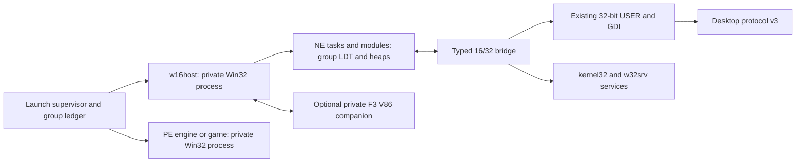

# F5 Win16 subsystem contract

Date: 2026-10-14. Directive: [f5-19 contract](../directives/f5-19-win16-subsystem-contract.md).
Status: proposed contract for lead review and the required independent Codex
cross-review; **no permission to start f5-19 runtime code is implied**.
This milestone changes documents only. No NE execution, original installer
completion, QEMU result, hardware result or measured memory budget is claimed.

## 1. Authority and scope

The owner reaffirmed complete Win16 support inside F5 on 2026-10-14 in
[the Win32 contract's evening decisions](win32-personality-contract.md#decisions-of-2026-10-14-owner-evening-after-the-cross-review-and-the-research).
This contract implements that direction and cross-review M06. **Full Win16
means a real protected-mode NE execution environment with KERNEL, USER and
GDI services, heaps, cooperative tasks and callbacks.** Its initial acceptance
surface is established by original period installers and authored programs;
it is not a claim that every Windows 3.x application already works.

Once reviewed, the requirements below are mandatory in F5. MUST/SHOULD/MAY
have the meaning used by [the Win32 contract](win32-personality-contract.md).
Explicit CiukiOS policies below are design choices, not descriptions of
Microsoft internals or measured capacities.

This amendment supersedes N3/W24's blanket NE refusal, N10's exclusion of
the thunks needed here, and the earlier research note's proposal to defer
full Win16 until after installer replacement. Earlier text remains historical.
PE32 continues to execute as ordinary Win32 processes. DOS programs retain
the F3 personality. An NE file is not the DOS stub preceding a PE header.

In scope: Windows-targeted i386-compatible 16-bit NE EXEs/DLLs, ordinal and
named imports, NE resources, self-loading Windows modules, original Win16
installer launchers/engines and their Win32 children. Windows 3.1 and Windows
95/98 user API behavior is the reference where applicable. Neither OS/2 NE
execution, Win32s as a hosted OS, a binary Microsoft KRNL386/USER/GDI, VxDs,
binary device drivers nor direct hardware access is required or permitted.
The Win32 contract's driver, copy-protection, MSI and networking boundaries
remain applicable. Legitimate unsupported requests need named failures.

Recognized-installer substitution and host extraction MAY assist diagnosis,
but MUST NOT replace either the Worms or IS3 original execution gate. The
original entry point, NE helpers and actual selected engine must execute.
There is no silent fallback to a downloaded replacement SETUP.EXE.

## 2. Research record and resulting decisions — 2026-10-14

Primary documents were researched before this contract was written. Mirrored
Microsoft manuals/articles below retain Microsoft authorship; Wine sources
are upstream implementation evidence, not Windows conformance authority.
Wine **10.0** is a fixed, accessible source reference for this research, not
the shipping Wine pin: f5-14A owns that pin and the dependency/license audit.
No claim is made to have read an inaccessible scan or a proprietary IS3 manual.

| Source, location consulted | Established behavior and CiukiOS decision |
| --- | --- |
| Microsoft, [Windows 3.1 SDK Programmer's Reference, Volume 4: Resources](https://www.bitsavers.org/pdf/microsoft/windows_3.1/Windows_3.1_Programmers_Reference_Volume_4_Resources_1992.pdf), chapters 6–7; [SDK Getting Started](https://bitsavers.computerhistory.org/pdf/microsoft/windows_3.1/Microsoft_Windows_3.1_SDK_1992/PC28914-0492_Windows_3.1_SDK_Getting_Started_199204.pdf), manual descriptions | Period authority for executable/resource formats and the API reference volumes. The scan was indexed but its full text could not be fetched in this session. Reconcile exact 3.1 fields against a readable copy in 19a; the following accessible Microsoft appendix and Wine code provide the independently inspected format baseline. |
| Microsoft Press, [MS-DOS Encyclopedia, Appendix K: Segmented (New) EXE File Header Format](https://www.pcjs.org/documents/books/mspl13/msdos/encyclopedia/appendix-k/) | Documents NE tables, alignment, segment lengths, imports/exports and fixups. Use explicit field decoding and test the distinction between file-relative and header-relative offsets; do not cast disk data to host structs. This earlier format description does not settle every 3.1/9x extension. |
| Microsoft, [Windows 3.1 DDK Installation and Update Guide](https://www.bitsavers.org/pdf/microsoft/windows_3.1/Microsoft_Windows_3.1_SDK_1992/PC29131-0392_Windows_3.1_Device_Driver_Kit_Installation_Mar92.pdf), introduction; [Windows DDK Virtual Device Adaptation Guide](https://www.pcjs.org/documents/books/mspl13/win/w3ddkvxd/), ch. 16; MSDN, [What's New in Windows 95 for VxD Writers?](https://techshelps.github.io/MSDN/TECHART/html/msdn_chicvxd.htm) | The 3.1 guide identifies the DDK's separate device/virtual-device manuals; the accessible 3.0 DDK and 95 architecture article explain the VMM/System VM boundary. Reuse CiukiOS isolation and virtual devices, not Windows binary drivers. Do not present the 3.0 transcription as a newly inspected 3.1 architecture manual. |
| Matt Pietrek, [Happy 10th Anniversary, Windows](https://learn.microsoft.com/en-us/archive/msdn-magazine/2000/july/under-the-hood-happy-10th-anniversary-windows), modes, memory and threading | KRNL286/KRNL386 differ underneath the Windows API; 16-bit selectors and shared heaps do not supply USER/GDI. Cooperative applications give up execution at API boundaries. CiukiOS recreates those observable semantics inside an isolated group, without the 9x globally writable system arena. |
| Pietrek, [Direct Thunking in Windows 95](https://jacobfilipp.com/DrDobbs/articles/DDJ/1996/9614/9614c/9614c.htm), adapted from *Windows 95 System Programming Secrets*; [book excerpt](https://ftp.st.ryukoku.ac.jp/pub/published/oreilly/windows/win95.update/dirty.html) | Describes bidirectional internal thunks and the Win16Mutex consequences. Use a group-local execution token; never a desktop-wide lock. Undocumented quick-thunk addresses are not a portable ABI to copy. These are consulted book excerpts, not a claim to have inspected the complete book. |
| Microsoft, [KB Q154093: calling 32-bit code from 16-bit code on Windows 95/98/ME](https://ftp.zx.net.nz/pub/archive/ftp.microsoft.com/MISC/KB/en-us/154/093.HTM); [Programmer's Guide to Windows 95](https://www.bitsavers.org/pdf/microsoft/windows_95/Programmers_Guide_to_Microsoft_Windows_95_1995.pdf), article 32, Thunk Compiler | Flat thunking uses paired 16/32 modules and explicit marshaling; it differs from NT generic and Win32s universal thunking. Our own system bridge has a typed, generated table. Binary third-party thunk formats require a separate census entry and tested connector; an internal bridge alone does not establish their compatibility. |
| DPMI Committee, [DPMI 1.0](https://openwatcom.org/ftp/devel/docs/dpmi10.pdf), ch. 2 and appendix C | 0.9 clients in one VM share an LDT and width convention; 1.0 changed client contexts. Neither defines Win16 scheduling or Windows APIs. Keep F3's advertised 0.9 behavior, including 1.0 refusals; a flat 32-bit implementation helper is not a second 32-bit DPMI client. |
| Wine 10.0, [winevdm launcher](https://raw.githubusercontent.com/wine-mirror/wine/wine-10.0/programs/winevdm/winevdm.c), [NE module manager](https://raw.githubusercontent.com/wine-mirror/wine/wine-10.0/dlls/krnl386.exe16/ne_module.c) | Separates launch/classification and NE module/task management. Use that separation as a design reference; do not import Wine's host-specific launcher or DOSBox backend into CiukiOS. |
| Wine 10.0, [NE segment loader](https://raw.githubusercontent.com/wine-mirror/wine/wine-10.0/dlls/krnl386.exe16/ne_segment.c), `apply_relocations`, `SELFLOADHEADER`, `NE_LoadAllSegments` | Distinguishes relocation target/width/additive forms and the self-loader's BootApp/LoadAppSeg protocol. Implement explicit bounded paths and a self-loader fixture; never assume all NE payloads are ordinary stored segments. Wine's permissive missing-import behavior is not our error policy. |
| Wine 10.0, [global heap](https://raw.githubusercontent.com/wine-mirror/wine/wine-10.0/dlls/krnl386.exe16/global.c), [local heap](https://raw.githubusercontent.com/wine-mirror/wine/wine-10.0/dlls/krnl386.exe16/local.c) | Handles, selectors, lock counts and DS-relative local heaps need separate representations. Do not implement Win16 allocation by truncating Win32 heap pointers. |
| Wine 10.0, [KERNEL export specification](https://raw.githubusercontent.com/wine-mirror/wine/wine-10.0/dlls/krnl386.exe16/krnl386.exe16.spec), [USER specification](https://raw.githubusercontent.com/wine-mirror/wine/wine-10.0/dlls/user.exe16/user.exe16.spec) | Ordinals, equate exports, Pascal/register conventions and return widths are API-specific. Use tables checked against period headers/import libraries, not Win32 export numbers. |
| Wine 10.0, [USER message conversion](https://raw.githubusercontent.com/wine-mirror/wine/wine-10.0/dlls/user.exe16/message.c), [GDI bridge](https://raw.githubusercontent.com/wine-mirror/wine/wine-10.0/dlls/gdi.exe16/gdi.c) | Messages, callbacks, handles and graphics structures need conversion, not pointer casts. The Win32 USER/GDI services stay the sole windowing/drawing backend. |
| Microsoft, [Application Installation on 64-bit Systems](https://learn.microsoft.com/en-us/windows/win32/winprog64/application-installation) | Documents recognized 16-bit installer replacement, including InstallShield 5.x. This is evidence about substitution, not general NE execution or a license to redistribute Microsoft installer replacements. Q3 requires more. |
| InstallShield/Revenera, [Setup.exe command-line parameters](https://community.revenera.com/s/article/what-command-line-parameters-are-available-for-setup-exe) | Documents version-specific Professional 5.x arguments, CMDLINE and Setup.ini. Preserve original arguments and working directories. These vendor notes do not establish any particular IS3 engine architecture or a universal silent switch. |
| Open Watcom, [C/C++ Programmer's Guide](https://www.openwatcom.org/ftp/manuals/current/pguide.pdf), Windows and extended-DOS development | Provides an upstream fixture toolchain reference. Pin an exact release/archive, headers, tools and licenses in 19a; build source-owned Win16 fixtures, without Microsoft SDK binaries. |

**Research limits.** No accessible period IS3 engine manual or complete
original IS3 fixture was obtained. The repository research reports an IS5
Worms launcher and compressed engine, not a measured engine API closure.
The shell cannot resolve `archive.org` in this sandbox; the attempted media
HEAD request failed before transfer. No game payload was fetched or retained.
These gaps block an installer compatibility verdict and the final API-table
freeze, not this proposed contract. Their resolution is explicit work in
19a/19d, not an invented census result.

## 3. Repository comparison and F3 boundary

The following are source observations in this worktree, not newly executed
F3 evidence:

| Existing component | Observed implementation | Consequence |
| --- | --- | --- |
| [dos-dpmi-contract.md](dos-dpmi-contract.md), Kernel-owned DPMI 0.9 | One LDT per VM, same-width nested clients, validated ring-3 transitions, private vectors/callbacks; explicitly refuses 1.0-only rows. | The Win16 runtime is not an upgrade to a DPMI 1.0 host. |
| [dpmi_internal.h](../../src/kernel/vm/dpmi_internal.h) | 1,024 LDT entries, four nested DPMI clients, 16 real-mode callbacks/client, 32 transition records, 16 KiB locked protected stack. | These are existing F3 limits, not proposed Win16 task or USER callback limits. Do not silently enlarge them. |
| [dpmi.c](../../src/kernel/vm/dpmi.c), `dpmi_entry`, `dpmi_v86_int` | Opposite-width nested entry fails; discovery returns 0.90. `DOSVM_DPMI_PUBLIC` remains zero in [dpmi.h](../../src/kernel/include/ciuki/dpmi.h); explicitly enabled VMs can discover it. | Existing code is not proof of a publicly qualified Win16 host. Never flip the F3 discovery gate for F5. |
| [dpmi_desc.c](../../src/kernel/vm/dpmi_desc.c), `dpmi_desc_set`, `dpmi_ptr`, `dpmi_frame_check` | Descriptor encoding and range/frame checks exist, but pointer translation ends in `dosvm_range`; GDT flat-code/data cases are explicit. | Encoding/checking rules can be reused; the full DOS pointer helper cannot validate arbitrary Win32 memory. |
| [dosvm.c](../../src/kernel/vm/dosvm.c), `dosvm_range`, `dosvm_arch_switch` | Valid ranges are the private low-memory region and DOS pool; context switch loads this VM's LDT and debug registers or clears them. | Add a Win32-owned selector context in f5-03; do not fake a DOS VM or expand `dosvm_range` to cover all process pages. |
| [desktop.md](../desktop.md), v1/v2.1; [Win32 contract](win32-personality-contract.md), f5-09/10 | Current resize/surface protocol differs from planned v3 multiple-window USER/GDI integration. | NE windows wait for the reviewed v3 backend. No parallel Win16 compositor or new wire version is introduced here. |
| [f5-02A census record](win32-census/README.md) | The implemented census accepts PE32; period inputs and IS3/IS5 samples are absent-input records. | Extend census with a separately tested NE reader in 19a. Do not feed NE to the PE parser and interpret refusal as an empty import set. |

### 3.1 What remains untouched, what is additive

F3 DOS boot, VM ownership, disk overlays, A20/XMS/EMS, virtual devices,
INT 31h 0.9 dispatch, real-mode switching/callback protocol and their existing
limits MUST keep their current contracts. Their production tests remain
regressions. Existing DOS workloads must observe identical results.

Reuse descriptor encoding/validation rules and the existing architecture LDT
load primitive through a reviewed, shared internal layer where practical.
The **new Win32 adapter** supplies process-owned backing/range checks,
allocation accounting, selector mutation authority and continuation validation.
It cannot invoke DOS-specific helpers on an invented `struct dosvm`.
Any extraction of shared production helpers requires unchanged F3 tests and
lead review; it does not authorize a semantic rewrite of the F3 host.

Real-mode services that genuinely require F3 use a private companion DOS VM
owned by the same installation group, via bounded register/buffer RPC. Its
existing 0.9 host and V86 execution stay unchanged. Such a companion is
created on demand, never the user's unrelated DOS window. Section 8 defines
the bridge; protected NE USER callbacks do not use F3's real-mode slots.

## 4. Process, address-space and kernel handoff

**Decision W16-1.** One protected Win16 VM per **process group**. Here group
means an explicitly supervised launch tree for one installer/application,
with an opaque ID and generation, not an ambient system-wide WOW session or
just a reused PID/Unix process-group number. An unrelated NE launch gets a
different group. A launch descended from this group joins its existing host.

The group owns one `w16host` ordinary **win32 personality process**. All its
NE tasks/modules execute at CPL3, IOPL0 in that process's private address
space; their ordinary 16-bit segments have D/B=0. A flat 32-bit worker in
the same process implements KERNEL and typed USER/GDI adapters. PE engines
and games are separate Win32 processes with ordinary private address spaces.
The optional F3 companion is a separately isolated DOS VM, not a second
Windows instance or a globally shared Microsoft System VM.

All NE segments, heaps and bridge buffers are reservations below `0x70000000`
through f5-03/04's allocator, alongside guarded flat/16-bit stacks. They must
not overlap PE mappings, builtins at `0x70000000–0x7FFDFFFF`, TEB/PEB or
reserved/null regions. There is **no new fixed high-memory arena**, 9x shared
2–3 GiB region, physical mapping or exemption from Win32 accounting. Keeping
V86 low memory in the companion avoids weakening the Win32 null-page guard.
Selectors translate to linear addresses; they are not real-mode paragraphs.

Before f5-03's ABI freeze, its written handoff MUST specify:

| Capability / record family (symbolic, not assigned syscall numbers) | Required kernel invariant |
| --- | --- |
| Create/destroy Win16 context; attach the authorized execution worker | Only the group's owning host may mutate it; cleanup is possible without guest cooperation. Ordinary native/Win32 callers acquire no selector authority by setting a flag. |
| Allocate/free/set/query descriptor or contiguous descriptor run | Kernel owns LDT storage. Allow only owned user mappings and approved DPL3 code/data types; forbid gates, system descriptors, kernel/device ranges and address overflow. Validate both extent and page permissions. |
| Enter/resume a 16-bit continuation | Validate CS:IP, SS:SP, data segments, registered stacks, context generation, return token, EFLAGS and supported processor state; caller cannot install a privileged return. |
| Handle/continue faults in 16-bit code or during a bridge | Deliver a bounded mixed-context record to the host; invalid continuation, stale owner or dispatcher fault terminates this host/group. Do not walk a Win16 stack as an FS:[0] SEH chain. |
| Context switch / teardown | Switch LDT and FS/GS/debug/x87/SSE state consistently with F2/F3/f5-03; restore Win32 TEB FS before entering 32-bit DLLs. Never leave a dead LDT installed. |

These use version/size-checked `CIUKI_SYS_W32` extensions, not a new native
ABI or privileged user call gate. Exact wire layout belongs to the reviewed
f5-03 handoff; until it exists, no kernel implementation begins. DPMI remains
a distinct INT 31h path. A same-CPL transition to the flat helper is not a
new DPMI client and cannot work around the 0.9 mixed-client rule.

The protected Win16 context's INT 31h adapter must have a reviewed 0.9
service matrix: descriptor/alias operations on this host's LDT, charged
memory allocation/resize, owned vectors/exceptions, virtual IF, lock/query
semantics and the real-mode translation rows in §8.1. Refuse physical maps,
privileged descriptors and 1.0-only calls with the documented carry/error
behavior. A 16-bit guest that uses this interface must see a coherent 0.90
host; no mixed-width nested client is admitted. The new trap dispatch selects
the Win16 process context explicitly, while F3 DOS contexts retain their
existing dispatch. This is reuse of the 0.9 mechanisms behind a new backing
adapter, not a claim that `dpmi_int31(struct dosvm *, ...)` already accepts
ordinary Win32 processes.

Because NE and the flat runtime share one process, segmentation does not
protect the runtime from every guest access: writable aliases or flat user
selectors can reach that process's memory. The guaranteed isolation boundary
is the host process and its validated service endpoints, not individual NE
tasks or secrecy of runtime metadata. The kernel/desktop must treat every
message from this process as untrusted even when a helper generated it.

## 5. NE module loader

**Decision W16-2.** A pure bounded parser produces a load plan without
executing payload code. Instantiation/relocation and guest entry are separate
operations. The same production parser and relocator run under Linux tests
and in the personality. Every arithmetic operation involving file offsets,
shift counts, counts, allocations or selector runs is checked before use.

| Stage | Required behavior and refusal cases |
| --- | --- |
| Classify | Validate MZ, `e_lfanew`, complete NE header and Windows target/version flags. Distinguish PE, NE, DOS, LE/LX, OS/2, resources-only and drivers. Do not execute the DOS stub when a malformed NE fails validation. |
| Tables | Validate segment/module-reference/import-name/resource/entry tables, resident and nonresident names, their different offset origins and terminators. Keep import ordinal numbers even when a name can also be resolved. Entry bundles distinguish unused, fixed and movable entries. |
| Segment plan | Decode file offset/alignment, initialized length, minimum allocation, code/data, read-only/execute-only, movable/shareable, preload and discard flags. A zero stored length/minimum can mean 64 KiB; an absent file sector denotes zero-filled backing. Distinguish these meanings, zero tails and bounds-check iterated-data expansion. |
| Data and startup | Honor automatic data, single/multiple/no-data modules, instance-specific DGROUP, stack/heap reservations and initial CS:IP/SS:SP. Specify the compiler startup register contract, PSP/environment/command-tail view and `InitTask`/`InitApp` behavior against SDK/Open Watcom before entry. `WinMain` is reached through the program's startup code, not called with invented parameters. |
| Dependencies | Case-insensitive Windows module identities, deterministic builtin/app search with f5-05/06, imports by module index and name/ordinal, cycle-safe load states, module/instance use counts. `KERNEL`/`KRNL386`, `USER`, `GDI` resolve to our implementations, never shipped Microsoft system modules. Resource-only modules do not run entry code. |
| Initialization | Dependencies are prepared before guest initialization; invoke NE library initialization/termination according to module type and expected Windows version, including LibMain/WEP and applicable 9x entry semantics. Reentrant loads and initialization failure have transactional rollback and precise diagnostics. Never transplant PE DllMain ordering without checking the NE rules. |

### 5.1 Relocations, movement and resources

The relocator MUST distinguish internal fixed/movable targets, imported
ordinals, imported names and OS fixups; source forms include byte, selector,
16-bit offset and 16:16 far pointer. Decode and test the documented 32-bit
offset/16:32 forms when present; their presence does not turn an NE module
into a PE32 process. Additive fixups and linked source chains have different
rules. Read chain links before overwriting them, detect cycles, cap visits
by segment length and check every patch width, target index and target offset.
Unknown/unsupported fixups fail by type; recognized floating-point fixups
need an explicit x87 policy and fixture, not a blanket ignored-record rule.
Missing imports fail loading with the original module and ordinal/name.

Movable handles stay stable across moves; selector bases and any required
export/prolog fixups are updated only at safe points without active pinned
references. Discardable code/resources can be reloaded from immutable input
and relocated again; live stack/code, locked blocks and active callback
targets cannot be discarded. Data must never silently be recreated as zero
after a failed reload. Keeping all segments initially resident is a valid
development stage, not completion of the discard/reload fixture gate.

Resource access preserves integer/name IDs, resource-table alignment, types,
sizes and load/lock/free lifetimes. Translate **16-bit** dialog/menu/string,
bitmap/icon/cursor and version structures for existing 32-bit services.
There is no PE language-tree layout in an NE resource table. Resource
decompression and decoding must reject truncation and impossible dimensions.
Foreign fonts stay within the amended fonts contract and approved parser
boundary; a `.FON` NE container is not an executable entry request.

### 5.2 Self-loading modules

Self-loading is part of the subsystem, even if Worms' launcher does not use
it. The load plan records the flag and validated first-segment protocol.
19a must reconcile the period protocol with Wine's inspected
`SELFLOADHEADER` (`0x3041` version, BootApp, LoadAppSeg and supplied allocator/
entry/owner helpers). 19b implements it on a dedicated guarded stack through
the ordinary checked callback bridge. Header/version/entry validation occurs
before BootApp. Guest loaders receive virtual file handles and owned memory,
never raw VFS pointers or descriptor-table write access.

LoadAppSeg results must pass selector ownership, type, allocation and extent
checks before the segment becomes executable to the requesting task. Nested
loads, loader reentry, cancellation and failure unwind without retaining
runtime locks. An authored module must load a noninitial segment, call its
export and exercise failure/cleanup. Supporting an external SFX extractor
does not satisfy this test. Unknown self-loader protocols produce a named
unsupported-protocol error, not execution with ordinary segment assumptions.

## 6. Census and API surface

### 6.1 Current evidence, explicitly bounded

This is the NE application of [f5-02's census method](../directives/f5-02-pe-toolchain-fixtures-census.md).
The [2026-10-14 research](research/win32-layer-2026-10-14.md#3-import-census)
contains binary observations; the f5-02A matrix is deliberately provisional.
Do not overwrite either historical account. An observation of engine
packaging is not a measured list of APIs used by its decompressed engine.

| Acceptance input / chain | Evidence available now | Required census completion |
| --- | --- | --- |
| Worms Armageddon demo, gate 6, original ZIP | Prior research: `SETUP.EXE` NE, 59,904 bytes, SHA-256 **prefix only** `feb61b7f007c8857`; `_SETUP.DLL` and `_ISDEL.EXE` NE; `_INST32I.EX_` compressed engine and `data1.cab`. IS5 family identified, exact build and full member hashes unavailable here. | Hash and inspect every NE helper, decompress/observe the original selected engine, determine its PE/NE architecture, imports, dynamic loads, version and completion/uninstall chain. Do not assume `_INST32I.EX_` is NE or that its name proves a Windows 3.x engine. |
| Identified licensed InstallShield 3 fixture | No fixture or exact edition/build yet. IS3 can have different launcher/engine selections; the family label alone does not identify a 16-bit engine. | Pin source/license and full hashes for original launcher, true Win16 engine, script and helpers. Acceptance must exercise a real 16-bit engine, not only a 16-bit launcher spawning a 32-bit replacement. |
| Diablo, StarCraft, AoE, Half-Life (gates 1–4) | Prior PE census exists for some editions/components; complete NE child inventory not established. | Inventory every original installer/helper/uninstaller, including DX setup children. A PE outer image does not close nested NE coverage. |
| UT348, Heroes III, RCT, Jazz2, Total Annihilation (gates 5, 7–10) | Engine/child architecture incomplete in the provisional matrix; Heroes' family name is not a version pin. | Apply the same inventory; record `not inspected`, never `no NE imports`, until media and spawned/extracted children are checked. |
| NFS II SE reserve `NFS2SEA.EXE` | Prior research: NE PKZIP SFX containing `nfs2sea.exe`, `DSETUP.DLL`, `eacsnd.dll`. It is not IS3 evidence or an approved replacement for gate 6. | Census actual SFX imports/helpers if used as supplemental coverage. Run its original NE path for an NE execution verdict. |
| Source-owned Open Watcom corpus | Specified in §11; not built in this document milestone. | Known independent expected imports, relocations/resources and traces; supplies repeatable tests even before original media is available. |

### 6.2 Census procedure and closure rules

19a extends the tooling with a separately tested NE reader and a text/JSON
schema compatible with f5-02's PE records. For **each** setup entry, extracted
helper, selected engine, app DLL and uninstaller:

1. Bind workload/edition, parent archive and member path, full SHA-256, byte
   length, provenance/redistribution classification and extraction method.
   A prefix cannot authenticate input. Keep payloads local on disk; only
   sources and nonpayload metadata enter Git.
2. Record image kind, target/version/module flags, entry points, segment
   forms, self-load flag, resources, static imports by exact name/ordinal,
   exports/equates and architecture of every selected child. Imported-name
   tables and **relocation references** together determine NE imports.
3. Resolve ordinal labels against period SDK/import-library evidence and the
   pinned upstream `.spec`; retain the original numeric import and source
   of resolution. A Wine ordinal is a cross-check, not proof for all Windows
   versions. Preserve private engine DLLs as dependencies, not system APIs.
4. Track runtime `LoadLibrary`/`GetProcAddress`, shell/DDE, thunk connections,
   register-style DOS calls, callbacks and spawned processes across install,
   cancel, restart and uninstall. String scans are hints. Linux extraction
   or a reference Wine run assists discovery; only Ciuki execution closes
   the executed path's coverage.
5. Every reachable import/behavior gets a named owning directive, signature,
   implementation status and fixture. Unknown dynamic closure, missing media
   or an unused stub is reported separately. A static-import percentage alone
   is insufficient. Essential calls cannot be fake-success stubs.

The final export manifest MUST be reviewed before 19b/19c API freeze. Missing
media prevents claiming closure, but independent parser/fixture development
can proceed after contract review. The following is a **proposed minimum
implementation surface**, not a measured union of the absent installers.
Original census requirements extend it within approved scope; new product
scope goes back to the lead/owner.

### 6.3 KERNEL / KRNL386 compatibility exports

The implementation exports the **NE module name `KERNEL`**, with aliases and
original ordinals checked individually. `KRNL386.EXE` is a compatibility
identity, not a request to load Microsoft's kernel or any NT NTVDM component.

| Family | Minimum functions/behavior to specify and test | Backend |
| --- | --- | --- |
| Startup/modules/tasks | `InitTask`, `GetVersion`, `GetWinFlags`, `GetCurrentTask`, `GetCurrentPDB`, `GetModuleHandle`, `GetModuleUsage`, `GetModuleFileName`, `LoadModule`, `LoadLibrary`, `FreeLibrary`, `GetProcAddress`, `WinExec`, `ExitKernel`, `FatalAppExit` | NE manager, group supervisor and PE launch service. GetVersion16/GetWinFlags have their own layouts and feature claims; do not truncate the Win32 result. |
| Cooperative execution | `Yield`, `DirectedYield`, `WaitEvent`, `PostEvent`, `LockCurrentTask`, task queue access where required | §9 scheduler; group-local effects. |
| Global/selector memory | `GlobalAlloc/ReAlloc/Free/Lock/Unlock/Size/Flags/Handle/Compact`, `LockSegment`, `UnlockSegment`, `AllocSelector`, `FreeSelector`, alias/base/limit operations required by census, `__AHINCR`, `__AHSHIFT` | §7 and kernel selector adapter; equates are not callable code. |
| Local heap | `LocalInit/Alloc/ReAlloc/Free/Lock/Unlock/Size/Flags/Handle/Compact/Notify` | DS-relative heap with fixed/movable objects, not Win32 LocalAlloc semantics. |
| Callbacks/nonlocal flow | `MakeProcInstance`, `FreeProcInstance`, applicable `Catch`/`Throw` and stack-switch helpers | §8; preserve instance DS, register conventions and continuation lifetimes. |
| Resources | `FindResource`, `LoadResource`, `LockResource`, `FreeResource`, `SizeofResource`, `AccessResource`, `LoadString` via USER | NE resource manager; virtual handles. |
| Files/environment | `OpenFile`, `_lopen`, `_lcreat`, `_lclose`, `_lread`, `_lwrite`, `_llseek`, huge-count helpers if imported, temp/system/Windows directories, `GetDOSEnvironment`, `GetDriveType`, `GetFreeSpace`, `DOS3Call`, debug output | f5-06 and §10; 16-bit HFILE/error and DOS-register ABIs. |
| Profiles/atoms/strings | `GetProfileInt/String`, `WriteProfileString`, private-profile variants, local atoms, length/copy/compare helpers | Shared INI/file policy and bounded CP1252 conversions. |

### 6.4 USER and GDI bridge surface

| Module/family | Initial behavior set | Required conversions |
| --- | --- | --- |
| USER windows/classes | register/unregister/query class, create/destroy/show/move/enable window, parent/owner/text, window words/longs, subclassing, default/window/dialog procedures | Instance/class handles; `WNDCLASS16`, `CREATESTRUCT16`, signed coordinates, callback identity and per-window extra data. |
| USER messages/input | `GetMessage`, `PeekMessage`, `TranslateMessage`, `DispatchMessage`, `SendMessage`, `PostMessage`, quit, timers, focus/capture/cursor, key state | `MSG16`, packing of control notifications, task routing, timer procedure and message-specific pointer lifetimes. |
| USER installer UI | modal/modeless dialogs, dialog item APIs, message boxes, standard controls, menus, accelerators, icons/cursors, painting/invalidation, system metrics/colors, text drawing | NE dialog/menu/accelerator resources, dialog units, default button/tab/group semantics, `RECT16`, `POINT16`, `PAINTSTRUCT16`; 32-bit surfaces/fonts. |
| USER interoperation | clipboard/global data and PROGMAN DDE paths actually used by setup | Atom/handle translation, copied bounded data, ownership transfer, ACK/free rules and f5-07B DDE. |
| GDI core | DC create/get/release/delete/save/restore; compatible DC/bitmap; pen/brush/font/object select/delete/query; colors/mapping/clipping; text/metrics; line/rectangle/fill; BitBlt/StretchBlt; DIB and palette APIs used by census | 16-bit handles, signed extents, `LOGFONT16`, `TEXTMETRIC16`, regions, bitmap bits/stride/palette and segmented large buffers. No hardware access. |
| Additional 16-bit modules | `SHELL` file launch/registry/PROGMAN services, `COMMDLG`, `VER`, `LZEXPAND`, `DDEML`, `TOOLHELP`, `CTL3D` or private setup helpers **when actually imported** | Audit names/ordinals and callbacks individually; bridge to reviewed f5-06/07/10/14/15 services. Missing module is visible, not an empty builtin. |

Tables are functional families, not permission to fabricate ordinals or
assume all 32-bit exports have 16-bit counterparts. API-specific Win16
signedness, stack bytes, pointer direction, null/sentinel cases and failure
returns belong in the reviewed machine-readable thunk/export table.

## 7. Memory and selectors

**Decision W16-3.** One LDT belongs to the Win16 host; module/task data and
global memory are shared only within that host. Local heaps are associated
with DS/DGROUP instances. Separate applications/groups cannot exchange raw
selectors or assume a system-global heap. Cross-group documented IPC is
brokered by USER/w32srv with copied or explicitly shared objects.

The kernel validates descriptor operations; runtime heaps hold handles,
ownership, lengths, flags, lock/reference counts and selector-run metadata.
Fixed and movable handles must follow the actual Win16 relationship to
selectors where observable. In particular, do not add generation bits into
public selector values or truncate arbitrary Win32 handle values.
Internal generations protect callbacks, RPC and supervisor objects; raw
16-bit handles/selectors cannot encode unlimited lifetime identity.

Near pointers are offsets in the specified DS/SS; far pointers are
selector:offset pairs. Check offset plus length, descriptor present/type/
rights/limit, base plus extent and owned committed pages with overflow-safe
arithmetic. Reject accidental 64 KiB wrap. Huge-pointer operations explicitly
walk allocated contiguous selectors with the documented `__AHINCR` stride,
checking the full run. Alias descriptors can reference only owned backing
with allowed rights and are invalidated when that backing is freed.

Global allocation supports zero-init, fixed/movable, realloc, lock/unlock,
size, discard state and resource ownership. Locked or callback-pinned memory
cannot move; failed realloc preserves the old live object. Local allocation
has independent handle offsets, compaction/notification behavior and stack/
heap collision checks within DGROUP. Forced compaction tests must exercise
movement, locks and callback reentry; constant dummy return values fail.

No kernel, DOS or Win32 memory limits change in this milestone. Before a
Win16 quota is frozen, the lead measures at **128 MiB on qemu-t23 and T23**:
desktop/service baseline, one host, optional companion, NE heaps/LDT/stacks,
PE engine coexistence and peak install/uninstall commitment. Preserve the
parent contract's required game headroom. Reuse existing LDT capacity as a
starting constraint, not a proof that 1,024 descriptors suffice. Any limit
change requires measured shortage, reviewed accounting and a documented
decision. Exhaustion must fail without leaked descriptors/commitment.

## 8. Thunking, callbacks and DOS bridge

**Decision W16-4.** Generate system thunks from typed tables. Each entry
records NE module/name/ordinal, convention (Pascal, C/varargs, register or
equate), input/output widths and signedness, argument order/stack cleanup,
return ABI (AX, DX:AX, far pointer or specified registers), structure schema,
pointer extents/directions, yield/reentry behavior and failure mapping.
One untyped dispatcher that treats arguments as Win32 words is forbidden.

The transition preserves required nonvolatile and segment registers,
instance DS, SS:SP, caller return width and flags; it establishes a valid
flat stack, cleared DF and the Win32 FS/TEB before calling 32-bit code.
Reverse entry restores the exact saved 16-bit context. Save x87/SSE state
as required by the worker/task ABI and f5-03; a callback cannot inherit a
different task's floating-point environment. Execute all control transfers
at ring 3 through registered trampolines and checked kernel continuations.

Thunks translate handles through typed maps and repack structures field by
field. Pin or copy buffers for the full call/callback lifetime, including
callbacks caused by CreateWindow, DialogBox and SendMessage. Never keep
a naked guest pointer across a yield, callback, heap move, RPC or async
completion. Copyback revalidates the original allocation/generation; it
cannot overwrite a subsequently reused object. Sentinel integer resource
IDs are distinguished from strings before pointer translation.

Win16 callbacks include WNDPROC/DLGPROC, timers, enumeration, heap/resource
notifications, self-loader entries and `MakeProcInstance` DS-binding thunks.
The callback ledger stores group/task/module generations, far entry,
instance DS, convention, pinned storage and outstanding references. Freeing
an instance/module revokes new entry; in-flight callbacks drain or are
aborted with the group. Late timers/IPC cannot jump into freed code.
Nested 16→32→16 calls require one continuation per level, bounded guarded
16/32 stacks and deterministic overflow. No VFS/kernel/server lock may be
held while running guest code. Reentrant invocation is serialized by §9.

The system's **flat-thunk-style** USER/GDI adapters do not by themselves
implement Microsoft THUNK.EXE output. If the census finds `ThunkConnect16/32`,
generic `LoadLibraryEx32W`/`CallProc32W` or a private connector, 19a must
identify the exact format and 19b implement/test that connector or report
an essential compatibility gap. Never resolve these names to successful
no-ops or invoke an arbitrary flat address supplied by an NE module.

### 8.1 DOS/real-mode service routing

Common `DOS3Call`/INT 21h file, path, time, disk-space, environment and
termination requests are translated into the same f5-06 drive-path services
as Win32 calls, preserving DOS register/carry/error conventions and
per-task state. This prevents installers from writing a separate private
DOS disk overlay instead of their Win32 destination. Unknown register
functions fail visibly; host/native INT 80h is never a guest DOS interrupt.

For real-mode execution that cannot be translated, the private F3 companion
receives a bounded register image, explicit virtual-segment buffers and
copy-in/copy-out descriptions. No NE selector or Win32 linear pointer is
meaningful in that VM. DPMI 0300–0302 and real-mode callback requests require
an adapter that maps buffers and uses the companion's existing transition
services. Real-mode 0303/0304 callbacks require VM-local relay entries and
checked RPC back to the owning NE continuation, including cancellation,
nesting and copyback. Returning a host's far pointer as a real-mode address
is forbidden. This bridge is new 19b code; the underlying F3 implementation
and its slot limits are reused unchanged.

The reviewed 19b interface must enumerate supported interrupt/functions and
relay protocol before implementation. Stateful file/directory operations
always use the personality's VFS view; the generic companion path must not
create a second inconsistent file service. Physical device/BIOS ownership
remains with CiukiOS. Native/DOS virtual devices and physical IRQ handlers
never directly call an NE USER procedure.

## 9. Messages and cooperative tasks

**Decision W16-5.** A host worker executes at most one Win16 task/continuation
at once. Task switching is cooperative **within a group**; the kernel still
preempts the host normally against desktop, native, PE and DOS processes.
A nonyielding NE loop can stall that group's tasks, never system scheduling.
Logical Win16 tasks are not F3's nested DPMI clients and need not consume
one kernel thread apiece. A task saves registers, stacks, DS/instance,
environment/current-directory/file state, queue and callback nesting.

`Yield`/`DirectedYield`, event waits, blocking GetMessage/WaitMessage,
documented PeekMessage behavior and dialog/modal message pumps define the
switch points. Record exact queue/filter/remove and yield rules in 19c
against the period API reference and fixtures. Do not forcibly switch tasks
in the middle of arbitrary 16-bit instructions to hide cooperative hangs.
`LockCurrentTask` affects only this group and cannot disable kernel
preemption or lend the guest a server/desktop mutex.

The local execution token is reentrant only for the owning callback chain.
At an allowed yield or blocking service wait, save the continuation and
release it so another eligible task can run. Async I/O/timer/input endpoints
enqueue work; only the owning worker enters 16-bit code. Pending synchronous
sends are processed where needed to avoid cross-task SendMessage deadlock;
callbacks preserve ordering across nested dialogs, sends and enumeration.

USER32 remains authoritative for windows, focus, z-order, painting, input
and modal ownership. Each Win16 top-level window is an ordinary v3 window
owned by `w16host`, with task/16-bit HWND mapping and a generational server
identity. `MSG16` and Win16 `WM_COMMAND`, control notifications, create/
measure/draw structures and dialog callbacks are converted by message type.
Subclass round trips preserve the original far procedure identity. Unknown
private messages are scalar-only across processes unless an explicit
reviewed marshaling schema exists; never forward a guest pointer.

Use f5-10's posted/sent/timer/paint semantics, controls, fonts and GDI
renderer. Backpressure and queue exhaustion have defined errors. A blocked
group has the desktop's unresponsive-window/End Task path; heartbeat and
independent PE/DOS processes must remain live. Clean shutdown sends the
documented close/query-end-session sequence where possible; forced cleanup
does not call untrusted guest termination procedures.

## 10. Files, registry, INI and PE handoff

**Decision W16-6.** Both sides share f5-06 drive-letter paths, case folding,
case-preserving names, 8.3 aliases, share modes/locks, CP1252 Windows text,
CP437 DOS alias boundaries, FAT time policy and defined error mappings.
Old `OFSTRUCT`, signed HFILE, 16-bit count/return overflow and disk-space
representations get explicit adapters. Free space is encoded/clamped by
the legacy API's rules, never by wrapping large FAT32 sizes. Test read-only
media, full disk, spaces/short aliases and invalid/truncated buffers.

Use f5-06's profile implementation for WIN.INI and private INI files;
preserve null argument enumeration, multi-string terminators, lengths,
integer/default/truncation behavior and flush semantics with Win16 sizes.
Use f5-07's same registry hives/transactions for 16-bit SHELL/registration
APIs and any 9x registry entry points actually imported, with Win16 roots,
value representations and default-value semantics. An INI or registration
API MUST NOT silently write to a second per-VM database. Service death and
reconnect follow the Win32 contract's committed-state rules.

Launches through `WinExec`, `LoadModule`, SHELL or the original DOS startup
bridge classify the **actual child**. NE children join the group's host as
tasks; PE children go through f5-05/06 as separate ordinary Win32 processes;
DOS children use the F3/desktop launch path if supported by f5-15. Preserve
quoted command tail, working directory, environment, show state, relevant
standard/file-handle inheritance and virtual temporary paths. WinExec's
success value (>31) is not a truncated PID or an automatic process wait.
Implement the wait/handshake the original installer uses, rather than
assuming all launch calls block until child exit.

Track launcher/engine/helper relationships in the supervisor. Normal NE
launcher exit does **not** kill a successful PE engine or game. A fatal
Win16 host crash/hang ends its NE tasks/companion and any explicitly attached
unfinished setup helpers, informs waiting parents and rolls back transient
IPC; independently handed-off games and unrelated processes remain live.
Cancel/uninstall/self-delete and virtual restart use f5-07B/15 mechanisms,
including applicable WININIT.INI/RunOnce and PROGMAN shortcut requests.
Never perform a physical reboot because a Win16 installer requested one.
Installed files and committed registry writes are not magically undone by
crash cleanup; later recovery follows the same installer/restart journal.

## 11. Containment, diagnostics and acceptance

### 11.1 Required failure behavior

Faults, bad selectors/stacks, invalid instructions, bridge overflow, corrupt
self-load results, stale callbacks and server disconnects MUST leave kernel,
desktop, unrelated groups and DOS VMs intact. One NE task can corrupt other
tasks in its own shared host; the safe default for unrecoverable corruption
is terminating that host's NE group, not continuing with unsafe metadata.

On owner death, revoke callback entry and input/capture/focus/presentation
rights first; cancel/drain IPC and I/O; disconnect/remove all host windows;
release file/share/registry handles, surfaces, atoms and task objects; then
release selector/heap/stack/companion backing and ledger charges. Kernel
teardown cannot trust guest lists or wait forever for a cooperative yield.
No instruction, fault handler or timer can reuse the dead LDT. Repeatable
baseline accounting includes PE helpers and companions, not just NE heaps.

Named diagnostics extend f5-16: wrong target, malformed NE/table/segment/
resource, missing module/export, unsupported relocation/self-loader/thunk,
selector/quota failure, bad callback/stack, unsupported DOS function and
host/group crash/hang. Record group/task/PID generation, full workload hash,
module, original ordinal/name, load stage or CS:IP/SS:SP, exception/error,
last thunk/callback chain and before/after resource ledger. Bound, escape
and rate-limit strings; do not dump payload/resource bytes or unchecked
stack memory. Include the friendly module/export on screen and structured
serial records. Error return widths/conventions remain API-specific.

Desktop identity stays the approved exact Ciuki portrait with Tango icons
and English copy; no subsystem-specific mascot or replacement branding.

### 11.2 Acceptance matrix

These are future gates; **all are not run in this contract milestone**.
No static parser pass, host extraction, Wine run or replacement installer
qualifies a CiukiOS execution row.

| Gate | Independent expected result | Where / owner |
| --- | --- | --- |
| Reviewed contract and handoffs | Lead plus independent Codex review disposition; f5-03/04 kernel and f5-10 bridge interfaces agree before code. Record unresolved scope explicitly. | Lead, before 19a runtime changes / f5-03 freeze. |
| NE parser/relocator | All valid and malformed authored plans match expected metadata, patches and exact errors; failed load leaves no partial state. | Linux T0, 19a/19b. |
| Source-owned Open Watcom suite | Real 16-bit entry executes; NE DLL LibMain/WEP, multiple DGROUP instances, heaps/huge buffers, resources, ordinal/name imports, movement/discard/reload and self-loading pass. | Host build/static checks; **execution only QEMU/T23**, 19b/19c. |
| Thunk/message/task suite | Both directions, register/Pascal/C conventions, instance DS, nested callback/modal/subclass/timer traces, two cooperating tasks, nonyielding task and PE-child handoff match independent expected traces. | T0 table/model plus QEMU/T23 execution, 19c. |
| Worms Armageddon demo setup | Original archive/entry and NE helpers execute; original engine finishes installation with expected files, registry/INI/shortcuts and child statuses; cancel/retry and original uninstall work where provided. No substitution. | Lead QEMU on 128 MiB qemu-t23 and T23, 19d + 15. Game play remains the separate F5-17 gate. |
| InstallShield 3 fixture | Pinned original launcher **and true 16-bit engine** process a lawful authored/sample script, display dialogs, install known files plus INI/registry/shortcut data and complete cleanup/uninstall where provided. A mere NE bootstrap to PE engine is insufficient. | Lead QEMU/T23, 19d; original-engine provenance is required. |
| Isolation and failures | Inject GP/invalid selector/stack/code fault, callback-after-free, self-loader failure, RPC/service death, full disk/OOM and a nonyielding loop. Native heartbeat, another NE group, independent PE and DOS VM survive; End Task works; desktop input restored. | T0 ledgers/state machines and lead QEMU/T23. |
| Lifecycle / memory | 100 normal and 100 forced-fault group cycles return owned pages/selectors/windows/handles/callbacks/commitment to baseline. Measure peak on 128 MiB with PE engine/companion and preserve parent headroom. | Lead QEMU; representative repeated/fault cases and memory measurement on T23. |
| Regression | F0–F4 and integrated F5 earlier gates still pass for the exact same canonical image. Existing native desktop v1/v2.1 clients, F3 16/32 DPMI clients and later PE launch remain functional. | Lead's normal regression runner, then T23 qualification. |

Self-authored fixture sources belong under `tests/host/win16/fixtures/`
with independent expected manifests; generated binaries go under
`build/host/win16/`. 19a pins Open Watcom, assembler/linker/resource tools,
compiler options, headers and licensing, and verifies two-build hashes.
Create conventional Windows NE EXE/DLL/resource fixtures and narrowly
authored malformed mutations. Cover long-name/short-name paths, every
relocation form, 64 KiB edges, iterated data, import cycles/missing symbols,
startup/termination failure, empty resources, huge selector runs and a
versioned self-loader. Resource/UI fixtures use project-authored content.

The IS3 fixture may pair an original lawfully held proprietary engine with
an authored project script/payload. Engine redistribution is not implied;
store hashes/metadata and scripts, keeping restricted bytes owner-local.
If no such engine is available, record that gate as **not run**, never
replace it with an unrelated installer or declare F5-19 complete.

### 11.3 Host strategy and evidence

T0 runs production C parser/relocator, pure heap/selector bookkeeping,
thunk table generation/validation and message/callback/task models with
fake process memory, VFS and USER/GDI endpoints. Use sanitizers where the
host toolchain supports them; check canaries, bounded work, rollback,
allocation fault injection and independent byte/trace expectations.
Test overflow, cyclic relocation chains, unterminated names, alias/free,
mispacked structures, callbacks after module unload, nested yields, missing
service and every copyback failure. Do not compare a decoder only with its
own encoder or mirror implementation logic as the expected result.

The Linux host does not execute the 16-bit code, load an LDT, exercise IRET,
prove FS/FPU switching, boot a DOS companion or establish installer success.
Author fixtures on Linux, inspect them there, and execute them only on
CiukiOS under QEMU/T23. Wine source/conformance metadata can inform expected
behavior; Wine execution is not used to qualify these authored NE fixtures.

Builds and suites run `nice -n 19`, host suites **one at a time**. Full
builds and guest execution remain lead-owned and memory-capped as required
by AGENTS.md. Check available memory first; no full image build is necessary
for this document milestone. The lead runs one QEMU at a time for this
work, uses runtime fw_cfg selection and qcow2 overlays, never build flags,
whole-image copies or commercial payloads in the canonical image.

Guest evidence records canonical image SHA-256, source revision, fixture/
original media and member full hashes, compiler pins, machine/RAM, run ID,
group/task generations, install/cancel/uninstall phase and named errors.
Checks compare installed output manifests and committed service state, not
only a guest PASS or screenshot. T23 uses the same image, records real
16-bit entry/callback/fault behavior and remains the hardware verdict.

## 12. Open questions and review dispositions required

These questions do not reopen the owner's full-Win16 decision.

| ID / owner | Unresolved point | Required disposition |
| --- | --- | --- |
| O1 — owner, with lead provenance check | Which original licensed IS3 edition/sample and true Win16 engine can qualify §11? No exact fixture is present. | Identify lawful local media or an authorized distributable sample, full hashes, script/toolchain rights and expected outputs before 19d. Do not invent a title or redistribute replacement engines. |
| O2 — owner | Does the owner want additional named Win16 applications/games beyond original installers and the complete authored suite in the initial gate? | Current obligation remains full subsystem plus the stated gate. Additional workload selection is explicit, not inferred universal compatibility. |
| L1 — lead and cross-reviewer | Approve process-group membership, private companion RPC and f5-03 selector/fault/FS handoff; ensure no ABI-freeze omissions. | Required before runtime code; reject or amend the proposed boundary explicitly rather than silently selecting another architecture. |
| L2 — lead and cross-reviewer | Exact Windows 3.1 startup/self-loader/9x thunk ABI fields where scans or period headers were unavailable. | Obtain readable primary manual/header evidence and pin each implemented extension in 19a/19b. Unsupported **essential** forms block acceptance. |
| L3 — lead | Measured Win16 descriptor/commitment needs and peak coexistence at 128 MiB; optional-companion cost. | Report QEMU/T23 numbers before fixing budgets/changing limits. If parent headroom cannot be met, escalate to owner, not a hidden memory increase. |

## 13. Ordered implementation directives and dependencies

The contract milestone is **f5-19c worktree / document only**; that worktree
suffix is not the later implementation directive **f5-19c** below. No future
directive file or implementation is created by this deliverable. The lead
writes each concrete directive, chooses model/effort, obtains the required
cross-review and integrates/tests it.

| Order / proposed directive | Dependencies and written handoff | Deliverables and closure |
| --- | --- | --- |
| **f5-19a — NE research, census, toolchain and parser** | This contract cross-reviewed; f5-02A fixture/census schema. Can start host-only work before f5-03 runtime, but sends selector/continuation requirements to **f5-03 before its freeze**. Coordinate f5-14A upstream audit. | Exact period ABI/source reconciliation; Open Watcom/tool pins; source-owned NE corpus and independent manifests; production bounded parser/load plan and NE census extension. Original-media absent cells stay explicit. No guest/runtime claim. Freeze import/thunk requirements only with actual closure evidence. |
| **f5-19b — protected NE core, heaps and bridge mechanics** | 19a; **f5-03** reviewed selector/context/fault/FS records; **f5-04** accounting/objects/sections; **f5-05** process/builtin loader and search; **f5-06** files/environment/process APIs. F3 companion RPC reviewed before its code. | Instantiate/relocate modules; init/termination, global/local heaps, huge/alias selectors, system thunk table, callbacks and self-loader; DOS register adapter and real-mode relay; NE/PE child routing without UI dependency. Host rollback/heap/relocation/table tests first; lead QEMU/T23 proves execution and containment. |
| **f5-19c — Win16 USER/GDI and cooperative desktop semantics** | 19b; **f5-07A** registry/atoms/server identities; **f5-08** presenter lifetime/cleanup interface; **f5-09** v3 windows/input; **f5-10** USER/GDI dialogs/controls/fonts/message bridge. DDE/restart parts await **f5-07B**. | Typed USER/GDI/resource/message/handle conversions, instance callbacks, scheduler/yields/modal loops, timer/subclass/DDE and file/INI/registry adapters. Own no physical display/device. Host trace/packing/lifetime tests; lead execution of two-task/modal/hang and normal desktop coexistence fixtures. |
| **f5-19d — original installers, diagnostics and qualification** | 19a census closed on provided media, 19b + 19c; **f5-14B** audited upper modules actually needed; **f5-15A** shell/installer plumbing and **f5-07B** restart/DDE; **f5-16** diagnostics and **f5-17A** workload/evidence schema. Does **not** depend on f5-15B, which consumes this gate. | Original Worms IS5 flow, pinned true-Win16 IS3 fixture and authored suite; cancel/uninstall/restart, failure/lifetime/regression and memory evidence. Host validation first; lead QEMU/T23 results tied to one image. Missing engine/media or essential thunk remains an explicit unclosed gate. |

Dependencies are transitive: 03 → 04 → 05 → 06, 08 → 09, and 06/07A/09
→ 10 remain as reviewed in the parent contract. **f5-15B depends on 19d**
for original Win16 installer closure; 19d uses 15A, avoiding a 15B↔19 cycle.
Implementation can be staged but 19d cannot be dropped because installer
substitution or a PE engine launch appeared to work. Before declaring F5
complete, the lead dispositions this contract, its cross-review, all census
gaps, owner fixture questions and the QEMU/T23 acceptance rows.

## Independent Codex cross-review — 2026-10-14 (f5-19r)

Reviewer: independent Codex session. **Verdict: approve with listed changes.**
Approve the proposed architecture conditionally; do not freeze the runtime
interfaces or start f5-19b/c until the P0 handoffs below are accepted by the
lead. Host-only f5-19a research, fixtures and parser work can proceed after
that disposition. This review does not change the owner's full-Win16 scope.

Reviewed repository: `7e376d9d8e36f9c7ad88dc35f135406f5db34ee8`.
Reviewed [contract](../../docs/design/win16-subsystem-contract.md): its original 659 lines, SHA-256
`f5a0646356b3ab689b99e47864ea5aa47974b472b7e910b5f19ee3ca29193311`.
All contract line references below refer to that original text. AGENTS.md was
read. No implementation, fixture compilation, test suite, full build, QEMU,
hardware run, payload download, commit or push was performed. The findings
are source/document review, not new compatibility or memory measurements.

Authority: the [owner's 2026-10-14 decision](../../dev_diary/2026-10-14-08-decisioni-notte-f5.md),
the [parent cross-review including M06](../../docs/design/win32-personality-contract.md#codex-cross-review-of-f5-00-2026-10-14),
and the [parent's evening decisions](../../docs/design/win32-personality-contract.md#decisions-of-2026-10-14-owner-evening-after-the-cross-review-and-the-research).

The strongest parts are worth retaining: real protected-mode NE execution;
original installer gates; separate global/local heaps; typed bidirectional
bridges; cooperative execution inside an independently preemptible host;
untrusted service endpoints; and group-wide failure containment. DPMI alone
does not supply any of KERNEL, USER or GDI.

### Evidence and research limits

The following distinctions apply throughout: **conflict** means incompatible
requirements or a source mismatch; **departure** means an intentional CiukiOS
policy; **gap** means an interface or proof still needed. A gap is not proof
that an uninspected installer uses a particular API. Recommendations are the
reviewer's proposed dispositions, not decisions silently adopted for the lead.

Primary material inspected on the web:

- Microsoft Windows 3.1 SDK, *Programmer's Reference*, volume 4, indexed
  excerpts of §§6.2.2, 6.2.8, 6.3 and chapter 7: [segment table and flags](https://www.bitsavers.org/pdf/microsoft/windows_3.1/Windows_3.1_Programmers_Reference_Volume_4_Resources_1992.pdf),
  [relocations and nonresident names, printed p. 80](https://f6.erista.me/files/bitsavers/pdf/microsoft/windows_3.1/Microsoft_Windows_3.1_SDK_1992/PC30211-0492_Programmers_Reference_Volume_4_199204.pdf).
  The complete scans were not retrievable (403 or fetch-size limit); these
  are specifically indexed primary excerpts, not a newly read full manual.
  [Microsoft's earlier NE appendix](https://www.pcjs.org/documents/books/mspl13/msdos/encyclopedia/appendix-k/)
  was accessible. No contradiction was found in the draft's offset-origin,
  absent-sector/64-KiB distinction or separation of relocation chains from
  additive records.
- Microsoft Windows 3.1 SDK volume 1, indexed [callback prolog discussion](https://bitsavers.trailing-edge.com/pdf/microsoft/windows_3.1/Microsoft_Windows_3.1_SDK_1992/PC28915-0492_Programmers_Reference_Volume_1_199204.pdf);
  Microsoft [compiler/prolog article](https://techshelps.github.io/MSDN/TECHART/html/msdn_optim.htm)
  and [SDK Q61285, protected-mode global locks](https://ftp.zx.net.nz/pub/Patches/ftp.microsoft.com/MISC/KB/en-us/61/285.HTM).
  These settle narrower ABI questions without treating a modern Win32 heap
  page as the Win16 specification.
- Microsoft [DDK Q75008, including Windows 3.1](https://jeffpar.github.io/kbarchive/kb/075/Q75008/),
  the earlier [3.0 Virtual Device Adaptation Guide, chapter 16](https://www.pcjs.org/documents/books/mspl13/win/w3ddkvxd/),
  and [Asche's shipping-Windows-95 DDK article](https://techshelps.github.io/MSDN/TECHART/html/msdn_chicvxd.htm).
  These support the distinction between Windows protected execution and DOS
  V86/device ownership. A complete 3.1 DDK scan was not independently read.
- Microsoft [Q125867, Understanding Win16Mutex](https://www.betaarchive.com/wiki/index.php/Microsoft_KB_Archive/125867),
  Pietrek's [Direct Thunking in Windows 95](https://jacobfilipp.com/DrDobbs/articles/DDJ/1996/9614/9614c/9614c.htm)
  and [authorized *System Programming Secrets* excerpt](https://ftp.st.ryukoku.ac.jp/pub/published/oreilly/windows/win95.update/dirty.html),
  and Microsoft [Q154093, flat thunk construction](https://ftp.zx.net.nz/pub/archive/ftp.microsoft.com/MISC/KB/en-us/154/093.HTM).
- DPMI Committee [1.0 specification, March 12, 1991](https://docs.pcjs.org/specs/dpmi/1991_03_12-DPMI_Spec_v10.pdf),
  especially chapter 2, translation services and appendix C; Microsoft
  [SDK Q65128, Windows applications' DPMI/DOS restrictions](https://www.betaarchive.com/wiki/index.php/Microsoft_KB_Archive/65128).
- Wine **10.0**, tagged upstream [NE module/task launch](https://raw.githubusercontent.com/wine-mirror/wine/wine-10.0/dlls/krnl386.exe16/ne_module.c),
  [segment loading](https://raw.githubusercontent.com/wine-mirror/wine/wine-10.0/dlls/krnl386.exe16/ne_segment.c),
  [global](https://raw.githubusercontent.com/wine-mirror/wine/wine-10.0/dlls/krnl386.exe16/global.c)
  and [local heaps](https://raw.githubusercontent.com/wine-mirror/wine/wine-10.0/dlls/krnl386.exe16/local.c),
  [KERNEL exports](https://raw.githubusercontent.com/wine-mirror/wine/wine-10.0/dlls/krnl386.exe16/krnl386.exe16.spec),
  [USER exports](https://raw.githubusercontent.com/wine-mirror/wine/wine-10.0/dlls/user.exe16/user.exe16.spec),
  [message bridge](https://raw.githubusercontent.com/wine-mirror/wine/wine-10.0/dlls/user.exe16/message.c)
  and [winevdm](https://raw.githubusercontent.com/wine-mirror/wine/wine-10.0/programs/winevdm/winevdm.c).
  `NE_CreateThread` and `NE_StartTask` were inspected; separate `task.c`,
  `wowthunk.c` and Makefile fetches failed. The upstream-authored
  [Developer's Guide](https://fast-mirror.isrc.ac.cn/winehq/wine/docs/en/winedev-guide.html)
  is historical design context, not a Wine-10 build/dependency audit.
- InstallShield [vendor documentation of version-specific setup switches](https://community.revenera.com/s/article/what-command-line-parameters-are-available-for-setup-exe)
  and a period [InstallShield Software Corporation support answer](https://groups.google.com/g/installshield.is5.free-edition/c/xGim-5ZLGxM)
  distinguishing its 16-bit launcher from the selected engine. No primary
  IS3 engine manual or original-engine binary was obtained. The absence
  remains a qualification blocker, not an excuse to infer engine bitness.
- Open Watcom [1.9 Programmer's Guide](https://open-watcom.github.io/open-watcom-1.9/pguide.html),
  upstream [16-bit startup source](https://raw.githubusercontent.com/open-watcom/open-watcom-v2/master/bld/clib/startup/a/cstrtw16.asm)
  and [compiler reference](https://openwatcom.org/ftp/manuals/current/cguideq.pdf).
  The startup source is a current upstream example; 19a must pin the actual
  fixture toolchain and matching CRT rather than treating `master` as a pin.

### 1. Conflicts and required corrections

P0 blocks the affected interface freeze/runtime implementation. P1 must be
closed before the affected milestone passes. Historical parent-contract
requirements already superseded by the owner's evening decision are not
reported again as newly discovered bugs.

#### C01 — P0: the kernel ABI still excludes the proposed execution context

Contract §4, lines 142–177, correctly requests an additive adapter, but the
binding ABI currently says LDTR is null for every non-DOS worker and Win32
continue accepts only the ordinary thread selectors. Both rules conflict
with a Win32 worker resuming a segmented Win16 continuation. The draft names
the handoff but does not itself amend those rules. See
[execution-abi.md, F3-04 amendment](../../docs/design/execution-abi.md#f3-04-amendment-dpmi-client-entry-path-2026-10-11),
[Win32 exception/continue rules](../../docs/design/win32-personality-contract.md#exceptions-and-processor-state),
and [`dosvm_task_switch`/`dosvm_client`](../../src/kernel/vm/dosvm.c), lines
441–479. This is an unresolved integration conflict, not evidence that
process-owned Win16 execution is impossible.

**Required:** f5-03 must publish one architecture-context dispatch rule for
native, Win32-flat, Win16 and F3 workers, including scheduler, trap entry,
fault return and teardown. Ordinary native/Win32 continuation checks stay
strict; the separately authorized Win16 continuation accepts owned LDT
selectors. Include #NP/#SS/#GP, INT 21h/2Fh/31h, CLI/STI/POPF/IRET virtual
flags, INT 80h, emergency flat-stack delivery, FS/GS and FPU state. Do not
solve this by routing a fabricated DOS VM through the native syscall path.

#### C02 — P0: one worker does not automatically provide several USER queues

Contract §9 allows multiple logical tasks on one worker, whereas the parent
[message service](../../docs/design/win32-personality-contract.md#waits-apcs-and-message-queues)
binds queue waits, posts, sends and APCs to kernel threads. Calling the
existing USER32 entry points on one thread does not identify which Win16
task owns a dialog, queue, sent-message continuation or blocked wait.
Wine's [historical design](https://fast-mirror.isrc.ac.cn/winehq/wine/docs/en/winedev-guide.html)
uses a Win32 thread per Win16 task; that choice cannot be assumed to exist
in the proposed fiber-like design.

**Required:** jointly freeze an explicit USER task/queue context and a
nonblocking wait/resume interface in f5-04/10/19. Preserve per-task filters,
wake state, event counts, modal nesting and send ancestry; route replies
to suspended continuations. Either retain the one-worker design with those
interfaces or have the lead choose threads serialized by the group token.
Do not silently merge all tasks into one Win32 message queue. No requirement
for one kernel thread per task follows from the Windows API itself.

#### C03 — P1: the blanket global-lock rule is too broad for protected Win16

Lines 363–368 say locked memory cannot move and require observable lock
counts. Microsoft [Q61285](https://ftp.zx.net.nz/pub/Patches/ftp.microsoft.com/MISC/KB/en-us/61/285.HTM)
distinguishes protected-mode `GlobalLock`: ordinary movable objects retain
selector identity without the real-mode physical-lock behavior; discardable
objects and DGROUP have meaningful lock counts. A Win32-style counter on
every movable block is therefore not established Windows 3.1 behavior.

**Required:** distinguish public Win16 lock/discard semantics from internal
bridge pins and physical/page locks. Internal pins may conservatively stop
movement; they must not fabricate `GlobalFlags` results. Specify the chosen
3.1/9x behavior and any measured departure. Wine 10's
[`global.c`](https://raw.githubusercontent.com/wine-mirror/wine/wine-10.0/dlls/krnl386.exe16/global.c)
is a useful implementation comparison, not the answer to a disagreement:
it increments lock counts and `GlobalCompact16` returns a constant, which
would also fail this draft's stronger compaction gate. Do not inherit those
shortcuts as conformance evidence.

#### C04 — P1: current desktop protocol cannot carry the promised host windows

The draft acknowledges v3 is future work, correctly. Make that a hard
handoff: current [`protocol.h`](../../apps/desktop/protocol.h), lines 11–17,
negotiates v1/v2.1, and [`client.c`](../../apps/desktop/client.c), lines
359–364, rejects a second CREATE on a channel. The existing
[desktop lifecycle](../../docs/desktop.md#protocol-version-1) binds the peer
to its PID. Several NE task windows must not be implemented by pretending
their task handles are native PIDs or assuming a v3 record already exists.

**Required:** f5-09 owns the actual v3 schema and peer authority; f5-10/19
agree window/task/host identity, modal ownership, close versus End Task,
PING responsiveness and cleanup. End Task must work when the NE worker
never yields. A separate host I/O thread must not answer PING indefinitely
on behalf of a frozen guest UI.

#### D01 — accepted departure: group isolation is not Windows 95's shared VM

Windows 95 shares Win16 state broadly and serializes entry with Win16Mutex;
[Microsoft's mutex article](https://www.betaarchive.com/wiki/index.php/Microsoft_KB_Archive/125867)
and [Pietrek's excerpt](https://ftp.st.ryukoku.ac.jp/pub/published/oreilly/windows/win95.update/dirty.html)
explain its failure propagation. The proposed private group address space
and local token deliberately improve containment. Keep them. This is not
a request to recreate the vulnerable 9x shared arena or use NT NTVDM.

Add a visible compatibility policy for cross-group `GetModuleHandle`,
task enumeration, shared DLL state, global memory, hooks, clipboard and DDE.
Documented IPC must translate identities/ownership; raw selector sharing
between unrelated groups is outside this design. A brokered object is not
a process pointer. Also freeze whether re-launching a single-instance app
joins an existing group or communicates through a broker. The directive's
explicit process-group model authorizes this boundary; do not turn it into
an unqualified claim of identical Windows 95 global semantics.

#### D02 — accepted distinction: native bridge versus binary flat thunks

The draft correctly separates its generated adapters from THUNK.EXE
compatibility. [Microsoft Q154093](https://ftp.zx.net.nz/pub/archive/ftp.microsoft.com/MISC/KB/en-us/154/093.HTM)
requires paired DLL/data/connection machinery, including the 16-bit
`DllEntryPoint`; [Pietrek](https://jacobfilipp.com/DrDobbs/articles/DDJ/1996/9614/9614c/9614c.htm)
shows stack/selector switching within a mapped address space.

For every required connector, f5-05/19 must decide where the paired PE DLL
loads. A DLL callable synchronously by a flat thunk belongs in the host's
32-bit mapping or needs a separately specified RPC implementation. A PE
*child process* is appropriate for an installer engine, not a substitute
for a paired in-process DLL. Generic, universal and flat thunk families
need distinct signatures and tests; the `W` in old generic-thunk export
names must not cause automatic Unicode classification.

### 2. Gaps against the requested goal

#### G01 — P0: close the DOS/DPMI address model before implementing the relay

The optional companion is reasonable, but copied RPC buffers alone do not
define DOS-addressable memory. Add `GlobalDOSAlloc/Free`, segment-to-selector
aliases, PSP/environment/DTA and vector ownership to §6/8. Microsoft
[Q65128](https://www.betaarchive.com/wiki/index.php/Microsoft_KB_Archive/65128)
specifically directs Windows applications to the KERNEL DOS allocator and
lists a narrower direct-DPMI surface than general DOS clients.

Freeze a row-by-row matrix distinguishing (a) Windows application exports,
(b) direct INT 31h compatibility and (c) internal kernel mechanisms. Do not
accidentally promise the whole F3 host merely because `0400h` reports 0.90.
Cover `0002h`, `0100h–0102h`, `0200h/0201h`, `0300h–0306h`, virtual IF,
discovery and termination; justify every refusal. The
[DPMI specification](https://docs.pcjs.org/specs/dpmi/1991_03_12-DPMI_Spec_v10.pdf)
defines real paragraph addresses, register images, callbacks and raw-switch
interfaces; none accepts an arbitrary host selector as an RM address.

**Required design:** persistent owned DOS backing with stable RM identities
and protected aliases, or explicit supported-call schemas with declared
limitations. Unknown real-mode procedures may follow arbitrary pointers;
their buffer graph cannot be inferred from registers alone. Reconcile file
handles/current directory/DTA across direct INT 21h, DOS3Call and reflected
calls, including a callback issuing another DOS call. The private companion
must not write an independent disk overlay for the same destination.

#### G02 — P0 handoff, P1 implementation: startup and callback ABI is deferred

§5 says to specify startup later. Before assembly/runtime work, freeze
initial registers, DGROUP's reserved instance bytes, stack/heap placement,
PSP view, command tail, `InitTask` outputs, `InitApp`, and clean task exit.
The [Open Watcom startup source](https://raw.githubusercontent.com/open-watcom/open-watcom-v2/master/bld/clib/startup/a/cstrtw16.asm)
actually calls `InitTask`, uses its register outputs and exits via INT 21h;
a fixture calling a custom entry without that CRT would miss the contract.

`MakeProcInstance` is not just “set DS before calling.” Microsoft's
[prolog article](https://techshelps.github.io/MSDN/TECHART/html/msdn_optim.htm)
describes the AX instance thunk and the different exported-prolog cases.
Cover old export prologs, 3.1 SS-based prologs, DLL callbacks with DS != SS,
register returns and nested stack switching. The
[3.1 SDK volume-1 excerpt](https://bitsavers.trailing-edge.com/pdf/microsoft/windows_3.1/Microsoft_Windows_3.1_SDK_1992/PC28915-0492_Programmers_Reference_Volume_1_199204.pdf)
confirms the protected-mode SS-based alternative. Separate normal return
from `Catch`/`Throw`/task termination unwinding across bridge frames; tokens,
pins and suspended sends must not leak when the guest skips a return.

#### G03 — P1: finish the NE format and module-lifetime profile

The parser outline is good but needs an executable support matrix before
its tests can be authoritative. Include constant/equate entry bundles,
case-sensitive export names versus module-name lookup, duplicate/ordinal-zero
name records, module/DLL version flags, and code/data alias permissions.
Specify legal table overlap and bounded work, not just in-bounds reads.
The [3.1 format excerpt](https://f6.erista.me/files/bitsavers/pdf/microsoft/windows_3.1/Microsoft_Windows_3.1_SDK_1992/PC30211-0492_Programmers_Reference_Volume_4_199204.pdf)
distinguishes names and relocation target forms; Wine's
[`NE_GetEntryPointEx`](https://raw.githubusercontent.com/wine-mirror/wine/wine-10.0/dlls/krnl386.exe16/ne_module.c)
also handles constant entries. Do not infer support for all forms merely
from constants defined in Wine headers.

Specify demand-load/discard faults as recoverable loader events, distinct
from stale-selector corruption. Define code prolog patching and legitimate
writable aliases, DLL reference cycles, initialization failure unwind,
per-instance versus per-module data, WEP and 9x DLL attach notifications.
For self-loaders, retain BootApp/LoadAppSeg and add a disposition for ExitProc
and ownership/prolog helpers. Wine's
[`SELFLOADHEADER` and loader](https://raw.githubusercontent.com/wine-mirror/wine/wine-10.0/dlls/krnl386.exe16/ne_segment.c)
are implementation evidence with permissive/partial paths, not a complete
normative protocol. Any unavailable period extension remains explicitly
unqualified until primary evidence or a clearly labelled experiment exists.

#### G04 — P0 UI handoff, P1 implementation: explicit message conversion matrix

“By message type” is necessary but not enough to divide f5-10 and 19c.
Enumerate scalar, synchronous-pointer, retained-buffer, handle-transfer and
callback messages. Cover WM_COMMAND/scroll/activate/menu packing,
WM_CTLCOLOR's 16-to-32 message split, owner-draw/measure/create structures,
dialog results, subclass procedure identity, text encoding and buffer-size
units. Wine's [message conversion source](https://raw.githubusercontent.com/wine-mirror/wine/wine-10.0/dlls/user.exe16/message.c)
contains concrete examples and backend registration hooks; it does not
forward everything by casting the 16-bit arguments.

Unknown private messages between tasks in the *same* host may carry local
far pointers under the caller's lifetime contract. Cross-group/process
messages need explicit schemas or named refusal. Define clipboard and DDE
ownership/ACK/abort and handle mapping across NE↔PE and NE↔NE groups. Test
that a blocked synchronous sender can receive the callbacks necessary for
progress without executing arbitrary pending tasks in the wrong context.

#### G05 — P1: games/utilities need a surface and a gate beyond installers

The minimum module list omits `MMSYSTEM` and legacy USER sound entry points.
Wine's [Win16 multimedia exports](https://raw.githubusercontent.com/wine-mirror/wine/wine-10.0/dlls/mmsystem.dll16/mmsystem.dll16.spec)
include timers, wave/MIDI and MCI; its
[winevdm startup](https://raw.githubusercontent.com/wine-mirror/wine/wine-10.0/programs/winevdm/winevdm.c)
even loads MMSYSTEM with USER/GDI. This is evidence of a relevant API family,
not proof that every selected game needs it.

Add a census-driven 16-bit multimedia bridge to f5-12A/B and 19c, including
far callbacks, persistent WAVE/MIDI headers, timer cancellation and MCI
notification packing. Also inventory legacy SOUND/USER sound, COMMDLG, LZ,
VER, TOOLHELP and any required Win16 OLE/DDEML components. Required engine
or app dependencies cannot be excluded just because the installer-only
minimum did not name them.

The current acceptance rows can all pass without a period Win16 game or
utility being usable. Require a project-authored interactive game and tool
fixture using normal Open Watcom startup, plus lead/owner-selected lawful,
unmodified period application coverage with pinned versions and observable
results. Keep selection explicit; this review does not invent a commercial
title or require universal Windows 3.x compatibility. Exercise windowed
painting, input, menus/dialogs, file save/reopen, optional audio and concurrent
desktop/native/DOS operation. Treat O2 as an acceptance decision to close.

#### G06 — P1: actual installer closure remains unproved

Retain both original gates. The
[repository research](../../docs/design/research/win32-layer-2026-10-14.md)
and [census record](../../docs/design/win32-census/README.md) do not provide
full NE closure. A family label or `_INST32I.EX_` filename cannot prove
bitness. The period [InstallShield vendor answer](https://groups.google.com/g/installshield.is5.free-edition/c/xGim-5ZLGxM)
distinguishes the launcher and selected engine; Microsoft's
[installer substitution page](https://learn.microsoft.com/en-us/windows/win32/winprog64/application-installation)
does not qualify original NE execution.

For every acceptance title, inventory its actual original setup, extracted
children, dynamic DLLs/custom actions, DirectSetup, uninstall and restart
path. Worms' original chain and a true 16-bit IS3 engine remain separate
obligations. An IS3 32-bit engine behind an NE launcher is insufficient.
Acquire provenance, exact edition/build and rights for the engine and script
compiler; no accessible IS3 vendor manual found here settles that selection.
Test UI completion and output/state manifests, cancel/retry, failure and
uninstall. Vendor [switch documentation](https://community.revenera.com/s/article/what-command-line-parameters-are-available-for-setup-exe)
is version-specific; preserve arguments and the actual engine handshake.
Do not replace original execution with silent-mode or extraction success.

#### G07 — P0 authority handoff, P1 qualification: containment needs enforcement

The shared host is the correct crash unit; individual tasks are not isolated.
Because guest code can reach flat user selectors, helper metadata cannot
authorize kernel, server or supervisor actions. Define kernel/server-owned
group membership and which PE helpers may be terminated, reparented or
handed off. Guest-supplied PIDs/return tokens cannot confer that authority.
The [native teardown contract](../../docs/design/execution-abi.md#processes-inheritance-and-teardown)
is the existing foundation, not a complete cross-personality group ledger.

Set bounds on module/segment counts, relocation visits, thunk nesting,
message payloads, retained pins and outstanding RPC. Check mutation versus
unmap/realloc, descriptor reuse/hidden segment caches, pending callbacks and
faults during the flat dispatcher. On helper corruption, kill the host and
use authoritative ledgers; do not walk corrupted guest ownership lists.
Do not promise that generations make arbitrary stale public 16-bit handles
safe forever. The draft already acknowledges that limitation correctly.
Test malicious service records as well as ordinary #GP crashes and hangs.

#### G08 — P1: memory evidence and dependency audit remain mandatory

Keep 1,024 F3 selectors and the 128-MiB baseline as constraints, not measured
Win16 capacities. Include the optional companion's entire admission cost,
descriptor runs/aliases, per-task stacks/queues, source snapshots, bridge
copies, PE DLLs/engine, surfaces and audio in peak commitment. Measure both
normal and failure peaks before fixing quotas. The
[Win32 memory budget](../../docs/design/win32-personality-contract.md#memory-budget-at-128-mib)
and [F3 admission](../../docs/design/dos-dpmi-contract.md#memory-services-and-admission-at-128-mib)
must use the same accounting boundary. No memory-limit change is proposed.

Coordinate with the already recorded
[Wine dependency audit](../../docs/design/win32-wine-dependency-audit.md).
Selected Win16 code brings Win32/private relay/backend dependencies; the
module name `user.exe16` does not make it an autonomous library. Upstream
source reuse also needs the existing license/source/patch workflow. Do not
claim a working Wine-10 port from this source review.

### 3. Handoffs and the F3 boundary

**Recommendation: retain the process-owned adapter.** It matches the written
directive's Win16-inside-Win32 model and isolates each group's failures.
The alternative, putting all NE execution into an existing F3 VM, inherits
its DOS address space, disk view, ownership and trap path, while still
requiring a new NE/KERNEL/USER/GDI implementation. DPMI 0.9's shared-client
LDT/width rule does not forbid a flat 32-bit runtime helper: it is not a
second DPMI client. See the
[Committee's chapter 2/appendix C](https://docs.pcjs.org/specs/dpmi/1991_03_12-DPMI_Spec_v10.pdf).

Source checks corroborate the draft's caution. In
[`dpmi_desc.c`](../../src/kernel/vm/dpmi_desc.c), `dpmi_ptr` ends in
`dosvm_range`; `dpmi_frame_check` and descriptor mutation are DOS-owned.
[`dpmi.c`](../../src/kernel/vm/dpmi.c) obtains a PSP via DOS during entry,
owns nested clients and RM transitions, and returns VM-local relay addresses.
[`dosvm.c`](../../src/kernel/vm/dosvm.c) maps only low memory/the DOS pool
and switches a VM's LDT/debug state. None is a generic Win32-memory adapter.
[`dpmi.h`](../../src/kernel/include/ciuki/dpmi.h) still has
`DOSVM_DPMI_PUBLIC=0`; do not flip it for F5.

Reuse descriptor encoding/decoding, validated arithmetic, frame-format rules
and architecture primitives where factoring is demonstrably neutral to F3.
Do not copy the entire F3 descriptor setter as the new security validator:
its base/limit changes rely on subsequent VM/paging checks, whereas the new
contract explicitly promises validation against Win32 mappings at mutation.
Keep F3 VM backing, DPMI client stack, interrupt/device state and limits
unchanged. The companion relay is a new endpoint/adaptation layer with its
own tests, not functionality that already exists in `dpmi_int31`.

| Owner | Required written handoff before consumer code |
| --- | --- |
| **f5-03 → 19b** | Win16 context authority/owner and versioned records; LDT lifecycle and scheduler selection; complete descriptor states including allocation placeholders, aliases/runs and mutation/reload; mixed 16/32 stack and fault records; validated resume; virtual flags and trap routing; FS/GS/FPU/FXSR policy per CPU. Publish execution-ABI amendments resolving C01. |
| **f5-04 → 19b/c** | Charged reserves/commitment and pinned/shared DOS backing; endpoint and group identities; cleanup ordering independent of guest lists; pending-operation cancellation; logical USER queue/wait contexts or the selected thread alternative; sent-message continuation/wakeup and authoritative helper ownership. |
| **f5-05 → 19a/b** | MZ/NE/PE/DOS classification and explicit malformed-NE failure; host bootstrap/builtin manifest; NE module identity and file search integration; paired PE DLL mapping; dependency/init/unload ordering and no loader lock across guest initialization; launcher/engine startup status. Do not send NE into the PE parser. |
| **f5-10 → 19c** | Task-aware window/queue/backend API, typed callbacks on the owning worker, synchronous send/modal reentry, HWND/HMENU/HDC/resource identity translation, per-message packing/ownership tables, surface/font/GDI lifetimes and failure handling. Explicitly consume f5-09's v3 schema and C04 liveness rule. |
| **F3 / f5-06 → 19b** | Enumerated RM services, persistent DOS allocation/aliases, register/stack/callback relay, vector ownership, cancellation and nesting; one coherent drive/file/INI/environment view. Resolve G01 before adding code to either dispatch path. |
| **07A/07B, 09, 12A/B, 14A/B, 15A, 16, 17A** | Server identities/atoms/clipboard/DDE/restart; v3 window lifecycle; Win16 multimedia backend; upstream dependency/license closure; original launch/uninstall plumbing; diagnostics and exact-input evidence schema. These are real dependencies, including the newly explicit f5-12 link. |

The adapter is the right boundary **conditional on G01's coherent RM memory
and service contract**. If a required original program cannot fit that
boundary, present the measured counterexample to the lead/owner. Neither
silently expanding F3 nor claiming generic pointer-copy RPC preserves all
DPMI semantics is an acceptable fallback.

### 4. Ordered and parallelisable f5-19a..d plan

#### Step 0 — lead disposition and shared interface design

Accept/reject each C/G finding explicitly. Resolve C01/C02/G01/G02/G04/G07
with the named directive owners before f5-03/04/05/10 freeze their records.
Keep the current contract's no-runtime-code restriction until that review.
Freeze enough abstract interfaces for host work; do not freeze a supposedly
complete API census before opaque original installers can execute.

#### f5-19a — research, fixture toolchain, NE parser/census

After Step 0's scope disposition, three lanes can run independently:

1. **Primary ABI/census lane:** reconcile exact 3.1 fields, equates,
   startup/self-loader/thunk formats; build the row/signature matrix; obtain
   lawful original IS3/Worms inputs or retain explicit absent cells.
2. **Toolchain/fixtures lane:** pin a Linux-hosted Open Watcom archive or
   source commit, SHA-256, headers, libraries, linker/resource compiler and
   licenses. Use `wcc`/`wcl` targeting Windows and `wlink`'s 16-bit Windows
   EXE/DLL systems, not `wcl386`, Win386 or PE as a surrogate. The upstream
   [1.9 guide](https://open-watcom.github.io/open-watcom-1.9/pguide.html)
   documents a Linux include setup and the ordinary Win16 build path.
3. **Parser lane:** production portable C parser and NE census metadata,
   independently specified byte fixtures/expected plans; no execution.

Use small/medium/large-model EXEs and single/no-data DLLs, normal CRT
startup, named/ordinal imports, shared-code/multiple-DGROUP instances,
resources and callback exports. Add hand-authored assembly/raw NE cases
for formats the pinned linker cannot emit. Preserve source provenance;
do not claim every special relocation is compiler-generated. Two builds
must have identical hashes after deliberate timestamp policy is recorded.

**Host gate:** exact independent metadata/errors for valid and malformed NE;
overflow/truncation/terminator tests, segment expansion limits and bounded
resource decoding; compare applicable output with an independent NE-aware
inspection tool such as pinned `wdump`, after verifying its capability.
Do not assume a PE-oriented `llvm-readobj` validates NE. Runtime-import
closure remains provisional and later traces feed it back into 19a/02B.

#### f5-19b — selector/NE core, heaps and bridge execution foundation

Depends on 19a and reviewed 03/04/05/06/RM interfaces. With frozen shared
types, selector/accounting, NE instantiation/relocation, and heap/thunk-table
work can be implemented in separate worktrees. One owner integrates loader,
heap and callback lifetime rules before guest execution.

**Host gate:** run the production relocator against independently assigned
selector layouts and hand-calculated patched bytes, for every supported
source/target/additive/chain combination. Include a byte relocation whose
chain link still needs two readable bytes, final-byte writes, self/two-node
cycles, huge-run boundaries, constant targets, missing imports and failure
at every allocation/patch transaction. Rebase/reload against different
selector assignments; do not compare only the relocator with its own writer.

Exercise production global/local heap state, fixed/movable/discarded handles,
alias invalidation, 64-KiB edges, realloc rollback, public lock semantics,
local notification reentry and fault/cleanup ledgers using fake backing.
Generate typed export/thunk tables and check exact ordinal/name/version,
argument widths, cleanup, register preservation, return ABI, pointer schema,
callback convention and equate classification against independent manifests.
Compile/disassemble authored 16-bit and i386 probes; host tables alone do
not execute a far call. Model startup/LibMain/WEP/self-loader and RM relay
with injected errors, including cancellation during a reverse callback.

The lead's first execution milestone is a normal-CRT NE program plus DLL
and a 16→32→16 callback, then discard/self-load/heap/companion paths. Record
execution as pending until the lead tests it; no new image variant is needed.

#### f5-19c — cooperative USER/GDI, multimedia and desktop applications

Depends on 19b execution foundations and 07A/08/09/10 handoffs; multimedia
consumes 12A/B, DDE/restart consumes 07B. Message/control/resource conversion,
GDI/graphics conversion, and multimedia adapters can proceed in parallel
against frozen interfaces; task/queue/reentry behavior has one integration
owner. Do not make all of 19c wait for original IS3 media.

**Host gate:** production conversion code with independently packed Win16
structures and expected Win32 fields/return copyback; deterministic traces
for two tasks, nested dialogs, subclass/CallWindowProc, synchronous sends,
paint/timer priorities, message filtering, yield/LockCurrentTask, worker
blocking and group death. Include private pointer messages within one host
and rejected/schema-marshalled cross-process cases. Fake USER/GDI/VFS/audio
endpoints must exercise production adapters, not only a parallel model.
Check independent reference frames, resource/dialog metrics, callback-after-
unload and multimedia completion/cancel races.

The lead then executes the interactive fixtures and selected period apps,
including a nonyielding task while another group/native/PE/DOS client stays
responsive. This milestone supplies the missing games/utilities verdict,
separate from installation.

#### f5-19d — original installers and integrated qualification

Depends on 19b/c plus 15A, 07B, needed audited 14B modules, diagnostics/17A
and exact media closure. **19d feeds 15B; it must not depend on 15B.**
Media metadata/expected-state design and host evidence tooling can start
earlier while runtime lanes proceed. The compiler/source, NE/DLL/helper,
engine and archive hashes form separate evidence fields.

**Host gate:** validate provenance and evidence schemas, canned pass/fail/
timeout records and expected install/cancel/uninstall/restart manifests.
Use self-authored payloads and scripts around a lawfully held original IS3
engine. Keep restricted engine/media bytes owner-local and out of the
system image and portable bundle. No original engine means **not run**.

**Lead execution gate:** original Worms and true-Win16 IS3 flows, all NE
children in the acceptance inventory, selected Win16 app/game fixtures,
normal/forced lifecycle counts, fault containment, peak memory and earlier
F0–F4/integrated-F5 regressions. Inspect installed files and committed
service state, not just a PASS line, splash screen or launch of a PE child.

#### Parallelism, testing tiers and evidence boundary

The dependency spine is `review/interfaces → 19a → 19b → 19c → 19d → 15B`.
03/04/05 core work and 19a host work can overlap after the interface
handoff; registry, desktop, audio, upstream audit and evidence/fixture lanes
can progress independently on reviewed interfaces. 19b's portable components
need not wait for all USER/GDI code. Runtime census closes iteratively after
execution, avoiding a 19a-import-freeze↔19d cycle. The lead alone assigns
implementation scope/models and integrates worktrees; no extra agents were
launched for this review.

Use Linux native builds with ASan/UBSan where suitable and i386/layout or
16-bit compiler checks for ABI-specific claims. Run allocation failures,
bounded malformed-input corpora and deterministic race schedules against
production portable logic. Authored sources live under the proposed
`tests/host/win16/fixtures/`, generated files under `build/host/win16/`.
Those are future deliverables; this review created none of them.

| Evidence tier | What it establishes; what remains unproved |
| --- | --- |
| **Linux T0/static** | Parser/relocator results, table/layout consistency, generated NE reproducibility, portable conversion/heap/accounting logic and specified model traces. Disassembly can show intended instructions and calling convention. It cannot establish the CiukiOS trap/IRET/LDT path, runtime scheduling, actual installer execution or physical memory fit. |
| **Lead QEMU, canonical image** | Real protected 16-bit entry, descriptor faults/demand reload, flat/far stack transitions, FS/FPU state, interrupts/virtual IF, callback/RM nesting, desktop routing, original installer output, cancellation/hangs/End Task and repeated teardown. Run 128-MiB qemu-t23 and relevant earlier regression profiles. Results apply to the recorded image/input hashes and emulated CPU, not to all supported hardware. |
| **Lead T23, same image** | Hardware verdict for selector/stack/FPU/fault/interrupt behavior, actual desktop input/render/audio responsiveness, installation/output and measured resident/commitment headroom. Include representative fault/reentry/hang/repeated-life cases; QEMU timing and CPU emulation cannot substitute for this. Other hardware profiles retain their existing qualification obligations. |

Keep host suites serial and `nice -n 19`; no host-runner suite during a guest
suite. The lead checks host memory and runs capped heavy builds/QEMU
sequentially, with fw_cfg runtime cases and qcow2 overlays. Preserve the
owner's one-final-image requirement: intermediate *milestones* are code/host
handoffs, not newly authorized build variants or release images. Do not
waive canonical regression evidence when the integrated image is built.

### 5. Verdict and closure conditions

**Approve with listed changes**, not “approve as is.” The architecture does
not need replacement by an F3-hosted Windows clone. It needs concrete shared
interfaces, corrected heap semantics and a broader execution gate.

Before runtime implementation: lead disposition of C01/C02 and
G01/G02/G04/G07, frozen 03/04/05/10 handoffs, and explicit decisions on the
group compatibility departures. Before the relevant milestone passes:
C03/C04, G03 and G05–G08, the typed API/service matrices and original-input
closure. Before F5-19 closes: original installers and selected Win16 desktop
applications complete; containment and lifecycle/memory measurements pass
on the canonical image under QEMU and the T23. Missing IS3 media, an essential
unsupported connector or an unmeasured 128-MiB budget remains an open gate.

Documentation validation for this review is limited to append-only
preservation, local-link targets, whitespace and changed-file scope. It is
not a host-test or execution result. No approval from the lead/owner is
asserted by appending this independent review.
