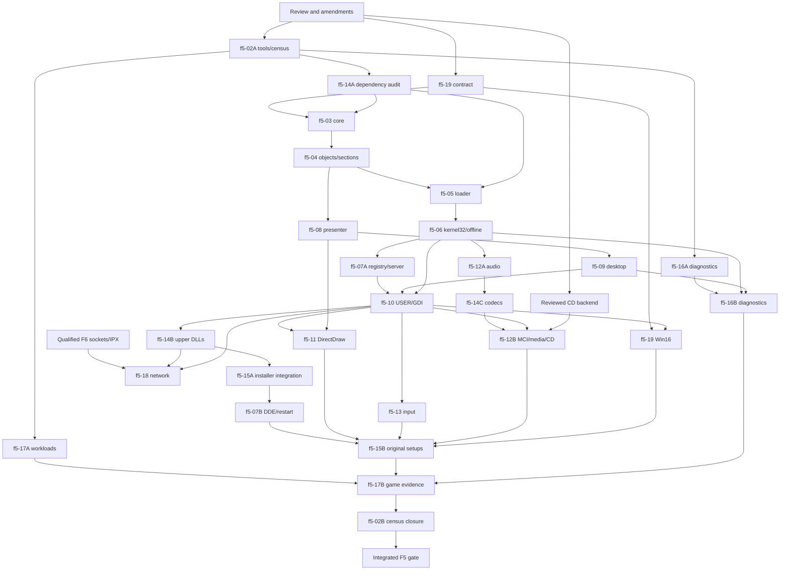

# F5 Win32 personality: Windows games of 1996–2004 on CiukiOS

Author: Claude (for the lead). Directive: f5-00. Date: 2026-10-13.
Status: draft for the lead's review, the Codex cross-review and the owner's
decisions listed under "Open questions for the owner". No code, build, QEMU
or hardware result is claimed by this document.

## Scope and authority

**[F5]** marks a requirement that becomes mandatory in step F5 and stays
binding afterwards; **[F6]** and **[F7]** mark the parts of this contract that
depend on those steps. MUST identifies a requirement, SHOULD a
recommendation and MAY an option. Normative tables MUST be read as
requirements, including their enumerated values and exclusions. Numbers,
limits, layouts and budgets below are proposed CiukiOS policy informed by
Microsoft's documentation; they are not Microsoft requirements and not
measurements.

**[F5]** Implementations MUST follow this document together with
[execution-abi.md](execution-abi.md) (F2 extension and its amendments),
[posix-subset.md](posix-subset.md), [vfs-storage-contract.md](vfs-storage-contract.md),
[device-firmware-ownership.md](device-firmware-ownership.md),
[f4-audio-media-contract.md](f4-audio-media-contract.md),
[boot-memory.md](boot-memory.md), [hardware-baseline.md](hardware-baseline.md),
[test-architecture.md](test-architecture.md), the desktop protocol in
[../desktop.md](../desktop.md) and, for networking, the F6 draft
[network-contract.md](network-contract.md). The F0–F4 QEMU gates MUST keep
passing on every integrated image. The native F2 ABI MUST NOT change for
native ELF programs: every kernel addition in this contract is additive and
applies only to processes whose personality is `win32`.

The owner's decision of 2026-10-13 (dev diary 2026-10-13-01) makes F5 the
Win32 personality — "an API Win32 compatible and working, to install and run
the Windows games of the era without additional steps" — and makes F8 the
optional native ports. It supersedes the phase assignment of the F5 and F8
rows in posix-subset.md's consumer table; those rows remain a historical
record of the F2 boundary.

**Directive numbering.** `f5-01` already exists
([f5-01-native-ide-and-compiler.md](../directives/f5-01-native-ide-and-compiler.md),
Tiny C Compiler and CiukIDE, assigned under the earlier F5 scope and merged
on 2026-10-12). To avoid overwriting it, this contract numbers its
directives **f5-02 to f5-18**. The lead MAY renumber them (question Q1).

## Goal and non-goals

### Goal

- **G1.** A player installs a Windows game of 1996–2004 with its original
  installer — from a CD, an ISO image or a downloaded setup program — and
  plays it from the Start menu, as on Windows 98 SE or ME, with no extra
  configuration step. Uninstalling through the Control Panel works when the
  game registered an uninstaller. The game data stays the player's copy.
- **G2.** PE32 executables and DLLs for i386 (`IMAGE_FILE_MACHINE_I386`), GUI
  and console subsystems, linked by the compilers and linkers of the era
  (Microsoft Visual C++ 4.x–7.x, Borland/Inprise, Watcom, Delphi, MinGW) and
  compressed by the common executable packers when they only use documented
  APIs.
- **G3.** The API surface games of the era used: kernel32, user32, gdi32,
  advapi32, winmm, DirectDraw 1–7, DirectSound 1–8 (playback), DirectInput
  3–8 (keyboard and mouse), the common controls, common dialogs and shell
  functions installers need, COM in-process servers, version and INI APIs.
  Direct3D 7/8 and OpenGL are F7; Winsock and DirectPlay are F6.
- **G4.** One canonical image for every machine (owner decision 2026-10-11);
  128 MiB is the reference RAM for the gate.
- **G5.** Containment: a Win32 crash, hang or exit never takes down the
  desktop, another process or a DOS VM, and always restores the desktop's
  display mode and input.
- **G6.** Honest diagnostics: every missing DLL, export or unimplemented
  behaviour is reported by name, on screen and in the serial/boot log.

### Non-goals

- **N1.** General Windows desktop compatibility: office suites, browsers,
  development tools, .NET, Java, services, multiple users, access control.
  Security APIs succeed without enforcement, as on Windows 9x.
- **N2.** Kernel-mode code of any kind: VxDs, `.sys` drivers, `DeviceIoControl`
  to drivers, ring-0 copy protection (SafeDisc, SecuROM, StarForce) and
  anti-cheat. Retail titles that require them are out of scope; the
  personality MUST fail such a request with a named diagnostic and MUST NOT
  emulate or bypass a protection scheme.
- **N3.** Win16 (NE) executables, including 16-bit installer stubs, unless
  the owner answers question Q3 otherwise. DOS programs keep running in DOS
  windows (F3); starting them from a Win32 process is a MAY (f5-15).
- **N4.** Windows binary drivers (display, audio, printer, codec drivers
  shipped as VxD or `.drv`).
- **N5.** NTFS-specific semantics, alternate streams, ACLs, junctions; 64-bit
  images; the NT native API as a public application interface.
- **N6.** Windows Installer (MSI), Windows Update, Internet Explorer and HTML
  rendering, DirectShow filter graphs beyond MCI AVI playback, DirectMusic
  and DirectPlay voice (DirectMusic MAY follow the gate if a chosen title
  needs it).
- **N7.** Physical port I/O, physical memory access and DMA by applications.
  Selected ports MAY be emulated by a shim (W20); none reaches hardware.
- **N8.** Printing, TAPI, MAPI, scanners, joystick and gamepad hardware (no
  CiukiOS driver exists; DirectInput reports no game controllers).
- **N9.** Game payloads in the canonical image or in any release artefact.
- **N10.** Bit-exact reproduction of Windows 98 internals: the 9x shared
  arena, VxD services, Win16Mutex, thunks, the 9x heap layout.
- **N11.** Performance parity with Windows 98 on identical hardware is a
  measurement recorded for every title, not by itself a gate (question Q7).

## Sources

Primary references checked on 2026-10-13. The decisions below cite them
where they rely on them; anything not backed by a source here is labelled
as CiukiOS policy.

| Source | Used for |
| --- | --- |
| Microsoft, [PE format](https://learn.microsoft.com/en-us/windows/win32/debug/pe-format) | Headers, sections, base relocations, import/export/delay-load/TLS/resource/load-config directories, alignment rules. |
| Microsoft, [DLL search order](https://learn.microsoft.com/en-us/windows/win32/dlls/dynamic-link-library-search-order), [DLL redirection](https://learn.microsoft.com/en-us/windows/win32/dlls/dynamic-link-library-redirection), [DllMain](https://learn.microsoft.com/en-us/windows/win32/dlls/dynamic-link-library-entry-point-function) | Search order with safe DLL search mode off (era behaviour), KnownDLLs, loader-lock rules. |
| Microsoft, [Thread Local Storage](https://learn.microsoft.com/en-us/windows/win32/procthread/thread-local-storage), [Fibers](https://learn.microsoft.com/en-us/windows/win32/procthread/fibers), [Process and thread functions](https://learn.microsoft.com/en-us/windows/win32/procthread/process-and-thread-functions) | TLS slots, fibers, process/thread lifetime. |
| Microsoft, [Structured exception handling](https://learn.microsoft.com/en-us/windows/win32/debug/structured-exception-handling), [Exception dispatching](https://learn.microsoft.com/en-us/windows/win32/debug/exception-dispatching), [EXCEPTION_RECORD](https://learn.microsoft.com/en-us/windows/win32/api/winnt/ns-winnt-exception_record), [CONTEXT](https://learn.microsoft.com/en-us/windows/win32/api/winnt/ns-winnt-context), [TEB](https://learn.microsoft.com/en-us/windows/win32/api/winternl/ns-winternl-teb) | Exception records, contexts, dispatch order, documented TEB offsets. |
| Microsoft, [VirtualAlloc](https://learn.microsoft.com/en-us/windows/win32/api/memoryapi/nf-memoryapi-virtualalloc), [VirtualProtect](https://learn.microsoft.com/en-us/windows/win32/api/memoryapi/nf-memoryapi-virtualprotect), [Memory limits for Windows releases](https://learn.microsoft.com/en-us/windows/win32/memory/memory-limits-for-windows-releases) | Reserve/commit, 64 KiB granularity, protections, 2 GiB user space for 32-bit processes. |
| Microsoft, [Wait functions](https://learn.microsoft.com/en-us/windows/win32/sync/wait-functions), [Asynchronous procedure calls](https://learn.microsoft.com/en-us/windows/win32/sync/asynchronous-procedure-calls), [MsgWaitForMultipleObjects](https://learn.microsoft.com/en-us/windows/win32/api/winuser/nf-winuser-msgwaitformultipleobjects), [Process security and access rights](https://learn.microsoft.com/en-us/windows/win32/procthread/process-security-and-access-rights) | Waitable objects, 64-handle waits, alertable waits, message waits. |
| Microsoft, [Registry](https://learn.microsoft.com/en-us/windows/win32/sysinfo/registry), [Registry hives](https://learn.microsoft.com/en-us/windows/win32/sysinfo/registry-hives), [Uninstall registry key](https://learn.microsoft.com/en-us/windows/win32/msi/uninstall-registry-key), [Application registration (App Paths)](https://learn.microsoft.com/en-us/windows/win32/shell/app-registration), [GetPrivateProfileString](https://learn.microsoft.com/en-us/windows/win32/api/winbase/nf-winbase-getprivateprofilestring) | Keys installers and games use; INI files. |
| Microsoft, [Naming files, paths and namespaces](https://learn.microsoft.com/en-us/windows/win32/fileio/naming-a-file), [GetShortPathName](https://learn.microsoft.com/en-us/windows/win32/api/fileapi/nf-fileapi-getshortpathnamew), [GetDiskFreeSpace](https://learn.microsoft.com/en-us/windows/win32/api/fileapi/nf-fileapi-getdiskfreespacea), [MoveFileEx](https://learn.microsoft.com/en-us/windows/win32/api/winbase/nf-winbase-movefileexa) | Path syntax, short names, free-space arithmetic, delayed replacement. |
| Microsoft, [OSVERSIONINFOA](https://learn.microsoft.com/en-us/windows/win32/api/winnt/ns-winnt-osversioninfoa), [CreateToolhelp32Snapshot](https://learn.microsoft.com/en-us/windows/win32/api/tlhelp32/nf-tlhelp32-createtoolhelp32snapshot), [ExitWindowsEx](https://learn.microsoft.com/en-us/windows/win32/api/winuser/nf-winuser-exitwindowsex), [QueryPerformanceFrequency](https://learn.microsoft.com/en-us/windows/win32/api/profileapi/nf-profileapi-queryperformancefrequency), [timeBeginPeriod](https://learn.microsoft.com/en-us/windows/win32/api/timeapi/nf-timeapi-timebeginperiod), [Multimedia timers](https://learn.microsoft.com/en-us/windows/win32/multimedia/multimedia-timers) | Version identity, process snapshots, restart requests, timing. |
| Microsoft, [Windows GDI](https://learn.microsoft.com/en-us/windows/win32/gdi/windows-gdi), [DirectDraw](https://learn.microsoft.com/en-us/windows/win32/directdraw/directdraw), [DirectSound (legacy)](https://learn.microsoft.com/en-us/previous-versions/windows/desktop/ee416960(v=vs.85)), [DirectInput (legacy)](https://learn.microsoft.com/en-us/previous-versions/windows/desktop/ee416842(v=vs.85)), [Winsock 2](https://learn.microsoft.com/en-us/windows/win32/winsock/windows-sockets-start-page-2) | API semantics of GDI and the DirectX 7/8-era components. The DirectX 7.0 and 8.1 SDK help files are the authoritative period documents; the import directive f5-02 MUST record which archived copies were consulted. |
| R. Chen, [mapping the same shared memory twice](https://devblogs.microsoft.com/oldnewthing/20120127-00/?p=8433) | Windows 95 and NT return different pointers for repeated views; neither may be relied upon. |
| Internet Archive items listed in "Acceptance set" | Installer files, sizes and SHA-1 digests published by the archive; installer engines identified on 2026-10-13 from the first MiB of each file. |

The Microsoft pages above are current documentation: where Windows 98
behaved differently from what they describe, the difference MUST be
established from the period SDK documentation or by a recorded experiment on
Windows 98 SE, and noted in the directive's report before it is implemented.

## Repository comparison

Checked on `main` `0d0a73ea` with bounded reads of the contracts and of
`src/kernel/arch/desc.c`, `src/kernel/core/fpu.c` and
`src/kernel/include/ciuki/abi.h`. These are existing mechanisms, not
evidence of Win32 support.

| Existing mechanism | Consequence for F5 |
| --- | --- |
| execution-abi.md "Native executable format": ELF32 `ET_EXEC` only; "PE32 is not accepted by the native loader; it is a later compatibility personality (decision D4)". | The kernel recognises PE at spawn and creates a `win32` process (W1); the ELF loader is unchanged. |
| Native layout: user range `0x00000000–0xBFFFFFFF`, ELF at `0x00400000–0x0FFFFFFF`, heap below `0x20000000`, mmap arena `0x20000000–0xBFBFFFFF`; mmap only private anonymous, no `MAP_FIXED`, no W+X, no file-backed or shared mappings. | A separate Win32 virtual-memory service with fixed placement, reserve/commit, W+X, guard pages and section views (W8, W9). F2 mmap/brk are refused in `win32` processes. |
| `desc.c`: GDT index 7 is the per-thread GS TLS descriptor (selector `0x3b`), index 8 the per-VM LDT (`_Static_assert(ARCH_LDT_GDT_INDEX == CIUKI_TLS_GDT_INDEX + 1)`). | A per-thread FS descriptor for the TEB at GDT index 9, selector `0x4b` (W5). The F0 protection probe's GDT-size expectation changes accordingly. |
| `fpu.c`: CR4.OSFXSR/OSXMMEXCPT cleared ("F0 policy: SSE stays disabled for ring 3"); F2 ucontext carries a 108-byte FNSAVE image and "User SSE MUST stay disabled". | SSE is enabled per process for `win32` processes only, with XMM state in FXSAVE images (W6). Native behaviour, including #UD on SSE, is unchanged. |
| F2 signals: one active handler per thread; a synchronous fault inside a handler terminates the process; sigreturn restricts editable state. | Windows exception dispatch nests freely and resumes through a full context. A dedicated delivery path replaces signals for synchronous faults in `win32` processes (W7). |
| `abi.h`: calls 0–5 and 16–77 assigned (77 `DISPLAY_ACCEL`). The F6 draft proposes 75–87, already colliding with 75–77. | One multiplexed call `CIUKI_SYS_W32` with versioned records (W2); its number is assigned by the lead when f5-03 freezes it, after the F6 renumbering. |
| F2 limits: 64 processes, 256 threads system-wide, 16 threads and 128 fds per process, 1024 open descriptions system-wide. | Win32 handles live in their own per-process table and kernel object ledger (W10). The per-process thread limit for `win32` processes is raised to 32, subject to the memory measurement in f5-04. |
| Desktop protocol v1/v2.1: one window per channel, 16 channels, ASCII titles of 1–63 bytes, client-local absolute motion, no cursor control, no full-screen request. | Desktop protocol v3 (f5-09): several windows per channel, UTF-8 titles, client placement, styles, cursor shape/visibility/capture/clip/warp, relative motion, full-screen lease. |
| Call 74 (f1-23): query is public, mode set only by the desktop; modes 640×480–1600×1200, 16/24/32 bpp, linear only; 10 s switch watchdog. Presenter: synchronous XRGB8888 copy, no vsync. Savage 2D acceleration compile-time opt-in since `03bf0427`. | Games never set modes themselves: the desktop switches on their behalf under a revocable lease; 8 bpp and low resolutions are emulated by the presenter (W15). |
| `/dev/audio` (f4-01): at most eight streams, 2048-frame rings, U8/S16LE mono/stereo, 8–48 kHz, default S16LE stereo 48 kHz; ≤60 ms latency budget. | Each Win32 process mixes all its DirectSound/waveOut sources in user mode into one stream (W16). |
| Input events: set-1 scan codes, E0 keys OR `0x100`, Pause `0x200`, relative MOTION from the kernel; the desktop converts motion to client-local coordinates; `keymap.c` has US and Italian layouts. | DirectInput key codes are derived from set-1 codes; relative motion is forwarded under capture (W17). |
| VFS: 9x-style drive letters, case-insensitive and case-preserving names, MAX_PATH 259, CP437 short names generated with the fatgen103 `~N` algorithm, share modes, byte-range locks, open descriptions. The POSIX view rejects `\` and `:`. | kernel32 uses a drive-path file service with share modes (f5-04), not the POSIX path view. Lookup by the on-disk 8.3 alias MUST be verified (W12). |
| F4: ATAPI and ISO 9660 read-only volumes with drive letters; NTFS read-only. | CD and ISO installs use the existing drive letters; `GetDriveType` reports `DRIVE_CDROM`. |
| Call 72: DOS-window authority by exact path `/Programs/dosbox` and parent. Calls 70/71: process list and termination authority. | The same exact-path rule grants service authority to `w32srv`; Task Manager lists and ends Win32 processes without change. |

## Decisions

The decisions are numbered W1–W24 to avoid confusion with the foundations
decisions D1–D11.

- **W1 — Personality, not emulation.** **[F5]** A Win32 program MUST run as
  an ordinary CiukiOS process whose personality is `win32`, natively on the
  CPU, scheduled, isolated and accounted like any other process. The kernel
  MUST select this personality at spawn when the file has a valid `MZ`
  header whose `e_lfanew` designates `PE\0\0` with machine `0x14C` and
  optional-header magic `0x10B`; every other file keeps the existing ELF path
  and errors. No CPU emulator, second kernel or virtual machine is involved.
- **W2 — Layers.** **[F5]** The personality MUST consist of: (a) additive
  kernel services reached through one multiplexed system call
  `CIUKI_SYS_W32` with versioned, size-checked records; (b) user-mode system
  DLLs in PE format, loaded from a read-only builtin store; (c) one native
  service process `w32srv`; (d) desktop protocol v3. Kernel additions MUST be
  limited to what cannot be done safely in user mode: address-space control,
  the FS descriptor, exception delivery, waitable objects and handles,
  section objects, service endpoints and presentation leases.
- **W3 — Version identity.** **[F5]** The personality MUST report Windows 98
  Second Edition: major 4, minor 10, build 2222, platform
  `VER_PLATFORM_WIN32_WINDOWS`, CSD string `" A "`, and `GetVersion()` with
  bit 31 set. A shim MAY report Windows 95, ME, NT 4.0, 2000 or XP per title
  (W20). The DirectX version reported before F7 is question Q4.
- **W4 — 2 GiB address space.** **[F5]** Win32 processes MUST see the layout
  in "Address space": application memory below `0x70000000`, builtin DLLs in
  `0x70000000–0x7FFDFFFF`, nothing at or above `0x80000000`.
  `IMAGE_FILE_LARGE_ADDRESS_AWARE` MUST be ignored.
- **W5 — TEB through FS.** **[F5]** Each Win32 thread MUST run with FS
  selecting a per-thread DPL 3 data descriptor at GDT index 9 (selector
  `0x4b`) whose base is that thread's TEB; the kernel reloads it on every
  switch, like the GS descriptor of F2.
- **W6 — SSE for Win32 processes.** **[F5]** When CPUID reports FXSR and SSE,
  CR4.OSFXSR and CR4.OSXMMEXCPT MUST be set while a `win32` thread runs and
  cleared while a native thread runs; XMM and MXCSR state MUST be preserved
  across switches. DirectX 6.1 and the games of 1999–2004 select SSE code
  paths ([AnandTech, 1999](https://at-web1.www.anandtech.com/show/254/6));
  some check only CPUID, which an application can always read on these
  processors, and would fault on #UD. Whether Windows 98 SE itself set
  CR4.OSFXSR is not established by a primary source found on 2026-10-13;
  f5-03 MUST record the answer (period documentation or a recorded
  experiment) without changing this requirement.
- **W7 — Windows exception dispatch.** **[F5]** Synchronous faults in a
  `win32` thread MUST be delivered as Windows exceptions: the kernel writes an
  `EXCEPTION_RECORD` and a `CONTEXT` on the faulting thread's stack and
  resumes it at the personality's user-mode dispatcher, which walks the
  FS:[0] handler chain. Continuing MUST go through a "continue with context"
  operation. No signal-handler state is involved, so nested exceptions and
  handlers that fault are ordinary.
- **W8 — Win32 virtual memory.** **[F5]** A separate virtual-memory service
  MUST implement reservation and commitment at caller-chosen addresses with
  64 KiB allocation granularity and 4 KiB pages, the Win32 protections
  including execute-read-write and guard pages, and exact region queries. The
  F2 rule against W+X does not apply to `win32` processes: on these non-PAE
  processors any readable page is executable, and the games and packers of
  the era write code at run time.
- **W9 — Sections.** **[F5]** The kernel MUST provide section objects: image
  sections (one per builtin DLL file, read-only pages shared by every Win32
  process), pagefile-backed shared memory (named or unnamed), and file views.
- **W10 — Kernel objects.** **[F5]** Handles, waitable objects (events,
  mutexes, semaphores, waitable timers, processes, threads, message-queue
  objects), the named-object namespace, APC queues and thread suspension
  MUST live in the kernel. Waits on several objects, including "wait all",
  MUST be atomic in the kernel.
- **W11 — `w32srv`.** **[F5]** A native service process MUST own the registry,
  global atoms, the top-level window directory and window-handle allocation,
  the shell DDE service and the virtual restart. It is not on any wait or
  message hot path of a running game.
- **W12 — File-system view.** **[F5]** Win32 paths MUST map directly onto the
  existing VFS drive letters. The image builder MUST create `C:\WINDOWS`
  and `C:\Program Files` as listed in "File-system view".
- **W13 — Registry storage.** **[F5]** Hives MUST be stored on the system
  volume in a CiukiOS text format with two checksummed slots per hive, never
  in the Windows 9x or NT binary hive formats, which no game reads directly.
- **W14 — Builtin store.** **[F5]** The personality's DLLs MUST live in the
  read-only store `C:\System\Win32\` and MUST take precedence over files of the
  same name anywhere else (KnownDLL semantics), so an installer copying
  `ddraw.dll` or running a DirectX setup cannot replace them.
- **W15 — Presentation.** **[F5]** Games draw into system-memory surfaces that
  the kernel presenter copies to the framebuffer: through the desktop for
  windowed games, and directly from the game under a revocable present lease
  for full-screen exclusive games. 8 bpp palettised and low-resolution modes
  are emulated by the presenter. Mapping the framebuffer into a game is not
  part of the baseline (question Q5).
- **W16 — Audio.** **[F5]** Each Win32 process MUST mix its DirectSound and
  waveOut sources in user mode into one `/dev/audio` stream. MIDI output MUST
  use a software synthesizer selected under question Q6.
- **W17 — Input.** **[F5]** Keyboard input MUST keep the set-1 code space end
  to end: window messages derive scan codes and virtual keys from it,
  DirectInput key codes equal set-1 codes with E0 keys `|0x80`. Relative
  mouse motion MUST reach a process that holds capture or exclusive mouse
  access.
- **W18 — Time.** **[F5]** `QueryPerformanceFrequency` MUST return 1,193,182
  (the 8254 input clock) and the counter MUST derive from the PIT, never from
  the time-stamp counter, whose rate changes with SpeedStep on the T23's
  Pentium III-M. `GetTickCount` and `timeGetTime` MUST have 1 ms resolution.
- **W19 — Installers.** **[F5]** InstallShield, Wise, NSIS 2.x, IExpress
  with advpack, WinZip self-extractors and vendor installers MUST be
  supported for the acceptance set; MSI MUST be refused with a clear message;
  "restart Windows" MUST be a virtual restart of the personality.
- **W20 — Shims.** **[F5]** Per-title compatibility shims MUST be named,
  versioned and selected by executable identity from a read-only database,
  never by hidden code paths.
- **W21 — Diagnostics.** **[F5]** Missing DLLs and exports, unimplemented
  functions and unhandled exceptions MUST produce a named on-screen message
  in Windows 98 wording and a bounded `[win32]` record on serial and in the
  boot log.
- **W22 — Implementation.** **[F5]** The recommended option is the hybrid
  of "Implementation options": a CiukiOS-written core and selected reused
  open-source DLLs for the installer-facing long tail. The owner decides
  (question Q2).
- **W23 — Acceptance.** **[F5]** Ten named demo or shareware titles with
  freely downloadable installers form the gate; payloads never enter the
  image; each title installs, starts, plays and exits on QEMU and on both
  laptops.
- **W24 — Win16 excluded pending Q3.** **[F5]** An NE executable MUST be
  refused with "This program requires 16-bit Windows support, which CiukiOS
  does not provide" and a `[win32] refuse ne` record.

## Personality architecture

```text
 game.exe, setup.exe, application DLLs          (PE32, unmodified)
 ------------------------------------------------------------------
 builtin DLLs, C:\System\Win32\ (PE32, read-only, shared image pages)
   core: ntdll kernel32 user32 gdi32 advapi32 winmm ddraw dsound dinput
   upper: comctl32 comdlg32 shell32 shlwapi ole32 oleaut32 riched20
          cabinet advpack setupapi version lz32 msacm32 msvcrt ...
 ------------------------------------------------------------------
 CIUKI_SYS_W32 (kernel personality)   F2 calls (VFS, channels, audio,
   VM, FS/TEB, exceptions, objects,    surfaces, clocks, process list)
   sections, endpoints, leases
 ------------------------------------------------------------------
 w32srv (native ELF)   desktop (native ELF, protocol v3)   kernel
```

**[F5]** The core DLLs MUST reach the kernel only through `CIUKI_SYS_W32`
and the existing F2 calls, through the `int 0x80` gate, from code in the
builtin store. Application code MUST NOT need either: a game issuing
`int 0x80` itself gets whatever the F2 ABI does with its registers, as on
Windows a game issuing a private system call gets undefined results.
`int 2Eh` and `sysenter` from application code MUST raise
`EXCEPTION_ACCESS_VIOLATION` and `EXCEPTION_ILLEGAL_INSTRUCTION` respectively.

**[F5]** A Win32 process MUST NOT use newlib or the F2 SDK runtime. The core
DLLs are freestanding PE images built with the pinned clang (f5-02); they
call the kernel directly. The F2 descriptor table of a Win32 process exists
but is used only by the personality (files, channels, audio, surfaces).

**[F5]** `w32srv` MUST be a native F2 program at `/System/Win32/w32srv`,
started by the desktop at its own start when that file exists, and granted
service authority by the kernel only for that exact path with the
supervisor's desktop as parent (the rule of call 72). Its loss MUST NOT
terminate running Win32 processes: registry, window-directory and atom
operations then fail with `ERROR_SERVICE_NOT_ACTIVE` (1062) until the desktop
restarts it, and the restarted server reloads the last committed hives.

## Process, thread and object model

### Process creation and identity

**[F5]** Spawning a PE file — from the desktop, from Files, or through
`CreateProcess` — MUST create a `win32` process whose initial thread starts
in the builtin loader with a process-parameters block: image path, command
line (one string, as given), current directory, environment block,
`STARTUPINFO` fields, and the handles of the service endpoints (desktop,
`w32srv`). The kernel MUST NOT parse the command line. Failure before the
first instruction MUST leave no visible process, as F2 spawn requires.

**[F5]** Process and thread identifiers returned by the Win32 API MUST be the
CiukiOS PID and TID, so Task Manager, `[win32]` records and Toolhelp agree.
`GetCurrentProcess()` and `GetCurrentThread()` MUST return the pseudo-handles
`(HANDLE)-1` and `(HANDLE)-2`. Exit codes MUST be 32-bit values;
`GetExitCodeProcess` MUST return `STILL_ACTIVE` (259) while the process runs.
`TerminateProcess`, `ExitProcess` (with `DLL_PROCESS_DETACH` notifications
on the normal path only) and termination by Task Manager MUST converge on the
existing idempotent teardown, then close every Win32 handle, release
sections, leases, endpoints and audio streams.

**[F5]** `CreateProcess` MUST support `bInheritHandles` with per-handle
inheritance flags, `CREATE_SUSPENDED`, `CREATE_NEW_CONSOLE` (ignored),
priority-class flags, an explicit environment block and current directory,
and the module-name/command-line search rules of the period documentation
(application directory, current directory, system directory, Windows
directory, `PATH`; `.exe` appended when absent). Starting an ELF file
through `CreateProcess` MUST start it as a native process with no inherited
Win32 handles. A DOS `MZ` file without a PE header MUST fail with
`ERROR_BAD_EXE_FORMAT` (193) unless the DOS-window launch MAY of f5-15 is
implemented.

### Threads, TEB and FS

**[F5]** Each Win32 thread MUST be one kernel thread with a TEB of 8 KiB
(two pages) allocated by the kernel in the application region and mapped
read-write. The FS descriptor MUST have base = TEB and limit = 8191. At
least the following documented offsets MUST be valid; other fields are
private to the core DLLs:

| Offset | Field | Rule |
| --- | --- | --- |
| `0x00` | `ExceptionList` | Head of the SEH chain; `0xFFFFFFFF` terminates it. |
| `0x04`, `0x08` | `StackBase`, `StackLimit` | Updated as the stack is committed. |
| `0x10` | `FiberData` | Current fiber, or the TEB version value when not a fiber. |
| `0x14` | `ArbitraryUserPointer` | Free for the application. |
| `0x18` | `Self` | Linear address of the TEB. |
| `0x20`, `0x24` | `ClientId` | PID and TID. |
| `0x2C` | `ThreadLocalStoragePointer` | Array of static TLS blocks (compiler `__declspec(thread)` code reads it through `fs:[2Ch]`). |
| `0x30` | `ProcessEnvironmentBlock` | Process block (below `0x70000000`). |
| `0x34` | `LastErrorValue` | `GetLastError`/`SetLastError`. |
| `0xE10` | `TlsSlots[64]` | `TlsAlloc` slots 0–63. |

The first seven fields are the `NT_TIB` layout shared by Windows 95/98 and
NT; offsets `0x2C`, `0x30` and `0xE10` follow the documented `TEB`
structure. Windows 9x thread blocks differed beyond `NT_TIB`; any title that
depends on a 9x-only field MUST be handled by a named shim after the
difference has been established (see "Sources").

**[F5]** Thread creation MUST reserve the stack from the PE header
(`SizeOfStackReserve`, default 1 MiB, rounded to 64 KiB) or from the
`CreateThread` argument, commit `SizeOfStackCommit` plus one guard page, and
grow the commitment on access to the guard page until one page remains,
which then raises `EXCEPTION_STACK_OVERFLOW` (`0xC00000FD`). Initial x87
control word MUST be `0x027F` (53-bit precision, all exceptions masked) and
MXCSR `0x1F80`. `TlsAlloc` MUST provide 64 slots; 9x had 80 and the NT
expansion slots are not required.

**[F5]** Suspension (`SuspendThread`/`ResumeThread` with counts up to 127),
`GetThreadContext`/`SetThreadContext` on a suspended thread of the same
process (integer, control, segment, x87 and extended-register flags;
debug-register flags accepted and ignored with zero values), and
`ExitThread`/`TerminateThread` MUST be implemented. Suspending a thread
MUST take effect at its next return to user mode and MUST NOT stop it inside
the kernel holding a lock.

### Handles and kernel objects

**[F5]** Every Win32 process MUST have a kernel handle table, separate from
its F2 descriptor table, with handle values that are non-zero multiples of
four, at most 4096 handles per process and a system-wide ledger of 8192
Win32 objects charged at creation. `CloseHandle` on an invalid handle MUST
fail with `ERROR_INVALID_HANDLE` (6) and MUST NOT raise an exception (9x
behaviour). `DuplicateHandle` MUST work within a process and between
processes when the caller holds a handle to both. Access masks MUST be
recorded and returned, but not enforced beyond the object's operations.

| Object | Required semantics |
| --- | --- |
| Event | Manual and auto reset; `SetEvent`, `ResetEvent`, `PulseEvent` (wakes current waiters only). |
| Mutex | Owner thread, recursion count, release by non-owner fails `ERROR_NOT_OWNER` (288), owner death makes the next wait return `WAIT_ABANDONED`. |
| Semaphore | Count and maximum; release beyond maximum fails `ERROR_TOO_MANY_POSTS` (298). |
| Waitable timer | Absolute or relative due time, period, manual/synchronization, optional completion APC. |
| Process, thread | Signalled at exit; exit code retained while a handle exists. |
| Message queue | One per thread with window or message activity; wake bits per `QS_*` class (below). |
| Section | Image, pagefile-backed or file-backed (see "Memory"). |
| File | A VFS open description with Win32 share and access flags. |
| Change notification | MAY: `FindFirstChangeNotification` signalled by VFS change hooks. |

**[F5]** Named events, mutexes, semaphores, waitable timers and sections
MUST share one case-sensitive, flat namespace of names up to 260 characters
(backslashes are ordinary characters; `Global\` and `Local\` prefixes are
stripped). Opening an existing name with `Create*` MUST return a handle to
it and set `ERROR_ALREADY_EXISTS` (183); a name used by an object of another
type MUST fail with `ERROR_INVALID_HANDLE`. Games use named mutexes to detect
a second instance; this MUST work across processes.

### Waits, APCs and message queues

**[F5]** `WaitForSingleObject(Ex)`, `WaitForMultipleObjects(Ex)` (1–64
handles, any or all) and `SignalObjectAndWait` MUST be kernel operations
with millisecond timeouts rounded up to the 1 ms timer quantum, `INFINITE`,
and results `WAIT_OBJECT_0+n`, `WAIT_ABANDONED_0+n`, `WAIT_TIMEOUT` (258),
`WAIT_IO_COMPLETION` (192) and `WAIT_FAILED`. "Wait all" MUST acquire every
object atomically or none. Auto-reset events, mutexes and semaphores MUST be
consumed only by the waiter that is satisfied. A wait MUST be interruptible
by process termination.

**[F5]** User APCs (`QueueUserAPC`, waitable-timer completion routines,
`ReadFileEx`/`WriteFileEx` completion routines) MUST be queued per thread and
run only when the thread performs an alertable wait (`SleepEx`, the `Ex` wait
functions with `bAlertable`, `MsgWaitForMultipleObjectsEx` with
`MWMO_ALERTABLE`), which then returns `WAIT_IO_COMPLETION` after all queued
APCs ran. APCs MUST run on the thread's own stack in user mode with no kernel
lock held.

**[F5]** The message-queue object MUST record wake bits for posted messages,
sent messages, input (keys, mouse moves, buttons), paint, timers and hot
keys. `MsgWaitForMultipleObjects(Ex)` MUST wait on the handles plus the
calling thread's queue with the requested `QS_*` mask, as one kernel wait.
`PostMessage` and `PostThreadMessage` to a thread of another process MUST
be a kernel queue operation of fixed-size records (window, message,
wParam, lParam, time, point); `SendMessage` to another process MUST queue a
sent-message record and wait for the reply while still dispatching messages
sent to the caller. Pointer parameters MUST NOT be marshalled across
processes except for `WM_COPYDATA`, `WM_SETTEXT` and `WM_GETTEXT`, whose
buffers (at most 64 KiB) the kernel copies. Each queue MUST hold at most
10,000 posted messages, the Windows default, and fail further posts with
`ERROR_NOT_ENOUGH_QUOTA` (1816).

### Fibers, TLS and scheduling

**[F5]** Fibers (`ConvertThreadToFiber`, `CreateFiber`, `SwitchToFiber`,
`DeleteFiber`, `GetFiberData`) MUST be implemented entirely in user mode by
swapping the stack, `ExceptionList`, `StackBase`, `StackLimit` and
`FiberData` fields of the TEB together with the callee-saved registers and
the x87 control word.

**[F5]** Win32 priorities MUST map onto the existing scheduler classes
without ever reaching `device`: idle class and `THREAD_PRIORITY_IDLE` to
`idle`; normal and high classes to `normal`; `THREAD_PRIORITY_TIME_CRITICAL`
and the realtime class to `interactive`. The threads of the process that owns
the focused window or a full-screen lease MUST run at `interactive`, like a
focused DOS VM, and return to their mapped class when focus leaves.
`Sleep(0)` and `SwitchToThread` MUST yield; `Sleep(n)` MUST NOT return
early. `SetProcessAffinityMask` MUST accept mask 1 and fail other masks.

## Memory

### Address space

**[F5]** A Win32 process MUST have this layout; the kernel half above
`0xC0000000` is unchanged:

| Range | Use |
| --- | --- |
| `0x00000000–0x0000FFFF` | No access (null-pointer region). |
| `0x00010000–0x6FFFFFFF` | Application region: EXE at its preferred base (usually `0x00400000`), application DLLs, heaps, stacks, TEBs, PEB, `VirtualAlloc`, section views, emulated surfaces. |
| `0x70000000–0x7FFDFFFF` | Builtin DLL region: image sections of the builtin store at fixed, non-overlapping bases recorded in the store manifest. |
| `0x7FFE0000–0x7FFE0FFF` | Shared user data page, read-only: tick count, interrupt time, system time, kept current by the kernel every millisecond. |
| `0x7FFE1000–0x7FFFFFFF` | No access. |
| `0x80000000–0xBFFFFFFF` | Never mapped in a Win32 process. |

**[F5]** An EXE without base relocations MUST load at its preferred base or
fail with `ERROR_BAD_EXE_FORMAT`; nothing else is mapped in the application
region before the EXE. The main thread stack MUST be placed below the EXE
when it fits in `0x00010000–ImageBase`, otherwise first-fit from the bottom.
`VirtualAlloc` without an address MUST use bottom-up first fit at 64 KiB
granularity (top-down with `MEM_TOP_DOWN`) inside the application region.

Windows 9x placed its system DLLs and shared views above 2 GiB; games of the
era therefore tolerate system code at high addresses. This contract keeps
everything below 2 GiB (W4) because titles built for Windows 2000 and XP
were never tested with pointers above 2 GiB. A 9x shared-arena shim is
deliberately not provided.

### Virtual-memory service

**[F5]** The kernel MUST implement these operations for the calling process;
the read and write rows MUST also work on another process through a process
handle (`ReadProcessMemory`, `WriteProcessMemory`):

| Operation | Required behaviour |
| --- | --- |
| reserve | Address 0 (placement as above) or a 64 KiB-aligned address; `ERROR_INVALID_ADDRESS` (487) on overlap. |
| commit | Pages inside a reservation; committing committed pages succeeds; contents zero on first commit. `MEM_RESERVE` and `MEM_COMMIT` together in one call. |
| decommit, release | Decommit any page range; release only a whole reservation from its base with size 0. |
| protect | `PAGE_NOACCESS`, `READONLY`, `READWRITE`, `WRITECOPY` (treated as read-write for private memory), `EXECUTE`, `EXECUTE_READ`, `EXECUTE_READWRITE`, `EXECUTE_WRITECOPY`, plus `PAGE_GUARD` and `PAGE_NOCACHE` (accepted, no effect). Returns the old protection of the first page. |
| query | `MEMORY_BASIC_INFORMATION` for free, reserved, committed, image and mapped regions, with allocation base, allocation protection, state, type and region size exact to the page. |
| read/write other process | Copy between processes for valid committed ranges; partial copies report bytes transferred. |

**[F5]** A guard page MUST raise `STATUS_GUARD_PAGE_VIOLATION`
(`0x80000001`) once and lose its guard attribute, except in the stack
reservation where the kernel moves the guard down transparently. Execute
protections MUST be recorded and reported but cannot be enforced on the
non-PAE processors of the baseline; no title may rely on enforcement.

**[F5]** Commitment MUST be charged against physical memory at commit time,
as F2 requires for anonymous mappings: no overcommit and no swap. Reserving
costs only address space and page-table metadata. `GlobalMemoryStatus` MUST
report total physical memory, available physical memory, a page-file total
equal to the commit limit, and 2 GiB of virtual address space; every field
MUST be capped at 2 GiB − 1 so that period arithmetic does not overflow.

### Sections, heaps and file mappings

**[F5]** Image sections: the kernel MUST map each builtin DLL from a single
section whose read-only pages are shared by all Win32 processes, and whose
writable pages are private copies on first write. Builtin DLLs MUST be
linked at their fixed base in the builtin region and therefore never
relocated. Application DLLs and EXEs MAY share pages when the same file
loads at the same base in several processes; this is a SHOULD measured in
f5-04, because installers spawn several processes that load the same
installer DLLs.

**[F5]** `CreateFileMapping`/`MapViewOfFile(Ex)`/`UnmapViewOfFile`/
`FlushViewOfFile` MUST support: pagefile-backed sections, named or
unnamed, shared coherently by every process that maps them; read-only file
views; and writable file views whose modified pages are written back on
`FlushViewOfFile`, unmap and process exit. Two processes MAY map the same
pagefile-backed section; the same file MUST NOT have two writable views in
different processes (`ERROR_ACCESS_DENIED`), a restriction recorded as a
departure. Views MUST be placed at 64 KiB granularity; `MapViewOfFileEx`
with an address MUST honour it or fail.

**[F5]** The process heap and `HeapCreate`/`HeapAlloc`/`HeapReAlloc`/
`HeapFree`/`HeapSize`/`HeapValidate`/`HeapWalk` MUST be implemented in the
core with serialization by default and `HEAP_NO_SERIALIZE` honoured;
`GlobalAlloc`/`LocalAlloc` MUST support fixed and moveable blocks with lock
counts and `GMEM_ZEROINIT`. Freed memory MUST NOT be zeroed or poisoned by
default (titles of the era read freed blocks; a shim MAY change this).

## Exceptions and processor state

**[F5]** A user fault in a `win32` thread MUST be translated as follows,
then delivered as in W7 to the dispatcher entry point the loader registered
for the process:

| CPU event | Exception code | Information |
| --- | --- | --- |
| `#PF` not present or protection | `EXCEPTION_ACCESS_VIOLATION` `0xC0000005` | `[0]` 0 read, 1 write; `[1]` CR2. |
| `#PF` on a guard page | `STATUS_GUARD_PAGE_VIOLATION` `0x80000001` | Same as above. |
| `#GP` from a privileged instruction (`cli`, `sti`, `hlt`, `in`, `out`, `ins`, `outs`, control/debug-register moves) | `EXCEPTION_PRIV_INSTRUCTION` `0xC0000096`, unless an I/O shim emulates the port | — |
| Other `#GP`, `#SS`, `#NP` | `EXCEPTION_ACCESS_VIOLATION` | `[0]` 0, `[1]` `0xFFFFFFFF`. |
| `#UD` | `EXCEPTION_ILLEGAL_INSTRUCTION` `0xC000001D` | — |
| `#DE` | `EXCEPTION_INT_DIVIDE_BY_ZERO` `0xC0000094` when the divisor is zero, `EXCEPTION_INT_OVERFLOW` `0xC0000095` otherwise | — |
| `#BP` (`int3`) | `EXCEPTION_BREAKPOINT` `0x80000003` | EIP of the `int3` byte. |
| `#DB` single step | `EXCEPTION_SINGLE_STEP` `0x80000004` | — |
| `#MF` | `0xC000008D`–`0xC0000093` from the x87 status word (denormal, divide by zero, inexact, invalid, overflow, stack check, underflow) | — |
| `#XM` | `STATUS_FLOAT_MULTIPLE_FAULTS` `0xC00002B4` or `..._TRAPS` `0xC00002B5` | — |
| `#AC` | `EXCEPTION_DATATYPE_MISALIGNMENT` `0x80000002` | — |

**[F5]** The `CONTEXT` MUST be the i386 layout with `CONTEXT_FULL`,
`CONTEXT_FLOATING_POINT` (108-byte x87 save area plus `Cr0NpxState`) and,
when FXSR is present, `CONTEXT_EXTENDED_REGISTERS` (512-byte FXSAVE image).
The kernel MUST deliver: the record and context on the user stack below the
interrupted ESP (aligned to 4), then EIP at the dispatcher with the two
pointers as arguments. If that stack area is not writable, the process MUST
terminate with exit code `0xC00000FD` and a `[win32] crash` record. The
dispatcher, not the kernel, MUST walk the handler chain, run unwinds,
`UnhandledExceptionFilter` and `SetUnhandledExceptionFilter` filters.

**[F5]** "Continue with context" MUST validate the context before restoring
it: segment registers MUST equal the thread's user selectors (FS the TEB
selector), EFLAGS may change only the arithmetic flags, TF, DF and AC, EIP and
ESP MUST be user addresses below `0x7FFE0000` or in the builtin region, and
x87/FXSAVE reserved fields and MXCSR reserved bits MUST be sanitized. An
invalid context MUST terminate only that process. `RaiseException` MUST use
the same delivery with the caller's context, without a CPU fault.

**[F5]** When a `win32` thread is the outgoing or incoming lazy-FPU owner,
the `#NM` handler MUST execute `FXSAVE`/`FXRSTOR` with CR4.OSFXSR set so that
XMM registers are saved and restored, and MUST then leave CR4 as the
incoming thread requires (W6). A native thread MUST still observe #UD on SSE
instructions. Asynchronous termination (Task Manager, owner death) MUST
continue to use the F2 teardown and never run user code.

## PE loader

The loader is user-mode code in the core `ntdll`; the kernel only creates
image sections and maps views. Every rule below MUST be covered by a
fixture of the PE fixture set (f5-02) before its directive closes.

### Accepted images

**[F5]** The loader MUST accept a PE32 image when: `e_magic` is `MZ`;
`e_lfanew` is 4-aligned and the headers lie within the file; the signature
is `PE\0\0`; `Machine` is `0x14C`; the optional header magic is `0x10B` and
`SizeOfOptionalHeader` covers the data directories it declares (at most 16);
`FileAlignment` is a power of two from 512 to 64 KiB, or equal to
`SectionAlignment` when that is below 4 KiB; `SectionAlignment` is a power
of two ≥ `FileAlignment`; `SizeOfImage` ≤ 512 MiB; section headers neither
overlap in virtual space nor exceed `SizeOfImage`; raw data lies within the
file or is zero-filled when beyond it; every RVA used by a directory, with
its size, lies inside the image without 32-bit wrap. Subsystem MUST be GUI
(2) or console (3); native (1), POSIX (7) and Windows CE subsystems MUST be
refused. `MajorSubsystemVersion` above 5 MUST be accepted with a log record,
not refused. Checksums and the `DllCharacteristics` flags of later Windows
versions MUST be ignored. Section characteristics MUST give each page its
protection; a writable and executable section MUST map read-write-execute.

**[F5]** Malformed images MUST fail with `ERROR_BAD_EXE_FORMAT` (193) and a
`[win32] load` record naming the first failed check, never with a crash of
the loader or a partially initialised process. Images whose sections overlap
the headers or each other, executable packers' unusual but valid layouts
(raw size 0 with virtual size > 0, sections sharing raw data, headers inside
the first section's alignment gap) MUST load as Windows does.

### Relocations

**[F5]** When an image cannot load at its preferred base it MUST be relocated
with `IMAGE_REL_BASED_HIGHLOW` (3) and `IMAGE_REL_BASED_ABSOLUTE` (0) entries;
`HIGH`, `LOW` and `HIGHADJ` (1, 2, 4) SHOULD be supported; any other type
MUST fail the load. A DLL whose preferred base is taken MUST be relocated;
a DLL without relocations whose base is taken MUST fail with
`ERROR_BAD_EXE_FORMAT`. Relocation MUST be applied to private copies of the
affected pages only.

### Imports, exports and binding

**[F5]** Import descriptors MUST be resolved by name (using the hint first,
then a binary search of the export name table) and by ordinal, through the
import address table; an empty or absent original-first-thunk table (Borland
style) MUST use the IAT itself. Forwarded exports (`DLL.Name` and
`DLL.#ordinal`) MUST be followed up to 16 levels. Bound imports MUST be
ignored and re-resolved (the timestamps belong to other Windows builds).
Delay-load descriptors MUST be left to the image's own helper, which needs
`LoadLibraryA` and `GetProcAddress` only. The IAT MUST be writable during
resolution and then given its section's protection.

**[F5]** A missing DLL MUST fail process start with the Windows 98 message
"The dynamic link library NAME could not be found in the specified path …"
and a missing export with "The NAME.EXE file is linked to missing export
DLL:FUNCTION." Both MUST also be recorded with the DLL and symbol name (W21).
`LoadLibrary` of a missing DLL MUST fail with `ERROR_MOD_NOT_FOUND` (126);
`GetProcAddress` of a missing export with `ERROR_PROC_NOT_FOUND` (127)
without a dialog.

### TLS

**[F5]** Static TLS (`IMAGE_DIRECTORY_ENTRY_TLS`) MUST be supported for the
EXE and for DLLs loaded at process start and, unlike Windows 98, for DLLs
loaded later with `LoadLibrary` (a superset that removes a known crash of
the era); the TLS index MUST be written to `AddressOfIndex`, each thread's
block initialised from the template plus zero fill, and TLS callbacks MUST
be called with the `DllMain` reasons in load order before the entry point.

### Initialisation, loader lock and unloading

**[F5]** `DllMain` MUST be called with `DLL_PROCESS_ATTACH` in dependency
order (dependencies first; cycles broken in import order), with
`DLL_THREAD_ATTACH`/`DETACH` for every thread unless
`DisableThreadLibraryCalls` was used, and with `DLL_PROCESS_DETACH` in
reverse order on `FreeLibrary` to zero and on `ExitProcess`. A failed
`DLL_PROCESS_ATTACH` during start MUST abort the process with
`ERROR_DLL_INIT_FAILED` (1114); during `LoadLibrary` it MUST unload that DLL
and fail. One recursive process-wide loader lock MUST serialise loads,
unloads and attach/detach notifications; `GetModuleHandle`,
`GetModuleFileName` and `GetProcAddress` MUST work inside `DllMain`.
Reference counts MUST be per module; builtin DLLs MUST NOT be unloaded.

### Search order and the builtin store

**[F5]** A DLL name MUST resolve in this order: (1) already loaded module of
the same base name; (2) builtin store, for every name listed in the store
manifest (KnownDLL semantics, W14); (3) the directory of the EXE; (4) the
current directory; (5) the system directory `C:\WINDOWS\SYSTEM`; (6) the
Windows directory `C:\WINDOWS`; (7) the `PATH` directories. This is the
documented order with safe DLL search mode disabled, as on Windows 98.
A full path MUST load that file unless its base name is a builtin. The
manifest MUST list, per builtin, file name, version resource values
reported to installers, SHA-256 and base address; T1 MUST check that the
bases do not overlap and lie in the builtin region.

**[F5]** Redistributable runtime libraries that installers place in the
system directory (`msvcrt.dll`, `mfc42.dll`, `msvcp60.dll`, `mss32.dll`,
`smackw32.dll`, `binkw32.dll`, codecs of the game) MUST load as ordinary
application DLLs when they are not builtins. Whether `msvcrt.dll` is a builtin
is decided in f5-14 by measurement; either choice MUST be recorded in the
manifest.

## File-system view

**[F5]** Win32 paths MUST resolve through the existing VFS drive mapping:
`C:` is the system volume, further volumes, CD and ISO drives keep the
letters the VFS assigned and logged. Both `\` and `/` separate components;
`.` and `..` resolve lexically as in Windows; trailing dots and spaces of a
component MUST be stripped; `\\?\` and `\\.\` prefixes MUST fail with
`ERROR_FILE_NOT_FOUND` except `\\.\` device names listed in f5-06 (none in
the baseline); UNC paths MUST fail with `ERROR_BAD_NETPATH` (53) until F6.
`MAX_PATH` is 260 including the terminator, as in the VFS.

**[F5]** Names MUST be case-insensitive and case-preserving through the VFS.
Every directory entry MUST be openable by its long name and by its on-disk
8.3 alias; `GetShortPathName`, `GetLongPathName` and the
`cAlternateFileName` field of `FindFirstFile` MUST return the alias that is
on disk. If the F1 VFS does not already resolve aliases, f5-06 MUST add it to
the VFS (an amendment of vfs-storage-contract.md, reviewed before code).
Wildcards MUST follow Windows matching, including `*.*` matching names
without a dot and patterns matching either the long name or the alias.
ANSI file APIs MUST use code page 1252; conversion to the VFS's UTF-8 MUST
be lossless for 1252, and a character outside the volume's alias code page
MUST still be valid in a long name.

**[F5]** The canonical image builder MUST create the following, with these
exact spellings (8.3 names upper-case, so no long-name entry exists for
them, as Windows 98 created them):

| Path | Use and API mapping |
| --- | --- |
| `C:\WINDOWS` | `GetWindowsDirectory`; `WIN.INI`, `SYSTEM.INI`, `WININIT.INI` when created by programs. |
| `C:\WINDOWS\SYSTEM` | `GetSystemDirectory`; installers' shared DLLs; never searched before the builtin store. |
| `C:\WINDOWS\SYSTEM32` | Exists (Windows 98 had it); not the system directory. |
| `C:\WINDOWS\TEMP` | `GetTempPath` default; emptied at every virtual restart of files older than the boot. |
| `C:\WINDOWS\FONTS` | `CSIDL_FONTS`; the personality's fonts are installed here read-only. |
| `C:\WINDOWS\Start Menu\Programs` | `CSIDL_PROGRAMS`; shortcuts appear in the CiukiOS Start menu (f5-09). |
| `C:\WINDOWS\Desktop` | `CSIDL_DESKTOPDIRECTORY`; shortcuts appear on the CiukiOS desktop. |
| `C:\Program Files` and `C:\Program Files\Common Files` | `ProgramFilesDir`, `CommonFilesDir`; alias `PROGRA~1`. |
| `C:\Documents` | `CSIDL_PERSONAL` (owner namespace decision 2026-10-12; no `My Documents`). |
| `C:\System\Win32` | Builtin store, read-only to Win32 processes. |

**[F5]** Writes, deletions and renames under `C:\System` from Win32
processes MUST fail with `ERROR_ACCESS_DENIED` (5). The image MUST carry no
other Windows files: no Microsoft binaries, fonts or data.

**[F5]** `CreateFile` MUST map access and share flags onto VFS share modes
(deny none, read, write, all) and fail conflicts with
`ERROR_SHARING_VIOLATION` (32); `LockFile(Ex)`/`UnlockFile(Ex)` MUST use the
VFS byte-range locks and fail conflicts with `ERROR_LOCK_VIOLATION` (33).
`FILE_FLAG_OVERLAPPED` on files MUST complete synchronously, set the event
and queue the completion APC; `FILE_FLAG_DELETE_ON_CLOSE` MUST be supported;
`MoveFileEx` with `MOVEFILE_DELAY_UNTIL_REBOOT` MUST fail with
`ERROR_CALL_NOT_IMPLEMENTED` (120) as on Windows 98, whose installers write
`WININIT.INI` instead (see "Installers"). `GetDiskFreeSpace` MUST cap total
and free bytes at 2 GiB − 1 so that installers' 32-bit arithmetic does not
overflow; `GetDiskFreeSpaceEx` MUST report true values. `GetDriveType`,
`GetVolumeInformation` (label, serial, `FAT32`/`CDFS` names, maximum
component length 255) and `GetLogicalDrives` MUST reflect the VFS.

**[F5]** File times: the VFS stores FAT timestamps; until question Q9 is
answered the personality's time zone MUST be UTC with
`TIME_ZONE_ID_UNKNOWN`, `GetLocalTime` equal to `GetSystemTime`, so FAT
timestamps written by native, DOS and Win32 programs agree.

## Registry and INI files

**[F5]** `w32srv` MUST hold two hives — `SYSTEM.CRG` (HKLM, including
`HKLM\Software\Classes`) and `USER.CRG` (HKU\.DEFAULT, which is HKCU) — in
`C:\WINDOWS\`, each as two slots with a version, a sequence number and a
CRC-32 over a UTF-8 text body (one key path per section, typed values),
following the two-slot rule of `C:\SYSTEM\AUDIO.CFG`. A write MUST be
committed by writing the inactive slot, `fsync`, then switching the
sequence; a torn or invalid slot MUST fall back to the other one with a
`[win32] registry` record. Commits MUST happen at most every 2 s while dirty,
on `RegFlushKey`, on the exit of the writing process and before a virtual
restart or shutdown. The hive files are CiukiOS files; no Windows hive format
is read or written.

**[F5]** Root keys MUST be `HKEY_CLASSES_ROOT` (alias of
HKLM\Software\Classes), `HKEY_CURRENT_USER` (alias of HKU\.DEFAULT; one user),
`HKEY_LOCAL_MACHINE`, `HKEY_USERS`, `HKEY_CURRENT_CONFIG` (synthesised
display settings) and `HKEY_DYN_DATA` (empty, present as on Windows 98).
Value types `REG_SZ`, `REG_EXPAND_SZ`, `REG_BINARY`, `REG_DWORD`,
`REG_MULTI_SZ` and `REG_NONE` MUST round-trip exactly. Limits: key names
255 characters, value names 255, value data 64 KiB (above Windows 98's
documented 16,300-byte limit, a superset), 4 MiB of text per hive.
`RegOpenKey*`, `RegCreateKey*`, `RegQueryValue*`, `RegSetValue*`,
`RegEnumKey*`, `RegEnumValue`, `RegDeleteKey` (recursive, as on Windows 98),
`RegDeleteValue`, `RegQueryInfoKey`, `RegFlushKey`, `RegCloseKey` and
`RegNotifyChangeKeyValue` (MAY) MUST be implemented with the documented
error codes.

**[F5]** The image builder MUST populate at least these keys; values derive
from the image and its configuration, never from a Windows installation:

| Key | Values |
| --- | --- |
| `HKLM\Software\Microsoft\Windows\CurrentVersion` | `ProgramFilesDir`, `CommonFilesDir`, `Version` = `Windows 98`, `VersionNumber` = `4.10.2222`, `SubVersionNumber` = ` A `, `ProductName` = `Microsoft Windows 98` (installers compare it; question Q4 covers the wording), `RegisteredOwner` = `Ciuki`, `RegisteredOrganization` = `CiukiOS`, `MediaPath` = `C:\WINDOWS\MEDIA`, `SystemRoot` = `C:\WINDOWS`. |
| `...\CurrentVersion\App Paths`, `...\Uninstall`, `...\Run`, `...\RunOnce`, `...\SharedDLLs`, `...\Fonts`, `...\Explorer\Shell Folders`, `...\Explorer\User Shell Folders` (HKLM and HKCU) | Present; folder values as in "File-system view". |
| `HKLM\Software\Microsoft\DirectX` | `Version`, `InstalledVersion` as decided under Q4. |
| `HKLM\Software\Classes` | `CLSID` registrations of the builtin COM classes (DirectDraw, DirectSound, DirectInput, ShellLink, …), `.lnk`, `.exe`, `.txt` associations. |
| `HKLM\System\CurrentControlSet\Control\MediaResources`, `...\Services\Class\Display`, `HKCC\Display\Settings` | Synthesised audio and display device descriptions (`Resolution`, `BitsPerPixel`) from the active mode. |
| `HKCU\Control Panel\Desktop`, `HKCU\Control Panel\International`, `HKCU\Control Panel\Mouse` | Defaults of an English (United States) Windows 98 installation. |
| `HKLM\Software\CiukiOS\Win32` | Personality configuration and the user override layer of the shim database. |

**[F5]** The profile APIs (`GetPrivateProfileString`, `…Int`, `…Section`,
`…SectionNames`, `…Struct`, `WritePrivateProfile*` and the `WIN.INI`
variants) MUST read and write INI files directly, with Windows 98 parsing
(case-insensitive sections and keys, first match wins, comments `;`, values
trimmed, quotes stripped, 64 KiB maximum file size for `WritePrivateProfile*`
growth). `WIN.INI` and `SYSTEM.INI` MUST exist with minimal `[windows]`,
`[fonts]`, `[boot]` and `[drivers]` sections; the registry mapping of
`IniFileMapping` (NT only) MUST NOT be applied.

## Version identity and system information

**[F5]** `GetVersion`, `GetVersionEx(A/W)`, `GetSystemInfo`
(`dwPageSize` 4096, `dwAllocationGranularity` 65536, application address
range as above, one processor, `PROCESSOR_INTEL_PENTIUM`, level and
revision from CPUID), `IsProcessorFeaturePresent` (MMX, SSE, `RDTSC`,
`CMPXCHG8B`, from CPUID), `GetComputerName` (`CIUKIOS`), `GetUserName`
(`Ciuki`), `GetSystemMetrics` (from the active mode and theme),
`GetSystemDefaultLCID`/`GetUserDefaultLCID` (`0x0409`, question Q15),
`GetACP` (1252) and `GetOEMCP` (437) MUST report a consistent Windows 98 SE
system. `CreateToolhelp32Snapshot` with processes, threads and modules of
the caller MUST be implemented from the process list (call 70) and the
loader's module list; other processes' module lists MAY be empty.
CPUID itself is not interceptable on these processors and reports the real
CPU.

## DLL set by phases

**[F5]** The builtin set MUST grow in the phases below; each phase is gated
by its directive's acceptance and by the API census of the acceptance set
(f5-02), which lists every imported DLL and function of every acceptance
executable and installer. A census entry that no phase covers MUST be
resolved (implemented, or stubbed with a W21 record) before the F5 gate.

| Phase | DLLs | Backed by | Directive |
| --- | --- | --- | --- |
| P1 core | `ntdll` (loader, exceptions, heaps, critical sections, `Rtl*` the other DLLs need), `kernel32` | `CIUKI_SYS_W32`, F2 file/clock calls, VFS drive paths | f5-05, f5-06 |
| P2 system | `advapi32` (registry, trivial security, `GetUserName`), `version`, `lz32` | `w32srv` | f5-07, f5-14 |
| P3 windows and drawing | `user32`, `gdi32` (windows, messages, dialogs, standard controls, menus, cursors, DIB engine, fonts, palettes), `imm32` stub | Desktop protocol v3, surfaces, presenter | f5-09, f5-10 |
| P4 installers | `comctl32`, `comdlg32`, `shell32` (folders, shortcuts, `ShellExecute`, `SHFileOperation`, `SHBrowseForFolder`, PROGMAN DDE), `shlwapi`, `ole32`/`oleaut32` (in-process COM, `CoCreateInstance`, `IMalloc`, `VARIANT`, `BSTR`), `riched20`/`riched32`, `cabinet`, `advpack`, `setupapi` (INF subset), `msvcrt` (by measurement), `dsetup`/`dsetup32` builtins | P1–P3 APIs only | f5-14, f5-15 |
| P5 multimedia | `winmm` (waveOut, timers, MIDI out, mixer, MCI wave/sequencer/AVI, `joy*` without devices), `dsound`, `msacm32` with IMA and MS ADPCM, `msvfw32`/`avifil32` with Cinepak, MS RLE and MS Video 1 | `/dev/audio`, OPL or wavetable synth (Q6) | f5-12 |
| P6 DirectDraw and input | `ddraw` (DirectDraw 1–7), `dinput`, `dinput8` | Presenter lease, protocol v3 input | f5-11, f5-13 |
| P7 network (F6) | `wsock32`, `ws2_32`, `dplayx`, `dpwsockx` | F6 sockets; IPX under Q13 | f5-18 |
| P8 3D (F7) | `d3dim`/`d3dim700` behind `ddraw`, `d3d8`, `opengl32`, `glu32` | F7 Mesa/DRM contract | F7 |

**[F5]** Before P8, `ddraw`'s `QueryInterface` for any `IDirect3D*`
interface MUST return `E_NOINTERFACE`, `Direct3DCreate8` MUST return NULL,
and `opengl32` MUST exist and fail `ChoosePixelFormat` for accelerated
formats, so that games with a software renderer fall back to it and games
without one report "no 3D accelerator" instead of failing to load.

## Display model

### Windowed programs

**[F5]** Every visible top-level Win32 window MUST be one window of desktop
protocol v3 (f5-09), with its own client surface (XRGB8888 or a format of
the presenter amendment), title in UTF-8, frame style (captioned, popup
without frame, tool window), owner relationship, topmost flag and
client-requested position. Child windows, menus, tooltips and combo-box
drop-downs MUST be drawn by `user32`/`gdi32` into the surface of their
top-level window; pop-up menus and drop-downs that extend beyond it MAY be
separate protocol windows. Painting MUST follow Windows semantics
(`WM_PAINT` from an update region, `WM_ERASEBKGND`, `BeginPaint`/`EndPaint`,
`InvalidateRect`, `UpdateWindow`), and only damaged rectangles MUST be sent
to the desktop.

**[F5]** Protocol v3 MUST carry: cursor shape (a 32×32 monochrome or colour
cursor bitmap with hot spot, cached by id), cursor visibility
(`ShowCursor` counts), mouse capture (`SetCapture`), cursor clipping
(`ClipCursor`), cursor warping (`SetCursorPos`, applied only for the focused
process), relative motion delivery while captured or clipped, activation and
focus messages, minimise/restore, and a `WM_CLOSE` request from the frame's
close button. A window whose process is suspended or not answering MUST be
marked unresponsive by the existing PING rule, not by the personality.

### Full-screen exclusive mode

**[F5]** `IDirectDraw*::SetCooperativeLevel` with
`DDSCL_EXCLUSIVE|DDSCL_FULLSCREEN` followed by `SetDisplayMode(w, h, bpp)`
MUST request a full-screen lease from the desktop over protocol v3. The
desktop MUST choose the hardware mode: the listed mode with the same width,
height and depth if present; otherwise the smallest listed mode at 16 or 32
bpp whose size is at least the requested size, preferring an exact integer
multiple (2× for 320×200, 320×240, 400×300 and 512×384). The desktop MUST
switch with call 74 (its authority is unchanged), stop compositing, and ask
the kernel to delegate a present lease to the game process.

**[F5]** The present lease (presenter amendment, f5-08) MUST let exactly
one process present its surfaces to the whole screen, with the kernel
converting the source format and scaling, until the lease is revoked. The
desktop MUST revoke it on Alt+Tab, Ctrl+Esc, the Windows key,
Ctrl+Alt+Del (Task Manager), a modal system dialog, the game's
`RestoreDisplayMode` or `SetCooperativeLevel(DDSCL_NORMAL)`, and the game
process's exit or death. Revocation MUST be synchronous for the kernel: no
present from the former holder reaches the screen after it. The desktop then
restores its own mode and repaints. The game MUST receive
`WM_ACTIVATEAPP(FALSE)`, its DirectDraw surfaces MUST report
`DDERR_SURFACELOST` until `Restore()` succeeds after reactivation, and its
lease MUST be re-granted on reactivation with the same mode.

**[F5]** A game that crashes or is terminated while holding a lease MUST
leave the desktop at its previous mode with input restored within 2 s,
and the f1-23 10 s watchdog MUST remain the last resort. The game process
MUST never obtain the display grant, the mode-set authority or a mapping of
the framebuffer (question Q5 asks the owner whether a later amendment may
map it under the lease).

### Formats, palettes, scaling and pacing

**[F5]** The presenter amendment MUST add source formats RGB565, XRGB1555
and 8-bit indexed with a 256-entry palette object, beside XRGB8888, and
integer scaling (1×, 2×, 3×) with centring and black borders, converting in
one pass into the qualified framebuffer format. Palette changes
(`IDirectDrawPalette::SetEntries`, GDI palette realisation in 8 bpp modes)
MUST take effect on the next present of the whole surface. A gamma ramp
(`IDirectDrawGammaControl`) SHOULD be applied as a per-channel lookup table
in the same pass.

**[F5]** DirectDraw display modes MUST be enumerated as the union of the
hardware modes and the emulated modes 320×200, 320×240, 400×300, 512×384,
640×400, 640×480, 800×600 and 1024×768 at 8, 16 and 32 bpp, limited to sizes
the active adapter can show at ≥ 1× scale. 16 bpp surfaces MUST be RGB565
unless a shim selects 555. Flip and blit timing: the presenter has no vertical
blank (execution-abi.md), so `WaitForVerticalBlank`, `Flip` with
`DDFLIP_WAIT` and `GetScanLine` MUST be paced by a 60 Hz software clock
derived from the monotonic clock, with `GetMonitorFrequency` reporting 60.
Real retrace waiting through the VGA input-status register is a later option
that needs a device-contract amendment.

### DirectDraw

**[F5]** DirectDraw MUST implement `IDirectDraw`, `2`, `4`, `7`;
`IDirectDrawSurface` through `7`; `IDirectDrawPalette`, `IDirectDrawClipper`,
`IDirectDrawColorControl` (accepted, no effect) and `IDirectDrawGammaControl`,
with these semantics: primary surface and flip chains of 2–3 buffers;
off-screen plain surfaces in "video" or "system" memory (both system memory
owned by the personality, accounted against a reported `dwVidMemTotal` equal
to the adapter's VRAM from call 74); `Lock`/`Unlock` returning a pointer and
pitch; `Blt` and `BltFast` with source and destination colour keys, colour
fill, stretching with nearest-neighbour sampling, mirroring and
`DDBLT_WAIT`; `GetDC`/`ReleaseDC` with GDI drawing on surfaces; clippers
bound to windows for windowed games; `EnumDisplayModes`, `EnumSurfaces`,
`GetCaps` and `GetDisplayMode`. Capabilities MUST report the blit, colour-key,
stretch and flip capabilities that the software implementation provides as
hardware capabilities, so titles that refuse "emulation only" drivers run.
Overlay surfaces, Z-buffers, textures and `DDSCAPS_3DDEVICE` belong to F7 and
MUST fail with `DDERR_NOOVERLAYHW` or `DDERR_INVALIDCAPS`. The Savage 2D
engine (f1-26) MAY accelerate presenter conversion and scaling once it is
qualified; it MUST NOT be exposed to games.

## Audio

**[F5]** Each Win32 process MUST open at most one `/dev/audio` stream on the
first audio use, at S16LE stereo 44,100 Hz unless every source uses 22,050
or 48,000 Hz, and mix into it in user mode: DirectSound secondary buffers,
waveOut queues and the MIDI synthesizer. The mixer MUST run on one personality
thread at `interactive` class, keep at most two device quanta (256 frames each)
queued beyond what the device consumed, and derive play cursors from the
consumed-frame counter of `AUDIO_GET_STATUS`. A process that cannot open a
stream (eight streams in use, `ENOMEM`) MUST receive
`DSERR_ALLOCATED`/`MMSYSERR_ALLOCATED`, not a fabricated success.

**[F5]** DirectSound MUST implement `IDirectSound`, `IDirectSound8`,
`IDirectSoundBuffer`, `IDirectSoundBuffer8`, `IDirectSound3DBuffer` and
`IDirectSound3DListener` (distance attenuation and pan only),
`IDirectSoundNotify` and `DirectSoundEnumerate` with one device "CiukiOS
audio": primary buffer format and `SetCooperativeLevel` (all levels
accepted), static and streaming secondary buffers, 8/16-bit mono/stereo
PCM at 4,000–48,000 Hz, `Lock`/`Unlock` with wrap-around pointers, `Play`
with looping, `Stop`, `GetCurrentPosition` within one quantum (5.3 ms)
of the consumed position, `SetVolume` (hundredths of a decibel), `SetPan`,
`SetFrequency`, `DuplicateSoundBuffer` and notification events. Capture
interfaces MUST fail with `DSERR_NODRIVER`.

**[F5]** winmm MUST implement waveOut (open, prepare, write, reset, pause,
restart, position, volume), `timeGetTime`, `timeGetDevCaps`,
`timeBeginPeriod`/`timeEndPeriod` (accepted, 1 ms always), `timeSetEvent`
and `timeKillEvent` (periodic and one-shot callbacks on a personality thread
at `interactive` class, at most 16 per process), midiOut with one device,
`mixerGetNumDevs`/`mixerOpen`/line and control queries for master and wave
volume (mapped to the stream gain, never to the master volume, which stays
the desktop's), `auxGetNumDevs` (0), `joyGetNumDevs` (16) with every
`joyGetPos*` returning `JOYERR_UNPLUGGED`, and MCI `waveaudio`, `sequencer`
(MIDI files) and `avivideo` for the codecs of phase P5. MCI `cdaudio` (Red
Book playback from the ATAPI drive) is question Q8.

**[F5]** MIDI output MUST be synthesised in user mode by the synthesizer
chosen under question Q6 and mixed like any source; at most one
synthesizer instance per process.

## Input

**[F5]** Keyboard messages MUST be built from protocol v3 KEY and TEXT
events: `WM_KEYDOWN`/`WM_KEYUP`/`WM_SYSKEYDOWN`/`WM_SYSKEYUP` with lParam
scan code = set-1 code & 0xFF, bit 24 set for E0 keys, repeat count and
transition bits; virtual-key codes from the active desktop layout (US or
Italian, `keymap.c`) with `MapVirtualKey`, `VkKeyScan`, `ToAscii`,
`GetKeyboardLayout` (`0x04090409` or `0x04100410`) consistent with it;
`WM_CHAR` from TEXT events in code page 1252. `GetKeyState`,
`GetAsyncKeyState` and `GetKeyboardState` MUST reflect the messages the
thread processed and the global state respectively, cleared on focus loss
and on RESYNC.

**[F5]** DirectInput 3–8 MUST implement the system keyboard and mouse
devices (`GUID_SysKeyboard`, `GUID_SysMouse`), data formats `c_dfDIKeyboard`
and `c_dfDIMouse`/`c_dfDIMouse2`, immediate (`GetDeviceState`) and buffered
(`GetDeviceData`, buffer size property) data, `SetEventNotification`,
cooperative levels foreground/background and exclusive/non-exclusive, and
`Acquire`/`Unacquire` with `DIERR_INPUTLOST`/`DIERR_NOTACQUIRED` on focus
loss. DIK codes MUST be the set-1 code for normal keys and `0x80 | code` for
E0 keys (Pause MUST map to `DIK_PAUSE` 0xC5). Mouse axes MUST be relative
counts from the kernel's motion deltas, never derived from absolute
positions, and exclusive mouse access MUST hide the cursor and clip it to the
window. `EnumDevices` for game controllers MUST return none.

## Networking boundary (F6)

**[F5]** Until F6 qualifies sockets, `wsock32` and `ws2_32` MUST exist:
`WSAStartup` MUST succeed for versions 1.1 and 2.2, socket creation MUST fail
with `WSAENETDOWN` (10050), host lookups with `WSAHOST_NOT_FOUND`, and
DirectPlay MUST enumerate no service providers. A game's single-player mode
MUST NOT be prevented by these failures.

**[F6]** f5-18 MUST implement Winsock 1.1/2 on the F6 socket calls: TCP and
UDP over IPv4, blocking and non-blocking sockets, `select`,
`WSAAsyncSelect` (window-message notifications, widely used by games),
`WSAEventSelect`, `gethostbyname`/`getaddrinfo` through `resolve4`,
`gethostname`, broadcast UDP, and DirectPlay's TCP/IP service provider. Win32
IPX (`AF_IPX`, used by the LAN modes of StarCraft, Diablo and Age of Empires)
needs an IPX endpoint on the F6 Ethernet bridge; it is question Q13.

## Installers

**[F5]** The installer engines found in the acceptance set on 2026-10-13
(see "Acceptance set") MUST complete an unattended-equivalent interactive
installation: Wise (Half-Life: Uplink), InstallShield (Heroes of Might and
Magic III demo), IExpress with `advpack` and cabinets (Age of Empires
trial), WinZip self-extractors that run a vendor `Setup.exe` (Unreal
Tournament demo, RollerCoaster Tycoon demo), vendor installers (Jazz
Jackrabbit 2 shareware, Total Annihilation demo) and installation from CD
images (Diablo and StarCraft shareware). NSIS 2.x MUST be covered by an
installer fixture generated from a pinned NSIS release (zlib licence) with a
pinned script (f5-17). Each requires:

- extraction to `GetTempPath`, `CreateProcess` of the extracted setup and a
  wait on its process handle; self-deleting uninstallers that copy
  themselves to the temporary directory, start the copy and exit;
- `version.dll` (`GetFileVersionInfo`, `VerQueryValue`, `VerInstallFile`)
  with builtins reporting the versions in the store manifest, so version
  comparisons never decide to overwrite a builtin;
- `lz32` and `cabinet` decompression; `advpack` `RunSetupCommand`,
  `LaunchINFSection(Ex)` and the `setupapi` INF subset they need
  (`CopyFiles`, `AddReg`, `DelReg`, `UpdateInis`, `RunPostSetupCommands`);
- shell folders, `SHGetSpecialFolderPath`, `SHBrowseForFolder`,
  `SHFileOperation`, `ShellExecute(Ex)`, `IShellLink`/`IPersistFile` writing
  `.lnk` files, and the PROGMAN DDE conversation (`CreateGroup`, `AddItem`,
  `DeleteGroup`, `ShowGroup`) that `w32srv` answers by creating or removing
  `.lnk` files under `C:\WINDOWS\Start Menu\Programs`;
- the Uninstall key: the desktop's Control Panel MUST list
  `DisplayName` entries and run `UninstallString` (f5-09);
- "DirectX setup": builtin `dsetup.dll`/`dsetup32.dll` MUST answer
  `DirectXSetup*` and `DirectXSetupGetVersion` with "already installed" at the
  version of question Q4, and a `DXSETUP.EXE` run by an installer MUST end
  successfully without copying files into `C:\System\Win32`.

**[F5]** "Restart Windows": `ExitWindowsEx` with `EWX_REBOOT` or
`EWX_LOGOFF`, and the restart prompts installers show, MUST trigger a
virtual restart: the desktop asks the user ("Setup wants to restart
Windows. CiukiOS will close all Windows programs and finish the
installation."), closes every Win32 process (WM_QUERYENDSESSION, then
termination after 10 s), `w32srv` commits the hives, processes the
`[rename]` section of `C:\WINDOWS\WININIT.INI` (copy or delete operations,
then renames the file `WININIT.BAK`), runs `RunOnce` and `RunServicesOnce`
entries once in order and deletes them, then resumes. A real machine reboot
MUST NOT be required by any acceptance title. `EWX_SHUTDOWN` and
`EWX_POWEROFF` MUST end only the Win32 programs and leave power decisions to
the desktop.

**[F5]** An `.msi` file, `msiexec.exe` or `msi.dll` use MUST show "This
program uses Windows Installer, which CiukiOS does not support" and record
`[win32] refuse msi`. A 16-bit setup stub MUST follow W24.

## Compatibility shims

**[F5]** The shim database MUST be a read-only text file
`C:\System\Win32\SHIMS.INI` in the image, plus an override layer under
`HKLM\Software\CiukiOS\Win32\AppCompat` written only by the Control Panel.
An entry MUST match by executable file name and at least one of: PE
`TimeDateStamp`, `SizeOfImage`, file size or SHA-256. Each shim MUST have a
stable name and an integer version; an entry names `shim@version` pairs and
their parameters. Changing a shim's behaviour MUST bump its version, and
every acceptance title using that shim MUST be requalified before the image
that carries the change counts as evidence for it. Applied shims MUST appear
in the process's `[win32] start` record.

| Shim (initial set) | Effect |
| --- | --- |
| `version` | Report Windows 95, ME, NT 4.0, 2000 or XP instead of 98 SE. |
| `ddraw-555` | Report and use XRGB1555 for 16 bpp surfaces. |
| `ddraw-scale` | Force an integer scale or a hardware mode. |
| `ddraw-windowed` | Run a full-screen title in a desktop window of its mode size. |
| `heap-zero`, `heap-pad` | Zero new heap blocks; pad allocations by N bytes. |
| `memstatus-cap` | Cap reported memory to N MiB (titles that overflow above 64 or 256 MiB). |
| `io-pit`, `io-gameport` | Emulate reads of PIT channel 0 and port `201h` (no joystick) on `EXCEPTION_PRIV_INSTRUCTION`, without hardware access. |
| `dll-native` | Prefer the application's copy of a named non-core DLL. |
| `fpu-cw` | Set the initial x87 control word. |
| `w-stubs` | Make named Unicode functions fail with `ERROR_CALL_NOT_IMPLEMENTED`, as Windows 9x did. |

## Error reporting and diagnostics

**[F5]** An exception that no handler and no filter handles MUST show a
desktop dialog modelled on Windows 98: "NAME has performed an illegal
operation and will be shut down." with a Details view (exception code, module
name and offset, EIP, registers, eight stack words) and a Close button, then
terminate the process with the exception code. The same facts MUST be
written as one `[win32] crash` record on serial and in the boot log, and as
a text file of at most 16 KiB in `C:\WINDOWS\CRASH\` (eight files, oldest
replaced). No memory dump is written.

**[F5]** Unimplemented functions that exist only as stubs MUST, on first
call per process, record `[win32] stub DLL!FUNCTION` and return the documented
failure value with `ERROR_CALL_NOT_IMPLEMENTED` (120); a stub MUST never
return success without performing the operation. Personality warnings MUST
be rate-limited to 64 records per process. Records MUST NOT contain file
contents, registry data or user text beyond names of DLLs, functions, files
of the title and window classes.

**[F5]** Every Win32 process start MUST emit
`[win32] start pid=<pid> exe=<path> pe=<timestamp>:<sizeofimage> shims=<list>`
and every exit `[win32] exit pid=<pid> code=<hex> reason=<normal|crash|killed|restart>`
with peak commit, peak handles and threads. Task Manager MUST show the
executable name of each Win32 process.

## Memory budget at 128 MiB

**[F5]** These are targets for a 128 MiB machine with the desktop running and
no DOS VM; f5-04 and f5-17 MUST measure them on QEMU at 128 MiB and on one
laptop and record the values. A target that measurement exceeds MUST return
to the lead; it MUST NOT be hidden by raising the reference RAM.

| Item | Target |
| --- | --- |
| Kernel Win32 additions (code, object ledger, per-thread FS and TEB pages excluded) | ≤ 256 KiB plus 512 bytes per Win32 object |
| `w32srv` resident, including loaded hives | ≤ 3 MiB |
| Core builtin images (P1, P3, P5, P6), shared once system-wide | ≤ 5 MiB |
| Installer builtin images (P2, P4), shared once system-wide, loaded only by installers | ≤ 14 MiB |
| Fonts and rasteriser, shared | ≤ 2 MiB |
| Private personality data per running game (DLL data, heaps of the personality, TEBs, mixer, message queues) | ≤ 4 MiB |
| Emulated display surfaces | Title-dependent, reported; 640×480×8 double-buffered 0.6 MiB, 800×600×16 triple-buffered 2.8 MiB |
| Memory left to one game, after the above and the desktop | ≥ 64 MiB of commit |

**[F5]** Running a Win32 game and a DOS VM at the same time is not required
at 128 MiB; admission of a DOS VM MUST keep its existing 32 MiB headroom
rule, with Win32 commitments counted as native commitments.

## Acceptance set

**[F5]** The gate MUST use these ten titles. All are demo or shareware
releases whose publishers distributed them free of charge; the download
source is the Internet Archive item named, with the file size and SHA-1 the
archive publishes. f5-17 MUST download each file once into
`build/downloads/win32-workloads/`, verify SHA-1, record SHA-256, and record
the licence or distribution text shipped inside. No title enters the
canonical image or any release artefact; the runner attaches them as a
fixture disk or CD image (f1-16 numbering).

| # | Title (year, publisher) | Archive item / file (bytes, SHA-1) | Installer observed | Expected to exercise (the f5-02 census confirms) |
| --- | --- | --- | --- | --- |
| 1 | Diablo shareware (1997, Blizzard) | `DiabloSharewareWindowsBlizzardEntertainment1997` / `DIABLOSW.iso` (137576448, SHA-1 `bf1a62b24ce01ce39993955bff4b3c4d4ab9d647`) | CD image, vendor setup | ISO 9660 install, DirectDraw 640×480×8, palette, DirectSound, SMK video |
| 2 | StarCraft shareware (1998, Blizzard) | `StarCraftUSAShareware` / `StarCraft Shareware (USA).zip` (248478379, `a29ccfb4b34d55034bbae6bde23199fc4766f288`) | CD contents, vendor setup | DirectDraw 8 bpp, DirectSound, Smacker video, `storm.dll` |
| 3 | Age of Empires trial (1997, Microsoft) | `aoe-trial-1997` / `MSAoE.exe` (24786864, `ccd19bd57e7070ffe7c0b20ed9265d680fbe36c7`) | IExpress (`ADVPACK.DLL`, CAB) with DirectX setup | advpack/cabinet, DirectDraw 8 bpp, MIDI music, DirectX setup |
| 4 | Half-Life: Uplink (1999, Valve) | `Half-lifeUplink` / `hluplink.exe` (50872079, `605e110670ca3d55b2093b7750d1d0138cbf1f4c`) | Wise | Software renderer on DirectDraw, DirectSound, `WSAStartup` |
| 5 | Unreal Tournament demo 348 (1999, Epic) | `unreal-tournament-demo-version-348` / `UTDEMO348.EXE` (55647232, `faf2c18852a1a53c59db490e044e0d3e100e8fed`) | WinZip self-extractor + vendor setup | Software renderer, DirectSound, large commit |
| 6 | Worms Armageddon demo (1999, Team17) | `WormsArmageddonDemo` / `WormsArmageddonDemo.zip` (13903680, `5a53c889037b91566c211b16d527c69afd037be8`) | To be identified at import | DirectDraw 8 bpp, DirectSound |
| 7 | Heroes of Might and Magic III demo (1999, New World Computing) | `HeroesOfMightAndMagicIiiTheRestorationOfErathia` / `h3demo.exe` (98265058, `8d44f794a3fe80bea524f90b38fed3325ca3d1cb`) | InstallShield | DirectDraw 800×600×16, streamed music, common controls in setup |
| 8 | RollerCoaster Tycoon demo (1999, Chris Sawyer Productions) | `RollercoasterTycoonDemo` / `RCTYCOON.EXE` (19596288, `f985bb782e974572805ee2990cfa2d1fd4e93eee`) | WinZip self-extractor + `Setup.exe` | DirectDraw 8 bpp, many sound buffers, mouse-driven UI |
| 9 | Jazz Jackrabbit 2 shareware (1998, Epic MegaGames) | `jazz2shareware` / `jazz2swf.exe` (11019236, `d2ab0a3107360563c5c3bb897a4adfb9d319c04f`) | Vendor installer calling `DirectXSetupA` | DirectDraw 8/16 bpp, DirectSound, `dsetup` builtin |
| 10 | Total Annihilation demo (1997, Cavedog) | `TotalAnnihilation_201405` / `Total Annihilation.exe` (21540864, `ce8a2c21488fbe807cd855b8effcc127053c3e85`) | To be identified at import | DirectDraw 8 bpp at 640×480 and above, DirectSound |

Sizes and SHA-1 digests were read from each item's metadata
(`https://archive.org/metadata/<item>`) on 2026-10-13; the download URL is
`https://archive.org/download/<item>/<file>`. Installer engines were
identified from strings in the first MiB of each file (Wise: "Wise
Installation Wizard", `GLBSInst`; InstallShield: "InstallShield"; IExpress:
`ADVPACK.DLL`, `IDR_CABFILE`; WinZip: "WinZip Self-Extractor"). The Worms
archive and the Total Annihilation demo, whose first MiB names no engine,
are identified at import.

**[F5]** Reserve and later titles, not part of the F5 gate: Quake III Arena
demo (`QuakeIiiArenaDemo` / `Q3ADemo.exe`, OpenGL only: F7 gate); Need for
Speed II SE demo (`NFS2SEA` / `NFS2SEA.EXE`, a Win16 self-extractor observed
on 2026-10-13: blocked by W24 and question Q3); Grand Theft Auto 2 freeware
release (`pc_gta2`); Tomb Raider: The Last Revelation demo
(`TombRaiderTheLastRevelationDemo`, Direct3D: F7). A reserve title replaces a
gate title only by owner decision.

## Gates and test architecture

### Tiers

**[F5/T0 host]** Host tests MUST cover: the PE parser and loader logic
against the PE fixture set, including every negative case of "Accepted
images" and the boundaries (maximum `SizeOfImage`, 16 data directories,
forwarder depth 16); the kernel object model (waits any/all, abandonment,
APC ordering, queue wake bits) in the host harness that already tests kernel
code; registry slot commit, torn-slot recovery and text round trip; INI
parsing against recorded Windows 98 results; path mapping, wildcards and
alias selection; DirectDraw blits, colour keys and palette conversion against
pinned reference digests; the DirectSound mixer sample-exactly against
reference PCM; DIK, VK and lParam mapping tables for US and Italian layouts;
shim matching. The PE fixtures are freestanding programs built by the pinned
clang for `i686-pc-windows-msvc` with `lld-link /nodefaultlib` and import
libraries generated from `.def` files (f5-02); they also run as T3 payloads.

**[F5/T1 image]** Static checks MUST verify the builtin store manifest
(hashes, bases inside `0x70000000–0x7FFDFFFF`, no overlaps, version
resources), the `C:\WINDOWS` skeleton and default hives, licence notices of
every reused component, and the absence of any acceptance payload or
Microsoft binary in the image.

**[F5/T3 QEMU]** Suite `f5-win32` on the `qemu-t23` profile (pentium3, 128
MiB, AC97, `-vga std`), selected through fw_cfg, one case per run, each
bounded to 10 minutes (owner directive 2026-10-12: no long campaigns):
`pe-fixtures` (every fixture self-reports PASS lines through the debug
output), `objects`, `exceptions` (nested SEH, unwind, guard pages, stack
overflow, x87 and SSE faults, context continue), `memory`, `registry`
(including power-loss simulation by QEMU kill between commits), `windowed`
and `fullscreen` fixtures (mode switch, Alt+Tab ten times, crash while
holding a lease), `audio` (WAV capture of a known DirectSound/waveOut/MIDI
sequence), `installers` (the NSIS fixture and one engine per run), and one
case per acceptance title. The 10 titles MUST NOT run in one session; the
lead schedules them per directive and at the gate.

**[F5/T4 hardware]** The same canonical image on the T23 and the E500 with
serial capture (38400 8N1); acceptance installers on a FAT32 partition or
a CD-R written from the pinned files; the operator follows the per-title
script of f5-17 and the serial records decide the result.

### Per-title pass criteria

**[F5]** A title passes on a machine when, on one image SHA-256:

1. **Install**: the original installer completes with its default choices,
   creates its Start-menu entry and Uninstall key when it registers one, and
   writes no file under `C:\System`;
2. **Start**: launched from the Start menu, the title reaches its main menu
   (screen digest region or `[win32]` window-class record) within 120 s on
   hardware;
3. **Play**: a scripted input sequence (f5-17 input player on QEMU, operator
   script on hardware) starts a game or a built-in demo and plays for at least
   3 minutes with sound: non-silent PCM consumed by the stream, no
   `[win32] crash`, no unhandled stub on the play path;
4. **Focus**: for three titles chosen in f5-17 (at least two full-screen
   8 bpp titles), ten Alt+Tab round trips without corruption or crash;
5. **Exit**: the title's own Quit returns to the desktop at the desktop's
   mode with exit code 0 (or the title's documented code), and the process,
   handle, section, stream and channel ledgers return to their pre-start
   values within 2 s;
6. **Uninstall**, when the title registers an uninstaller: it runs from the
   Control Panel and removes the Uninstall key and Start-menu entries;
7. **Record**: frame rate (median and 5th percentile over the play segment),
   audio underruns, peak commit and shims applied are recorded; the playable
   thresholds of question Q7 apply on hardware once the owner sets them.

**[F5]** The F5 gate closes when every title passes on QEMU and on both
laptops on one image, with F0–F4 QEMU gates passing on that image; where the
E500 audio backend is not qualified, the sound criteria are `not_run` there
and the gate stays open for that machine.

## Implementation options

Three ways exist to provide the user-mode DLLs. All three need the same
kernel personality (W5–W10) and desktop and presenter work; they differ in
who writes the roughly fifty DLLs of phases P1–P6.

**Option A — write every DLL from scratch.** CiukiOS-owned, MIT-licensed
code sized by the API census of the acceptance set. Advantages: smallest
footprint, direct use of kernel objects, the desktop protocol and the
presenter; every line is reviewed and host-testable; no upstream to track.
Costs: the installer-facing long tail (common controls, common dialogs,
rich edit, shell namespace, COM and OLE automation, INF processing,
cabinets, codecs) is large and full of undocumented behaviour that period
installers depend on; each acceptance installer becomes a debugging project.

**Option B — port an existing complete Win32 user-mode implementation with
its own host layer.** The mature open-source implementation is Wine
(LGPL-2.1-or-later; the release examined on 2026-10-13 was `wine-10.0`). In
current releases its DLLs are PE modules whose system services are provided
by a Unix-side `ntdll`, `win32u` and display/audio drivers loaded with
`dlopen`, plus the `wineserver` process; its README requires an operating
system with kernel-level threads. Porting it as a whole means making CiukiOS
a POSIX host for that layer: dynamic ELF loading, `MAP_FIXED` and
file-backed `mmap`, Unix-domain sockets with descriptor passing, `poll`,
alternate signal stacks, compiler TLS, process creation with `exec`
semantics — almost every exclusion of posix-subset.md — plus a CiukiOS
display, audio and input driver. Advantages: the widest compatibility and
upstream fixes. Costs: the largest kernel and libc expansion of any option,
the server's per-process overhead at 128 MiB, and fault containment and
latency that depend on code tuned for Linux.

**Option C — hybrid (recommended).** CiukiOS writes the core — the PE loader
and `ntdll`, `kernel32`, `user32`, `gdi32`, `advapi32`, `winmm`, `ddraw`,
`dsound`, `dinput` — directly on `CIUKI_SYS_W32`, `w32srv`, the desktop
protocol, the presenter and `/dev/audio`. The installer-facing upper DLLs of
phase P4 and the codec DLLs of P5 (`comctl32`, `comdlg32`, `shell32` subset,
`shlwapi`, `ole32`, `oleaut32`, `riched20`, `cabinet`, `advpack`,
`setupapi`, `version`, `lz32`, `msacm32` and its ADPCM drivers, `msvfw32`
and its codecs, possibly `msvcrt`) are taken unmodified where possible from
one pinned Wine release, built as PE images with the pinned clang. These
DLLs call documented Win32 functions of the core plus a small set of Wine
debug and helper exports, which the CiukiOS `ntdll` provides; patches MUST
be kept minimal and recorded. Wine's conformance tests (`dlls/*/tests`, PE
programs that check documented and observed Windows behaviour) SHOULD be
built for the core DLLs and run in the `f5-win32` suite as additional
evidence; failing tests are recorded, not hidden.

Reasons for recommending C:

1. **Memory and containment.** The core is sized by the census, runs on the
   kernel objects and presenter directly, and needs no POSIX host layer or
   per-session server on the hot path; it fits the 128 MiB budget and keeps
   W1's isolation.
2. **The long tail is where reuse pays.** Installer UI, shell, COM, cabinets
   and codecs have little to do with CiukiOS integration and much to do with
   accumulated behaviour; reusing them removes the largest risk of option A.
3. **Testability.** Core code is CiukiOS code with host tests in the existing
   harnesses; reused DLLs come with conformance tests that run on the guest.
4. **Licensing stays clean.** Reused DLLs remain separate LGPL-2.1-or-later
   files with their notices and corresponding source recorded in the
   dependency manifest; the GPL-2.0-only kernel and the MIT SDK are separate
   works; core DLLs are CiukiOS code (licence decided with Q2).
5. **The boundary is the documented Win32 API**, which is stable, so the
   core and the reused DLLs can be upgraded independently, and option B
   stays open for a later step if the core's compatibility plateaus.

Risks of C, to be tracked: `user32`/`gdi32` fidelity determines how the
reused common controls behave (mitigated by the conformance tests and the
installer cases); the reused DLLs may import more internal exports than
expected (f5-14 starts with an import audit and stops for lead review when
the list exceeds 40 functions); Wine's PE build expects a mingw-w64 header
set, which f5-02 pins and records.

## Directives

Implementer suggestions follow AGENTS.md (Codex `gpt-6.1-sol` by default,
`xhigh` for kernel work). Every directive is host-testable; the lead runs
QEMU and hardware. Each directive's acceptance below is in addition to the
relevant MUSTs of this contract.

- **f5-02 — PE toolchain, fixture set and API census** (Sol, high). Pin the
  clang `i686-pc-windows-msvc`/`i686-w64-mingw32` targets, `lld-link`,
  `llvm-dlltool` and a mingw-w64 header release (versions and hashes in
  `config/toolchain.json`); `.def`-based import libraries for builtins; the
  PE fixture set (≥ 60 fixtures: every loader rule, SEH, TLS, resources,
  malformed images); a host census tool listing DLLs and functions imported
  by any PE (installers, and the executables they install, extracted with
  host tools where possible, otherwise after the first guest installation);
  the census of the acceptance set committed as text (names only, no
  payload bytes). *Acceptance:* reproducible fixtures
  (identical hashes on two builds), census complete for the ten titles and
  their installers, all host tests pass.
- **f5-03 — Kernel personality core** (Sol, xhigh). PE recognition at spawn,
  `win32` personality flag, `CIUKI_SYS_W32` numbering and records, address
  layout, the virtual-memory service, TEB allocation and the GDT index 9 FS
  descriptor, per-process CR4.OSFXSR with FXSAVE contexts, exception delivery
  and continue, shared user data page, PIT performance counter, refusal of
  F2 `mmap`/`brk` in `win32` processes; execution-abi.md amendment.
  *Acceptance:* host tests of every record and validation rule; F0–F4 probes
  unchanged (GDT probe updated for index 9); QEMU `exceptions` and `memory`
  cases with fixtures; native SSE still raises #UD.
- **f5-04 — Kernel objects, sections and service endpoints** (Sol, xhigh).
  Handle tables and ledger, all objects of "Handles and kernel objects",
  waits, APCs, message-queue objects and cross-process messages, suspension
  and contexts, image/pagefile/file sections with shared builtin pages,
  service registration for `desktop` and `w32srv` with per-process
  endpoints, priority mapping and focus boost, memory measurements of the
  budget table. *Acceptance:* host model tests (wait-all atomicity,
  abandonment, APC order, 10,000-message quota), QEMU `objects` case, 100
  create/exit cycles with ledgers back to baseline.
- **f5-05 — Loader and `ntdll` core** (Sol, xhigh). Everything in "PE
  loader", SEH dispatch and unwind, `UnhandledExceptionFilter` hook, heaps,
  critical sections, the `Rtl*` and helper exports needed by the reused DLLs
  (from the f5-14 audit), builtin store manifest. *Acceptance:* all f5-02
  fixtures pass in QEMU; malformed fixtures fail with the named check.
- **f5-06 — `kernel32`** (Sol, high). Files and the VFS drive-path service
  (share modes, locks, aliases, wildcards, free space), memory APIs and file
  mappings, processes and `CreateProcess` search rules, threads, waits,
  fibers, TLS, time and performance counter, version and system information,
  environment and command line, code pages, profile APIs, Toolhelp32,
  console subsystem minimum (handles to a log), error-code mapping.
  *Acceptance:* census coverage for kernel32 = 100 % (implemented or W21
  stub), host and QEMU tests, Windows 98 INI parity cases.
- **f5-07 — `w32srv`, registry and `advapi32`** (Sol, high). Hives, commit
  and recovery, default keys, atoms, window directory and handle allocation,
  PROGMAN DDE, virtual restart with `WININIT.INI` and `RunOnce`.
  *Acceptance:* torn-write recovery in QEMU, restart of a killed `w32srv`
  without losing committed keys, registry API error codes.
- **f5-08 — Presenter and display amendments** (Sol, xhigh). Source formats
  RGB565, XRGB1555, 8-bit indexed with palettes, integer scaling and gamma
  LUT; delegated present lease with synchronous revocation; mode switching
  on behalf of a lease holder through the desktop; execution-abi.md and
  f1-acceptance amendments. *Acceptance:* pinned conversion digests per format
  and scale; revocation race test; T23 check by the lead of 640×480×8 and
  320×200×8 at 2×.
- **f5-09 — Desktop protocol v3 and desktop integration** (Sol, high).
  Multiple windows per channel, UTF-8 titles, styles, placement, cursors,
  capture, clip, warp, relative motion, full-screen lease handling and
  hot keys, Start-menu and desktop `.lnk` entries, Control Panel "Add/Remove
  Programs", the crash and restart dialogs. *Acceptance:* desktop host suite
  extended with pinned frames; native clients of v1/v2.1 unchanged.
- **f5-10 — `user32` and `gdi32`** (Sol, xhigh; the largest directive, MAY be
  split by the lead). Windows, classes, messages, timers, dialogs from
  resources, standard controls, menus, message boxes, clipboard, cursors and
  icons, painting; DCs, DIB engine for 1/4/8/16/24/32 bpp, DIB sections,
  bitmaps, pens, brushes, regions, `StretchBlt`, palettes, fonts with a
  rasteriser and metric-compatible faces (question Q10). *Acceptance:*
  reference-image tests, dialog layout tests in dialog units, the selected
  conformance tests recorded, the NSIS fixture's UI completes.
- **f5-11 — DirectDraw** (Sol, xhigh). "DirectDraw" and "Full-screen exclusive
  mode". *Acceptance:* fixture games (windowed and full-screen, 8/16/32 bpp,
  colour keys, GetDC, Alt+Tab ten times), Diablo shareware reaches its menu
  on QEMU.
- **f5-12 — Audio: `winmm`, DirectSound, MIDI, ACM, AVI** (Sol, high).
  *Acceptance:* sample-exact host mixer tests, QEMU WAV capture of a scripted
  sequence, cursor accuracy within one quantum, MIDI file through MCI.
- **f5-13 — Input: messages and DirectInput** (Sol, high). *Acceptance:*
  mapping tables for both layouts, buffered-data overflow semantics, focus
  loss, relative motion under exclusive access in QEMU.
- **f5-14 — Reused upper DLLs** (Sol, high). Pin the release and archive
  hash, import audit, PE build of the P4/P5 list, notices and source offer,
  patches recorded, `msvcrt` measurement and decision. *Acceptance:* T1
  licence and hash checks; each DLL loads in QEMU and passes its selected
  conformance tests or records the failures.
- **f5-15 — Installer flows and shell integration** (Sol, high). Everything
  in "Installers"; MAY: starting DOS programs from Win32 through the
  desktop's DOS window. *Acceptance:* the NSIS fixture and the ten acceptance
  installers complete on QEMU; virtual restart processes a fixture
  `WININIT.INI`.
- **f5-16 — Shims, error reporting and diagnostics** (Sol, high; Luna,
  medium, for the database text). *Acceptance:* matching tests, crash dialog
  and record for each exception class, stub records rate-limited.
- **f5-17 — Acceptance suite** (Sol, high). Workload manifest and download
  with digests, fixture disk and CD image builder, QEMU input player and
  screen-region checks selected by fw_cfg, per-title scripts for operators,
  records and `docs/validation/` template. *Acceptance:* one title end to end
  on QEMU under the runner's limits, the manifest reproducible.
- **f5-18 — Winsock and DirectPlay on F6** (Sol, high; after the F6 socket
  gate). *Acceptance:* `WSAAsyncSelect` and UDP broadcast fixtures; one LAN
  title between the two laptops when Q13 allows. Not part of the F5 gate.

Dependencies: f5-02 first; f5-03 → f5-04 → f5-05 → f5-06; f5-07, f5-08 and
f5-09 in parallel after f5-04; f5-10 after f5-06 and f5-09; f5-11 after
f5-08 and f5-10; f5-12 and f5-13 after f5-06 and f5-09; f5-14 after f5-05
(audit) and f5-10 (runtime); f5-15 after f5-07 and f5-14; f5-16 and f5-17
may start after f5-05.

## Open questions for the owner

- **Q1 — Numbering.** f5-01 is the Tiny C Compiler/CiukIDE directive of the
  previous scope. Keep f5-02–f5-18 as written, or renumber?
- **Q2 — Implementation option.** Approve option C (CiukiOS core plus the
  reused LGPL upper DLLs of one pinned upstream release, as described under
  "Implementation options"), or prefer A or B? Which
  licence for the CiukiOS-written core DLLs (MIT like the SDK, or
  LGPL-2.1-or-later like the reused DLLs)?
- **Q3 — Win16.** 16-bit setup stubs exist (the NFS II SE demo's
  self-extractor is Win16; InstallShield 3 setups are Win16). Add a Win16
  subsystem in F5, defer it to a later step, or exclude it?
- **Q4 — Reported identity.** Confirm Windows 98 SE as the default. Which
  DirectX version should the registry and `dsetup` report before F7: 7.0a
  (closest to what F5 provides; some 2001–2004 installers refuse to continue) or 8.1 (lets them
  install, but they find no Direct3D 8)?
- **Q5 — Framebuffer mapping.** May a later amendment map the framebuffer
  into a full-screen game under the revocable lease (faster, authentic
  `Lock` on the primary surface), or must games always present through the
  kernel copy?
- **Q6 — MIDI sound.** FM synthesis on the existing OPL3 model (small,
  period-authentic on laptops of the era) or a General MIDI wavetable bank
  (2–8 MiB of RAM, licence of the bank to choose)?
- **Q7 — "Playable" on hardware.** Thresholds for the gate, e.g. median
  ≥ 20 fps and 5th percentile ≥ 12 fps at the title's default resolution,
  at most one audio underrun per minute?
- **Q8 — CD audio.** Is Red Book audio playback (MCI `cdaudio`) required in
  F5? None of the ten titles needs it; many retail games of the era do.
- **Q9 — Local time.** Keep UTC for Win32 programs (consistent with the
  native and DOS sides), or introduce a configured time zone for all of
  CiukiOS?
- **Q10 — Fonts.** Approve open-licence metric-compatible faces (for
  example Liberation fonts, SIL OFL) and a CiukiOS bitmap face for
  "MS Sans Serif"/"System", rasterised by FreeType (FTL or GPLv2)?
- **Q11 — Retail titles.** Confirm that titles needing kernel-mode copy
  protection remain out of scope (N2), and that the gate uses only the ten
  freely distributed titles.
- **Q12 — RAM.** Is 128 MiB the only qualification size for F5, or must the
  64 MiB scope target of hardware-baseline.md also be measured?
- **Q13 — Win32 IPX.** Should F6 provide `AF_IPX` sockets for Win32 games
  over the same Ethernet bridge as the DOS VMs, for StarCraft, Diablo and Age
  of Empires LAN play?
- **Q14 — Acceptance set.** Approve the ten titles and the reserves, in
  particular moving Quake III Arena to the F7 gate (it requires OpenGL)?
- **Q15 — Locale.** English (United States) locale and code page 1252 with
  the desktop's US or Italian keyboard layout, or an Italian locale?

## Interfaces required from other contracts

- `execution-abi.md`: the `win32` personality flag, `CIUKI_SYS_W32` and its
  records, the GDT index 9 descriptor, per-process CR4 SSE policy, FXSAVE
  contexts, exception delivery, sections, endpoints and present leases
  (f5-03, f5-04, f5-08 amendments).
- `boot-memory.md`: the Win32 process layout as a third address-space kind,
  and measured budget values.
- `vfs-storage-contract.md`: lookup by 8.3 alias if missing, drive-path
  service for Win32 with share modes and locks, change hooks (MAY).
- `device-firmware-ownership.md`: no new device ownership; presenter lease
  semantics; any future retrace polling.
- `f4-audio-media-contract.md`: one stream per Win32 process within the
  eight-stream limit; no change to the mixer.
- `desktop.md`: protocol v3 and the desktop features of f5-09.
- `network-contract.md` (F6): renumbering of its proposed calls after
  75–77, and the Winsock and IPX questions.
- F7 contract: Direct3D 7/8 behind `ddraw`/`d3d8` and `opengl32` on Mesa.

## Decisions on the open questions (owner and lead, 2026-10-13)

- **Q1** Directive numbers stay f5-02 to f5-18 (f5-01 is the native toolchain).
- **Q2 (owner)** Option C approved: CiukiOS writes the core DLLs, the installer-facing DLLs are reused from one pinned Wine release. **Lead:** the CiukiOS-written Win32 DLLs are licensed LGPL-2.1-or-later, like the reused parts, so proprietary games may load them.
- **Q3 (owner)** Win16 is in scope for F5 ("let us include it and close the matter"): a directive for the 16-bit setup stubs and InstallShield 3 installers (WOW-style thunking on the V86/DPMI infrastructure of F3) joins the set as f5-19.
- **Q4 (lead)** The system reports Windows 98 SE 4.10.2222 A and DirectX 7.0a until F7; 8.1 is reported once Direct3D 8 exists.
- **Q5 (lead)** Games always present through the kernel copy with the display lease; a direct framebuffer mapping may be added by amendment after the 2D accelerator is qualified.
- **Q6 (owner: "the most faithful and best made")** General MIDI wavetable synthesis with an open-licence GM bank (FluidR3 GM, MIT, or GeneralUser GS with its licence recorded), resampled to the audio device; OPL3 FM remains the DOS VM path. The bank size counts against the image budget (a reduced bank for the 128 MiB machines is acceptable).
- **Q7 (lead)** "Playable" on hardware: the gate scene of each title averages at least 25 frames per second at the title's default resolution with no audio underrun over ten minutes, inputs reacting within one frame.
- **Q8 (lead)** CD audio (MCI cdaudio) is required in F5 after the core phases, since several gate titles use it.
- **Q9 (lead)** Time stays UTC in the kernel; a time-zone setting for all of CiukiOS (Control Panel Date & Time) is added with F5 and used by the Win32 time functions.
- **Q10 (lead)** Open-licence metric-compatible fonts (Liberation family) rendered with FreeType are approved for the Win32 GDI text path.
- **Q11 (lead)** Retail titles that need kernel-mode copy-protection drivers stay out of scope.
- **Q12 (lead)** Qualification at 128 MiB; the 64 MiB figure is measured and reported, not gated.
- **Q13 (owner)** Yes: F6 provides Win32 IPX sockets for the LAN play of StarCraft, Diablo and Age of Empires.
- **Q14 (lead)** The ten titles and the reserves are approved as listed; Quake III Arena and Tomb Raider move to the F7 gate.
- **Q15 (owner)** Bilingual: English (United States) is the default locale and UI language, Italian is offered as a selectable locale and keyboard layout; UI copy in the repository stays English.


## Codex cross-review of F5-00 (2026-10-14)

Reviewer: Codex. Date: 2026-10-14. Disposition: **changes required before the
implementation interfaces are frozen**. This is a review and proposed directive
plan, not a replacement for the owner's decisions or a runtime qualification.

Reviewed repository: `4bc615b50bbc6b9163087607513abc9f55b57da3`.
Reviewed contract: the original 1,545 lines of
[`win32-personality-contract.md`](../../docs/design/win32-personality-contract.md),
SHA-256 `701a95f7967d6ef704331a4bc266a86b294536705e4ed896d2af85f141bf5239`.
AGENTS.md was read. No code, build, QEMU, Windows experiment, game download,
commit or push was performed. Source-level comparisons do not establish binary
compatibility or performance.

### 1. Verdict and evidence rules

The approved architecture is a plausible *bounded compatibility personality*:
native i386 execution, private process address spaces, PE DLLs, additive kernel
mechanisms and integration with CiukiOS drivers. Its largest risk is semantic
completeness, especially USER/GDI, installer bootstrap, COM and multimedia.
The contract does not yet make G1–G3 demonstrable. It contains incompatible
requirements, leaves important integration interfaces unspecified, and asserts
that a largely new core fits the budget before measuring it.

Keep the owner-approved option C provisionally. Before committing to its core
ABI, complete an upstream dependency/build experiment and one installer-oriented
vertical slice. A full Wine port is a credible alternative, but neither a small
POSIX translation layer nor evidence of a fit at 128 MiB exists here.

The final section, “Decisions on the open questions”, supplies the current
decisions. References below use **original line numbers**, which remain stable
because this review is appended. Findings distinguish:

- **Contradiction:** two requirements cannot both hold, or a purported API
  behavior conflicts with an inspected primary reference.
- **Declared departure:** intentional Ciuki policy that limits compatibility;
  it must not be presented as Windows behavior.
- **Gap/risk:** behavior, dependency or evidence is absent; no source proves
  that a particular uninspected commercial executable uses it.

Modern Microsoft pages provide interface evidence; their minimum-supported-OS
rows are not a historical census. Wine source is primary evidence of Wine,
not proof of Windows 98 behavior. Period Microsoft publications take precedence
for 9x differences. Inferences and pending experiments are identified below.

#### Primary references inspected

The citations in findings link directly to the relevant publication or source.
The following records establish provenance and the limits of the research:

| Family | Inspected material and relevance |
| --- | --- |
| Microsoft PE/COFF | [PE format](https://learn.microsoft.com/en-us/windows/win32/debug/pe-format): image/section/directory structures. In particular, the certificate directory uses a file offset; zero-filled virtual tails differ from absent file bytes. |
| Windows 98 architecture | Microsoft [Windows 98 Resource Kit, chapter 28 overview](https://library.thedatadungeon.com/msdn-2000-04/rk98book/html/wrkc28_1.content.htm), an archival MSDN reproduction. It describes the protected-mode kernel/filesystem and backward compatibility. |
| VMM/VxD and DDK lineage | Microsoft Ruediger Asche's [What's New in Windows 95 for VxD Writers](https://techshelps.github.io/MSDN/TECHART/html/msdn_chicvxd.htm), revised for the shipping 95 DDK: System VM threads, DOS VMs, DPMI, VxD interfaces and DDK headers. Microsoft [Virtual Device Adaptation Guide](https://www.pcjs.org/documents/books/mspl13/win/w3ddkvxd/), an earlier DDK text, was consulted for lineage only. Neither is labelled a retrieved Windows 98 `OTHER.CHM`. |
| Contemporary Microsoft architecture explanation | Matt Pietrek, [Happy 10th Anniversary, Windows](https://learn.microsoft.com/en-us/archive/msdn-magazine/2000/july/under-the-hood-happy-10th-anniversary-windows): the VMM/VxD architecture persists into 98. |
| DirectX 7 SDK | Microsoft [DirectX 7 Programmer's Reference](https://library.thedatadungeon.com/directx7/), [publication identity](https://library.thedatadungeon.com/directx7/devdoc/live/directx/legal_7tbg.content.htm), [IDirectDraw7 reference](https://library.thedatadungeon.com/directx7/devdoc/live/directx/ddref_0khj.content.htm), [DirectDraw return values](https://library.thedatadungeon.com/directx7/devdoc/live/directx/ddref_6u9j.content.htm), [FPU precision](https://library.thedatadungeon.com/directx7/devdoc/live/directx/imover_7410.content.htm), [DirectSound HAL/HEL](https://library.thedatadungeon.com/directx7/devdoc/live/directx/dsover_1opw.content.htm). Archival Microsoft content, not a third-party API implementation. Some individual pages were available only through indexed text; complete help-file coverage is not claimed. |
| Wine design and build | Upstream-authored [Wine Developer's Guide, chapters 7–13](https://fast-mirror.isrc.ac.cn/winehq/wine/docs/en/winedev-guide.html), archival mirror; the guide is historical. Check modern implementation separately: [wine-10.0 winebuild manual](https://raw.githubusercontent.com/wine-mirror/wine/wine-10.0/tools/winebuild/winebuild.man.in), [ntdll build split](https://raw.githubusercontent.com/wine-mirror/wine/wine-10.0/dlls/ntdll/Makefile.in), [DirectDraw dependencies](https://raw.githubusercontent.com/wine-mirror/wine/wine-10.0/dlls/ddraw/Makefile.in), [DirectSound backend](https://raw.githubusercontent.com/wine-mirror/wine/wine-10.0/dlls/dsound/primary.c). |
| Wine upper DLLs | Inspected [wine-10.0 shell32 implementation](https://raw.githubusercontent.com/wine-mirror/wine/wine-10.0/dlls/shell32/shell32_main.c). Some 10.0 Makefiles were unavailable; accessible upstream [ole32](https://raw.githubusercontent.com/wine-mirror/wine/master/dlls/ole32/Makefile.in), [comctl32](https://raw.githubusercontent.com/wine-mirror/wine/master/dlls/comctl32/Makefile.in) and [shell32](https://raw.githubusercontent.com/wine-mirror/wine/master/dlls/shell32/Makefile.in) Makefiles are **master snapshots, not a pinned 10.0 dependency census**. |
| Chappell and Chen | Geoff Chappell's [TEB analysis](https://geoffchappell.com/studies/windows/km/ntoskrnl/inc/api/pebteb/teb/index.htm) is NT-focused; his [2000 explanation of VxD Win32 services](https://groups.google.com/g/microsoft.public.win32.programmer.kernel/c/uUjeWuA_fLk) discusses the DDK/undocumented interface boundary. Raymond Chen's articles cited below distinguish installer substitution and input-queue state. |
| Game and installer authors | id Software's original [Quake II Windows sources](https://github.com/id-Software/Quake-2/tree/master/win32); Valve's [Half-Life SDK repository](https://github.com/ValveSoftware/halflife) does not expose all original engine/platform behavior. [NSIS release history](https://nsis.sourceforge.io/Docs/AppendixF.html) and its [DirectSetup integration example](https://nsis.sourceforge.io/DirectX_Installation_for_Fixed_Media). |

Research limitation: the complete Windows 98/ME DDK help archive and every DX7
help topic were not retrievable in this environment. Do not claim they were
read. f5-02 must pin period SDK/DDK editions and extract the specific topics
needed for the unresolved 9x cases. This report uses accessible Microsoft DDK
material and period Microsoft publications, and does not substitute NTVDM
documentation for Win9x architecture.

#### Repository interfaces compared

| Interface | Observed boundary and consequence |
| --- | --- |
| [execution ABI](../../docs/design/execution-abi.md), [POSIX subset](../../docs/design/posix-subset.md) | Native ELF, private anonymous mappings, fixed native VA arenas, GS TLS, restricted signals, x87-only user policy. New Win32 services must coexist with these rules and use the existing resource/teardown accounting. |
| [desktop protocol](../../docs/desktop.md#protocol-version-1), [wire declarations](../../apps/desktop/protocol.h) | Negotiated v1/v2.1, one window per channel, 63-byte titles, 160-byte LAUNCH argument, 16 channels; shared surfaces use native mapping machinery. v3 needs a complete wire/lifecycle contract, not just a feature list. |
| [audio/media contract](../../docs/design/f4-audio-media-contract.md#native-audio-api-for-processes) | Eight independently opened native streams, source-frame counters plus separate output/fetched/transport positions; 256 *output* frames at 48 kHz are 5.333 ms. Optical scope explicitly excludes audio-CD playback/extraction. |
| [registry contract](../../docs/design/registry-contract.md) | Native roots under `/System/Registry`, bounded typed UTF-8 dialect, one writer per root, journaled recovery. It is explicitly not a Win32 registry compatibility API. The System audio preference is already authoritative. |
| [fonts contract](../../docs/design/fonts-contract.md) | Trusted Liberation TTFs under `/System/fonts`; immutable future Win32 view; stb rasterizer, no hinting, no arbitrary game fonts. FreeType replacement/extension needs an explicit backend and validation boundary. |
| [hardware baseline](../../docs/design/hardware-baseline.md), [test architecture](../../docs/design/test-architecture.md) | 128 MiB gate, 64 MiB scope target; CPU features vary across machines. Evidence belongs to the tested image hash; host tests do not qualify guest faults, timing or physical output. |

Bounded implementation reads corroborated those interfaces: `fpu.c` clears
OSFXSR/OSXMMEXCPT and switches lazy owners; `desc.c` has GS at slot 7 and LDT at
slot 8; `abi.h` assigns calls through 77; `surface_map` calls `ua_map_shared`;
`pic_pit.c` programs divisor 1193; audio `mixer_retire` increments consumed
source frames when they enter the mixer. None implements Win32 today.

### 2. Contradictions and required corrections

Severity: **P0** blocks an interface/scope freeze; **P1** is required before
the affected directive closes; **P2** needs an explicit policy/evidence repair.
The table is the full list of concrete contradictions found in this review;
additional omissions are listed separately in section 3.

| ID | Severity; contract location | Finding, citation and required disposition |
| --- | --- | --- |
| C01 | P0; N3/W24, lines 82–84, 269–271, 1087, 1199; final Q3, 1533 | Earlier MUSTs reject every NE executable while the owner includes Win16 installers and adds f5-19. Add an explicit precedence clause that suspends those refusal rules for the supported installer class; include f5-19 in the graph and gate. An NE stub is not the ordinary DOS stub in a PE header. [Chen on recognized 16-bit installers](https://devblogs.microsoft.com/oldnewthing/20131031-00/?p=2783%2F) also shows why substitution is a separate mechanism, not generic Win16 execution. |
| C02 | P0; scope, line 28; W2/W11; f5-07–09 | All kernel additions are said to apply only to `win32` processes, but native desktop and native `w32srv` must register endpoints, own/delegate/revoke leases and publish global state. Define an operation-by-operation authority table: Win32 clients versus trusted native server/desktop. Preserve native ABI behavior without making every new operation inaccessible to its owner. [Native desktop grants](../../docs/design/execution-abi.md#desktop-surfaces-input-and-channels). |
| C03 | P0; PE acceptance, lines 613–625 | Section overlap is both forbidden and required to load. Choose a tested compatibility class; do not use a universal acceptance sentence. The same paragraph silently zero-fills any beyond-EOF raw data, which needs a bounded exception, not blanket acceptance. Section virtual tails are a different case. [PE section data](https://learn.microsoft.com/en-us/windows/win32/debug/pe-format). |
| C04 | P1; PE acceptance, line 617 | Requiring every directory address to be an RVA inside `SizeOfImage` rejects valid certificate tables: that entry is a **file offset**. Validate/ignore it as file metadata. [PE attribute certificate table](https://learn.microsoft.com/en-us/windows/win32/debug/pe-format). |
| C05 | P1; VM operations, lines 506–509 | The reserve service permits only already aligned caller addresses. Public `VirtualAlloc` must round reserve addresses down to allocation granularity and commit addresses down to pages, covering the complete requested span. A strict internal service is fine only if the wrapper performs those calculations. [VirtualAlloc](https://learn.microsoft.com/en-us/windows/win32/api/memoryapi/nf-memoryapi-virtualalloc). |
| C06 | P1; stack creation, lines 371–374 | Taking `CreateThread`'s size as the reserve while always using PE commit size is wrong for ordinary calls: the size denotes commit unless the reservation flag is supported/requested. Freeze the intended 98 behavior separately from later flags. [CreateThread parameter semantics](https://learn.microsoft.com/en-us/windows/win32/api/processthreadsapi/nf-processthreadsapi-createthread). |
| C07 | P1; exceptions, line 569 | The nonzero-divisor #DE path is assigned integer-overflow status. Wine's x86 dispatcher maps #DE to integer-divide-by-zero without decoding the divisor. Treat the draft mapping as unverified, test quotient overflow separately from `INTO`/#OF, and establish period Windows results before making it normative. [Wine 10.0 x86 dispatcher](https://raw.githubusercontent.com/wine-mirror/wine/wine-10.0/dlls/ntdll/unix/signal_i386.c). This is a conflict with Wine, not a claimed new Win98 experiment. |
| C08 | P1; cross-process messages, lines 443–447 | Only three system messages receive marshalling. Windows marshals other system messages below `WM_USER`; unsupported pointer messages must fail by a declared allowlist, not send pointers into another address space. PROGMAN DDE also needs its own shared-data/atom protocol. [SendMessage](https://learn.microsoft.com/en-us/windows/win32/api/winuser/nf-winuser-sendmessagea). |
| C09 | P1; waits, lines 423–443 | “Handles plus queue” cannot inherit the 1–64-handle ordinary wait rule unchanged. Message waits allow **zero to 63 external handles** and distinguish new input from already observed input through `MWMO_INPUTAVAILABLE`. Add a separate validation/state contract. [MsgWaitForMultipleObjectsEx](https://learn.microsoft.com/en-us/windows/win32/api/winuser/nf-winuser-msgwaitformultipleobjectsex). |
| C10 | P1; overlapped file rule, line 754 | “Set the event and queue the completion APC” conflates ordinary overlapped `ReadFile` with `ReadFileEx`. The latter ignores `OVERLAPPED.hEvent`, which can contain application data. Specify offset, status, event and APC behavior per API. Synchronous backing I/O can preserve those completion semantics. [ReadFileEx](https://learn.microsoft.com/en-us/windows/win32/api/fileapi/nf-fileapi-readfileex). |
| C11 | P1; fullscreen loss, lines 903–907 | Losing every surface on deactivation is too broad. Explicit offscreen system-memory surfaces normally survive; primary/virtual-video surfaces may be lost even if backed by system RAM. Retain the logical allocation class. [Wine's tested loss predicate](https://raw.githubusercontent.com/wine-mirror/wine/wine-10.0/dlls/ddraw/ddraw_private.h). |
| C12 | P1; input, lines 1006–1008 | The text groups three APIs into two state models and puts `GetKeyboardState` on a global-state interpretation. `GetKeyState` and `GetKeyboardState` follow queue retrieval; `GetAsyncKeyState` observes current asynchronous state. Define all three explicitly, including toggles and focus resync. [Microsoft GetKeyboardState](https://learn.microsoft.com/en-us/windows/win32/api/winuser/nf-winuser-getkeyboardstate), [Chen](https://devblogs.microsoft.com/oldnewthing/20041130-00/?p=37173). |
| C13 | P1; DirectInput, lines 1012–1017 | Unconditional acquisition loss on focus loss contradicts background nonexclusive access. Also do not accept every foreground/background × exclusive/nonexclusive combination: keyboard/mouse exclusive background is rejected. [Wine 10.0 device validation and acquisition](https://raw.githubusercontent.com/wine-mirror/wine/wine-10.0/dlls/dinput/device.c), [Microsoft's background keyboard example](https://library.thedatadungeon.com/directx81-vb/directx_vb/Input/VB_Tuts/Tut1/Step2SetKeyboardParameters.content.htm). |
| C14 | P1; DirectSound, lines 959–976 | All cooperative levels are accepted, but the only required mixer sources are secondary buffers. `DSSCL_WRITEPRIMARY` requires primary-buffer write behavior and suppresses secondary mixing, or an explicit compatible failure/fallback. [Microsoft primary-buffer rules](https://learn.microsoft.com/ja-jp/previous-versions/windows/desktop/ee419051%28v%3Dvs.85%29). |
| C15 | P1; audio timing, lines 962–964, 975 | A 256-frame quantum is not always 5.3 ms: the process default is 44,100 Hz (5.80 ms), or 22,050 Hz (11.61 ms). More seriously, consumed source frames are retired into the F4 mixer **ahead of device playback**. Track output timeline and transport lead before calling this a play cursor. [F4 cursor/latency distinction](../../docs/design/f4-audio-media-contract.md#native-audio-api-for-processes), [`mixer_retire`](../../src/kernel/audio/mixer.c). |
| C16 | P1; P8 fallback, lines 852–855 | `ChoosePixelFormat` belongs to GDI32, not an OpenGL32 export. Rejecting accelerated formats also leaves generic software OpenGL formats unspecified. Put pixel-format selection in GDI32; until F7, do not offer any format requiring unsupported rendering. Provide the audited imports/failure paths without promising universal automatic fallback. [Microsoft ChoosePixelFormat](https://learn.microsoft.com/en-us/windows/win32/api/wingdi/nf-wingdi-choosepixelformat). |
| C17 | P0; option C/P4, lines 845, 1309–1321, 1340–1346 | Reused upper DLLs are asserted to use only P1–P3 and a small helper set. Accessible upstream build files include `combase`, `rpcrt4`, `kernelbase`, `coml2`, delayed shell dependencies and other interfaces outside that set. The arbitrary “40 functions” trigger cannot prove a stable boundary. Audit direct, delayed, forwarded, runtime and build dependencies **before** f5-03/05 freeze. [Wine ole32](https://raw.githubusercontent.com/wine-mirror/wine/master/dlls/ole32/Makefile.in), [comctl32](https://raw.githubusercontent.com/wine-mirror/wine/master/dlls/comctl32/Makefile.in). Those are master observations; repeat against the pinned release. |
| C18 | P0; option comparison, lines 1278–1281 | All options are said to require the same kernel personality W5–W10. Wine puts much object/handle/synchronization management in user-space wineserver and uses Unix host services. It does not intrinsically require CiukiOS's Win32 object ledger in the kernel. Compare actual port requirements, not a forced common design. [Wine architecture guide](https://fast-mirror.isrc.ac.cn/winehq/wine/docs/en/winedev-guide.html), [modern ntdll Unix split](https://raw.githubusercontent.com/wine-mirror/wine/wine-10.0/dlls/ntdll/Makefile.in). |
| C19 | P0; interfaces list, lines 1510–1527; final Q8, 1538 | CD audio is mandatory in final Q8 while F4 optical explicitly excludes it; “no change to the mixer” does not supply TOC, audio transport or ISO track metadata. Add a reviewed optical/media amendment and a named dependency of f5-12. Ordinary ISO9660 images cannot represent Red Book tracks. [F4 optical boundary](../../docs/design/f4-audio-media-contract.md#atapi-and-iso-9660-read-only-mounts). |
| C20 | P1; Q8 prompt, line 1488; final Q8, 1538 | “None of the ten titles needs it” becomes “several gate titles use it” without new evidence. Record exact edition/media and music path in the census. Q8 remains binding regardless; do not invent observed CD music from a title name. The original game source demonstrates why a separate fixture is needed: [Quake II MCI CD path](https://raw.githubusercontent.com/id-Software/Quake-2/master/win32/cd_win.c). |
| C21 | P0; Q7, 1537 versus tiers/play criteria, 1225–1240, 1257 | Ten minutes of playback plus installation/start/focus/exit cannot fit a ten-minute total case timeout. Earlier play evidence is only three minutes, and N11 says performance is not itself a gate while Q7 makes it one. Specify separate install/play/focus runs, with >600 s required for a ten-minute play segment, or obtain a lead revision of the campaign rule. [Test architecture](../../docs/design/test-architecture.md), final Q7. Do not silently reduce the approved duration. |
| C22 | P1; final Q9/Q15, 1539/1545 versus lines 817–828, 764 | The normative API table remains permanently en-US and UTC although selectable Italian locale and configured timezone are approved. Add process/system/thread locale precedence and a Windows-local-time conversion rule while retaining UTC kernel time. Native F2 libc currently supports only C/POSIX locale and UTC. [POSIX exclusions](../../docs/design/posix-subset.md#supported-library-surface-and-exclusions), [native clocks](../../docs/design/execution-abi.md#memory-and-clocks). This must not silently change the native ABI. |
| C23 | P1; fonts Q10/f5-10 versus interfaces list | FreeType is approved, but the existing fonts contract is omitted from the amendments list. Define the GDI backend and the `/System/fonts` → `C:\\WINDOWS\\FONTS` view; retain native stb use unless separately changed. Installer `AddFontResource` cannot simply feed arbitrary files to trusted-only stb. [Fonts contract](../../docs/design/fonts-contract.md#rasteriser-decision), [FreeType license alternatives](https://freetype.org/license.html). |
| C24 | P0; original dependency paragraph, 1457–1461 | f5-05 needs the f5-14 audit, which starts after f5-05; f5-02's “complete” installed census may require later installation; f5-03 requires dispatcher fixtures from f5-05. f5-07 DDE/restart needs USER/shell work it precedes. f5-10's complete NSIS acceptance and f5-11's Diablo menu need later DLL/audio/input work. Split preparation, host acceptance and integrated acceptance as in section 4. These are internal dependency contradictions. |
| C25 | P1; namespace rules, line 726 | The requirement for exact uppercase 8.3 names and no long entries, if applied to the whole path table, contradicts `Program Files`, `Common Files`, `Start Menu` and the existing canonical `System` long spelling. Apply the uppercase rule only to the intended short components; keep approved native names intact. [Native namespace decision](../../docs/design/posix-subset.md#posix-paths-over-the-drive-vfs). |
| C26 | P1; spawn atomicity, lines 327–328; loader lines 655–679 | “No visible process on failure before first instruction” is insufficiently defined when the first instruction is the loader and imports/DllMain can fail later. Specify kernel-preparation failure versus loader failure after publication. Do not promise Windows-style initialization failure is synchronous with every `CreateProcess` return; use a ready/error handshake where Ciuki launch UI requires one. [Microsoft CreateThread remarks on process initialization](https://learn.microsoft.com/en-us/windows/win32/api/processthreadsapi/nf-processthreadsapi-createthread), [F2 atomic spawn](../../docs/design/execution-abi.md#processes-inheritance-and-teardown). |
| C27 | P1; paths, lines 715–718 | The shared sentence requires `GetLongPathName` to return the on-disk alias. It must return the **long** form; only `GetShortPathName` and `cAlternateFileName` return short aliases. Preserve the correct no-long-name fallback and buffer sizing. [Microsoft GetLongPathName](https://learn.microsoft.com/en-us/windows/win32/api/fileapi/nf-fileapi-getlongpathnamea). |

#### Declared departures and assertions that need qualification

These are not automatically reasons to reproduce Windows internals. They are
compatibility costs or unsupported feasibility assertions:

| ID | Location | Recommendation and evidence |
| --- | --- | --- |
| D01 | W4, memory layout | Private below-2-GiB layout is a valid policy. Call the TEB/shared-user-page design an NT/Wine-compatible *internal ABI with 98 API identity*, not authentic Win98 layout. A TEB offset source about NT does not establish the corresponding 9x structure. [Chappell](https://geoffchappell.com/studies/windows/km/ntoskrnl/inc/api/pebteb/teb/index.htm). |
| D02 | File mappings, lines 538–546 | Prohibiting writable views of one file in different processes is an explicit incompatibility, not Windows coherency. Add `FILE_MAP_COPY` and same-process multi-view behavior; prefer coherent file-backed sections if a selected installer needs them. [Microsoft MapViewOfFile](https://learn.microsoft.com/en-us/windows/win32/api/memoryapi/nf-memoryapi-mapviewoffile). |
| D03 | W14, loader search, lines 685–700 | Protecting the builtin core is reasonable. Blanket overriding of *all* manifest DLLs, even explicit paths, is stronger than a historical KnownDLL rule and can suppress an installer/game's expected runtime version. Preserve core protection; use explicit non-core native/builtin precedence and conflict fixtures. [Microsoft historical KnownDLL KB](https://ftp.zx.net.nz/pub/archive/ftp.microsoft.com/MISC/KB/en-us/164/501.HTM), [current search factors](https://learn.microsoft.com/en-us/windows/win32/dlls/dynamic-link-library-search-order). The stated EXE/current/system/Windows/PATH ordering itself is not rejected by this review. |
| D04 | W18 | PIT frequency is Ciuki policy, not a Win98 guarantee. Specify rollover-safe latching and pending-IRQ accounting; frequency 1,193,182 does not establish sub-ms resolution. Current divisor 1193 means scaling ticks by 1000 μs introduces drift. Do not reprogram or read ports from applications. [PIT implementation](../../src/kernel/arch/pic_pit.c), [native clocks](../../docs/design/execution-abi.md#memory-and-clocks). |
| D05 | DirectDraw caps/colour control, lines 944–953; diagnostics | A virtual display device may advertise operations it truly implements, but do not claim physical acceleration or memory residency. Unsupported capability bits must remain off; successful no-effect colour/3D controls need an explicit approximation policy and diagnostic. Hardware/HEL distinction is observable. [DX7 return values](https://library.thedatadungeon.com/directx7/devdoc/live/directx/ddref_6u9j.content.htm). |
| D06 | DirectX setup and Q4 | Reporting 7.0a is an approved installation-identity policy, not full DirectX 7 conformance: D3D and DirectMusic are absent. “Every DXSETUP succeeds” exceeds it when a package requests a later runtime. Define supported package/version behavior; do not manufacture requested capabilities. [DirectSetup return values](https://library.thedatadungeon.com/directx81-c/directx_cpp/Setup/Reference/RetVal.content.htm), [NSIS DirectSetup usage](https://nsis.sourceforge.io/DirectX_Installation_for_Fixed_Media). |
| D07 | Memory targets, option C reason 1 | “It fits” is not measured. A 10,000-record queue × 32 threads alone can exceed 4 MiB at 28 bytes/record, before allocator/APC/send payload costs. A 4-MiB text hive × two is not a ≤3-MiB resident guarantee. Charge sparse queue growth, COW credits, stacks, decoded registry, synth samples and surface conversions explicitly. [Existing admission limits](../../docs/design/execution-abi.md#processes-inheritance-and-teardown); arithmetic here is a review calculation. |
| D08 | G2, TLS limit, console, mappings, stubs | Sixty-four TLS slots, console handles reduced to a log, absent MSI/DirectMusic, synchronous file completion, mapping restrictions and 3D/network deferrals delimit a subset. API import coverage “implemented or stub” is not G1–G3 success. Required paths need functioning semantics; optional unsupported paths need demonstrated fallback. |

The recursive 9x `RegDeleteKey` choice is **not** flagged as an NT-style bug:
the [period Microsoft documentation](https://techshelps.github.io/MSDN/WINBASE/devdoc/live/pdwbase/regapi_1po9.htm)
documents deletion of descendants on Windows 95. Likewise guards, later static
TLS support and a private address space can be deliberate supersets. The review
does not require VxDs, a shared System VM or Win16Mutex for ordinary PE32 games.

### 3. What G1–G3 still need

The following extends specified partial behavior; it does not pretend the
contract omitted DirectDraw, registry, MCI or installers altogether.

#### 3.1 Scope, executable ABI and runtime discovery

**M01 — A compatibility matrix rather than an era-wide promise.** The approved
ten titles are all dated 1997–1999. They provide no actual 1996 or 2000–2004
installer/game coverage, no approved Quake II gate and no identified InstallShield
3 or Win16 fixture. Keep them, but record for each exact version: original setup
entry point, bootstrap/child engines, PE/NE/DOS architecture, codecs/runtimes,
disc requirements, renderer, audio/input paths and expected exclusions. Propose
additional period coverage to the lead/owner rather than replacing approved
titles. A later PE build that calls DirectInput8 proves one ABI, not a 2004
original installer. NSIS 2 is period-relevant at the end of the range; pin an
appropriate release rather than current NSIS 3. [NSIS's release history](https://nsis.sourceforge.io/Docs/AppendixF.html).

**M02 — Calling conventions and public layouts.** Specify i386 `stdcall`,
`cdecl`/varargs (`wsprintf`), `thiscall`/compiler runtime adapters where imported,
COM vtables, export names/ordinals and data exports. Fix structure packing,
BOOL/HRESULT/HANDLE widths, UTF-16 `WCHAR`, 32-bit `long`, 64-bit return handling,
stack alignment and callback conventions. Preserve nonvolatile registers and
DF rules. Compile with an i386 toolchain: a Linux x86_64 struct test is not an
ABI test. [winebuild spec syntax](https://raw.githubusercontent.com/wine-mirror/wine/wine-10.0/tools/winebuild/winebuild.man.in)
illustrates why `.def` names alone are insufficient.

**M03 — Loader details and dynamic API census.** Include image-vs-DLL flags,
headers actually mapped, `VirtualSize == 0`, low alignment, page-shared section
protections, bound-IAT-without-name-table policy, forwarder cycles, TLS callback
termination and alignment, DLL reference dependencies, detach during failed
initialization and thread startup/shutdown ordering. Resources need language,
named/ordinal lookup and DATAFILE loads. Packers need self-modifying executable
memory and relocation-correct entry points; *not all packers satisfy G2's
documented-API condition*. Parse static/delayed imports and scan manifests, then
augment with `LoadLibrary`/`GetProcAddress`/COM/codec activity during installation
and play. Missing import names can block before an optional branch is reached.
The contract's source listing is not an import manifest. Section-specific bounds
must protect every walker, string and relocation write.

**M04 — Exceptions, TLS and kernel boundary completion.** Define x86 PEB/process
parameters and loader lists expected by the reused core boundary; specify SEH
registration, nested exceptions, collided/target unwind, noncontinuable status,
`setjmp`/`longjmp` and language-runtime handlers, #OF/#BR, breakpoint record vs
resume EIP, and exception dispatch on stack exhaustion. Keep an emergency
per-thread delivery strategy if recovery from stack overflow is promised.
Saving only a fiber's control word must be a deliberate documented scope;
define full processor-state requirements for later fiber variants. Establish
the actual 98 SSE enablement and initial x87 state from period sources or a
lead-owned experiment. CPU feature support must be dynamic (Pentium II/E500
versus Pentium III); bundled DLLs must not acquire an unconditional SSE2 floor.
CR4, FPU images, FS reload, DPMI LDT and native signal contexts must coexist.
[Intel FXSAVE/FXRSTOR requirements](https://www.intel.com/content/dam/www/public/us/en/documents/manuals/64-ia-32-architectures-software-developer-vol-2a-manual.pdf).

#### 3.2 Installers, shell and file namespace

**M05 — Installer engines are complete flows.** An “InstallShield” string is
not engine/version evidence. Separate IS3's 16-bit engine, IS5's possible
16-bit launcher/32-bit engine, Wise variants, NSIS plugins/compressors,
IExpress INF/CAB and vendor setup. Catalog setup data, unpacking helpers,
custom DLL entry points, temporary children and uninstaller versions. Define
WinExec/ShellExecute/CreateProcess dispatch for NE/DOS/PE, command quoting and
working directory, process waits, named mutex/atom/DDE rendezvous, and cleanup
after cancellation. COM initialization/apartments, class factories,
`DllRegisterServer`/`DllUnregisterServer`, type libraries, RPC/in-process
marshalling dependencies and utility entry points (`rundll32`, `regsvr32`) need
a measured decision. No requirement for a general SCM follows from one setup
helper named “service”. A legacy out-of-process installer helper, if measured,
cannot be covered by the in-process-COM promise alone.

**M06 — Win16 is more than DPMI.** f5-19 needs its own reviewed contract before
the core ABI freezes. Specify NE segments/relocations/import ordinals, selectors
and far pointers, local/global heaps, Win16 KERNEL/USER/GDI APIs used by setup,
cooperative tasks, thunked callbacks, DOS/file bridges, PE-child handoff and
owner-death cleanup. DPMI supplies processor/memory mechanisms, not a Windows
API implementation. Keep DOS V86 execution, Win16 protected execution, and NT
WOW/NTVDM terminology distinct. [Microsoft's DDK architecture discussion](https://techshelps.github.io/MSDN/TECHART/html/msdn_chicvxd.htm),
[existing DPMI boundary](../../docs/design/dos-dpmi-contract.md).
Recognized-stub substitution can be investigated as a named compatibility
mechanism, but cannot be presented as general Win16 support or used to silently
drop IS3 after Q3.

**M07 — Bundled DirectX redistributables.** Support the actual original path:
setup loads DSETUP by name **or full path**, checks component/version resources,
registers callbacks, passes setup/test/driver flags, or spawns DXSETUP with a
command line. Define exact DWORD registry values, setup version/revision values,
callbacks, “already present” outcome, refusal of unsupported package demands and
virtual restart. Keep native drivers and core DLLs protected. Identify whether
the launcher itself is NE. Exercise at least one actual DX3/5/6/7-era bundle
from a licensed demo plus a generated facade fixture. [NSIS DirectSetup example](https://nsis.sourceforge.io/DirectX_Installation_for_Fixed_Media)
demonstrates why a single success-return export is not a flow test.

**M08 — Per-drive paths and process parameters.** Specify `C:relative`,
`\\rooted`, current-directory-per-drive and `=C:` environment entries, environment
inheritance, ANSI/UTF-16 conversions, DOS reserved device names (`NUL`, `CON`,
`COM1`, etc.), path-length counting and invalid/trailing-name errors. Win32
normalization belongs above the unchanged POSIX parser. `GetTempPath` needs
environment precedence, existence/access handling and a stable trailing slash;
temporary filenames need collision-safe creation. Version, file attributes,
creation dispositions, delete-on-close and existing opens must match the
sharing/lock matrix. Add errors for full disk, read-only CD and media removal.
[Microsoft per-drive path semantics](https://learn.microsoft.com/en-us/windows/win32/fileio/naming-a-file).

**M09 — INI and registry are observable services.** INI lookup without a full
path searches the Windows directory; handle NULL section/key enumeration,
double-NUL truncation, defaults, delete/flush operations, encodings and
cross-process visibility. [GetPrivateProfileString](https://learn.microsoft.com/en-us/windows/win32/api/winbase/nf-winbase-getprivateprofilestringa).
Win32 registry needs case-insensitive names, default/empty values, exact
ANSI/W string byte counts, enum buffer sizing, zero-length/binary values,
DWORD unsigned round-trip, deleted-key handle lifetime, errors and commit
failure propagation. Separate the native roots from HKLM/HKCU explicitly;
if storage/parser code is reused, its current 16-level/4096-byte/native-type
limits cannot implement the promised Windows view unchanged. No dual writer
may edit either service's files. Give Control Panel an authorized RPC view of
Win32 hives and preserve native System audio ownership.

**M10 — Shell integration preserves installation state.** `.lnk` must retain
target, arguments, working directory, icon/index and show state. Specify the
MS-SHLLINK subset or a compatible binary writer, and how the native desktop
reads it; arbitrary launch strings exceed the existing 160-byte protocol
argument. Start-menu/desktop discovery must refresh and validate stale links.
PROGMAN DDE needs actual conversations, shared data and acknowledgment, not only
verb parsing. App Paths differs from `CreateProcess` search. Handle uninstall
quoting, self-deletion, registry SharedDLLs, INF callbacks and files in use.
`WININIT.INI` rename processing needs correct source/destination/`NUL` handling,
an idempotent recovery record, and crash tests across each step. Include
WM_QUERYENDSESSION/WM_ENDSESSION veto/force behavior and regular boot as well as
virtual reboot processing of RunOnce. Do not treat persistent Run entries as
RunOnce. Clarify whether native reboot waits for `w32srv` to flush.

#### 3.3 Display, messages and input

**M11 — Complete USER/GDI behavior and protocol v3.** Freeze byte layouts,
version negotiation, window IDs/generations, ownership, surface transfers,
geometry/resize acknowledgments, mode generations, queue pressure and all
server-disconnect paths. Native v1/v2.1 clients must stay valid. Specify at
least message ordering/filtering, `GetMessage`/`PeekMessage`/TranslateMessage,
WM_QUIT, sent-message reentrancy/timeout, modal loops, window-class/subclass
lifetime, window/owner z-order, focus versus activation, nonclient messages,
screen/client coordinates, timers, clipboard and DDE. Painting needs regions,
ROP2/ROP3, palette realization, DIB orientation/stride, SaveDC/RestoreDC and
selected-object lifetime. Installer dialogs require DIALOG/DIALOGEX resources,
dialog units, tab/default buttons and metrics for MS Sans Serif/System/Tahoma,
not just aliases for Arial/Times/Courier. General arbitrary game fonts must use
the validated GDI backend. [Repository fonts and F5 alias boundary](../../docs/design/fonts-contract.md#fonts-and-f5-aliases).

**M12 — Exclusive mode and primary-surface visibility.** The lease design is
useful, but add a transaction/state machine: requested/active/revoking/revoked,
one owner, request tokens/generations, pending-present cancellation, failure
rollback, mode negotiation and desktop death. Regrant must precede eligible
restoration and repaint. Keep *logical* game dimensions/depth distinct from
physical mode/scaled framebuffer; make GDI GetDeviceCaps/GetSystemMetrics,
mouse coordinate conversion, cursor clipping, hit-testing and DirectDraw
GetDisplayMode consistent. Preserve offscreen system-memory surfaces across
focus loss. Define what triggers presenting a primary surface after
`Unlock`, `ReleaseDC` and palette changes **without Flip or Blt**; a locked
surface can be updated directly for long periods. A dirty snapshot/refresher
or another declared mechanism is necessary. Define GetFlipStatus/GetBltStatus,
non-WAIT failure, busy/locked surfaces, clipping, ROP support, full COM versions
and size negotiation, video-memory exhaustion and flipping identity. Suspend
the game on loss only where API semantics require it. Software 60-Hz pacing
is a reported approximation, not a real scanout position.

A fullscreen game may still use GDI/windows for menus. Stopping composition
unconditionally does not make those windows visible: specify the same-process
popup/DC path and system-modal revocation. Wine's own code records this
interaction and references the DX7 `fswindow` sample. [Wine 10.0 frontbuffer/GDI implementation](https://raw.githubusercontent.com/wine-mirror/wine/wine-10.0/dlls/ddraw/surface.c).

**M13 — DirectInput and ordinary mouse APIs.** Keep set-1 motion provenance,
but add button/wheel delivery (F1 already exports WHEEL), E0/E1/Pause/PrintScreen,
left/right modifiers, repeat/toggle/dead-key/AltGr behavior, TranslateMessage
duplication prevention and layout switching. DIK is positional, VK/character
mapping is layout-dependent. DirectInput needs every required interface/version,
struct size and A/W variant, custom DIDATAFORMAT object offsets, properties,
peek/read buffered events, timestamps/sequences, event notifications and
overflow/reacquisition behavior. Test background nonexclusive access and
foreground exclusive loss independently. Normal `GetCursorPos`/`SetCursorPos`
recentring and SystemParametersInfo mouse behavior are required alongside
DirectInput: [Quake II's ordinary mouse path](https://raw.githubusercontent.com/id-Software/Quake-2/master/win32/in_win.c)
uses capture, clipping, cursor visibility and absolute recentering.

#### 3.4 Audio, media and disc checks

**M14 — Audio completion and cursor semantics.** Define the consumed/output/
audible model and source-rate conversion; include the write cursor's safe
distance, underruns, wrap, looping, stopped-buffer position, frequency changes,
duplicate shared storage versus independent playback, reset generations and
buffer-loss/Restore. Specify all waveOut callback modes, prepared-header
lifetime, WHDR_DONE, completion order, WAVE_FORMAT_QUERY, position formats,
pause/reset/drain and per-process allocation failures. DirectSound versions,
caps, format negotiation, priority/primary writes, 3D approximation and effects
refusal must match the reported interfaces. [Microsoft play/write cursor distinction](https://learn.microsoft.com/en-us/previous-versions/windows/desktop/ee418062%28v%3Dvs.85%29).

MCI needs both command-string and command-ID APIs, device/alias handling,
WAIT/NOTIFY, success/aborted/superseded/failure notifications, seek/time formats,
status/stop/pause/resume, cleanup and concurrency. ACM/VfW need codec
discovery/registration/driver messaging and lifetime, not only decoder routines.
Game-bundled Smacker/Bink/Miles DLLs must be measured rather than replaced with
an assumed AVI codec list. Win32 user-mode codec modules must be distinguished
from forbidden kernel drivers despite `.drv`/`.acm` suffixes. MIDI requires a
synth implementation, bank provenance, program/percussion mapping, controllers,
tempo/long messages/volume, CPU cost and sample-cache budget.

**M15 — CD-ROM checks and Red Book transport.** Data-disc checks require
consistent drive letters/types, volume labels/serials, files on CD, media-change
generations, error modes and multi-disc replacement. Provide bounded read-only
volume/TOC/device enquiries only if census requires them; blanket refusal of
all `DeviceIoControl` requests cannot cover a benign CD information enquiry.
Keep protection-driver refusal and no hardware passthrough unchanged. Do not
classify every CD-presence check as DRM.

ISO mount covers a data filesystem, not audio tracks. A CD-audio amendment
must choose physical PLAY AUDIO plus qualified analog routing, or READ CD
digital extraction mixed through `/dev/audio`; qualify drive support and
fallback. The digital path also needs TOC/subchannel position, media errors,
ownership of the ATA channel and bounded buffering. A mixed-mode image needs a
track-aware representation (for example cue/bin support), with licensed
fixtures. MCI `cdaudio` must preserve track numbering/data tracks/TMSF,
notifications and door/media operations. An ISO-only fixture cannot verify it.
Generate a data+audio test disc from project-authored PCM; real game audio stays
private. [Quake II's CD control/status/notification usage](https://raw.githubusercontent.com/id-Software/Quake-2/master/win32/cd_win.c)
is concrete source evidence of this class.

**M16 — Offline network bootstrap before F6.** f5-18 is correctly deferred,
but F5 itself still needs loader-complete `wsock32`/`ws2_32`/DirectPlay exports
that installers/games statically import, plus correct no-network failures on
optional single-player paths. Define this as f5-06/f5-14 work and measure the
imports. “DirectPlay enumerates none” requires COM class creation/enum semantics,
not just an absent DLL. F6 must later preserve Winsock readiness, error,
blocking and window-message behavior; IPX sockets and DOS virtual NE2000/IPX
must share wire semantics rather than merely a drive-style namespace.

#### 3.5 The five requested game families

This table is a **workload checklist**, not an invented exact import census.
Closed-engine claims in the contract must be checked on the exact demo binary;
open-source engine observations need separate binary confirmation.

| Family | Paths to verify and the contract changes they motivate | Evidence status |
| --- | --- | --- |
| Half-Life 1 / Uplink | Wise bootstrap and child DLLs; dynamic renderer/sound modules; default renderer selection without manual launch flags; DirectDraw palette/DC/primary updates in software mode; DirectSound streaming and waveOut fallback; cursor capture/warp and optional DirectInput; Winsock startup that permits single-player; config/save paths and in-game video. | Uplink is an approved original binary but not executed here. [Valve's SDK](https://github.com/ValveSoftware/halflife) is primary game-code evidence, **not** the complete original engine/import source. |
| Quake II | Software renderer module loading, USER/GDI window/fullscreen paths, `LoadLibrary`/`GetProcAddress`; DirectSound secondary *and writable primary* paths, caps and waveOut prepared buffers; cursor recenter/capture/clip, SystemParametersInfo; MCI CD TMSF/status/notify; optional Winsock. | [id audio source](https://raw.githubusercontent.com/id-Software/Quake-2/master/win32/snd_win.c), [mouse source](https://raw.githubusercontent.com/id-Software/Quake-2/master/win32/in_win.c), [CD source](https://raw.githubusercontent.com/id-Software/Quake-2/master/win32/cd_win.c), [renderer DLL loading](https://raw.githubusercontent.com/id-Software/Quake-2/master/win32/vid_dll.c). Source release is primary; it is not proof for every retail/demo revision. Add a original-demo qualification proposal; do not confuse Quake II with the Quake III F7 reserve. |
| StarCraft | Exact shareware setup/CD-content provenance; Storm and bundled video DLL imports; 640×480 palette modes, clipping and primary buffer update paths; streamed sound/codec queries; CD-file and registry install-path checks; save/config files, optional network initialization and IPX later. | Approved contract workload hypothesis, pending static/dynamic census and media inspection. No inference from modern remaster or open reimplementation qualifies the original engine. |
| Age of Empires | IExpress/ADVPACK CAB+INF chain; bundled DXSETUP behavior; shell/DDE shortcuts and registry installation paths; DirectDraw palettes, surface/DC semantics, sound and music-device selection; original media checks and later DirectPlay/IPX. | Approved trial needs a census. The claim “MIDI music” needs edition/file/API evidence; final Q8's CD-audio decision does not resolve which trial assets use it. |
| Diablo | Original shareware setup and drive/media checks; Storm/game/video runtime imports and dynamic calls; 8-bit primary/flip/palette/clipper behavior; DirectSound buffers and decoder paths; registry/save paths; optional network bootstrap and later IPX. | Approved original shareware workload; no binary execution or verified API counts here. Diablo menu acceptance for f5-11 must wait for the required audio/input/runtime paths. |

The census must follow original installers and installed child executables,
including uninstallers and codecs. Host extraction is for **review and fixture
discovery**; a host-extracted game that launches without its original setup is
not G1 acceptance. Record why an exclusion applies to each exact retail edition.

### 4. Ordered directives f5-02–f5-18 and Linux host tests

#### 4.1 Preparation and acceptance separation

Keep the approved numbers. Letters below denote **handoff milestones inside a
directive**, not new directive numbers or build variants.

1. Dispose of this review and cross-review the ABI, desktop-v3, optical/CD,
   Win16 and fonts/registry amendments before their implementation. Assign
   syscall numbers globally.
2. f5-02A prepares tools/fixtures and a provisional census. f5-14A performs
   the Wine dependency/build audit immediately afterward, **before** core ABI
   freeze. f5-16A diagnostics and f5-17A workload/evidence design can overlap.
3. Implement f5-03 → f5-04 → f5-05 → f5-06. Kernel mechanism host acceptance
   precedes integrated PE acceptance. Later guest checks are recorded as
   pending, not waived or falsely passed.
4. Develop f5-07A registry/server, f5-08 presentation, f5-09 desktop and
   f5-12A audio foundation on their frozen interfaces. f5-10 supplies USER/GDI.
5. f5-11 DirectDraw, f5-13 input, f5-14B upper DLLs and f5-14C codecs can
   then overlap. f5-12B completes callbacks/MCI/media/CD. f5-19 implements
   the approved Win16 installer scope before installer closure.
6. f5-15A assembles shell/installer flows; f5-07B implements DDE/restart
   orchestration on working USER/shell interfaces; f5-15B closes original
   installer acceptance. f5-16B closes diagnostics, f5-17B closes game
   acceptance and f5-02B publishes final static+dynamic coverage.
7. f5-18 follows F6's qualified socket/IPX interfaces. F5 has an earlier
   loader-complete no-network facade so offline games do not wait for F6.

#### 4.2 Deliverables and host-test strategy per directive

T0 means production portable logic compiled as Linux ELF with injected service
adapters. Independent models/reference calculations test that logic; tests of
a separate reimplementation alone do not qualify it. Use i386 layout checks,
sanitizers where suitable, deterministic schedules and allocation/I/O failure
injection. Privileged instructions and original PE execution are lead-owned
guest/hardware evidence.

| Directive / milestones | Required predecessor handoffs and deliverable | Linux host strategy |
| --- | --- | --- |
| **f5-02A/B: tools, PE fixtures, census** | First. A pins i386 clang/lld, llvm-dlltool/resource tools and MinGW-w64 headers/CRT; builds self-authored fixtures and provisional census. B finalizes opaque child/dynamic imports after original installation/play. | Two reproducible fixture builds; independent llvm-readobj/objdump versus production parser. Negative mutations/fuzz corpus for truncation, alignment, image/section bounds, TLS, certificates, imports/ordinals/forwarders. Compile packing/callback convention tests for i386. Preserve independently derived expected outcomes. |
| **f5-03: personality, VM, faults** | 02A + 14A + reviewed amendments including f5-19 kernel needs. Freeze records, personality/authority dispatch, VA, FS, feature gating, faults/continue and PIT counter. | Production record/authority validation; reserve rounding, region accounting/guard growth/OOM rollback; descriptor encoding; i386 context/MXCSR sanitizer checks. Mock lazy-owner Win32/native/DPMI transitions including stale owners/termination; PIT latch/rollover/pending IRQ. FS/CR4/instruction faults remain unproved by T0. |
| **f5-04: objects, sections, endpoints** | 03. Generational handles/objects, inheritance, atomic waits/APCs, suspension, sections/COW/coherent views, service endpoints and charges. | Deterministic interleavings of enqueue/reset/timeout/close/death; lowest-index wait-any, all-or-none acquisition, abandonment/recursion and quota failures. APC order and pinned-buffer lifetime. Shared/private page identity, dirty-view flush failure, duplicate/inherit cleanup and ledger return. Charge sparse queue growth and COW backing credits. |
| **f5-05: loader/NTDLL** | 03 + 04 + 14A. PEB/TEB/process records, imports/exports/resources/TLS/order/unload, heaps/SEH and audited private exports. | Production parser/resolver/relocator against 02A corpus in mock VA/file store; no-reloc collisions, cyclic imports/forwarders, bound IAT, explicit path/builtin policies, all-thread TLS callback traces, DllMain failure rollback and heap failures. i386 calling-convention disassembly; SEH/unwind state-machine tests. Integrated PE fixtures follow later. |
| **f5-06: kernel32 and offline facade** | 05 + 04. File/drive paths, process/thread/memory/wait/fiber/TLS/time/profile/console APIs; census-sized Winsock offline exports. | Wrappers verify exact return/last-error/unchanged-output conventions and copied records. Production VFS harness checks share/locks/alias/wildcard/delete matrices; per-drive cwd/environment/quoted command dispatch to PE/NE/DOS. INI bytes and Windows-reference cases, time/filetime overflow/zone conversion, thread/TLS/fiber lifecycle and optional offline failure paths. |
| **f5-07A/B: server, registry, advapi** | A: 04 + 05 + 06 for PE facade (native parser work can start earlier). B: 09 + 10 + 15A for actual DDE/end-session/restart. Separate native registry ownership and Win32 RPC. | Typed/case/default/enum/buffer/delete-handle semantics; fault every slot-write/fsync/commit stage and validate committed recovery state. Server death/reconnect, generational HWND/atoms and concurrent client updates. Restart interruptions at rename/delete/RunOnce steps, quoted commands and idempotent recovery. Host fsync mocks do not qualify FAT power-loss durability. |
| **f5-08: presenter/display** | 03 + 04 capability interfaces and existing display service. Formats/palettes/scaling, lease tokens/generations/revocation, mode rollback. | Production conversion versus independent patterned-image calculations at all depths/scales/pitches, canaries, clipping/negative rectangles/gamma/palette. Revocation versus pin/copy/exit/stale token schedules; failure rollback and native authority regressions. Real VBE/accelerator cost stays lead-owned. |
| **f5-09: desktop v3** | 04 + 08 interface handoff. Wire schema, windows/generations, surfaces/resize, logical/physical coordinates, focus/cursor/leases, bounded shell launch records. | Extend existing desktop harness with malformed packets/attachments/UTF-8/backpressure, v1/v2.1 regression, multiple windows/ownership/z-order/resize and client death. Lease/focus/disconnect/modal races, scale/clip/warp hit-tests, `.lnk` decoding and uninstall quoting. Preserve Ciuki portrait/Tango/English UI. |
| **f5-10: USER/GDI/fonts** | 05 + 06 + 07A + 09 + reviewed GDI fonts boundary. Split reviewed handoffs for message/window core, drawing, dialogs/controls/fonts inside the number. | Production message traces for nested sends, modal loops, filters/new-input/timer/paint, cross-process pointer allowlist. Independent DIB/ROP/region/palette/reference frames and object lifetime tests. Compiled DIALOG/DIALOGEX resources, font metrics/dialog units/tab/default-button behavior, validated font parser bounds. UI-only installer fixture here; complete NSIS flow in 15. |
| **f5-11: DirectDraw** | 06 + 08 + 09 + 10. Required COM generations/descriptors, primary visibility, flips/blits/DC/palette, caps/logical modes and selective loss. Demo menu additionally needs audio/input/upper runtime/install. | Independent blit/colour-key/stretch/ROP checksums, pitch/lock/overlap/canary tests, old structure sizes/refcounts, window clipping and busy/non-WAIT states, memory exhaustion. Alt+Tab/regrant/Restore state machine retains explicit offscreen system-memory assets. Primary Unlock/ReleaseDC/palette-only changes become visible without Flip. Guest demo evidence is pending. |
| **f5-12A/B: audio, MIDI, MCI, media** | A: 04 + 06 + F4 adapter; mixer/primary/cursors/wave/MIDI backend contracts. B: 10 + 14C + reviewed CD-media backend; callbacks/codecs/AVI/MCI/cdaudio. | Exact production PCM from authored sources across split batches/rates/volume/pan/frequency/wrap/duplicates/stop/reset. Source/output/transport cursor model at 22.05/44.1/48 kHz; event/header callback order and quotas. MIDI program/controllers/tempo/long-message and bounded sample-cache tests. MCI command/time/notify/cancel traces; malformed codec frames. Mock TOC/media-change/track-aware image/packet errors with project-authored CD audio; no device access. |
| **f5-13: Win32 input/DirectInput** | 06 + 09 + 10; agree input schema with 09 early. All device/interface versions, custom formats and cooperative states. | Set-1→DIK/VK/lParam tables for both layouts, modifiers/dead keys/repeats/Pause/PrintScreen/wheel. Object offsets/properties/size checks; timestamp/sequence/peek/overflow/event buffering. Foreground-exclusive and background-nonexclusive acquire/loss/resync traces. Raw mouse deltas independent of cursor warps. |
| **f5-14A/B/C: Wine reuse** | A after 02A **before core freeze**: pin/build/full dependency audit. B after 05 + 06 + 07A + 10: upper UI/shell/COM. C after 12A + audited core: codecs/driver boundary. | A: inspect actual PE direct/delay imports, `.spec` forwards/ordinals, runtime loads/private exports/CRT/build tools/CPU floor; size map, license/source/patch manifest. B/C: convention/link/boundary fixtures and portable codec tests. Selected Wine PE tests under Linux Wine give a reference baseline only. Unmodified Ciuki `int 0x80` DLLs cannot simply execute there. Actual DLL loads/conformance on Ciuki are guest gates. |
| **f5-15A/B: original installers/shell** | A: 07A + 09 + 10 + 14B assembles child launch/shortcuts/uninstall/DirectSetup/restart requests. B: 07B + 11 + 12B + 13 + 14C + 19 closes actual original flows. | Authored period-NSIS/CAB-INF/link/DDE/restart fixtures with independent expected file/registry/link manifests after install/cancel/restart/uninstall. Short paths/spaces/full disk/RO media/self-delete. Lawful host extraction and reference Wine runs assist discovery; neither proves original installer completion on CiukiOS. |
| **f5-16A/B: shims/diagnostics** | A after 02A for schema/error taxonomy/identity; B after 05 + 06 + 09 plus implemented paths. | Match/version/precedence/hash-conflict cases, API-specific BOOL/HRESULT/MMRESULT/LSTATUS failure conventions, bounded/redacted/rate-limited logs and safe malformed-stack formatting. Loader/crash/no-server dialogs through desktop harness; refused MSI/driver/unsupported-runtime paths. Required install/play stubs are failures. |
| **f5-17A/B: workloads/acceptance** | A after 02A for provenance/scripts/evidence design. B after 15B + 16B and relevant APIs; drives final 02B census and lead gate. | Host manifest/digest/license classification; deterministic media metadata, verdict/timeout/input/screen-check logic tested with canned logs/frames. Distinguish guest icount/host time and repeated presents versus real game progress. Segment install/play/focus records tied to one image hash/edition/scene. Small local downloader fixtures; no payload in canonical image. |
| **f5-18: Winsock/DirectPlay** | 04 + 06 + 10 + F6 qualified IPv4/IPX + 14B COM boundary. Early F5 offline facade is separate. | Production socket adapter with mocked readiness/partial I/O/select deadlines/nonblocking errors, WSAAsyncSelect/WSAEventSelect rearm/close races, network byte order and legacy sockaddr_ipx layouts. Authored TCP/UDP/IPX packets and Linux-local reference endpoints where harness permits. DirectPlay provider/session/lobby/no-network fixtures. Physical LAN is lead-owned. |

**f5-19**, already added by Q3: its reviewed contract precedes 03's interface
freeze; implementation follows 03/04/05/06 + 10's USER/GDI bridge. T0 tests
exercise production NE parser/relocator, selector/far-pointer bounds,
heap/resource/thunk/callback records and PE-child handoff. Use self-authored
Open Watcom 16-bit fixtures and an identified original licensed IS3/IS5 flow.
A host NE-parser pass cannot qualify 16-bit execution. This review invents no
new directive number and does not drop the owner's Win16 requirement.

#### 4.3 Dependency graph and parallel work

Edges are required handoffs; all transitive predecessors count. The explicit
dependency table is authoritative when a compact graph omits an edge.



The 14A audit breaks the original 05↔14 cycle. The 07A/07B and 15A/15B
handoffs break the registry/window/shell/restart cycle. 12A/14C/12B separates
the audio service boundary from codec/MCI integration. 02B closes the census
after opaque installers actually run; it cannot hold the initial toolchain
host handoff hostage to an unavailable future subsystem.

After core interfaces stabilize, independent lanes are registry/server,
presenter/desktop, portable audio and fixture/diagnostic work. After USER/GDI,
upper DLLs, DirectDraw and input can proceed concurrently. Shared `uaddr`,
task/fault and protocol/input schemas must have one owner and reviewed handoffs.
If the lead later delegates, isolated worktrees and serial integration follow
AGENTS.md. **No subagents were launched for this review.** Parallelism here is
code/model work, not parallel QEMU/heavy builds; the lead retains validation.

#### 4.4 PE binaries and honest host evidence

Use three labelled corpora:

1. **Linux cross builds:** pinned `i686-w64-mingw32-gcc`/windres with an
   **MSVCRT** configuration for CRT fixtures; clang
   `i686-pc-windows-msvc` plus lld-link `/nodefaultlib` for minimal
   ABI/SEH/`.def` fixtures. MinGW headers do not supply Microsoft runtime
   binaries. Modern defaults can choose UCRT: audit actual imports and CPU
   instructions. [Upstream default change](https://www.mingw-w64.org/changelog/).
   Generate EXE/DLL pairs, resources, TLS, static/runtime loads and all COM
   versions. Mutate files for malformed cases and retain independent oracles.
   Pin and verify a Linux-host Open Watcom toolchain for self-authored NE tests.
2. **Upstream conformance binaries:** selected pinned Wine `dlls/*/tests`
   cross builds. Run on Linux Wine as a reference if available, recording
   Windows/Wine differences. Keep test-runtime imports separate from the game
   census; they must not accidentally define F5 scope. Wine reference behavior
   is not the Microsoft specification or CiukiOS syscall evidence.
3. **Original era binaries:** approved Diablo/StarCraft shareware, AoE trial,
   Uplink, UT and the other demos; propose a Quake II demo and identified
   IS3/IS5/Win16 examples to the lead. Free download is not redistribution
   permission. Inspect the bundled distribution terms and pin SHA-256 before
   calling a file freely redistributable. Payloads whose terms permit local
   use only remain local; publish names/hashes/observations. Keep original
   helpers/uninstallers intact. Host extraction is discovery, not G1 proof.
   No large archives in tmpfs and no Microsoft/game payload in the canonical
   image. A rebuilt open engine does not qualify an original PE game.

Production portable logic runs in Linux ELF harnesses. A host PE runner is
optional separate engineering; it is not implied by having MinGW. Do not run
Ciuki `int 0x80` PE DLLs unmodified under Wine and assume that gate means the
same thing. PE execution, FS-relative SEH, CR4/SSE, physical display changes
and actual audio latency remain T3/T4 evidence. Each directive reports T0
results and pending integration evidence separately.

### 5. Recommended answers to Q1–Q15

These questions already have answers in the final section dated 2026-10-13.
The recommendations below affirm or challenge them for lead disposition;
they do not reopen settled owner decisions or authorize a scope change.

| Question | Recommendation and justification |
| --- | --- |
| **Q1 numbering** | Keep f5-02–f5-18 and the already approved f5-19. Lettered handoffs remove cycles without overwriting f5-01 or inventing numbers. |
| **Q2 implementation/license** | Retain approved C provisionally and LGPL-2.1-or-later for the core. Require 14A before core freeze and a reviewed vertical slice. LGPL requires proper source/notices/replacement arrangements; a separate PE DLL is not an automatic compliance proof. Do not describe LGPL as the only license allowing proprietary games—permissive libraries do too. Keep kernel, SDK and DLL licensing/provenance distinct. [GNU licensing FAQ](https://www.gnu.org/licenses/gpl-faq.en.html). |
| **Q3 Win16** | Include it as already mandated. Give 19 a measured installer-facing API set and explicit containment design. NE execution uses protected-mode mechanisms plus Windows APIs; the DOS VM is infrastructure, not a finished Win16 subsystem. Recognized-stub replacement is an optional audited technique, not blanket success or a substitute for IS3. |
| **Q4 identity/DirectX** | Keep 98 SE 4.10.2222 A default and the lead's 7.0a *installation identity* through F5. Report component capabilities honestly and version-gate unsupported redistributables. Do not report 8.1 simply to pass a check; also do not claim 7.0a is a complete runtime while D3D/DirectMusic are absent. Before F7 closes its component gates, no global version bump. Per-title version shims need measured default-flow evidence. |
| **Q5 framebuffer** | Keep kernel-copy presentation. First qualify primary-surface refresh correctness, logical modes, revocation and measured bandwidth. Only then consider the lead's allowed amendment for mapped/accelerated presentation, with generation-based revocation and device ownership unchanged. There is no host performance evidence favoring a mapping here. |
| **Q6 MIDI** | Honor General MIDI wavetable. Select synth and bank separately, pin exact versions/terms and measure image size, decoded samples, active voices, CPU and cache at 128 MiB. A reduced bank is a documented derivative requiring provenance and listening/GM-coverage checks. Do not infer “2–8 MiB” resident size for a full bank. [GeneralUser author documentation](https://schristiancollins.com/generaluser.php) directs users to its actual bundled license; the bank's license is not the synth's license. Never import Microsoft's Roland sample bank. |
| **Q7 playable** | Preserve the lead's 25-average-fps/no-underrun/ten-minute decision pending explicit reconciliation with the ten-minute campaign ceiling. Add 5th-percentile/frame-time and input-latency evidence; presenter refreshes are not new game frames. For capped-rate 2D games, define title-specific meaningful scene/progress metrics and ask the lead to disposition the universal 25-fps rule. Keep hardware input in ms as well as game frames. Split install/play/focus evidence; do not silently shorten playback or raise timeouts. |
| **Q8 CD audio** | Required as decided. Add a physical/track-aware-image transport contract and an authored MCI fixture regardless of which demos contain Red Book music. Prefer digital extraction into the existing mixed-audio path **if drive support and resource costs qualify**; otherwise qualify analog routing as an explicit backend. An ISO data mount alone cannot close this requirement. |
| **Q9 local time** | UTC kernel and configured global timezone, as decided. Win32 `GetLocalTime`, conversion APIs and FAT local-time↔UTC FILETIME behavior must use the same setting. Define offset/DST rules, UTC fallback and persistence owner. Preserve F2 ABI/libc UTC behavior unless a separate amendment changes it. |
| **Q10 fonts** | Keep Liberation and FreeType for validated Win32 GDI text. Select FreeType modules/configuration and FTL distribution path explicitly; preserve native fonts/backend. Add the missing MS Sans Serif/System/Tahoma-era metric/dialog-font plan and font-install lifecycle. [Fonts contract](../../docs/design/fonts-contract.md), [FreeType licensing](https://freetype.org/license.html). Liberation's Arial/Times/Courier metrics do not cover every installer face. |
| **Q11 retail/protection** | Keep driver-dependent protection editions outside scope and do not bypass protection. Distinguish ordinary disc presence/file/volume/TOC checks from protection-driver behavior. Report exact edition/version/refused dependency, not a blanket assertion that every edition of a named title or brand needs a kernel driver. |
| **Q12 RAM** | Keep 128 MiB qualification and report 64 MiB without gating, consistent with the hardware baseline. Measure actual kernel/desktop/reservations before limits; report peak installed-tree/runtime/synth/surface/queue/COW costs and graceful OOM. No image per machine and no unilateral raising of quotas. |
| **Q13 IPX** | Honor owner approval in F6. Specify Windows `AF_IPX` layouts/endpoints/readiness/broadcast alongside DOS IPX wire semantics and a common Ethernet ownership bridge. Mock packet tests first, cross-personality and real LAN evidence later. This cannot be declared solved by lwIP IPv4 alone. |
| **Q14 workloads** | Preserve approved ten/reserves and F7 placement of Quake III/Tomb Raider. Propose additional Quake II, 1996, 2000–2004, IS3/IS5/Win16 and CD-audio coverage without replacing existing titles. Label current results as a bounded demo matrix, not universal era compatibility. Keep payload rights/provenance distinct from free download availability. |
| **Q15 locale** | Honor English default and selectable Italian locale/layout; all project UI copy stays English. Define system/user/thread LCID, layout/HKL, 1252 ACP versus OEM code page, date/number/currency/calendar behavior and MultiByte/WideChar conversion. Keyboard position/DIK is not locale text. Win32 locale support need not change newlib's native C/POSIX locale boundary. |

The unresolved technical questions are now boundary details, not fifteen owner
choices: period SSE/TEB/fault behavior, which Wine release/subset actually builds,
the full dependency closure, the CD transport, synth/bank residency, font metrics,
protocol wire records, timing measurement and gate segmentation. Record their
answers in written directives before their dependent code.

### 6. Personality architecture risks and recommendation

#### 6.1 Correct architectural comparison

Win9x uses VMM/VxDs and a System VM for Windows tasks, with separate DOS VMs;
this is not Windows NT's NTVDM architecture. A ring-3 PE compatibility layer on
CiukiOS does not have to recreate that internal organization. Its correctness
criterion is the observed installer/game interfaces and containment, not the
absence or presence of VMs. [Microsoft Windows 98 architecture overview](https://library.thedatadungeon.com/msdn-2000-04/rk98book/html/wrkc28_1.content.htm).

Wine is already largely a user-mode API implementation executing application
instructions natively. The real comparison is where host adaptation and shared
state live, how much compatible API code is reused and which kernel/libc services
are required. Wine's modern PE/Unix NTDLL split and wineserver are not a second
Windows kernel or CPU emulator. [Wine's ntdll build boundary](https://raw.githubusercontent.com/wine-mirror/wine/wine-10.0/dlls/ntdll/Makefile.in).

| Dimension | Ciuki core + selected Wine DLLs (C) | Wine-like userland/POSIX host (B) |
| --- | --- | --- |
| Kernel surface | Additional VM/FS/fault/context/section/wait/handle/APC/queue/lease mechanisms touch kernel containment paths. Can reuse existing Ciuki object/lifetime machinery. | Broader fixed/file/shared mapping, threading, signals/context/alternate stacks, IPC/fd transfer and dynamic host loading. Existing F2 subset is insufficient. Can keep Wine object policy and compatibility state in userland. |
| Compatibility work | New loader/kernel32/USER/GDI/DirectDraw/sound/input behavior is the majority of risk. Upper DLLs pressure this boundary with NT/private/modern dependencies. | Retains a much larger established compatibility implementation. A new Ciuki display/audio/input backend and Unix adaptation still require substantial work and validation. |
| Failure containment | Ordinary process crashes isolate well if all kernel entry/teardown paths are correct. Moving complex queue/object policy into the kernel increases the cost of a bug. | Server crash can affect a session; individual processes retain OS isolation. Containment/latency is an implementation property to test, not something inherently absent from Wine. |
| Performance | Direct Ciuki presentation/audio adapters avoid some host-layer overhead; copy, software blits, rasterization and mixing may dominate. No measured superiority. | More host/server boundaries in some paths, but mature algorithms and optimized paths may help. No measured fit or performance result on this kernel. |
| Memory | Potentially bounded tailored core/shared PE pages. Queues, private heaps, Win16, sample bank and installer helper chains can defeat speculative budgets. | Larger dependency/build closure and host backend, but PE sharing/server accounting can be measured. “Too large for 128 MiB” is not established by this review. |
| Maintenance | Own behavioral implementation plus patches to one upstream subset; a small API boundary is not guaranteed. Upgrade can expose new private dependencies. | More upstream compatibility fixes available, alongside responsibility to maintain the Ciuki host adaptation and selected release's host assumptions. |
| Testing | Portable production modules host-test well; kernel hardware transitions and full PE workflows require guest gates. Linux Wine can supply references. | Existing Wine tests and Linux comparison are more directly applicable, but a Linux pass still does not qualify Ciuki host adapters or hardware. |

#### 6.2 Specific risks to track

1. **Kernel attack/fault surface and lifetime.** Win32 callers can reach the
   gate regardless of where DLL code lives; checking instruction address is
   not an authority boundary because applications can call DLL routines.
   Validate copied records, pointers, operation rights, personalities and
   generational ownership in every path. Preserve G5 even during partial loader
   initialization, suspended owners, nested faults, shutdown and stale IPC.
   `w32srv` death must not reallocate live HWND/atom identities or strand the
   desktop. Keep format parsing/registry/DDE/most USER policy in userland.
2. **Address-space interoperability.** Merely refusing F2 mmap/brk does not
   fix inherited F2 surface maps: `surface_map` delegates to `ua_map_shared`,
   whose native arena extends beyond the Win32 ceiling. All surface/section/
   stack/pin/read/write/teardown operations need a personality-aware common
   map ledger. Do not let one allocator treat another's mappings as free.
   [Production surface mapping](../../src/kernel/proc/surface.c),
   [native VM rules](../../docs/design/execution-abi.md#memory-and-clocks).
3. **CPU entry/state.** Preserve lazy old-owner XMM/MXCSR before switching
   OSFXSR; sanitize and align save images; kernel stays integer-only. Define
   what `SYSENTER` actually does on SEP-capable CPUs: with a zero SYSENTER CS
   MSR it faults #GP, not intrinsically #UD. If the chosen user exception is
   illegal-instruction, initialize MSRs and translate the trap explicitly.
   `int 2Eh` refusal must coexist with the existing IRQ vector range. Test
   native/DPMI/Win32 transitions without relying on reset MSRs.
   [Intel SYSENTER instruction](https://www.intel.com/content/dam/www/public/us/en/documents/manuals/64-ia-32-architectures-software-developer-vol-2b-manual.pdf).
4. **The new core as a moving Wine host.** A 40-import threshold counts names,
   not semantics: one `Nt*`, COM apartment or USER internal interface can be
   harder than dozens of leaf APIs. Build and recursively audit selected
   release DLLs, including forwards/delays/registration/CRT/private functions.
   Either implement the needed stable boundary, remove an unused source path
   with a recorded patch, or return scope to the lead. An unbounded imitation
   of modern NTDLL/combase/kernelbase defeats the intended small core.
5. **Media integration.** Modern Wine DirectDraw uses wined3d, and its
   DirectSound implementation uses modern device/audio-client interfaces;
   taking those DLLs wholesale does not merely mean wiring Linux PCM.
   [Pinned ddraw dependencies](https://raw.githubusercontent.com/wine-mirror/wine/wine-10.0/dlls/ddraw/Makefile.in),
   [pinned sound backend](https://raw.githubusercontent.com/wine-mirror/wine/wine-10.0/dlls/dsound/primary.c).
   C avoids those dependencies by writing the backend, at the cost of proving
   original DirectDraw/DirectSound behavior itself.
6. **Acceptance blind spots.** A menu, a window-class log or non-silent PCM
   does not establish installer success, real game progress, correct music,
   synchronized video or usable input. Compare installed artifacts, inspect
   the actual scripted scene and require progress/visual/audio/focus/teardown
   evidence. Keep synthetic PE tests and actual original workflows separate.
7. **Quota and budget failure.** Shared image pages help only after image
   section identity and COW credits work. Decoder/synth/cache/Win16/queue
   metadata are not accounted by DLL text size. Use admission failure and
   measured headroom rather than overriding `GlobalMemoryStatus` to hide OOM.
8. **Licensing and upgrade reproducibility.** Keep exact sources, local
   patches, tool hashes, component notices and replacement/rebuild procedures.
   A read-only manifest must not make the LGPL modification path impossible;
   a supported rebuilt image/library replacement arrangement needs review.
   Do not copy GPL-only kernel implementation into LGPL core libraries without
   a compatible provenance decision. Reuse decisions and game payload rights
   belong in the dependency manifest, not an assumption of a blanket license.

#### 6.3 Recommended decision and early stop conditions

**Recommend C with a mandatory feasibility checkpoint**, respecting owner Q2.
The shape is defensible for a defined offline demo/retail matrix at 128 MiB.
It is not yet defensible as a blanket Windows-games-1996–2004 compatibility
promise. Keep complex formats and compatibility policy out of ring 0 where
safe; add mechanisms to the existing kernel rather than a second filesystem,
scheduler or driver stack.

Before freezing f5-03/05, require 14A to produce a buildable selected DLL set,
full import closure, CPU baseline, size map, required private ABI and a minimal
installer dependency manifest. The first integrated slice should execute a
self-authored PE program, a real installer-style dialog, a generated period
NSIS install/uninstall and one original 32-bit demo installer through its
normal entry point. It must keep native/DOS behavior and the resource ledgers
intact. The lead supplies all guest evidence.

Return to the lead if reuse requires an effectively complete modern Wine
core/COM subsystem, if USER/GDI dependencies prevent that installer slice,
if memory measurements cannot preserve the mandated headroom, or if f5-19's
NE architecture cannot satisfy the installer goal within its reviewed scope.
Report the specific incompatible boundary and measured cost; do not quietly
replace original installers or accept success stubs. A full Wine-host port
then becomes a **proposal** with its own POSIX/ABI changes, measured budget
and cross-review, requiring owner/lead disposition under the existing approved
architecture. It is not authorized by this review.

Close this review when the lead records a disposition for C01–C27 and D01–D08,
assigns M01–M16 to written directives, approves the acyclic handoffs and updates
the affected interface contracts. Until then, implementation can perform
approved research/fixtures but must not treat this draft as a frozen ABI.

#### 7. F5-17A acceptance tooling research and decisions — 2026-10-14

This appended review subsection records the host-only milestone A. It does
not freeze a guest ABI or claim that any original game ran. The input remains
the approved ten titles and four reserves; no reserve replaces an F5 title.

Research compared the existing `scripts/test/run.py` QMP pacing, bounded
`CIUKI_TEST` parser and screen checks, `scripts/test/iso_fixtures.py`, and
f1-58's independently encoded `root_record_fixture` in `test_optical.py` with:

- [QEMU input-send-event and screendump](https://www.qemu.org/docs/master/interop/qemu-qmp-ref.html#command-input-send-event):
  ordered key/qcode, relative-axis and button unions, command acknowledgements
  and PPM capture. An acknowledged input is not a measured guest response.
- [QEMU fw_cfg](https://www.qemu.org/docs/master/specs/fw_cfg.html): the existing
  `opt/it.alcybercloud.ciukios/test` item remains the runtime selection channel.
- [ECMA-119, fourth edition, clauses 8/9 and Annex C](https://www.ecma-international.org/wp-content/uploads/ECMA-119_4th_edition_june_2019.pdf):
  volume descriptors begin at logical block 16, both-endian numbers, directory
  records cannot cross logical blocks, separate little/big-endian path tables,
  and Joliet UCS-2 big-endian identifiers in a supplementary descriptor.
- [GNU libcdio image formats and sector units](https://libcdio.github.io/libcdio.html#CD-Image-Formats)
  and [GNU CUE track modes](https://www.gnu.org/software/ccd2cue/manual/html_node/MODE-_0028Compact-Disc-fields_0029.html):
  cooked MODE1/2048 and AUDIO are distinct; CD-DA is stereo 44,100 Hz signed
  16-bit PCM, 588 sample frames/2352 bytes per sector and 75 sectors/second.
  Use a multi-file CUE with a data ISO and a separate authored PCM binary,
  explicit track numbers, two-second audio pregap and lead-out metadata.
  A plain ISO is never reported as CD-audio evidence. QEMU/ATAPI track-aware
  attachment and physical burning remain lead qualification work.
- Original media listings [Diablo shareware](https://archive.org/details/DiabloSharewareWindowsBlizzardEntertainment1997),
  [Half-Life: Uplink](https://archive.org/details/Half-lifeUplink) and
  [Quake III demo](https://archive.org/details/QuakeIiiArenaDemo) corroborate
  edition names. Archive JSON metadata endpoints were inaccessible through
  the research browser. The 2026-10-13 contract size/SHA-1 table is therefore
  retained with its provenance, without claiming new digest measurements.
  No original payload was downloaded in this design milestone. Free download
  availability does not establish redistribution rights.

Decisions for implementation:

1. `tests/win32/workloads.json` records all ten titles and four reserves.
   Null fields, explicit unknown lists and provisional scenes/inventories are
   intentional. There are no invented silent switches, installed sizes,
   licence grants, SHA-256 pins or measured screenshots. GTA2's exact freeware
   edition/terms are pending, so its row is conservatively owner-local and
   cannot be fetched. The manifest supports additional owner-local retail
   path-pattern rows without turning them into approved gate titles.
2. The directive's `build/downloads/win32/` supersedes the older download
   directory for this tooling. A bounded streaming downloader verifies size,
   supplied SHA-1 and SHA-256; SHA-1-only initial import records a candidate
   SHA-256 separately, never silently promotes it to a trusted pin. Unknown
   provenance is refused. Local fixtures test downloading without game bytes.
3. Extend the optical fixture module with a Python-only directory masterer,
   sharing f1-58's encoding rules and using fixed dates/order/primary aliases,
   full path tables and separate primary/Joliet directory trees. Reject
   symlinks, special files, alias/name ambiguity, non-UCS-2 names and excess
   depth. Stream payload files; no whole game archive in RAM. Existing xorriso
   generator and existing suite behaviour remain intact.
4. Separate `win32_session.py`/`win32_evidence.py` implement a future runner
   model, not a new live suite. `f5:win32-<title-id> run=<8-hex>` requires
   validated fw_cfg. Timed host input uses monotonic time anchored to a guest
   ARM for a segment; guest elapsed milliseconds and guest icount are distinct
   fields. Polling never collapses delayed key-down/key-up into a burst.
   Screens use pinned region SHA-256 or bounded per-channel/pixel tolerance
   against a pinned reference. Menu/progress goldens require original runs.
5. Versioned, bounded `CIUKI_TEST` win32 records bind an image hash, payload
   hash and scene at BEGIN, segment install/start/play/focus/exit/uninstall,
   and carry process, loader, display, timing, audio, input, progress and
   ledger evidence. Repeated presents are separate from new game frames.
   PASS requires independent host checks plus complete guest records; missing
   evidence is `not_run`, timeouts/faults are failures. Host canned data proves
   validation logic only, never game compatibility.
6. Propose Diablo and StarCraft (full-screen 8 bpp) plus RollerCoaster Tycoon
   for ten focus round trips; exact modes still need original confirmation.
   Keep three-minute minimum play and 600-second case ceiling. Q7's ten-minute
   hardware play requirement conflicts with the case ceiling once install/
   start/focus/exit are included. The lead must disposition timing and capped
   2D progress/fps thresholds before F5-17B can issue a hardware playable PASS.

## Decisions of 2026-10-14 (owner, evening) after the cross-review and the research

- **Win16 (Q3, reaffirmed):** a complete Win16 subsystem inside F5 (real NE execution on the DPMI/V86 infrastructure), not only installer substitution. f5-19 gets its own reviewed contract before code.
- **MIDI (Q6, refined):** both banks ship; the system detects installed RAM and selects the reduced bank (≤ 32 MiB) at 128 MiB and the full FluidR3 bank where RAM allows it safely; the selection is automatic and recorded.
- **Fonts (Q10, changed):** FreeType everywhere, native path included; `fonts-contract.md` is amended by f2-63; FTL licence recorded.
- **Playable gate (Q7, changed):** ten minutes on QEMU as well, once per image, at night; the T23 run remains the hardware verdict.
- **Wine reuse (Q2, conditional):** if f5-14A shows the dependency closure costs more than it yields, CiukiOS writes more DLLs itself (LGPL-2.1-or-later) and Wine reuse is limited to autonomous modules (codecs, comctl32, shell parts).
- **Acceptance titles:** freely distributable demos and shareware live on a separate optional games disk image for the tests, never in the system image.
- **DOS full screen (F3, new):** the Windows 98 two-mode model is approved (f3-20): full-screen DOS sessions on the real VGA hardware under a released display lease, exact windowed emulation for desktop use.
### f5-14A findings (2026-10-14)

The host-only [Wine dependency audit](win32-wine-dependency-audit.md) pins
Wine 10.0, tag commit `b073859675060c9211fcbccfd90e4e87520dc2c2`, in
`config/wine-pin.json`. The release archive remains `pending-download`
after a sandbox DNS failure; the audit uses individual tagged sources.
Wine 9.0 is recorded as an alternative stable release; the inspected upstream
announcement does not designate it LTS.

The source census covers 27 requested/candidate/P4/P5 modules, 73 `.spec`
catalogs and 74 Makefiles. Its four-core reference union is 1,052 i386 export
names (NTDLL 242, KERNEL32 374, USER32 301, GDI32 135), before preprocessing or
linking. Excluding the six full core/candidate modules leaves 784 P4/P5
source names. These are candidates, not exact linked or reachable requirements.
The corpus records 461 explicit forwards and 413 imported-export entries;
implicit UCRTBASE/WINECRT0/KERNEL32/NTDLL dependencies and modern core providers
are retained separately from explicit imports and delays.

Pinned Wine 10.0 winebuild/winegcc and an i386 PE32 version.dll were built
with clang/lld 23.1.1 without MinGW GCC, external MinGW headers or an external
MinGW CRT. Resource compilation used the separately pinned host wrc 11.18
with only tagged headers. Two consecutive script runs gave identical hashes.
The PE hash is `f4ccd4292b9b9e40af081f9479c15d759256c70898cbd952666ce1e3bce12d32`:
40,960 file bytes, 32,768 SizeOfImage bytes, 16 exports, a VERSIONINFO resource,
35 imports (21 KERNELBASE, 7 KERNEL32, 4 UCRTBASE, 3 NTDLL debug helpers),
and two KERNEL32 export forwarders. No guest or DLL API execution was performed.

No direct Wine server-request or Unix-call site was observed in the root
source inputs; transitive backend use remains distinct. The audit records
exact request names in three NTDLL Unix files, shell Unix-path/private helpers,
WinMM MMDevice COM activation, COMBASE RPCSS paths and WineD3D candidate
dependencies. It does not establish per-root reachable protocol closure.

The ten-title f5-02 census and Wine 10.0 sizes/heaps for the other DLLs are
absent. An explicitly separate installed-Wine-11.18 proxy for the 27 modules
totals 18.681 MiB of files and 45.031 MiB of SizeOfImage; neither is measured
Wine 10.0 residency. The audit retains the provisional/core-freeze-blocked
status. Offline host checks verify source/spec/table consistency and the
recorded small PE imports; they supply no Ciuki runtime or 128 MiB fit evidence.

### f5-14B findings (2026-10-19; incomplete)

The complete pinned Wine source cache is absent in this worktree and the
release-archive request failed with DNS error (curl 6). Individually checked
tagged Makefiles/specs and selected COM/RPC/SetupAPI sources support research,
not a full-source build or source-distribution claim.

Original CiukiOS DirectSetup builtins implement the Q4 7.0a installation
identity (version `0x00040007`, revision 716), with no-copy setup success 0
and nonzero version-query success. The existing census-sized IMM32 W21
placeholder remains. There is no later-package version parameter in
DirectXSetup; the installer preflight gate remains unqualified.
Unknown component flags, including Managed DirectX, fail with -1 rather
than acknowledging unsupported components.

The actual-PE audit checks names, ordinals, eager/delayed imports and recursive
export forwarders against actual provider tables. The source-candidate audit
separately lists present exports (including W21 coverage) and missing names.
T1 checks the authored builtin inventory, license, source/binary hashes and
store-model page counts, refuses unlisted PEs and rejects unqualified reused
Wine records. Cold seed residency and private COW commitment promises are
reported separately, excluding DllMain heaps, metadata and page tables.

The reused upper builds, Wine transport/RPCSS patches, each-DLL loads and
selected upstream conformance tests, measured Wine-vs-libc MSVCRT choice,
and 128 MiB system fit remain open. The source and linked audits cannot close
these gates. `w32-upper-dlls-qemu-t23` is an authored, unrun integration case;
it requires a guest exercise driver from the lead before use. See
[the dependency audit](win32-wine-dependency-audit.md) and
`build/codex/f5-14b-report.md` for measured host results and missing inputs.

## Win16 subsystem contract proposal — 2026-10-14 (f5-19 contract)

[win16-subsystem-contract.md](win16-subsystem-contract.md) specifies the full
Win16 subsystem required by Q3 and the owner's evening reaffirmation. It
addresses cross-review M06: protected NE loading/relocation/resources and
self-loaders, selector/global/local heaps, typed KERNEL/USER/GDI thunks and
callbacks, cooperative tasks, common file/INI/registry services, PE-child
handoff, containment and diagnostics. It compares these requirements with
the actual F3 DPMI 0.9 implementation and documents the additive Win32
selector/context adapter required before f5-03's interface freeze.

The new document is **proposed, awaiting the lead and independent Codex
cross-review before runtime code**. Once reviewed, it supersedes the earlier
N3/W24 blanket NE refusal and N10 exclusion of the required thunks, and the
research note's suggestion to defer full Win16 after installer substitution.
Earlier text is preserved as history. Ordinary PE and F3 DOS behavior retain
their existing boundaries; NT WOW/NTVDM is not the CiukiOS execution model.

The proposal orders f5-19a parser/toolchain/census, f5-19b protected core and
heaps, f5-19c USER/GDI/cooperative integration, and f5-19d original installer
qualification, with explicit f5-03–10 handoffs. f5-19d consumes f5-15A and
feeds f5-15B, avoiding a circular installer dependency. The `f5-19c` contract
worktree suffix does not denote implementation of the future f5-19c step.

Worms Armageddon's original NE setup/helper chain and a licensed IS3 fixture
with a true 16-bit engine must complete, alongside source-owned Open Watcom
fixtures. Installer substitution cannot satisfy those gates. Actual NE
imports/engine closure, an exact licensed IS3 fixture, unreadable period ABI
sources and measured 128 MiB budgets remain explicit follow-up requirements;
there is no invented API census or execution evidence. This milestone makes
no code, build, QEMU, hardware or installer-completion claim.

## f5-03a — Kernel record freeze and research (2026-10-14)

This additive amendment takes precedence over C02/C05/C07 and the original
stack-exhaustion termination paragraph. Native ELF syscall numbers, selectors,
FNSAVE signal records and SSE refusal remain unchanged.

Research compared `proc/uaddr.c`, `proc/spawn.c`, `arch/desc.c`, `core/fpu.c`
and `arch/pic_pit.c` with the following primary sources:

- [Microsoft, 1999-02-17](https://news.microsoft.com/source/1999/02/17/microsoft-products-speed-along-with-new-intel-pentium-iii-processor/)
  confirms native Windows 98 support for Pentium III Streaming SIMD Extensions.
  This establishes OS support; the exact retail CR4 value still needs a lead
  hardware observation. Win32 enables OSFXSR/OSXMMEXCPT only with FXSR **and** SSE.
- [VirtualAlloc](https://learn.microsoft.com/en-us/windows/win32/api/memoryapi/nf-memoryapi-virtualalloc),
  [VirtualFree](https://learn.microsoft.com/en-us/windows/win32/api/memoryapi/nf-memoryapi-virtualfree),
  [VirtualProtect](https://learn.microsoft.com/en-us/windows/win32/api/memoryapi/nf-memoryapi-virtualprotect),
  [guard pages](https://learn.microsoft.com/en-us/windows/win32/memory/creating-guard-pages):
  reserve addresses round down to 64 KiB, affected spans round up to pages;
  commitment is idempotent; release requires the allocation base and size zero;
  decommit size zero at the allocation base affects the whole allocation.
  Protection is atomic, requires committed pages in one allocation and reports
  the old first-page protection. Guard is one-shot and incompatible with NOACCESS.
  Ciuki charges physical backing eagerly, including committed NOACCESS pages.
- [Microsoft PE specification](https://learn.microsoft.com/en-us/windows/win32/debug/pe-format)
  and f5-02 `scripts/win32/census.py`: structural recognition accepts i386 PE32,
  GUI/CUI, up to 96 sections/16 directories, zero virtual sizes and low alignment;
  rejects virtual overlap and checks certificate metadata as file offsets.
  Beyond-EOF raw tails are zero-filled only within the validated image span,
  matching the fixture parser. Imports/relocations/TLS belong to f5-05, not spawn.
- [Intel SDM](https://www.intel.com/content/www/us/en/developer/articles/technical/intel-sdm.html):
  temporarily enable OSFXSR during FX saves/restores of lazy owners, preserve TS
  and the current personality policy, align buffers to 16 bytes, sanitize MXCSR
  with the hardware mask (zero mask means 0xFFBF), and clear reserved image bytes.
- [Wine 10.0 i386 fault dispatcher](https://raw.githubusercontent.com/wine-mirror/wine/wine-10.0/dlls/ntdll/unix/signal_i386.c)
  and [i386 public layouts](https://raw.githubusercontent.com/wine-mirror/wine/wine-10.0/include/winnt.h):
  #DE maps to integer divide by zero, including quotient overflow; #OF maps to
  integer overflow, #BR to array bounds. #BP's record address is EIP-1 while its
  resume context retains post-INT3 EIP. These are upstream-reference decisions,
  pending period Windows comparison, not claimed Windows 98 measurements.

### Numbering, layouts, transport and authority

`CIUKI_SYS_W32 = 96` is the single global interrupt-0x80 number. Existing
0–5/16–77 remain assigned as before; 78–95 are left for the networking
renumbering. EBX points to an in/out record, ECX is its exact byte size;
EDX/ESI/EDI/EBP must be zero. `ciuki_w32_header` is four little-endian u32
words: version=1, size, operation, reserved=0. No pointer-sized host types,
implicit u64 alignment or variable trailing records cross the boundary.
Every record and pointed-to context is copied once before effects. The record
is pinned writable through copy-out. Bad transport returns native -errno;
a well-formed authorized operation returns NTSTATUS in EAX (including success
zero). Public DLL wrappers map status to Win32 error and update TEB LastError
only on public API failure; the kernel never overwrites LastError on success.

Operations 1–11 are IDENTITY, COUNTER, VM_ALLOC, VM_FREE, VM_PROTECT,
VM_QUERY, DISPATCHER, CONTINUE, RAISE, THREAD, DIAGNOSTIC. Their exact fixed
layouts are in `abi.h`: identity 60, counter 32, VM 40, query 48, dispatcher
24, continue/raise 24, thread 40, diagnostic 240 bytes. CONTINUE/RAISE carry
pointers to the 716-byte i386 CONTEXT and 80-byte EXCEPTION_RECORD; the x87
FLOATING_SAVE_AREA is 112 bytes (108-byte save plus Cr0NpxState). Diagnostic
records contain header, kind/PID/TID/status and 208 bounded payload bytes.
Unused words must be zero on input. Unknown version/size/operation/flags and
reserved words fail before any effect. The common shared-page gate is
`int 0x80; ret` at 0x7FFE0100. No code-origin test is an authority grant.

All these core operations require a live Win32 process. Native desktop and
w32srv gain **no** memory/continue/thread privileges through them. Future object
operations start at 0x100, service operations at 0x200 and display leases at
0x300; each later directive must freeze its own capability-checked authority
rows (C02), without granting blanket access based on PID or executable EIP.
Native callers currently receive -EPERM; unimplemented rows return -ENOSYS.

Status mapping at the native boundary: EFAULT -> ACCESS_VIOLATION/error 998;
ENOMEM/EAGAIN -> NO_MEMORY/error 8; EACCES/EPERM -> ACCESS_DENIED/error 5;
EINVAL -> INVALID_PARAMETER/error 87; address overlap/unreserved range ->
CONFLICTING_ADDRESSES/error 487; ENOEXEC -> INVALID_IMAGE_FORMAT/error 193;
ENOENT -> OBJECT_NAME_NOT_FOUND/error 2; EBUSY -> DEVICE_BUSY/error 170;
ENOSYS -> NOT_IMPLEMENTED/error 120. Other native errors -> UNSUCCESSFUL/31.

### Initial process and processor boundary

Spawn validates the EXE and reserves its preferred image range before any
stack/TEB allocation. The builtin loader `/System/Win32/ntdll.dll` must exist,
validate as a DLL in the builtin arena and have an executable entry; otherwise
spawn rolls back with no published process. The kernel seeds image bytes and
protections, but import binding, application DLL relocation, PEB loader lists,
TLS callbacks and Win32 CRT startup remain f5-05. A loader receives the PEB
pointer on its initial stack. Kernel-owned PEB fields: ImageBaseAddress at 8,
ProcessParameters at 0x10 and version at 0xA4/0xA8/0xAC/0xB0. The parameter
handoff is a versioned Ciuki record of image-path, one verbatim command-line
string, current-directory and environment addresses; f5-05 converts it into
its complete RTL process-parameters/loader-list layout. Native spawn argv[0]
is the path, argv[1] is the verbatim command line (or empty); additional argv
items are rejected for PE rather than silently re-quoted. Environment strings
are copied into a double-NUL terminated block.

Thread stack defaults come from the EXE, reserve rounded to 64 KiB, commit to
pages plus a moving guard. CreateThread size means commitment unless flag
0x10000 requests reservation sizing. Kernel-owned TEB/PEB/shared-page/emergency
allocations cannot be released by public VM operations. Every thread has two
committed emergency pages, used when its normal dispatcher frame cannot fit;
recursive emergency delivery terminates with STACK_OVERFLOW. CONTINUE requires
an outstanding exception, exact selectors, safe flags and readable executable
EIP/writable ESP, and rejects continuation of noncontinuable exceptions.
User-mode SEH traversal/unwind remains f5-05. Initial x87 FCW is 0x027F,
MXCSR 0x1F80, XMM zero. Native templates keep FCW 0x037F. Debug registers are
not writable through CONTEXT; DPMI watchpoints retain their existing path.

The performance counter counts PIT oscillator cycles (1193182 Hz), combining
IRQ epochs, a channel-0 latch, pending IRQ0 and rollover correction under an
IRQ-disabled snapshot. It does not depend on TSC frequency. Shared time uses
a sequence word and split u64 words to avoid torn i386 reads; updated each PIT
IRQ. Identity is 4.10.2222/platform 1, GetVersion high bit set, CSD `" A "`,
DirectX installation identity 7.0a; component capabilities remain separate.

### f5-03 implementation clarifications (2026-10-14)

[Intel SYSENTER](https://www.intel.com/content/dam/www/public/us/en/documents/manuals/64-ia-32-architectures-software-developer-vol-2b-manual.pdf)
raises #GP when IA32_SYSENTER_CS is zero, rather than necessarily #UD. The
kernel keeps that MSR zero on SEP-capable CPUs (excluding early family-6
models below 3); Win32 recognizes the faulting 0F 34 instruction and reports
ILLEGAL_INSTRUCTION, while an INT 2E privilege fault remains ACCESS_VIOLATION.
This prevents an unsupported fast gate from entering an uninitialized kernel
address. No SYSENTER gate is installed.

Public Win32 entry points use i386 stdcall (callee stack cleanup), except
cdecl/varargs and explicitly adapted thiscall imports. Callbacks follow their
public convention. EBX/ESI/EDI/EBP are nonvolatile; DF is clear at DLL entry.
BOOL/HRESULT/HANDLE/LONG/pointers are 32 bits, WCHAR is 16 bits, structures use
Windows header packing (normally 8); the kernel transport above is deliberately
all 32-bit words with 4-byte alignment. EDX:EAX carries 64-bit integer returns.
The kernel does not claim a complete public GDI/COM or loader-list header in
f5-03; those remain their owning directives. Native scalar assertions continue
to require the ELF compiler's 12-byte long double; Win32 MSVC has 8-byte long
double and is checked independently without changing native records.

A PIT/PIC snapshot corrects at most one pending IRQ/rollover. The PIC cannot
recover several periods lost while IRQs remain disabled, so QPC clamps a
backwards sample and may undercount such an interval. This is a measurement
limit for the lead's IRQ-latency/T23 gate, not a calibrated TSC fallback.
Shared user pages have identical initial data and private backing in f5-03;
coherent common backing/image section sharing is the f5-04 section-object
integration, while each page is refreshed through the IRQ publication hook.

### f5-03 host validation and probe completion (2026-10-15)

The production mechanisms pass the sequential kernel host suite. The new
host fixture checks eager commitment/NOACCESS/W+X, allocation failures, pins,
region queries, one-shot guards, exact TEB fields, missing-loader rollback,
nested delivery/continue, emergency delivery, invalid continuation isolating a
native peer, and lazy FPU transitions in non-FXSR, FXSR-only and SSE modes.
The production PE structural validator agrees with every generated f5-02
fixture at the structural-header boundary; import/resource/TLS walker failures
remain user-loader work. Frozen layouts also compile for i686 ELF and both
pinned i386 COFF targets; stdcall export decoration is checked independently.

`f5-core`, `w32-exceptions` and `w32-memory` selectors have boot-loader, kernel,
linker and runner registration. `tests/suites/f5-core.json` provides the two
requested T23 cases. The test-only builtin loader executes the unchanged
f5-02 `seh-nested` image, then probes privileged/#BP/#DE/#PF/SYSENTER/INT2E,
#DB, x87 and SSE faults, guard removal, decommit/recommit zeroing, release,
stack growth/overflow recovery and FS/XMM state across a second Win32 thread.
No guest result is claimed here. Stack-overflow exceptions always use the
private emergency stack, even if the lowest committed normal page could fit a
frame. Stack reservations are bounded by the application address space;
commitment remains limited by actual PMM availability, without a new arbitrary
physical-memory cap. Shared system-time arithmetic saturates on FILETIME
conversion overflow. Guest gates and T23 measurements remain lead work.

Header placement: `CIUKI_SYS_W32 = 96` is declared in its own
`enum ciuki_w32_syscall` after the native `enum ciuki_syscall`, which keeps
its frozen 0–77 member list byte-for-byte. Each `f5-core`, `w32-exceptions`
and `w32-memory` run also spawns the native F2 payload in mode `x`
(`xorps xmm0, xmm0`) while the Win32 fixture is still live; the case passes
only if that ELF dies with vector 6/SIGILL (`case=native_sse ud=1`), i.e. the
CR4.OSFXSR policy follows the dispatched task's personality. The new selector
names exceeded the fixed 24576-byte loader image by 28 bytes; the 65-byte
`selector_buffer` moves to loader BSS (beyond the fixed image, inside
`loader_end`), the same hunk f3-20 carries, since both input paths write
every byte before validation.

## f5-05B — Kernel loader integration research (2026-10-19)

Primary references rechecked before implementation:

- [Microsoft PE/COFF](https://learn.microsoft.com/en-us/windows/win32/debug/pe-format):
  retain part A's bounded walkers and refusal names; section backing is supplied
  by f5-04, with private writes for relocations, IAT and TLS indices. A raw
  snapshot is distinct from an image view; short raw tails are zero filled.
- [DLL search order](https://learn.microsoft.com/en-us/windows/win32/dlls/dynamic-link-library-search-order)
  and [DLL entry points](https://learn.microsoft.com/en-us/windows/win32/dlls/dynamic-link-library-entry-point-function):
  preserve the contract's era-specific order and recursive process loader lock;
  dependency notifications and rollback stay in user mode.
- [Exception dispatch](https://learn.microsoft.com/en-us/windows/win32/debug/exception-dispatching)
  and [TEB](https://learn.microsoft.com/en-us/windows/win32/api/winternl/ns-winternl-teb):
  register the user dispatcher through the frozen syscall, keep the kernel's
  TEB/stack ownership, and convert bootstrap parameters to the public RTL layout.
- Wine 10.0 [loader](https://github.com/wine-mirror/wine/blob/b073859675060c9211fcbccfd90e4e87520dc2c2/dlls/ntdll/loader.c)
  and [NTDLL build boundary](https://raw.githubusercontent.com/wine-mirror/wine/wine-10.0/dlls/ntdll/Makefile.in):
  inspected as references only. No Wine Unix companion, server protocol or new
  third-party code is introduced. The audit pin remains unchanged.

Repository comparison: the existing kernel maps an EXE and a test bootstrap;
part A's production ntdll has `/noentry` and a fail-closed CiukiOS backend.
Integration adds a production bootstrap and additive loader/wait-word records.
The native ELF ABI and the existing frozen record layouts remain unchanged.
The host kernel model must exercise the production record validation, VM and
section implementation; observer callbacks are structural evidence, never proof
of executing PE instructions or of hardware qualification.

The Wine helper ABI was also checked against the pinned
[debug header](https://raw.githubusercontent.com/wine-mirror/wine/wine-10.0/include/wine/debug.h):
`__wine_dbg_header/output/strdup/get_channel_flags` use cdecl;
`__wine_dbg_write` uses stdcall. Their implementation here is original,
uses bounded diagnostics/per-thread buffers and does not copy Wine code.

The kernel-backed corpus and startup checks are documented in
[the f5-05B validation record](../validation/f5-05b-loader.md). The five-fixture
QEMU case is registered but deliberately unrun. Synchronous spawn preparation
and asynchronous user-mode loader failure remain distinct: a DllMain refusal
is logged and becomes process NTSTATUS, rather than pretending user code ran
before the initial thread started.

The startup error boundary is corroborated by Microsoft's
[CreateProcessA return-value documentation](https://learn.microsoft.com/en-us/windows/win32/api/processthreadsapi/nf-processthreadsapi-createprocessa#return-value):
creation can return before initialization completes; missing/failing DLLs then
terminate the child, with the status available through its process object.
Accordingly, kernel preparation refusals roll back atomic spawn, while all
user-loader refusals converge on the protected load diagnostic and child exit
status. No native F2 spawn synchronization protocol is introduced.

Continuation correction for the kernel integration: Microsoft's
[RtlUnwind](https://learn.microsoft.com/en-us/windows/win32/api/winnt/nf-winnt-rtlunwind)
accepts an optional exception record; the pinned Wine 10.0
[i386 implementation](https://raw.githubusercontent.com/wine-mirror/wine/wine-10.0/dlls/ntdll/signal_i386.c)
constructs STATUS_UNWIND when it is absent and ends in NtContinue. Therefore a
validated W32_CONTINUE cannot require an outstanding CPU delivery. The core
user dispatcher enforces noncontinuable/invalid-disposition rules; the kernel
validates privilege-sensitive context state and restores it, dropping a
pending delivery record when present. This also permits unwinding a handled
noncontinuable exception rather than falsely treating unwind as continuation
of its faulting instruction. Invalid selectors/context still kill only the
calling process. No record size or native ABI changes are needed.
