# CiukiOS overview

Longer background that used to live in the README: what the project wants to
be, where the two code lines stand, the plan F0–F8, what the 1.0.0 alpha does
and the older screenshot sets. Status text below is dated; the current state
is in the [README](../README.md), the [Changelog](../CHANGELOG.md) and the
[development diary](../dev_diary/README.md).

## What CiukiOS wants to be

CiukiOS is for people who own a late-1990s PC or laptop and want to play on
it with a system that is open, understandable and still maintained.

It is **not a Windows clone** and it does not try to run every Windows
program: Windows 98 already exists and does that. CiukiOS aims at something
narrower and more useful today:

- a system that boots quickly, plays reliably, and whose source you can read;
- **DOS games** running natively, with sound, full screen or in a window;
- the **Windows games** of those years, together with their original
  installers and the Windows applications of the period, installed and
  started as on Windows through a compatible Win32 API; the game data stays
  the player's own copy;
- **LAN play**, for DOS and Windows games alike, with the network cards
  those machines have;
- later, **3D acceleration** on a chosen set of graphics chips and, only
  where it adds value, optional native ports of engines with public source.

"Modern" means modern engineering, not a modern look: isolated processes,
a kernel that owns the hardware, automated tests, and evidence for every
claim. Completed features need recorded tests on QEMU and on the supported
machines (laptops and assembled desktop PCs of 1998–2004, all from one
image); unfinished work stays clearly marked
as such.

The project is small and is meant to stay active for years. Each step of
the plan adds capabilities that can be tested and shown, so there is
always something concrete to bring to a retro computing fair.

## Where the project is (22 October 2026)

There are two lines of code:

| Line | Branch | What it is | State |
| --- | --- | --- | --- |
| **0.8** | [`legacy-0.8`](https://github.com/PeronSlayer/CiukiOS/tree/legacy-0.8) | The DOS-based system in the screenshots below: CiukiDOS kernel, graphical desktop, DOS games in windows, CiukWeb browser. | Frozen. Last release: prerelease **0.8.3 build 849** with a [Windows portable bundle](windows-portable-release.md). |
| **Ciuki VMM** | `main` | **1.0.0 alpha.** A 32-bit protected-mode kernel with paging, priority scheduling and fault containment, whose disk, memory, cache and real-time management follow the Windows 98/ME model (dynamic block cache, asynchronous I/O queues, memory objects, page replacement and a swap file); drivers for ATA with UDMA, FAT32, PS/2 and USB input, USB sticks, ATAPI CD-ROM, NTFS read-only, the framebuffer with native 2D drivers, AC'97 and other audio chips and several network cards; native processes with a POSIX-subset libc, Lua and an on-board C compiler; a ring-3 desktop (top bar with the Ciuki orb, window bar, Files, CiukNote, Music, Terminal, Registry Editor, Control Panel, accessories); DOS virtual machines (V86, XMS/EMS/UMB, a kernel DPMI host, Sound Blaster 16 and OPL3, in a window or full screen) whose DOS file calls are handed to the kernel's file system (merged, host-tested); the first libraries of a Win32 personality. DOOM, Wolfenstein 3D and Quake shareware are pre-installed. | Unreleased. DOS games start on the unified DOS kernel by default since 21 October (see DOS games below). QEMU: the last campaign (image `f56fcbf5…`, 2026-10-19) passed the F0–F4 gate cases and the F5 kernel-core cases, except four known red cases; the owner then suspended the QEMU gates for the hardware trial cycle, so what was merged after it (resource management, DOS file API, Win32 libraries) has host-test evidence only. Hardware: only the reference laptop has run this line, in owner trials of more than twenty images between 13 and 19 October and of the five 1.0.0 alpha images between 21 and 22 October (the last one `a4d9454e…`, trial of 22 October: stutter, browser and cursor defects open); other laptops and generic PCs have not run it. Main prereleases are suspended. |

**Regressions of 20 October 2026, fixed.** The first QEMU boot of the
integrated image found three regressions (application windows, wallpaper, DOS
games stuck at "Preparing..."); all three were bisected and fixed the same
day (see the [changelog](../CHANGELOG.md)). Since f3-51c a DOS game reaches its
start-up screen within 15 s under QEMU TCG, and a relaunch skips the disk hash.

The 0.8 line ran a real-mode DOS kernel under a third-party V86 monitor and
a 16-bit desktop. It worked on emulators but not reliably on the real
laptops it targets. On 9 October 2026 the owner decided to rebuild on a
kernel that owns the machine, with DOS as a guest. The decision, the review
by a second AI agent and the design contracts are in the
[development diary](../dev_diary/README.md) and in [`docs/design/`](README.md).

## The plan, one step at a time

Nine steps, F0 to F8, in the order the owner set on 13 October 2026. Each
one adds capabilities that can be tested and demonstrated. A step is done
only when its tests pass on QEMU **and** on the real hardware. During the
current hardware trial cycle the owner has suspended the QEMU gates
(19 October): changes are merged with green host suites and a canonical
build, and the hardware qualifies the final image of the programme.

| Step | What you get | Status (22 October 2026) |
| --- | --- | --- |
| F0 Foundations | Kernel boots, isolates processes, survives faults, reports its own tests; memory and real-time management on the Windows 98/ME model | QEMU: `f0-core` 92/92 on five profiles; `f0-smoke` 4/4 on the delivered images up to the last campaign (2026-10-19). Real time (R1–R3) and memory management with a swap file (M1–M4) merged 19–20 October with host tests only. Real hardware: the nine non-fatal probes pass in the sweeps; the hardware-check page runs and its power-cut repair check passes. Other laptops and generic PCs: open |
| F1 Drivers and disk | Keyboard, mouse, display, hard disk, FAT32, safe mode; USB input and sticks, CD-ROM; a disk cache and I/O on the Windows 98/ME model | QEMU: storage, FAT32, input, USB and optical cases pass on the last campaign. Hardware trials: UDMA disk, PS/2 and USB keyboard and mouse, USB stick, data CD. The background cache writeback was on the last hardware image; asynchronous I/O, staged FAT updates and the adaptive cache have host tests only. Not done until hardware passes |
| F2 Native programs | POSIX-compatible API, a desktop that survives application crashes | QEMU: `libc-smoke`, `fd-table` and `desktop-shell` (with its 100-cycle crash-isolation probe) pass on the last campaign; the full F2 batch last ran green in the 0.9.0 integration. The desktop was redesigned (top bar with the Ciuki orb, window bar) and gained Terminal, Registry Editor, Music, CiukPaint and CiukIDE with a C compiler; Hardware trials run it. Not done until hardware passes |
| F3 DOS | DOS programs and games in virtual machines, with DPMI (DOOM, Wolfenstein 3D, Quake…); DOS file calls served by the kernel | QEMU: VM boot, video, window, DPMI and DOS/4GW cases pass on the last campaign; the full-screen and Quake cases stay red under QEMU TCG for recorded reasons. Real hardware: DOOM, Wolfenstein 3D and Quake run in a window and full screen, with defects still open in the last trials. DOS file API in the kernel merged with host tests; its FreeDOS-referenced conformance battery has not run yet. Pageable DOS VMs: in progress |
| F4 Sound and media | Sound Blaster for DOS games, AC'97 and other audio chips, CD-ROM, NTFS read-only, a music player | QEMU: the whole `f4-audio` suite (7/7, including DOS VM audio on three profiles) plus ES1370 and Sound Blaster 16 cases pass on the last campaign; NTFS read-only passed in the 0.9.0 integration. Real hardware: native AC'97 audio is heard; DOS game audio and MP3 playback work with defects still open in the last trial. ESS (another laptop): planned only |
| F5 Windows games | Windows games of 1996–2004, their installers and the Windows applications of the era, through a compatible Win32 API (DirectX 7 level 2D, sound and input); Win16 installers and programs | Contract written and cross-reviewed with the owner's decisions (13–14 October). QEMU: the kernel personality core runs self-authored Win32 test programs (`f5-core` 2/2). Merged 19 October with host tests only: PE loader and ntdll, kernel objects, kernel32, registry service, presenter, desktop protocol v3, user32, gdi32, DirectDraw, DirectSound/waveOut/MIDI, DirectInput, shims and crash reports, Wine 10.0 DLL builds. In progress: dialogs and controls, multimedia and CD audio, installers, end-session and restart, the acceptance runner, Win16, the core exports the reused Wine DLLs need. No original Windows game, installer or application has run yet |
| F6 Network | TCP/IP, DHCP, network cards, IPX for DOS games: **LAN parties** | Ahead of the step: eight network card drivers, `/dev/net` and the tray icon are merged; the Intel e100 case passes on QEMU and the reference laptop detects its cable being plugged in; contract draft. TCP/IP, DHCP and IPX: not started |
| F7 3D | OpenGL on chosen graphics chips (SuperSavage, Rage Mobility, Voodoo, TNT…): Quake 3 natively | Contract draft for native Savage 3D (review pending); a software OpenGL subset (TinyGL) and the Graphics Demo are merged. Hardware 3D: not started |
| F8 Native ports (optional) | Engines with public source built for CiukiOS only where that adds value over the Windows version | Not started |

Details and gates: [Roadmap](../Roadmap.md).

## What the 1.0.0 alpha does today

Only what is merged on `main`. Each item says how far its evidence goes:
**real hardware** (seen in an owner trial on the reference laptop, always on an earlier
image), **QEMU** (passed on a QEMU campaign; the last one ran on image
`f56fcbf5…` on 2026-10-19), **host** (implemented and passing host tests,
not yet run in the guest).

- **Boot.** The loader menu (N Normal, S Safe, L Log, H Hardware, P Probe),
  then a quiet boot with the original Ciuki photograph until the desktop.
  H opens a hardware-check page (disk, power-cut repair, USB stick and
  mouse, keyboard and volume keys, timer, serial port, graphics engine,
  audio). The disk log keeps the last three boots (`BOOT.LOG`, `BOOT1.LOG`,
  `BOOT2.LOG`) and a black box in reserved sectors outside the file system,
  and the system volume repairs itself after a forced power-off. *QEMU
  (normal boot); real hardware (hardware-check page with its power-cut repair check,
  log rotation, black box).*
- **Desktop.** A top bar with the Ciuki orb (the approved portrait), tray,
  notifications, date and time; a bottom bar with the open windows; themes
  Ciuki Blue (default) and Platinum; one Tango 0.8.90 icon family; the
  owner's wallpaper scenes (Ciuk2 by default); FreeType text with the
  Liberation fonts; the DMZ-White cursor set; windows resizable from every
  edge; text selection in text fields, lists and the terminal; the desktop
  is a folder (`C:\Documents\Desktop`) with a Trash; AutoPlay for USB sticks
  and CDs and safe removal of sticks; a Control Panel in seven categories
  with Display Properties. *Host tests and pinned frames; QEMU desktop-shell
  case; the two-bar interface was seen on the reference laptop.*
- **Programs.** Files (copy, move and delete on a worker thread with
  progress dialogs), CiukNote, Task Manager, Terminal, Registry Editor, Music
  (WAV, MP3, Ogg Vorbis, M3U playlists), Image Viewer, CiukPaint, a Graphics
  Demo on a software OpenGL subset, CiukIDE with the Tiny C Compiler, Device
  Manager, accessories, DOS Box and Lua. *Host tests; Files, Music, CiukPaint,
  CiukIDE, the Control Panel, the Graphics Demo and DOS Box were used in real hardware
  trials.*
- **Hardware support.** ATA with UDMA, USB 1.1 (UHCI/OHCI) keyboards, mice
  with wheel and USB sticks, ATAPI CD-ROM, AC'97 audio plus the ES1370/1371,
  Sound Blaster 16, VIA, SiS and nForce audio families, S3 Savage/SuperSavage
  (2D engine and a native full-screen mode for DOS games), laptop volume
  keys, shared PCI interrupts, and drivers for eight network card families
  (TCP/IP, DHCP and DNS come from lwIP). *Real hardware: UDMA disk, USB input and stick, AC'97 audio,
  SuperSavage full screen, volume keys. QEMU: USB input, ES1370, Sound
  Blaster 16, e100. The other drivers: host.*
- **Disk, memory and real-time management on the Windows 98/ME model**
  (owner decision 2026-10-19, contract
  [`win98-class-resource-management.md`](design/win98-class-resource-management.md)):
  a block cache that grows and shrinks with memory pressure, writes back in
  the background and reads ahead; asynchronous request queues per controller
  with fair readers; staged FAT updates and byte-range locks; one memory
  ledger with pinning; memory objects with demand-zero pages; global page
  replacement; a swap file `C:\SYSTEM\PAGEFILE.SWP` with idle prewrite; 32
  priority levels with boosts and priority donation; short interrupt
  handlers, deferred work and a timer queue. *Host, merged 19–20 October;
  only the background writeback was on the last hardware image.*
- **DOS games.** DOOM 1.9, Wolfenstein 3D 1.4 and Quake 1.06, shareware
  releases, are pre-installed on `C:\GAMES\CIUKIGAM.IMG` and start from
  Programs > Games in a DOS window with the kernel DPMI host and Sound
  Blaster 16/OPL3 emulation; a game switches to full screen on the real
  VGA hardware at its first graphics mode and Alt+Enter returns it to the
  window (remembered per program), as Windows 98 did. Since the owner decision of 21 October
  the **unified DOS kernel** (the CiukiDOS fork of FreeDOS kernel 2043 with
  the native file-system binding) is the sole DOS kernel for games and the
  interactive shell. The DOS Box has no configuration panel. The
  shareware licence texts are in `third_party/games`; Wolfenstein 3D stays
  pre-installed (owner decision 2026-10-21). *QEMU: DOS VM, DPMI and DOS/4GW cases. Real hardware: the
  three games run in a window and full screen, with defects still open.*
- **DOS file calls in the kernel**: INT 21h file and directory calls are
  handed to the kernel's file system through the native IFS binding, as
  Windows 9x did with its IFS manager (the unified kernel reports `DFV2 IFS
  active`); a conformance battery compares the results with FreeDOS. *Host;
  on QEMU the unified kernel starts DOOM and reads its WAD through the IFS,
  but the windowed run stays frozen under TCG single-step tracing; the
  verdict is left to the reference laptop.*
- **Network and browser.** lwIP 2.2.1 with DHCP and DNS, eight network card
  families (the e100 receive filter was fixed on 22 October and DHCP now
  gets a lease on the reference laptop), BearSSL for HTTPS and the NetSurf 3.11 browser
  port. *Real hardware: DHCP works; the browser opens but cannot be used properly yet.*
- **2D acceleration.** A universal display registry selects native 2D drivers,
  with a synchronized software renderer for visible framebuffers. The
  splash, the tray and the log show `2D acceleration: YES` or `NO (reason)`
  (`2D engine: OK (drawing: software)` until the engine has been used).
  `accel=0` in `BOOT.CFG` disables native 2D drivers. Driver families and
  scope are listed in [the display model](design/display-driver-model.md). *Real hardware: engine used, no gain in
  compositor work yet (f2-95 rebuilds the compositor).*
- **Win32 personality (F5, in progress).** The kernel side of a Windows
  process (memory, exceptions, objects, sections), a PE loader with ntdll,
  kernel32, a registry service, user32, gdi32, DirectDraw, DirectSound,
  waveOut and MIDI, DirectInput, compatibility shims with crash reports, and
  a desktop protocol for Win32 windows. *QEMU: the kernel core with
  self-authored test programs. The rest: host. No original Windows game,
  installer or application has run yet.*
- **File names.** Programs see a POSIX view of the drives (`/` is `C:\`,
  `/Programs`, `/Documents`, `/system`, `/tmp`, synthetic `/dev` and `/mnt`);
  users see `C:\Programs`, `C:\Documents`, `C:\System` and `C:\Games`.

## 0.9.0 pre-alpha in pictures (2026-10-12)

QEMU captures (Pentium III profile, TCG) of the integration image `8435a16a…`
of 2026-10-12 ([capture details](screenshots/0.9.0/README.md)). The two
game frames show the games starting up, not play.

| Desktop | Ciuki menu |
| --- | --- |
| 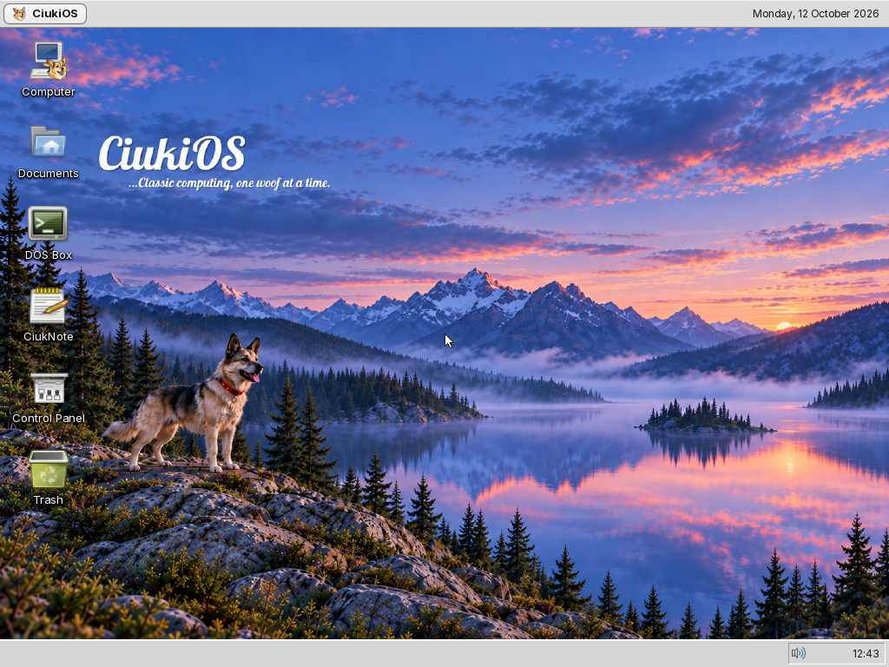 | 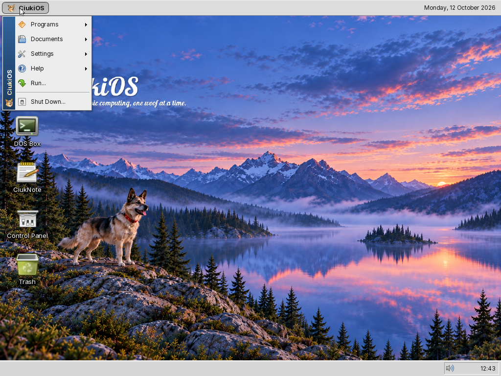 |

| Programs | Files, Computer view |
| --- | --- |
| 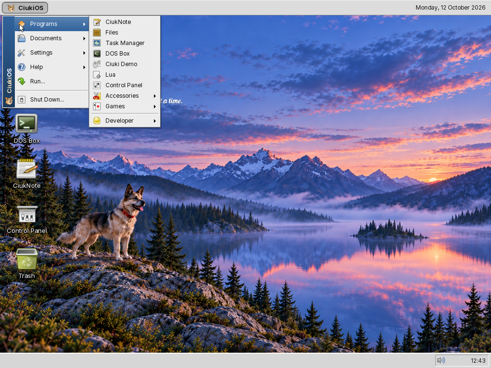 | 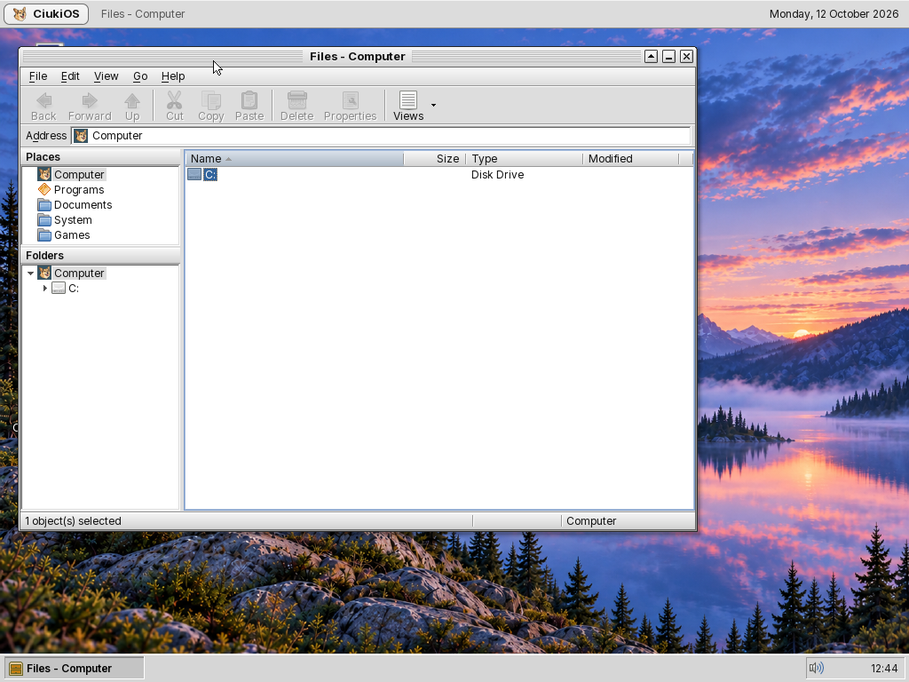 |

| CiukNote | Task Manager |
| --- | --- |
| 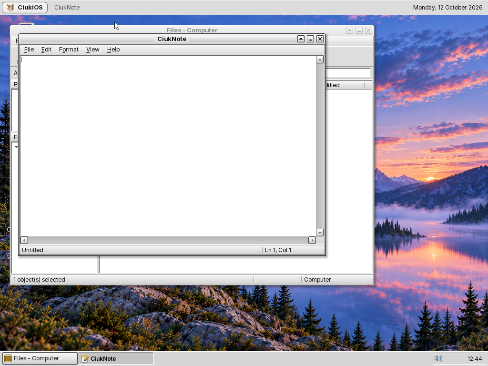 | 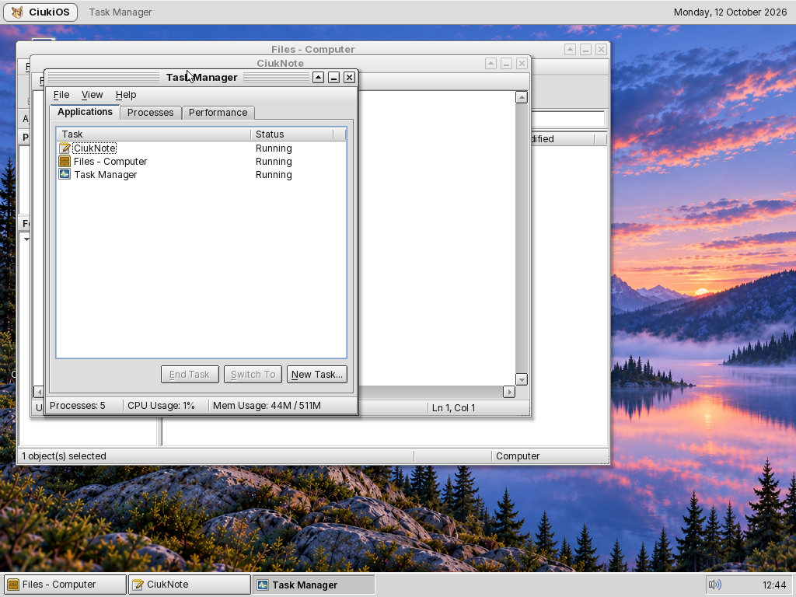 |

| Control Panel and Calculator | Games menu |
| --- | --- |
| 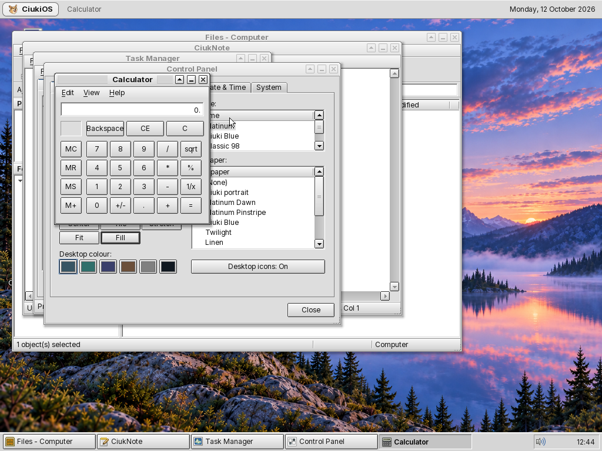 | 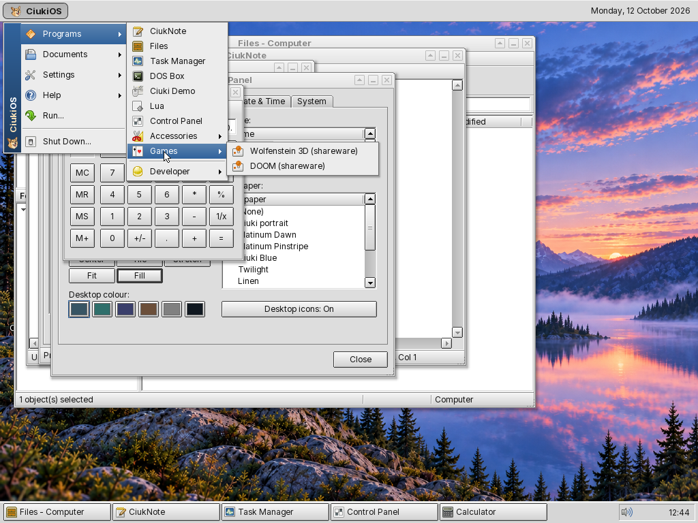 |

| Wolfenstein 3D (shareware) | DOOM (shareware) |
| --- | --- |
| 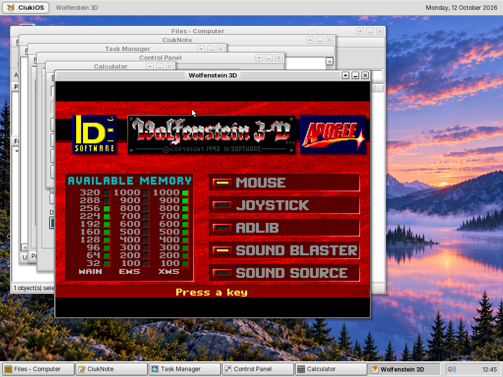 | 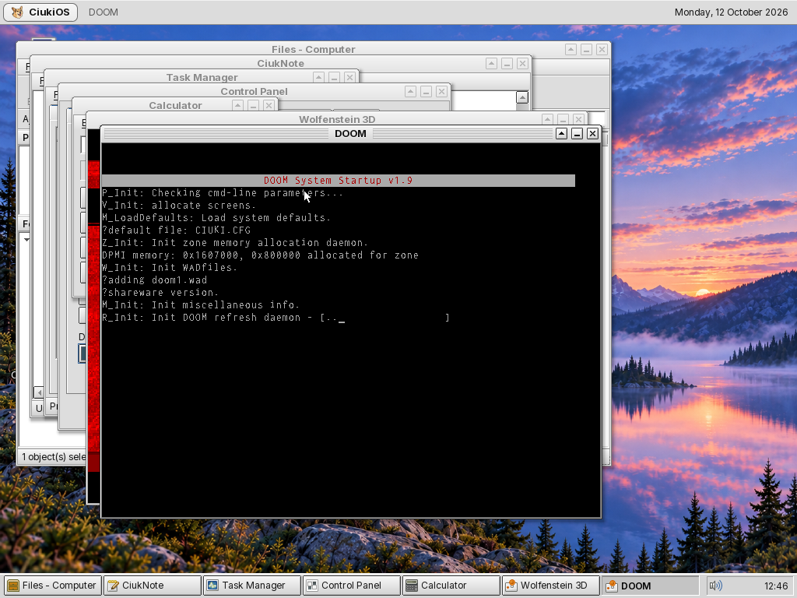 |

## The 0.8 line in pictures

Actual Linux QEMU captures of 0.8.3 ([capture details](screenshots/0.8.3/README.md)).

| Desktop | DOS game in its own window |
| --- | --- |
| 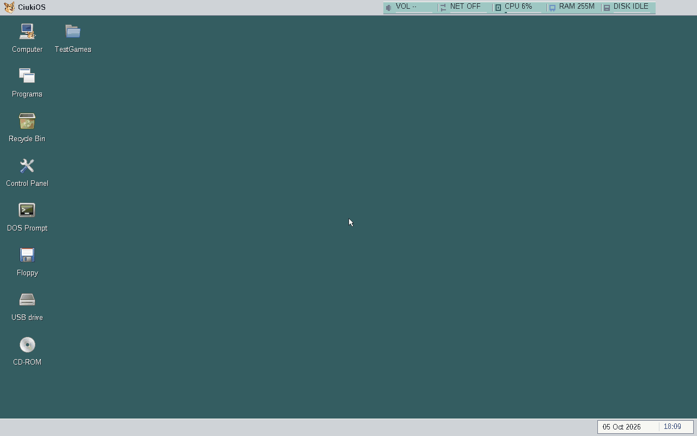 | 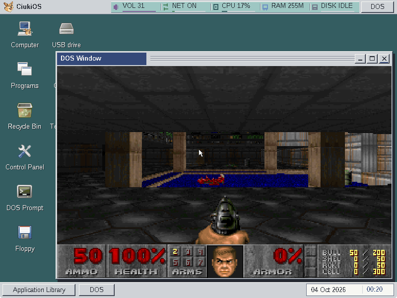 |

| CiukWeb over HTTPS | Display and monitor settings |
| --- | --- |
| 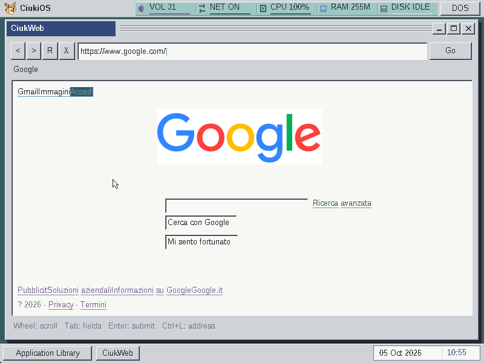 | 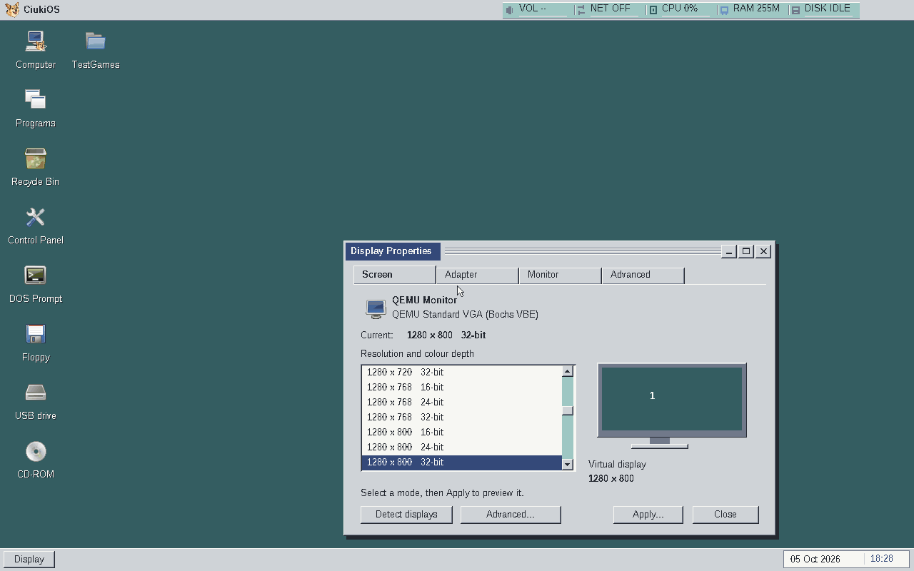 |

## How it is made

The project is developed by its owner with AI agents: Claude Code directs
(plan, written directives, reviews, integration, evidence, commits) and
OpenAI Codex writes the code from those directives and cross-reviews plans
and diffs; Claude subagents took over tasks when Codex was out of credit.
Disagreements are recorded and decided by the owner ([AGENTS.md](../AGENTS.md)).
Nothing is claimed without a recorded test, and a QEMU result never
qualifies a physical PC.

The 1.0.0 alpha screenshots taken on the 0.9.2 pre-alpha desktop are in [screenshots/0.9.2](screenshots/0.9.2/README.md).
